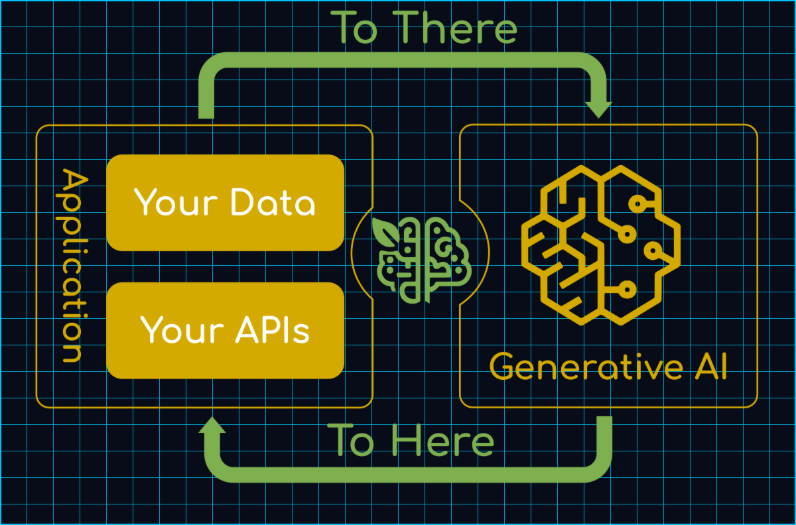
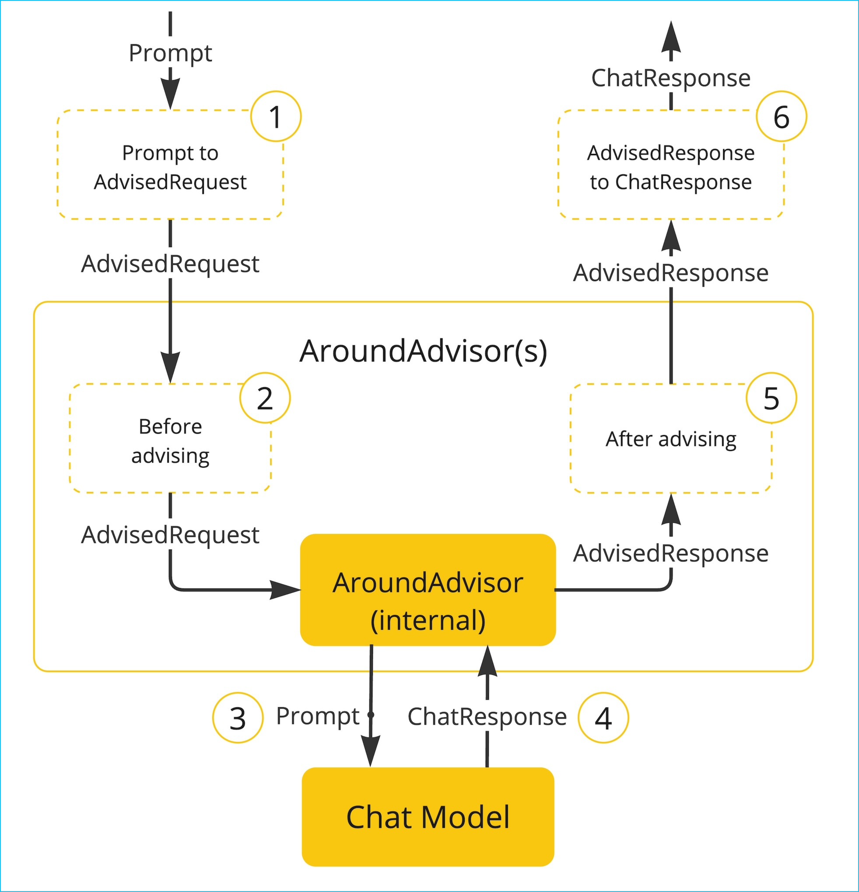
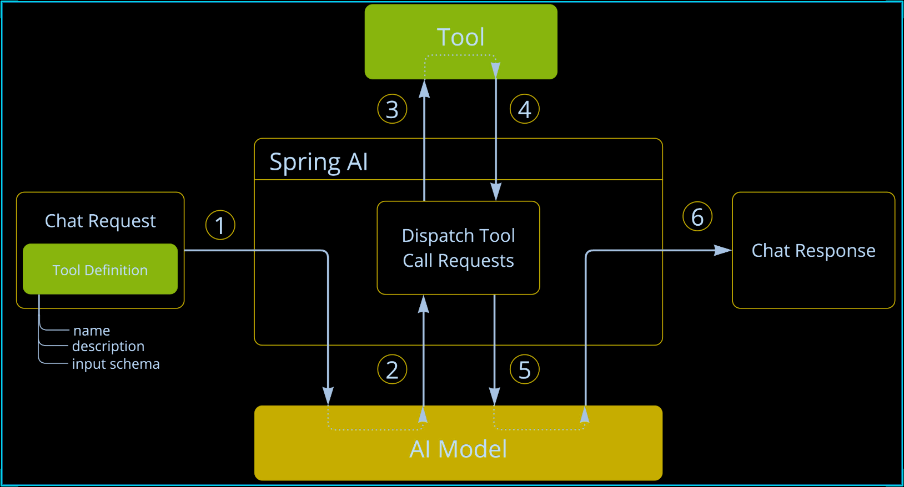
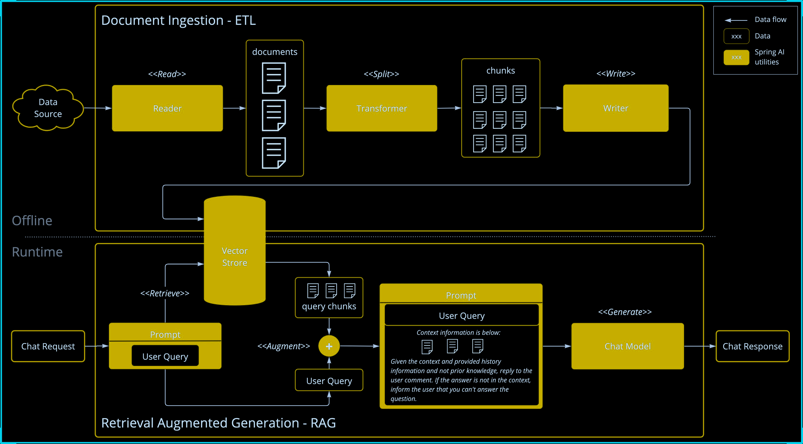
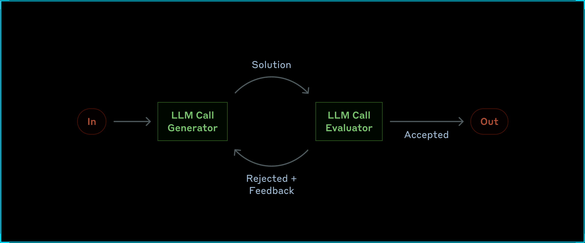
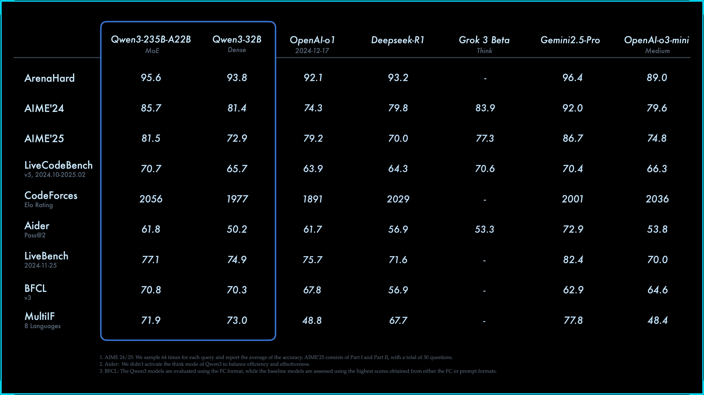
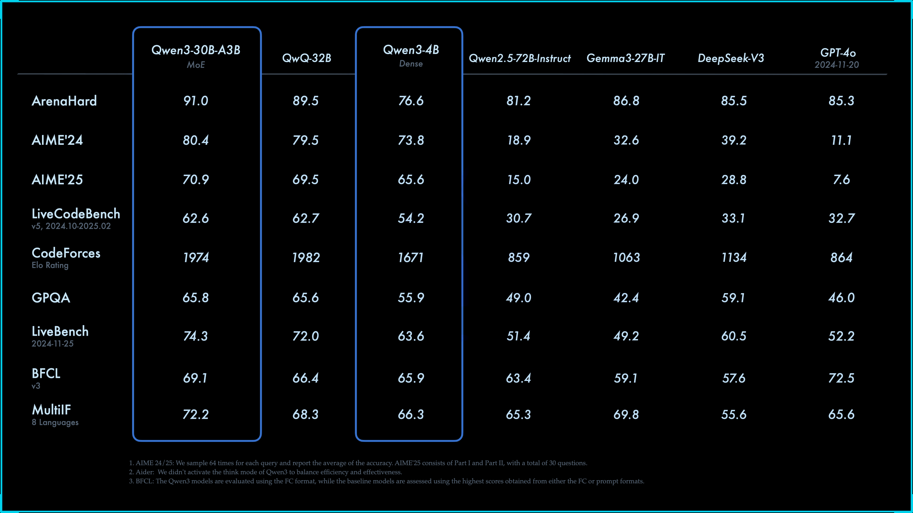
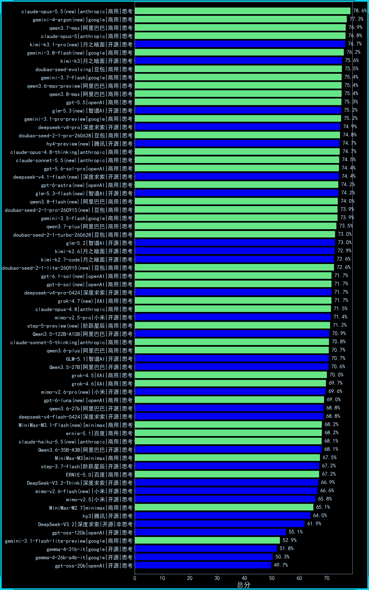

<div class="essay-banner essay-image11">
    Spring AI Features
</div>

## 介绍

<div class="img-wrap-left"></div>

Spring AI 是一个面向人工智能工程的应用框架。解决了 AI 集成的基本挑战：将企业数据和API与AI 模型连接起来。

### 特性：

#### 提示词工厂

可以说是大模型应用中最简单也是最核心的一个技术。他是我们更大模型交互的媒介，提示词给的好大模型才能按你想要的方式响应。

#### 对话拦截advisors

<div class="img-wrap-left"></div>

面向切面的思想对对模型对话和响应进行增强。

#### 对话记忆

```plain
@Autowired
ChatMemoryRepository chatMemoryRepository;
```

通过一个bean组件就可以让大模型拥有对话记忆功能，可谓是做到了开箱即用

#### tools

<div class="img-wrap-left"></div>

让大模型可以跟企业业务API进行互联 ，这一块实现起来也是非常的优雅

```plain
class DateTimeTools {

    @Tool(description = "Get the current date and time in the user's timezone")
    String getCurrentDateTime() {
        return LocalDateTime.now().atZone(LocaleContextHolder.getTimeZone().toZoneId()).toString();
    }

}
```

#### RAG技术下的 ETL

<div class="img-wrap-left"></div>

让大模型可以跟企业业务数据进行互联（包括读取文件、分隔文件、向量化） 向量数据库支持 目前支持20+种向量数据库的集成 这块我到时候也会详细去讲

#### MCP

让tools外部化，形成公共工具让外部开箱即用。 原来MCP协议的JAVA SDK就是spring ai团队提供的 提供了MCP 客户端、服务端、以及[MCP认证授权方案](https://spring.io/blog/2025/05/19/spring-ai-mcp-client-oauth2) ，还有目前正在孵化的[Spring MCP Agent](https://github.com/tzolov/spring-mcp-agent) 开源项目:

#### 模型的评估

可以测试大模型的幻觉反应(`在系列课详细讲解`）

#### 可观察性

它把AI运行时的大量关键指标暴露出来， 可以提供Spring Boot actuctor进行观测(`在系列课详细讲解`）

#### agent应用

springai 提供了5种agent模式的示例

1. [Evaluator Optimizer](https://github.com/spring-projects/spring-ai-examples/tree/main/agentic-patterns/evaluator-optimizer) – The model analyzes its own responses and refines them through a structured process of self-evaluation.

<div class="img-wrap-left"></div>

2. [Routing](https://github.com/spring-projects/spring-ai-examples/tree/main/agentic-patterns/routing-workflow) – This pattern enables intelligent routing of inputs to specialized handlers based on classification of the user request and context.
3. [Orchestrator Workers](https://github.com/spring-projects/spring-ai-examples/tree/main/agentic-patterns/orchestrator-workers) – This pattern is a flexible approach for handling complex tasks that require dynamic task decomposition and specialized processing
4. [Chaining](https://github.com/spring-projects/spring-ai-examples/tree/main/agentic-patterns/chain-workflow) – The pattern decomposes complex tasks into a sequence of steps, where each LLM call processes the output of the previous one.
5. [Parallelization](https://github.com/spring-projects/spring-ai-examples/tree/main/agentic-patterns/parallelization-worflow) – The pattern is useful for scenarios requiring parallel execution of LLM calls with automated output aggregation.

学完这5种你会对对模型下的agent应用有一个完整认识(`在系列课详细讲解`）

## langchain4j vs springAI

|  |  |  |
| --- | --- | --- |
| 生态 | 不依赖Spring，需要单独集成Spring | Spring官方，和Spring无缝集成 |
| 诞生 | 更早，中国团队，受 LangChain 启发 | 稍晚，但是明显后来居上 |
| jdk | v0.35.0 前的版本支持jdk8 ，后支持jdk17 | 全版本jdk17 |
| 功能 | 没有mcp server, 官方建议使用[quarkus-mcp-server](https://github.com/quarkiverse/quarkus-mcp-server) | 早期落后langchain4j， 现在功能全面，并且生态活跃，开源贡献者众多 |
| 易用性 | 尚可，中文文档 | 易用，api优雅 |
| 最终 | 不需要spring选择！ | 无脑选！ |

## 大模型选型

1. 自研（算法 c++  python 深度学习 机器学习 神经网络 视觉处理 952 211研究生 ）AI算法岗位
2. 云端大模型     占用算力  token计费     功能完善成熟
3. 开源的大模型（本地部署）Ollama  购买算力
    1. 选型
    2. 自己构建选型-->评估流程
        1. 业务确定：（ 电商、医疗、教育 ）
        2. 样本准备：数据集样本 选择题
        3. 任务定制：问答  （利用多个大模型）
        4. 评估： 人工评估
    3. 通用能力毕竟好的
        1. 2月份   deepseek   6710亿   671b = 算力 显存   H20  96G   140万  ； 比 openai gpt4节省了40/1 成本。
        2. 3月份   阿里  qwq-32b(不带深度思考)   32b=320亿   媲美deepseek-r1  32G   比deepseek-r1节省20/1
        3. 4月份   阿里  qwen3 (深度思考)    2350亿=235b   赶超了deepseek-r1  比deepseek-r1节省2-3倍    选择(qwen3-30b)
        4. 5月    deepseek-r1-0528     6710亿   671b  性能都要要
4. 对成本有要求： 选择(qwen3-30b)
5. 不差钱 deepseek-r1-0528 满血版本
        1. <div class="img-wrap-left"></div>

<div class="img-wrap-left"></div>

<div class="img-wrap-left"></div>