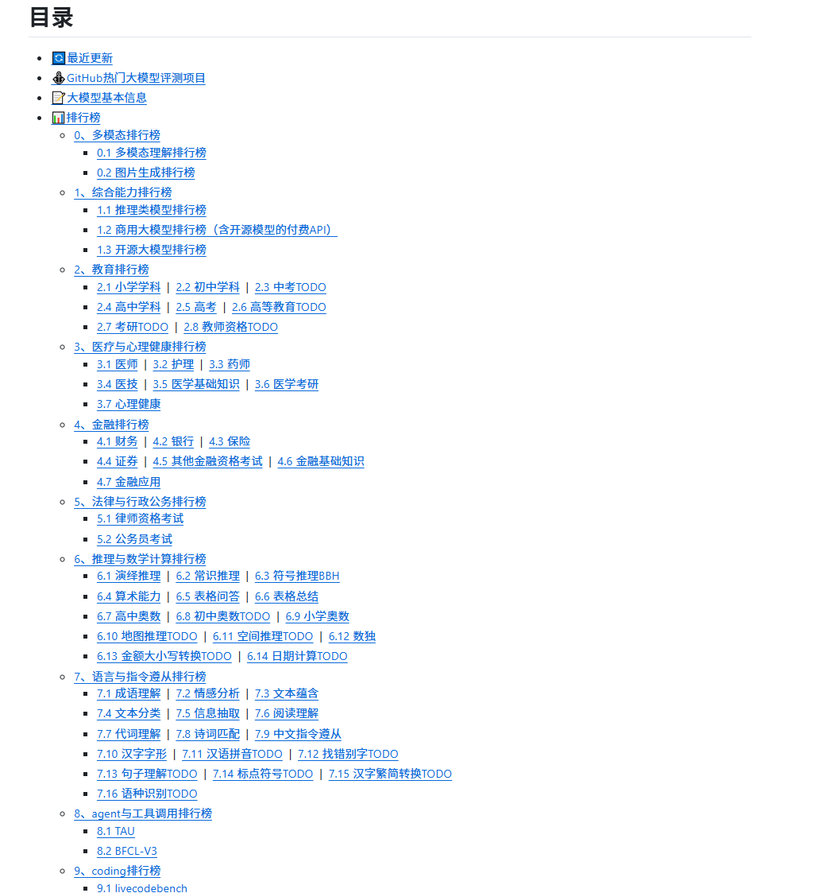

<div class="essay-banner essay-image11">
    Spring AI Features
</div>

## 介绍

<div class="img-wrap-left"></div>

Spring AI 是一个面向人工智能工程的应用框架。解决了 AI 集成的基本挑战：将企业数据和API与AI 模型连接起来。

### 特性：

### 提示词工厂

可以说是大模型应用中最简单也是最核心的一个技术。他是我们更大模型交互的媒介，提示词给的好大模型才能按你想要的方式响应。

### 对话拦截advisors

<div class="img-wrap-left"></div>

面向切面的思想对对模型对话和响应进行增强。

### 对话记忆

```plain
@Autowired
ChatMemoryRepository chatMemoryRepository;
```

通过一个bean组件就可以让大模型拥有对话记忆功能，可谓是做到了开箱即用

### tools

<div class="img-wrap-left"></div>

让大模型可以跟企业业务API进行互联 ，这一块实现起来也是非常的优雅

```plain
class DateTimeTools {

    @Tool(description = "Get the current date and time in the user's timezone")
    String getCurrentDateTime() {
        return LocalDateTime.now().atZone(LocaleContextHolder.getTimeZone().toZoneId()).toString();
    }

}
```

### RAG技术下的 ETL

<div class="img-wrap-left"></div>

让大模型可以跟企业业务数据进行互联（包括读取文件、分隔文件、向量化） 向量数据库支持 目前支持20+种向量数据库的集成 这块我到时候也会详细去讲

### MCP

让tools外部化，形成公共工具让外部开箱即用。 原来MCP协议的JAVA SDK就是spring ai团队提供的 提供了MCP 客户端、服务端、以及[MCP认证授权方案](https://spring.io/blog/2025/05/19/spring-ai-mcp-client-oauth2) ，还有目前正在孵化的[Spring MCP Agent](https://github.com/tzolov/spring-mcp-agent) 开源项目:

### 模型的评估

可以测试大模型的幻觉反应

### 可观察性

它把AI运行时的大量关键指标暴露出来， 可以提供Spring Boot actuctor进行观测

### agent应用

springai 提供了5种agent模式的示例
1. [Evaluator Optimizer](https://github.com/spring-projects/spring-ai-examples/tree/main/agentic-patterns/evaluator-optimizer) – The model analyzes its own responses and refines them through a structured process of self-evaluation.

<div class="img-wrap-left"></div>

2. [Routing](https://github.com/spring-projects/spring-ai-examples/tree/main/agentic-patterns/routing-workflow) – This pattern enables intelligent routing of inputs to specialized handlers based on classification of the user request and context.
3. [Orchestrator Workers](https://github.com/spring-projects/spring-ai-examples/tree/main/agentic-patterns/orchestrator-workers) – This pattern is a flexible approach for handling complex tasks that require dynamic task decomposition and specialized processing
4. [Chaining](https://github.com/spring-projects/spring-ai-examples/tree/main/agentic-patterns/chain-workflow) – The pattern decomposes complex tasks into a sequence of steps, where each LLM call processes the output of the previous one.
5. [Parallelization](https://github.com/spring-projects/spring-ai-examples/tree/main/agentic-patterns/parallelization-worflow) – The pattern is useful for scenarios requiring parallel execution of LLM calls with automated output aggregation.

## langchain4j vs springAI



||
生态|不依赖Spring，需要单独集成Spring|Spring官方，和Spring无缝集成
诞生|更早，中国团队，受 LangChain 启发|稍晚，但是明显后来居上
jdk|v0.35.0 前的版本支持jdk8 ，后支持jdk17|全版本jdk17
功能|没有mcp server, 官方建议使用[quarkus-mcp-server](https://github.com/quarkiverse/quarkus-mcp-server)|早期落后langchain4j， 现在功能全面，并且生态活跃，开源贡献者众多
易用性|尚可，中文文档|易用，api优雅
最终|不需要spring选择！|无脑选！


## 大模型选型

1. 自研（算法 c++  python 深度学习 机器学习 神经网络 视觉处理 952 211研究生 ）AI算法岗位
2. 云端大模型     占用算力  token计费     功能完善成熟
3. 开源的大模型（本地部署）Ollama  购买算力
    1. 选型
    2. 自己构建选型-->评估流程
        1. 业务确定：（ 电商、医疗、教育 ）
        2. 样本准备：数据集样本 选择题
        3. 任务定制：问答  （利用多个大模型）
        4. 评估： 人工评估
    3. 通用能力毕竟好的
        1. 2月份   deepseek   6710亿   671b = 算力 显存   H20  96G   140万  ； 比 openai gpt4节省了40/1 成本。
        2. 3月份   阿里  qwq-32b(不带深度思考)   32b=320亿   媲美deepseek-r1  32G   比deepseek-r1节省20/1
        3. 4月份   阿里  qwen3 (深度思考)    2350亿=235b   赶超了deepseek-r1  比deepseek-r1节省2-3倍    选择(qwen3-30b)
        4. 5月    deepseek-r1-0528     6710亿   671b  性能都要要
4. 对成本有要求： 选择(qwen3-30b)
5. 不差钱 deepseek-r1-0528 满血版本

## 综合能力排行榜

### 1.各行评测基准（Qwen3 官方评测表）

图 1：Qwen3 超大模型（235B/32B）官方自测，对标 o1/R1/Gemini2.5-Pro

<div class="img-wrap-left"></div>


<style>
table.llm-bench th,table.llm-bench td {padding:8px 10px;font-size:14px;}
table.llm-bench {width:100%;border-collapse: collapse;}
table.llm-bench th {background:#f4f4f4;}
</style>


### LLM Benchmark 评测基准汇总


名称|全称 / 中文|用途说明|官网/仓库链接|备注
ArenaHard|Arena Hard|高难度通用对话推理评测，使用 LLM 作为裁判打分，考察模型复杂指令、综合推理能力，分数越高对话越强|[github](https://github.com/lm-sys/arena-hard-auto) <br> [huggingface](https://huggingface.co/spaces/lmsys/arena-hard-browser)|LMSYS（Chatbot Arena）出品，可在线浏览样例
AIME'24 / AIME'25|American Invitational Mathematics Examination|美国数学邀请赛真题，专门测数学推理，AIME24 是 24 年真题、AIME25 是 25 年真题，数学能力核心指标|[maa.org](https://www.maa.org/math-competitions/aime)|美国数学邀请赛（MAA 官方），真题来源
LiveCodeBench|LiveCodeBench|代码能力评测，全部是比赛新题、规避训练集污染，测算法代码生成、自我修复能力，v5 是版本号|[主页](https://livecodebench.github.io/) <br> [github](https://github.com/livecodebench/livecodebench) <br> [v5榜单](https://livecodebench.github.io/leaderboard_v5.html)|防污染代码评测，表中 v5 榜单页
CodeForces|CodeForces Elo Rating|算法竞赛平台 Elo 分，和人类选手同一套评分体系，代表模型竞赛算法水平|[codeforces](https://codeforces.com/)|算法竞赛平台，Elo 评分体系原生站点
Aider|Aider Pass@2|Aider 是真实项目代码助手基准，Pass@2：最多 2 次尝试通过项目级代码修复任务，测工程代码能力|[aider.chat](https://aider.chat/) <br> [github](https://github.com/Aider-AI/aider)|真实项目代码助手基准，测试仓库级代码修复
LiveBench|LiveBench|防数据泄露的综合评测，包含推理、数据分析、工具调用等，题目持续更新，不容易刷分|[livebench.ai](https://livebench.ai/)|持续更新、规避训练集污染的综合评测
BFCL v3|Berkeley Function Calling Leaderboard v3|伯克利函数调用榜单，专门测试模型工具调用、function call，单轮 / 多轮、并行调用、参数正确性，Agent 必备能力|[博客页](https://gorilla.cs.berkeley.edu/blogs/8_berkeley_function_calling_leaderboard.html) <br> [github](https://github.com/ShishirPatil/gorilla)|伯克利 Gorilla 团队函数调用榜单
MultiIF|Multi-IF|多语言多轮指令跟随评测（Meta 出品），8 Languages = 覆盖 8 种语言，考察模型能不能严格遵守复杂指令、多轮对话不跑偏、多语言稳定性|[arxiv](https://arxiv.org/abs/2410.15553) <br> [github](https://github.com/facebookresearch/Multi-IF)|Meta 的多语言多轮指令跟随评测


图 2：Qwen3 中小参数（30B MoE / 4B 稠密）官方自测，对标 GPT4o、Gemma3、DeepSeek V3

<div class="img-wrap-left"></div>

图 3：第三方 AA 聚合总榜，全世界所有主流模型放一起比，商用 / 开源分开，统一标准打分[非官方图]

仓库地址：https://github.com/jeinlee1991/chinese-llm-benchmark

<div class="img-wrap-left"></div>

<div class="img-wrap-left"></div>
