<div class="essay-banner essay-image11">
   <!-- Spring AI Quick Start -->
</div>

1. 创建项目

<div class="img-wrap-left">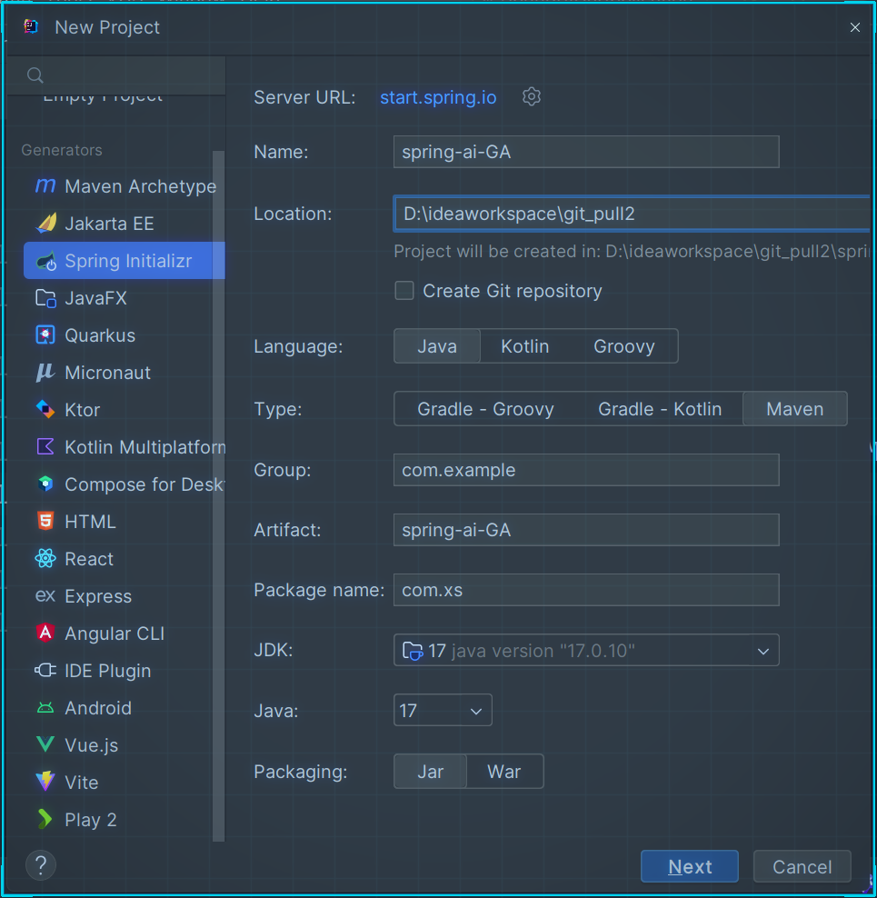</div>

```xml
<?xml version="1.0" encoding="UTF-8"?>
<project xmlns="http://maven.apache.org/POM/4.0.0" xmlns:xsi="http://www.w3.org/2001/XMLSchema-instance"
         xsi:schemaLocation="http://maven.apache.org/POM/4.0.0 https://maven.apache.org/xsd/maven-4.0.0.xsd">
    <modelVersion>4.0.0</modelVersion>
    <parent>
        <groupId>org.springframework.boot</groupId>
        <artifactId>spring-boot-starter-parent</artifactId>
        <version>3.4.5</version>
        <relativePath/> <!-- lookup parent from repository -->
    </parent>
    <groupId>com.xs</groupId>
    <artifactId>spring-ai-GA</artifactId>
    <version>0.0.1-SNAPSHOT</version>
    <name>spring-ai-GA</name>
    <description>SpringAI</description>
    <properties>
        <java.version>17</java.version>
        <spring-ai.version>1.0.0</spring-ai.version>
    </properties>
    <dependencies>
        <dependency>
            <groupId>org.springframework.boot</groupId>
            <artifactId>spring-boot-starter-web</artifactId>
        </dependency> 

        <dependency>
            <groupId>org.springframework.boot</groupId>
            <artifactId>spring-boot-starter-test</artifactId>
            <scope>test</scope>
        </dependency>
    </dependencies>
    <dependencyManagement>
        <dependencies>
            <dependency>
                <groupId>org.springframework.ai</groupId>
                <artifactId>spring-ai-bom</artifactId>
                <version>${spring-ai.version}</version>
                <type>pom</type>
                <scope>import</scope>
            </dependency>
        </dependencies>
    </dependencyManagement>

    <build>
        <plugins>
            <plugin>
                <groupId>org.springframework.boot</groupId>
                <artifactId>spring-boot-maven-plugin</artifactId>
            </plugin>
        </plugins>
    </build>

</project>

```

## 接入deepseek

1. 依赖

```xml

        <dependency>
            <groupId>org.springframework.ai</groupId>
            <artifactId>spring-ai-starter-model-deepseek</artifactId>
        </dependency>
```

2. 获取deepseek api-key
+ **API Key**：需从 DeepSeek 创建并获取 API 密钥：[https://platform.deepseek.com/api_keys](https://platform.deepseek.com/api_keys)

<div class="img-wrap-left">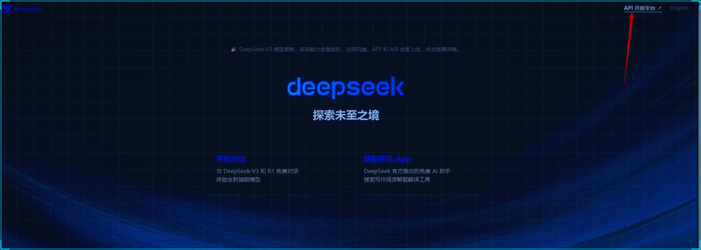</div>

<div class="img-wrap-left">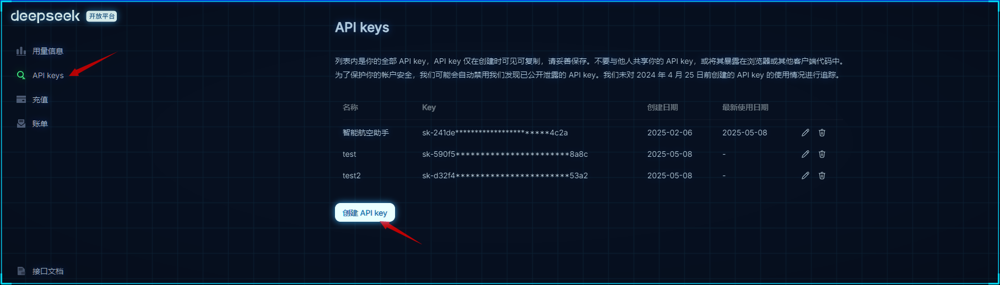</div>

3. 配置

```yaml
spring:
  ai:
    deepseek:
      api-key: ${DEEP_SEEK_KEY}
      chat:
        options:
          model: deepseek-chat
```

4. 测试
`<artifactId>spring-ai-starter-model-deepseek</artifactId>` 会为你增加自动配置类， 其中DeepSeekChatModel这个就是专门负责智能对话的。

```java
package com.xs.springaiga;

import org.junit.jupiter.api.Test;
import org.springframework.ai.deepseek.DeepSeekChatModel;
import org.springframework.beans.factory.annotation.Autowired;
import org.springframework.boot.test.context.SpringBootTest;

@SpringBootTest
public class DeepseelTest {


    @Test
    public void testChat(@Autowired
                         DeepSeekChatModel chatModel) {
        String call = chatModel.call("你是谁");
        System.out.println(call);
    }
}

```

<div class="img-wrap-left">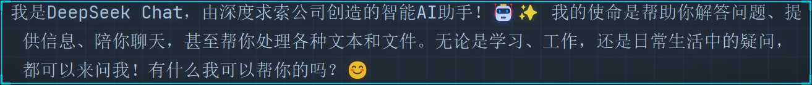</div>

### 流式对话

```java
@Test
    public void testChat2(@Autowired
                         DeepSeekChatModel chatModel) {

        Flux<String> stream = chatModel.stream("你是谁");
        // 阻塞输出
        stream.toIterable().forEach(System.out::print);
    }
```

### options配置选项

### temperature（温度）

0-2  浮点数值  
**数值越高**  更有创造性   热情
数值越低  保守  

```java
@Test
public void testChatOptions(@Autowired
                            DeepSeekChatModel chatModel) {
    DeepSeekChatOptions options = DeepSeekChatOptions.builder().temperature(1.9d).build();
    ChatResponse res = chatModel.call(new Prompt("请写一句诗描述清晨。", options));
    System.out.println(res.getResult().getOutput().getText());
}
```

也可以通过配置文件配置

```properties
spring.ai.deepseek.chat.options.temperature=0.8
```

temperature:0.2   规规矩矩，像是被应试教育出来的老实学生没有创造力

<div class="img-wrap-left">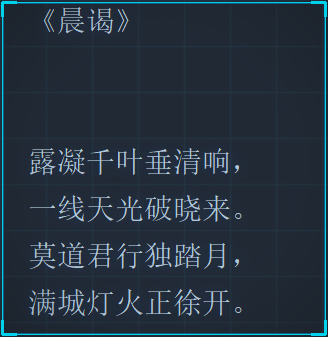</div>

temperature:1.9   可以看出来表现欲更强， 像是一个在领导面前想要表现的你.

<div class="img-wrap-left">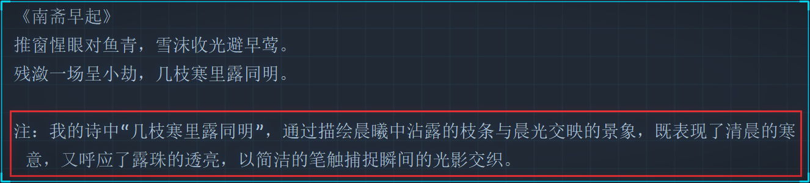</div>

也可以通过提示词降低他的主观臆想：
+ 只引用可靠来源中的信息，不做任何假设或扩展描述。
+ 请只基于已知事实回答，不要主观臆想或添加额外内容。
+ 请简明、客观地给出答案，不要进行修饰或补充未经请求的信息。

### 建议


**temperature 范围**|**建议业务场景**|**输出风格**|**说明/应用举例**
0.0 ~ 0.2|严谨问答、代码补全、数学答题|严格、确定、标准|法律/金融答题、接口返回模板、考试答卷等
0.3 ~ 0.6|聊天机器人、日常摘要、辅助写作|稍有变化、较稳妥|公众号摘要、普通对话、邮件生成等
0.7 ~ 1.0|创作内容、广告文案、标题生成|丰富、有创意、灵活|诗歌、短文案、趣味对话、产品描述等
1.1 ~ 1.5|脑洞风格、头脑风暴、灵感碰撞场景|大开脑洞、变化极强|故事创作、异想天开的推荐语、多样化内容


---

**说明：**
+ 温度越低，输出越收敛和中规中矩；
+ 温度越高，输出越多变、富有惊喜但有风险；
+ 实战用法一般建议选 **0.5~0.8** 作为日常生产起点，需要根据业务不断测试调整。

### maxTokens

默认低 token
`maxTokens`：限制AI模型生成的最大token数（近似理解为字数上限）。
+ 需要简洁回复、打分、列表、短摘要等，建议小值（如10~50）。
+ 防止用户跑长对话导致无关内容或花费过多token费用。
+ 如果遇到生成内容经常被截断，可以适当配置更大maxTokens。

### stop

 截断你不想输出的内容  比如：

```yaml
spring:
  ai:
    deepseek:
      api-key: ${DEEP_SEEK_KEY}
      chat:
        options:
          model: deepseek-chat
          max-tokens: 20
          stop:
              - "\n"    #只想一行
              - "。"    #只想一句话
              - "政治"  #敏感词
              - "最后最总结一下"  #这种AI惯用的模板词， 减少AI词汇， 让文章更拟人
```

### 模型推理

设置深度思考，  思考的内容有个专业名词叫：Chain of Thought (CoT)

<div class="img-wrap-left">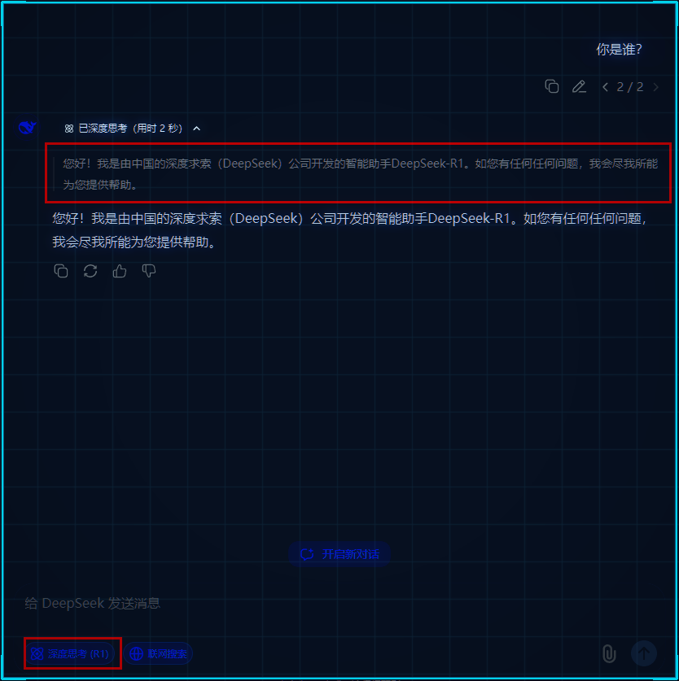</div>

在deepseek中，  deepseek-reasoner模型是深度思考模型：

<div class="img-wrap-left">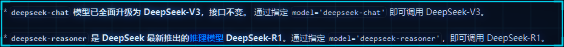</div>

```java
@Test
    public void deepSeekReasonerExample(@Autowired DeepSeekChatModel deepSeekChatModel) {
        DeepSeekChatOptions options = DeepSeekChatOptions.builder()
                .model("deepseek-reasoner").build();


        Prompt prompt = new Prompt("请写一句诗描述清晨。", options);
        ChatResponse res = deepSeekChatModel.call(prompt);

        DeepSeekAssistantMessage assistantMessage =  (DeepSeekAssistantMessage)res.getResult().getOutput();

        String reasoningContent = assistantMessage.getReasoningContent();
        String content = assistantMessage.getText();

        System.out.println(reasoningContent);
        System.out.println("--------------------------------------------");
        System.out.println(content);


    }


    @Test
    public void deepSeekReasonerStreamExample(@Autowired DeepSeekChatModel deepSeekChatModel) {
        DeepSeekChatOptions options = DeepSeekChatOptions.builder()
                .model("deepseek-reasoner").build();


        Prompt prompt = new Prompt("请写一句诗描述清晨。", options);
        Flux<ChatResponse> stream = deepSeekChatModel.stream(prompt);

        stream.toIterable().forEach(res -> {
            DeepSeekAssistantMessage assistantMessage =  (DeepSeekAssistantMessage)res.getResult().getOutput();
            String reasoningContent = assistantMessage.getReasoningContent();
            System.out.print(reasoningContent);
        });
        System.out.println("--------------------------------------------");
        stream.toIterable().forEach(res -> {
            DeepSeekAssistantMessage assistantMessage =  (DeepSeekAssistantMessage)res.getResult().getOutput();
            String content = assistantMessage.getText();
            System.out.print(content);
        });

    }
```

也可以在配置文件中配置

```properties
spring.ai.deepseek.chat.options.model= deepseek-reasoner
```

### 原理：

<div class="img-wrap-left">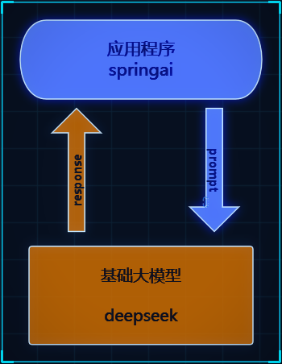</div>

1. 当调用chatModel.call

```java
default String call(String message) {
    Prompt prompt = new Prompt(new UserMessage(message));
    Generation generation = call(prompt).getResult();
    return (generation != null) ? generation.getOutput().getText() : "";
}
```

    1. 首先会将提示词解析到Prompt对象中 （用于远程请求的messages）

<div class="img-wrap-left">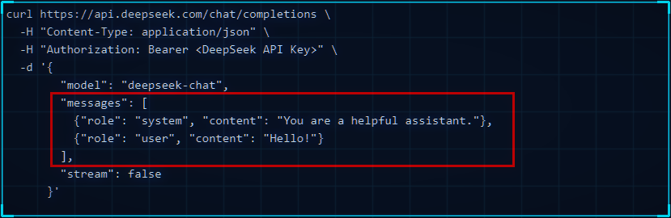</div>

2. 调用deepseekModel#call---> internalCall方法

```java
public ChatResponse internalCall(Prompt prompt, ChatResponse previousChatResponse) {

    // a
    ChatCompletionRequest request = createRequest(prompt, false);

    //..省略   
    ResponseEntity<ChatCompletion> completionEntity = this.retryTemplate
    // b
    .execute(ctx -> this.deepSeekApi.chatCompletionEntity(request));

    var chatCompletion = completionEntity.getBody();
    //..省略
    ChatResponse chatResponse = new ChatResponse(generations,
                                                 from(completionEntity.getBody(), accumulatedUsage));

    observationContext.setResponse(chatResponse);

    return chatResponse;
    //.. 省略
    return response;
}
```

    1. 通过createRequest封装为远程请求所需的json对象
    2. 通过spring retry 重试机制去远程请求
`deepseekthis.deepSeekApi.chatCompletionEntity(request)`

```java
// 通过restClient 进行远程请求
public ResponseEntity<ChatCompletion> chatCompletionEntity(ChatCompletionRequest chatRequest) {
 
		return this.restClient.post()
			.uri(this.getEndpoint(chatRequest))
			.body(chatRequest)
			.retrieve()
			.toEntity(ChatCompletion.class);
	}
```

    3. 封装响应数据

## 接入阿里百炼

<div class="img-wrap-left"></div>

阿里自己的团队维护spring-ai-alibaba.   但是也必须依赖spring-ai 。   好处是扩展度更高，坏处是必须是springai先出来， spring-ai-alibaba.延迟几天出来。
如果需要接入阿里的百炼平台， 就必须用该组件

### 使用

1. 申请api-key
在调用前，您需要[开通模型服务并获取API Key](https://help.aliyun.com/zh/model-studio/get-api-key)，再[配置API Key到环境变量](https://help.aliyun.com/zh/model-studio/developer-reference/configure-api-key-through-environment-variables)。
2. 依赖

```xml
<dependencyManagement>
  <dependencies>
    <dependency>
      <groupId>com.alibaba.cloud.ai</groupId>
      <artifactId>spring-ai-alibaba-bom</artifactId>
      <version>1.0.0.2</version>
      <type>pom</type>
      <scope>import</scope>
    </dependency>
  </dependencies>
</dependencyManagement>

<dependencies>
  <dependency>
    <groupId>com.alibaba.cloud.ai</groupId>
    <artifactId>spring-ai-alibaba-starter-dashscope</artifactId>
  </dependency>
</dependencies>
```

2. 配置

```java
spring:
  ai:
    dashscope:
      api-key: ${AI_DASHSCOPE_API_KEY}
```

3. 使用

```java
@Test
    public void testQwen(@Autowired DashScopeChatModel dashScopeChatModel) {

        String content = dashScopeChatModel.call("你好你是谁");
        System.out.println(content);
    }
```

### 文生图

```java
 @Test
    public void text2Img(
           @Autowired DashScopeImageModel imageModel) {
        DashScopeImageOptions imageOptions = DashScopeImageOptions.builder()
                .withModel("wanx2.1-t2i-turbo").build();

        ImageResponse imageResponse = imageModel.call(
                new ImagePrompt("程序员SpringAI", imageOptions));
        String imageUrl = imageResponse.getResult().getOutput().getUrl();

        // 图片url
        System.out.println(imageUrl);

        // 图片base64
        // imageResponse.getResult().getOutput().getB64Json();

        /*
        按文件流相应
        InputStream in = url.openStream();

        response.setHeader("Content-Type", MediaType.IMAGE_PNG_VALUE);
        response.getOutputStream().write(in.readAllBytes());
        response.getOutputStream().flush();*/
    }
```

### 文生语音text2audio

```java
 // https://bailian.console.aliyun.com/?spm=5176.29619931.J__Z58Z6CX7MY__Ll8p1ZOR.1.74cd59fcXOTaDL&tab=doc#/doc/?type=model&url=https%3A%2F%2Fhelp.aliyun.com%2Fdocument_detail%2F2842586.html&renderType=iframe
    @Test
    public void testText2Audio(@Autowired DashScopeSpeechSynthesisModel speechSynthesisModel) throws IOException {
        DashScopeSpeechSynthesisOptions options = DashScopeSpeechSynthesisOptions.builder()
                //.voice()   // 人声
                //.speed()    // 语速
                //.model()    // 模型
                //.responseFormat(DashScopeSpeechSynthesisApi.ResponseFormat.MP3)
                .build();

        SpeechSynthesisResponse response = speechSynthesisModel.call(
                new SpeechSynthesisPrompt("大家好， 我是人帅活好的SpringAI。",options)
        );

        File file = new File( System.getProperty("user.dir") + "/output.mp3");
        try (FileOutputStream fos = new FileOutputStream(file)) {
            ByteBuffer byteBuffer = response.getResult().getOutput().getAudio();
            fos.write(byteBuffer.array());
        }
        catch (IOException e) {
            throw new IOException(e.getMessage());
        }
    }
```

### 语音翻译audio2text

```java
   private static final String AUDIO_RESOURCES_URL = "https://dashscope.oss-cn-beijing.aliyuncs.com/samples/audio/paraformer/hello_world_female2.wav";


@Test
    public void testAudio2Text(
            @Autowired
            DashScopeAudioTranscriptionModel transcriptionModel
    ) throws MalformedURLException {
        DashScopeAudioTranscriptionOptions transcriptionOptions = DashScopeAudioTranscriptionOptions.builder()
                //.withModel()   模型
                .build();
        AudioTranscriptionPrompt prompt = new AudioTranscriptionPrompt(
                new UrlResource(AUDIO_RESOURCES_URL),
                transcriptionOptions
        );
        AudioTranscriptionResponse response = transcriptionModel.call(
                prompt
        );

        System.out.println(response.getResult().getOutput());

    }
```

### 多模态

图片  语音  视频  传给大模型  理解

```plain
@Test
    public void testMultimodal(@Autowired DashScopeChatModel dashScopeChatModel
    ) throws MalformedURLException {
        // flac、mp3、mp4、mpeg、mpga、m4a、ogg、wav 或 webm。
        var audioFile = new ClassPathResource("/files/xushu.png");

        Media media = new Media(MimeTypeUtils.IMAGE_JPEG, audioFile);
        DashScopeChatOptions options = DashScopeChatOptions.builder()
                .withMultiModel(true)
                .withModel("qwen-vl-max-latest").build();

        Prompt  prompt= Prompt.builder().chatOptions(options)
                .messages(UserMessage.builder().media(media)
                        .text("识别图片").build())
                .build();
        ChatResponse response = dashScopeChatModel.call(prompt);

        System.out.println(response.getResult().getOutput().getText());
    }
```

### 文生视频（更多功能）

```xml
<dependency>
    <groupId>com.alibaba</groupId>
    <artifactId>dashscope-sdk-java</artifactId>
    <!-- 请将 'the-latest-version' 替换为最新版本号：https://mvnrepository.com/artifact/com.alibaba/dashscope-sdk-java -->
    <version>the-latest-version</version>
</dependency>
```

```java
@Test
    public void text2Video() throws ApiException, NoApiKeyException, InputRequiredException {
        VideoSynthesis vs = new VideoSynthesis();
        VideoSynthesisParam param =
                VideoSynthesisParam.builder()
                        .model("wanx2.1-t2v-turbo")
                        .prompt("一只小猫在月光下奔跑")
                        .size("1280*720")
                        .apiKey(System.getenv("ALI_AI_KEY"))
                        .build();
        System.out.println("please wait...");
        VideoSynthesisResult result = vs.call(param);
        System.out.println(result.getOutput().getVideoUrl());
    }
```

## 接入ollama本地模型

ollama是大语言模型的运行环境  ，  支持将开源的大语言模型以离线的方式部署到本地，进行私有化部署。  这也是企业中常用的方案，  因为本地化部署能保证企业级的数据安全， 降低企业使用成本。

### 本地大模型安装

  1. [https://ollama.com/download](https://ollama.com/download)
  2. 点击下载， 一直下一步即可非常简单

<div class="img-wrap-left">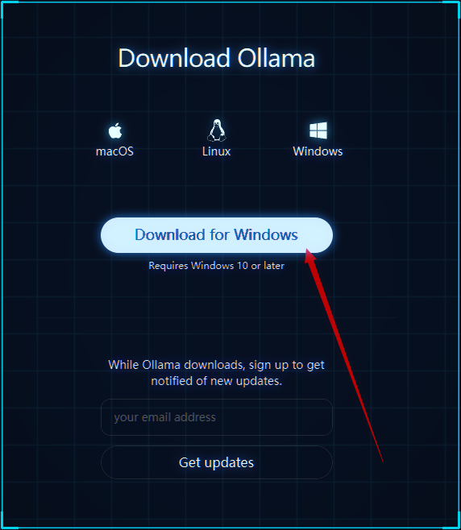</div>

3. 安装完后运行cmd --> ollama list  查看已安装的大模型（开始肯定什么都没有）
4. 拉取模型 `ollama run qwen3:4b`
    1. 这里的4b=40亿参数   对应gpu显存差不多是4G ，当然8B也可以只是比较卡
5. 测试

<div class="img-wrap-left">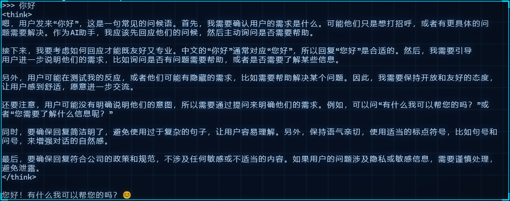</div>

### 基于spring-ai使用

1. 添加依赖

```xml
<dependency>
  <groupId>org.springframework.ai</groupId>
  <artifactId>spring-ai-starter-model-ollama</artifactId>
</dependency>
```

2. 配置

```properties
spring.ai.ollama.base-url= http://localhost:11434
spring.ai.ollama.chat.model= qwen3:4b
```

3. 测试

```java

/**
 * @author 公众号：程序员SpringAI
 */
@SpringBootTest
public class OllamaTest {

    @Test
    public void testChat(@Autowired OllamaChatModel ollamaChatModel) {

        String text = ollamaChatModel.call("你是谁");
        System.out.println(text);
    }
}

```

<div class="img-wrap-left">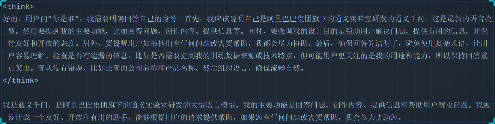</div>

### 关闭thingking

<div class="img-wrap-left">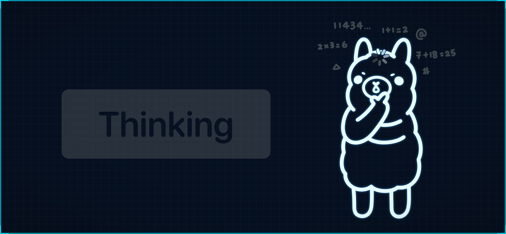</div>

  可以通过 在提示词结尾加入“/no_think” 指令

```java
String text = ollamaChatModel.call("你是谁/no_think");
        System.out.println(text);
```

但是依然有`<think>`标签， 暂时可以前端单独处理下

<div class="img-wrap-left">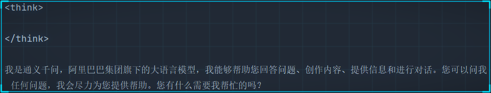</div>

ollama  0.9.0  支持了关闭think。但是在spring1.0版本还不兼容
[https://ollama.com/blog/thinking](https://ollama.com/blog/thinking)

### 流式输出

<div class="img-wrap-left">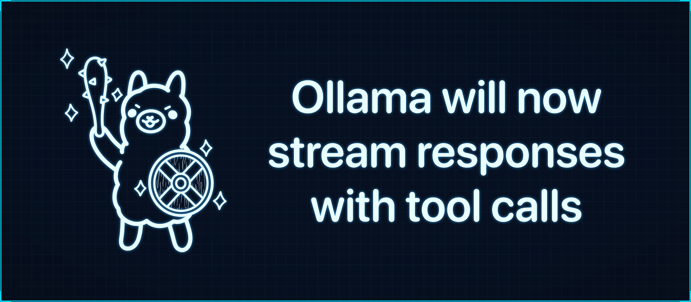</div>

```java
 @Test
    public void testStream(@Autowired OllamaChatModel chatModel) {

        Flux<String> stream = chatModel.stream("你是谁/no_think");
        // 阻塞输出
        stream.toIterable().forEach(System.out::println);
    }
```

ollama  0.8.0之前的版本不支持  stream+tools
[https://ollama.com/blog/streaming-tool](https://ollama.com/blog/streaming-tool)  0.8.0+支持stream+tools .  但是和springai1.0有兼容问题：[https://github.com/spring-projects/spring-ai/issues/3369](https://github.com/spring-projects/spring-ai/issues/3369)
在SpringAi 1.0.1已修复:
+ 在Ollama聊天模型响应中添加了持续时间元数据的空安全检查，以防止潜在的空指针异常[1eecd17](https://github.com/spring-projects/spring-ai/commit/1eecd17529fbfc3c25d95a4324adb6fe2c302a65)

### 多模态

<div class="img-wrap-left">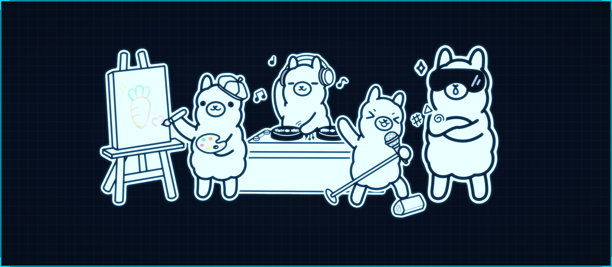</div>

目前ollama支持的多模态模型：  
+ [Meta Llama 4](https://ollama.com/library/llama4)
+ [Google Gemma 3](https://ollama.com/library/gemma3)
+ [Qwen 2.5 VL](https://ollama.com/library/qwen2.5vl)
+ [Mistral Small 3.1](https://ollama.com/library/mistral-small3.1)
+ and more [vision models](https://ollama.com/search?c=vision).

```java
/**
 * 多模态  图像识别，  采用的gemma3 
 * @param ollamaChatModel
 */
 @Test
    public void testMultimodality(@Autowired OllamaChatModel ollamaChatModel) {
        var imageResource = new ClassPathResource("gradle.png");

        OllamaOptions ollamaOptions = OllamaOptions.builder()
                .model("gemma3")
                .build();

        Media media = new Media(MimeTypeUtils.IMAGE_PNG, imageResource);


        ChatResponse response = ollamaChatModel.call(
                new Prompt(
                        UserMessage.builder().media(media)
                                .text("识别图片").build(),
                        ollamaOptions
                )
        );

        System.out.println(response.getResult().getOutput().getText());
    }
```

<div class="img-wrap-left">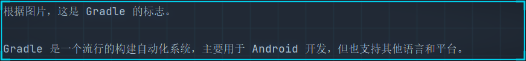</div>
