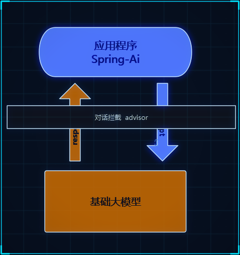
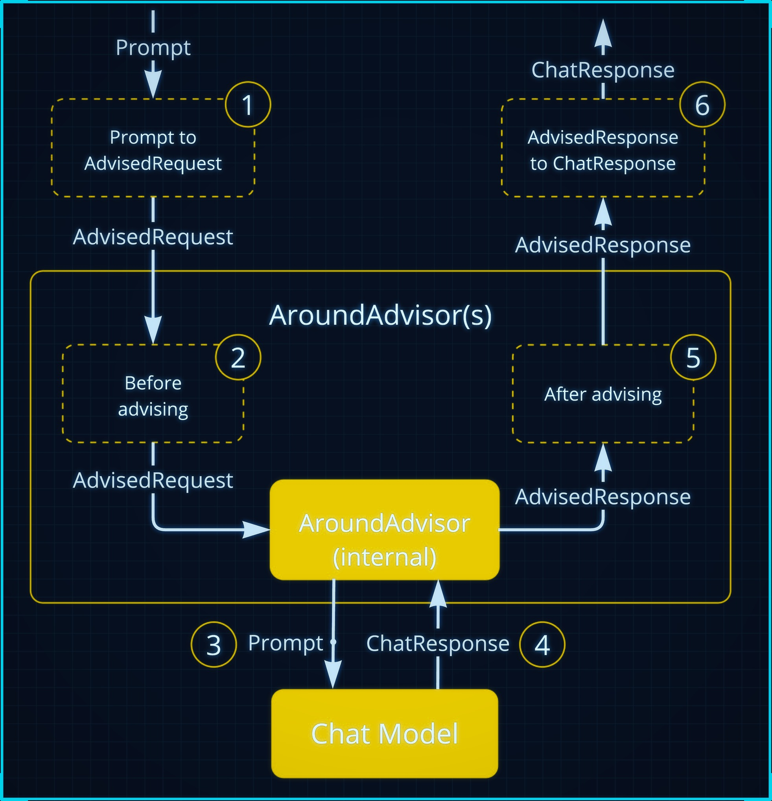
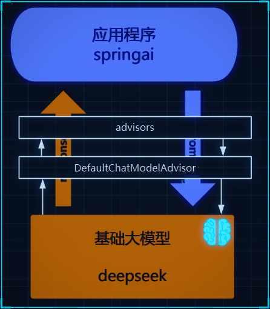

<div class="essay-banner essay-image11">
   Advisor Interceptors
</div>

## Advisor对话拦截

Spring AI 利用面向切面的思想提供 Advisors API ， 它提供了灵活而强大的方法来拦截、修改和增强 Spring 应用程序中的 AI 驱动交互。

<div class="img-wrap-left"></div>

`Advisor `接口提供了`CallAdvisor`和组成`CallAdvisorChain`（适用于非流式场景），以及`StreamAdvisor`和 （`StreamAdvisorChain`适用于流式场景）。它还包括`ChatClientRequest`，用于表示未密封的 Prompt 请求，以及 ，`ChatClientResponse`用于表示聊天完成响应。

<div class="img-wrap-left"></div>

### 日志拦截：

由于整个对话过程是一个“黑盒”， 不利于我们调试， 可以通过SimpleLoggerAdvisor拦截对话记录可以帮助观察我们发了什么信息给大模型便于调试。
1. 设置defaultAdvisors

```java

@SpringBootTest
public class AdvisorTest {

    ChatClient chatClient;
    @BeforeEach
    public  void init(@Autowired
                      DeepSeekChatModel chatModel) {
        chatClient = ChatClient
                .builder(chatModel)
                .defaultAdvisors(
                        new SimpleLoggerAdvisor()
                )
                .build();
    }
    @Test
    public void testChatOptions() {
        String content = chatClient.prompt()
                .user("Hello")
                .call()
                .content();
        System.out.println(content);
    }
}

```

2. 设置日志级别

```properties
logging.level.org.springframework.ai.chat.client.advisor=DEBUG
```

日志中就记录了  
request:  请求的日志信息
response: 响应的信息

### 自定义拦截：

### 重读（Re2）

 重读策略的核心在于让LLMs重新审视输入问题，这借鉴了人类解决问题的思维方式。通过这种方式，LLMs能够更深入地理解问题，发现复杂的模式，从而在各种推理任务中表现得更加强大。

```properties
{Input_Query}
再次阅读问题：{Input_Query}
```

可以基于BaseAdvisor来实现自定义Advisor， 他实现了重复的代码 提供 模板方法让我们可以专注自己业务编写即可。

```java

/**
 * 公众号：程序员SpringAI
 */

public class ReReadingAdvisor implements BaseAdvisor {

	private static final String DEFAULT_USER_TEXT_ADVISE = """
      {re2_input_query}
      Read the question again: {re2_input_query}
      """;

	@Override
	public int getOrder() {
		return 0;
	}

	@Override
	public ChatClientRequest before(ChatClientRequest chatClientRequest, AdvisorChain advisorChain) {
		// 获得用户输入文本
		String inputQuery = chatClientRequest.prompt().getUserMessage().getText();

		// 定义重复输入模版
		String augmentedSystemText = PromptTemplate.builder().template(DEFAULT_USER_TEXT_ADVISE).build()
				.render(Map.of("re2_input_query", inputQuery));

		// 设置请求的提示词
		ChatClientRequest processedChatClientRequest =
				// 不保留
				ChatClientRequest.builder()
				.prompt(Prompt.builder().content(augmentedSystemText).build())
				.build();
		return processedChatClientRequest;
	}

	@Override
	public ChatClientResponse after(ChatClientResponse chatClientResponse, AdvisorChain advisorChain) {
		//我们不做任何处理
		return chatClientResponse;
	}
}
```

测试：

```java

@SpringBootTest
public class AdvisorTest {

    ChatClient chatClient;
    @BeforeEach
    public  void init(@Autowired
                      DeepSeekChatModel chatModel) {
        chatClient = ChatClient
                .builder(chatModel)
                .defaultAdvisors(
                        new SimpleLoggerAdvisor()
                )
                .build();
    }
    @Test
    public void testChatOptions() {
        String content = chatClient.prompt()
                .user("中国有多大？")
                .advisors(new ReReadingAdvisor())
                .call()
                .content();
        System.out.println(content);
    }
}

```

### 原理

<div class="img-wrap-left"></div>

**记住！   **

<div class="img-wrap-left"></div>

dvisor只有结合ChatClient才能用！   是SpringAi上层提供的。  模型底层并没有这个东西
