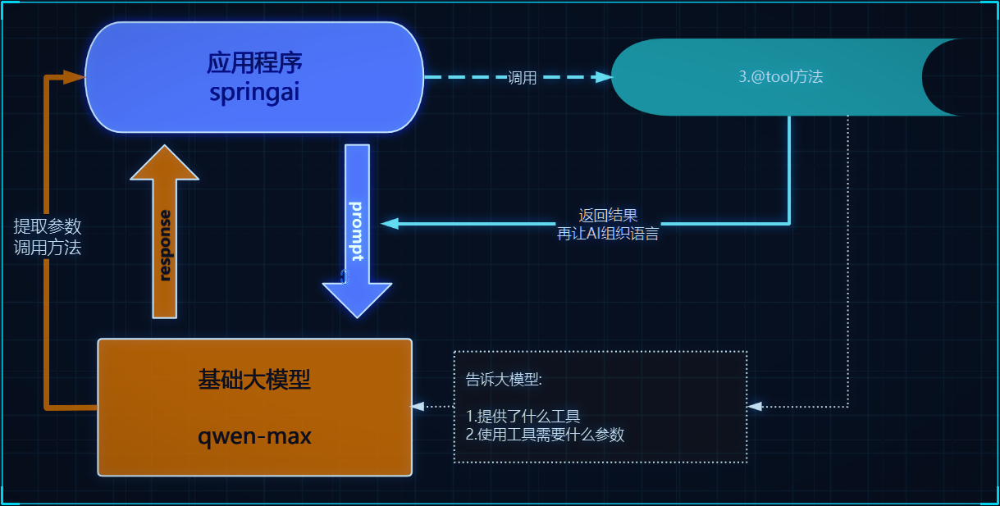
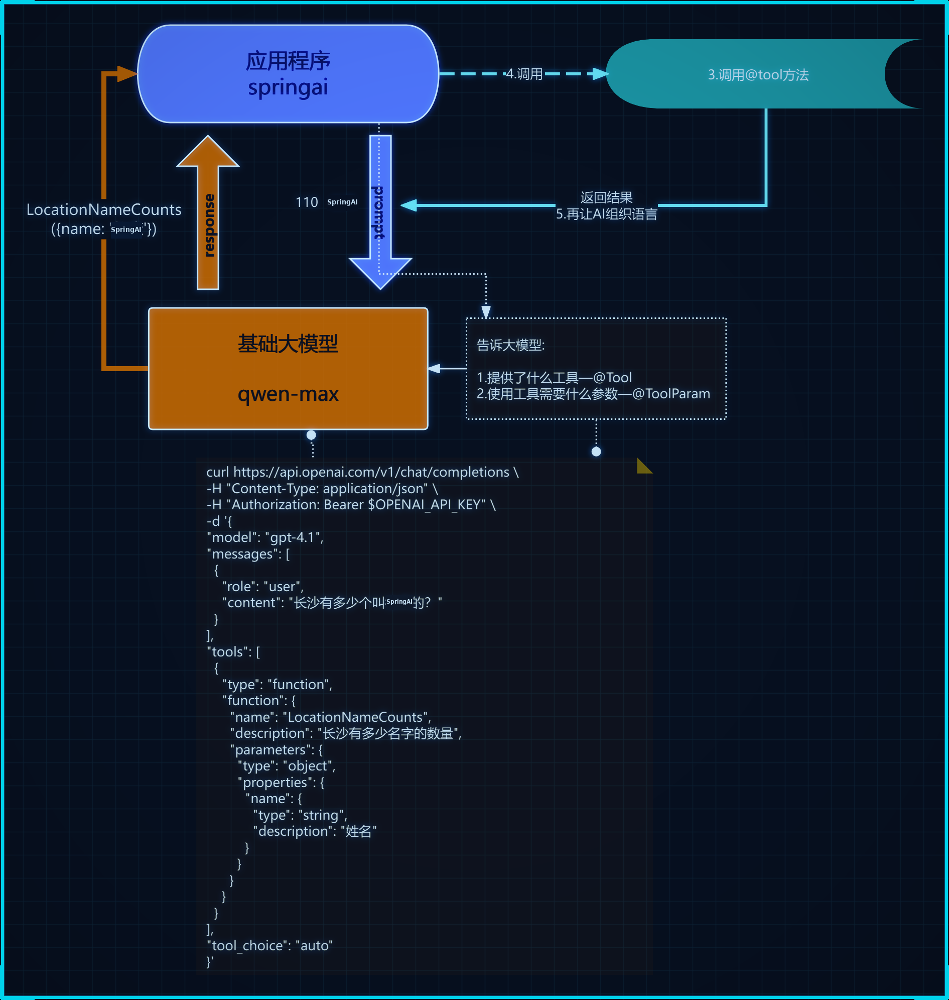
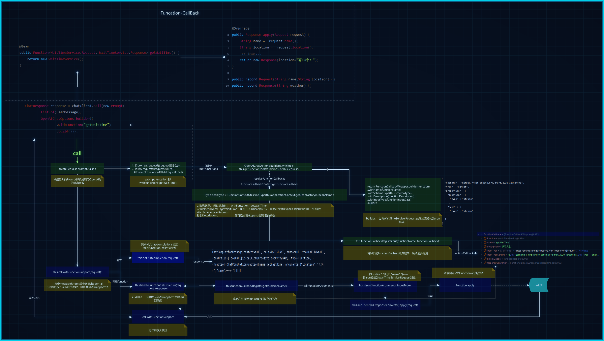
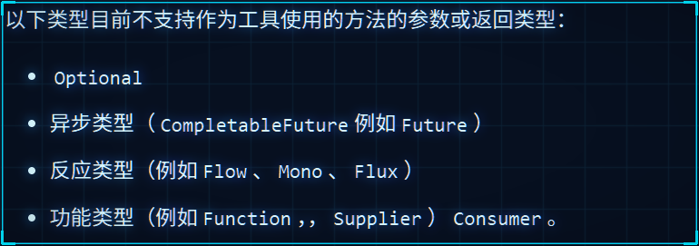
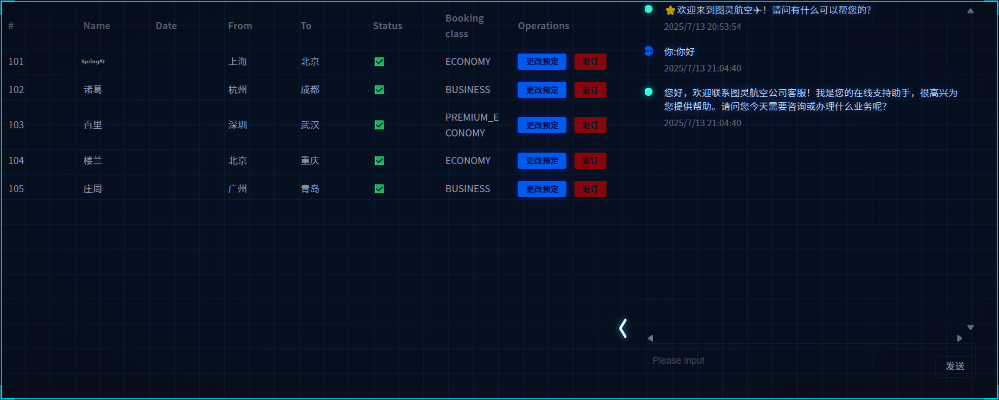
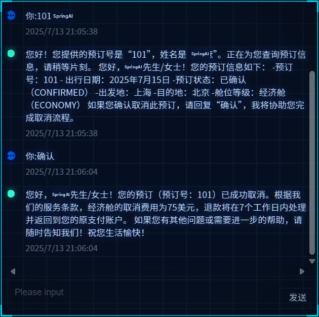
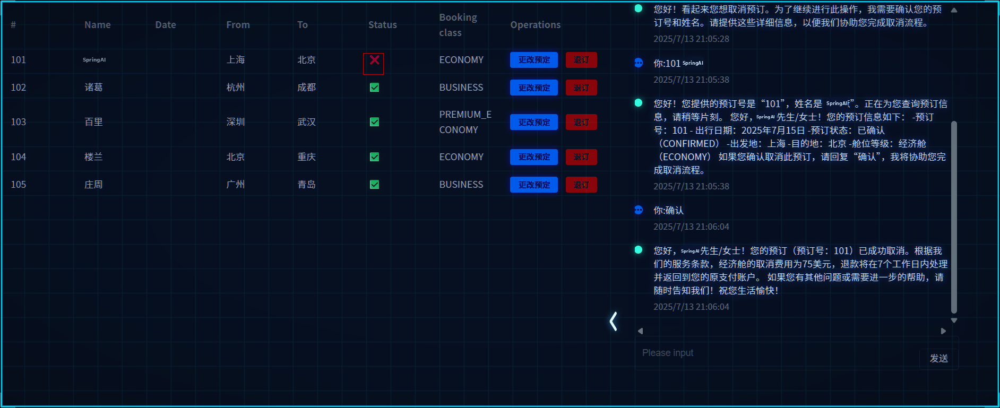
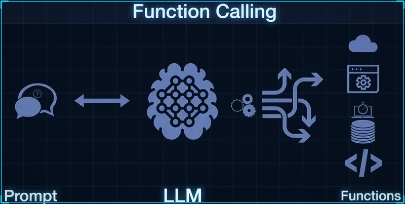

<div class="essay-banner essay-image11">
   Tools & Function Call
</div>

想做企业级智能应用开发，  你肯定会有需求要让大模型和你的企业API能够互连，  
因为对于基础大模型来说， 他只具备通用信息，他的参数都是拿公网进行训练，并且有一定的时间延迟，  无法得知一些具体业务数据和实时数据， 这些数据往往被各软件系统存储在自己数据库中：
比如我问大模型：“中国有多少个叫SpringAI的” 他肯定不知道，  我们就需要去调用政务系统的接口。
比如我现在开发一个智能票务助手，  我现在跟AI说需要退票， AI怎么做到呢？  就需要让AI调用我们自己系统的退票业务方法，进行操作数据库。
在之前我们可以通过链接多个模型的方式达到，  但是很麻烦，  那用tools， 可以轻松完成。
tool calling也可以直接叫tool（也称为function-call）, 主要用于提供大模型不具备的信息和能力：
1. **信息检索：**可用于从外部源（如数据库、Web 服务、文件系统或 Web 搜索引擎）检索信息。目标是增强模型的知识，使其能够回答无法回答的问题。例如，工具可用于检索给定位置的当前天气、检索最新的新闻文章或查询数据库以获取特定记录。  这也是一种检索增强方式。
2. **采取行动：**例如发送电子邮件、在数据库中创建新记录、提交表单或触发工作流。目标是自动执行原本需要人工干预或显式编程的任务。例如，可以使用工具为与聊天机器人交互的客户预订航班，在网页上填写表单等。

## 需要使用tools必须要先保证大模型支持。   比如ollama列出了支持tool的模型

<div class="img-wrap-left"></div>

## 使用

<div class="img-wrap-left"></div>

### 1. 声明tools的类:

```java
@Service
class NameCountsTools {

    @Tool(description = "长沙有多少名字的数量")
    String LocationNameCounts(
            @ToolParam(description = "名字")
            String name) {
        return "10个";
    }

}


1. 将Tool类配置为bean（非必须）
2. @Tool 用户告诉大模型提供了什么工具
3. @ToolParam 用于告诉大模型你要用这个工具需要什么参数（非必须）

```

### 2. 绑定到ChatClient

```java

@SpringBootTest
public class ToolTest {
    ChatClient chatClient;
    @BeforeEach
    public  void init(@Autowired
                      DashScopeChatModel chatModel,
                      @Autowired
                      NameCountsTools nameCountsTools) {
        chatClient = ChatClient.builder(chatModel)
                .defaultTools(nameCountsTools)
                .build();
    }
    @Test
    public void testChatOptions() {
        String content = chatClient.prompt()
                .user("长沙有多少个叫SpringAI的/no_think")
                // .tools() 也可以单独绑定当前对话
                .call()
                .content();
        System.out.println(content);
    }
}

```

<div class="img-wrap-left"></div>

### 原理

<div class="img-wrap-left"></div>

1.  当我们设置了defaultTools 相当于就告诉了大模型我提供了什么工具， 你需要用我的工具必须给我什么参数， 底层实际就是将这些信息封装了json提供给大模型
2. 当大模型识别到我们的对话需要用到工具， 就会响应需要调用tool

### 源码

<div class="img-wrap-left"></div>

### tools注意事项：

### 1. **参数或者返回值不支持**

<div class="img-wrap-left"></div>

**推荐**：  pojo  record   java基础类型   list  map

### 2. **Tools参数无法自动推算问题**

+ _温度_（即模型随机性）太低，AI可能缺失自由度变得比较拘谨（从一定程度可以解决， 但是不推荐）
+ 也可以通过描述更加明确

```java
  @Tool(description = "获取指定位置天气,根据位置自动推算经纬度")
    public String getAirQuality(@ToolParam(description = "纬度") double latitude,
                                @ToolParam(description = "经度") double longitude) {
        return "天晴";
    }
```

### 3. **大模型“强行适配”Tool参数的幻觉问题**

+ 加严参数描述与校验

```java
@Parameter(description = "真实人名（必填，必须为人的真实姓名，严禁用其他信息代替；如缺失请传null）")
String name
```

+ 后端代码加强校验和兜底保护
+ 系统Prompt设定限制

```java
“严禁随意补全或猜测工具调用参数。
参数如缺失或语义不准，请不要补充或随意传递，请直接放弃本次工具调用。”
```

+ 高风险接口（如资金、风控等）tools方法**加强人工确认，多走一步校验。**
4. **工具暴露的接口名、方法名、参数名要可读、业务化**
+ AI是“看”你的签名和注释来决定用不用工具的；
+ 尽量避免乱码、缩写等。

### 4. **方法参数数量不宜过多**

+ 建议每个工具方法尽量少于5个参数，否则AI提示会变复杂、出错率高。

### 5. **工具方法不适合做超耗时操作， 更长的耗时意味着用户延迟响应时间变长**

性能优化 能异步处理就异步处理、 查询数据  redis

### 6. **关于Tools的权限控制**

    1. 可以利用SpringSecurity限制

```java
    @Tool(description = "退票")
    @PreAuthorize("hasRole('ADMIN')")
    public String cancel(
            // @ToolParam告诉大模型参数的描述
      @ToolParam(description = "预定号，可以是纯数字") String ticketNumber,
      @ToolParam(description = "真实人名（必填，必须为人的真实姓名，严禁用其他信息代替；如缺失请传null）") String name
           ) {
        // 当前登录用户名
        String username = SecurityContextHolder.getContext().getAuthentication().getName();
        // 先查询 --->先校验
        ticketService.cancel(ticketNumber, name);
        return username+"退票成功！";
    }
```

    2. 将tools和权限资源一起存储， 然后动态设置tools

```java
.defaultToolCallbacks(toolService.getToolCallList(toolService))
```

根据当前用户读取当前用户所属角色的所有tools

```java
public List<ToolCallback> getToolCallList(ToolService toolService) {

        Method method = ReflectionUtils.findMethod(ToolService.class, "cancel",String.class,String.class);
        ToolDefinition build = ToolDefinition.builder()
                .name("cancel")
                .description("退票")
                .inputSchema("""
                        {
                          "type": "object",
                          "properties": {
                            "ticketNumber": {
                              "type": "string",
                              "description": "预定号，可以是纯数字"
                            },
                            "name": {
                              "type": "string",
                              "description": "真实人名"
                            }
                          },
                          "required": ["ticketNumber", "name"]
                        }
                        """)
                .build();
        ToolCallback toolCallback = MethodToolCallback.builder()
                .toolDefinition(
                        build)
                .toolMethod(method)
                .toolObject(toolService)
                .build();

        return List.of(toolCallback);
    }
```

7. **tools过多导致AI出现选择困难证     **
问题：  
    1. token上限
    2. 选择困难证
tools的描述作用   保存  向量数据库。
实现方式：
1. 把所有的tools描述信息存入到向量数据库
2. 每次对话的时候根据当前对话信息检索到相似的tools（RAG）
3. 然后动态设置tools
** **
****

## **《智能客服项目实战》**

### 项目效果：

### 角色预设：

<div class="img-wrap-left"></div>

### 记忆对话

<div class="img-wrap-left"></div>

### tools

<div class="img-wrap-left"></div>

<div class="img-wrap-left"></div>
