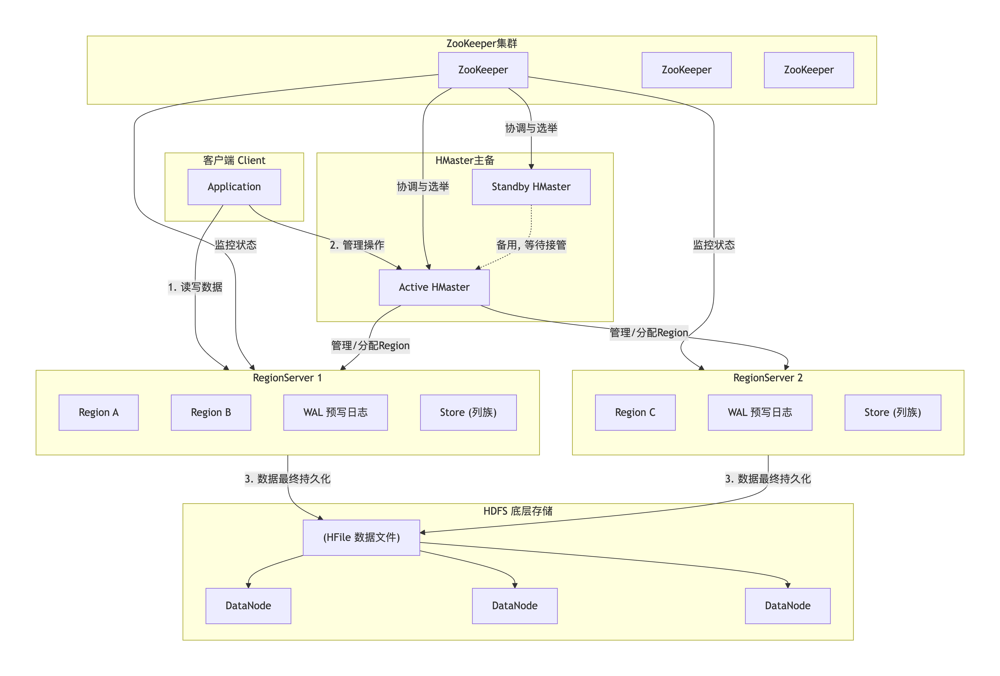
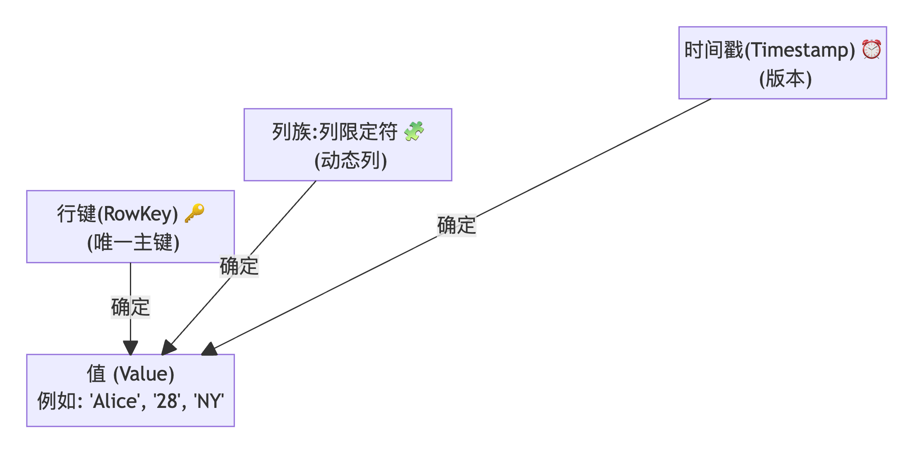
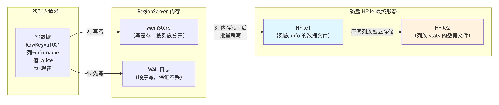
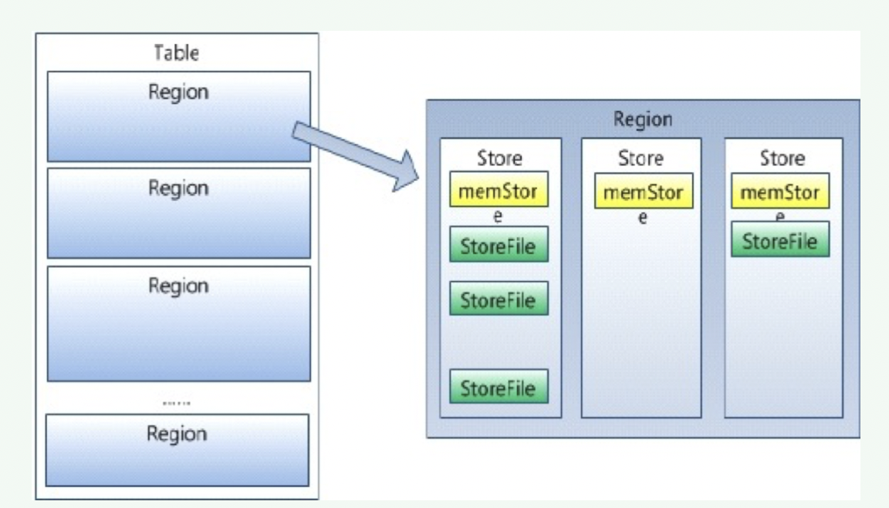
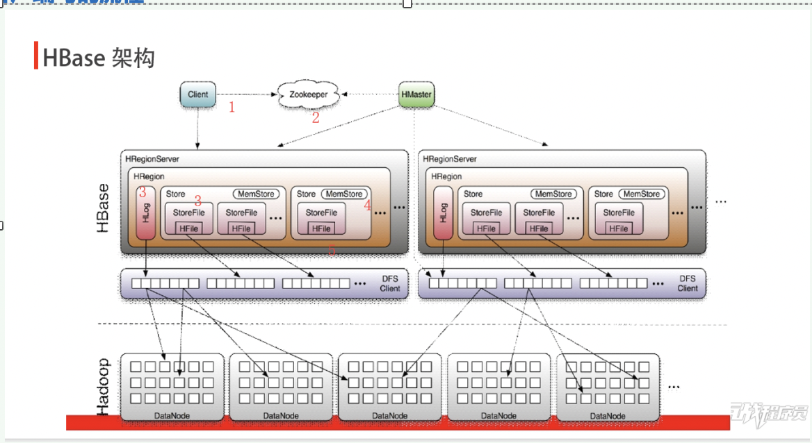
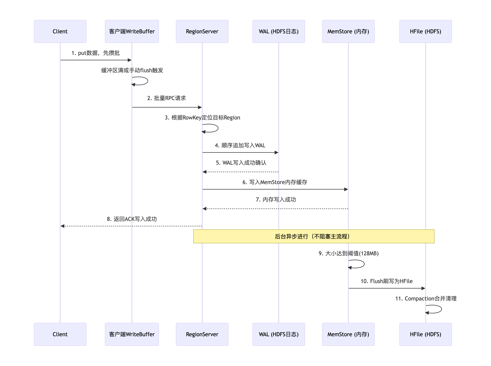

# HBase 分布式列式数据库

## 一、HBase 基础介绍
### 1. 核心定义
HBase 是基于Hadoop的KV格式、面向列存储的分布式数据库，**非内存数据库、非传统列式数据库**。

### 2. 五大核心特点
1. 高可靠性
2. 可伸缩水平扩容
3. 面向列（列族）存储
4. 支持海量数据实时读写
5. 高性能高并发吞吐

### 3. 数据规模适配
- 行：十亿级别海量行
- 列：百万级别稀疏列

### 4. 适用业务场景
1. 存储非结构化/半结构化稀疏数据
2. 高并发客户端读写业务
3. 低延迟、实时性要求高的海量数据业务
 

---
## 二、HBase 集群架构

  

### 1. 集群角色分工
#### ZooKeeper 协调组件
- 存储元数据表`hbase:meta`位置入口
- 保存Table表元数据
- 实时监控`RegionServer`上下线，通知`Master`处理故障

#### Client 客户端
- 提交HBase读写请求
- 本地缓存元数据，减少ZK频繁交互

#### Master（HMaster）
- 管理集群全部`RegionServer`节点
- 分配`Region`到对应`RegionServer`，维护负载均衡
- 负责`Region`拆分、迁移、故障重分配
- 集群高可用：同一时间仅一台Active Master，其余Standby备用

#### RegionServer（数据节点）
负责承载客户端读写请求，托管所有`Region`分片，是真正存储数据的节点。

##### Region 分片概念
- 建表初期整张表仅1个`Region`，写入数据后自动扩容拆分
- `Region`数据量达到阈值，自动切分为两个新`Region`

##### Store 存储单元（对应单个列族）
- `MemStore`：内存有序缓冲区
- `StoreFile`（HFile）：落地磁盘持久化文件
- `MemStore + StoreFile` 共同组成LSM树存储结构

#### HLog（WAL预写日志）
宕机恢复的日志文件，所有写入操作先落WAL再写入内存。

### 2. HBase 数据模型示意
#### HBase表数据逻辑模型示意图

  

#### HBase表数据存储模型示意图

  

### 核心字段概念
1. **`RowKey`（行键）**
   - 唯一标识单行数据，等价MySQL主键
   - 全局字典序排序，分片、查询核心依据
   - 最大长度64K，工程建议10~100字节
2. **`Column Family`（列族）**
   - 一组列的集合，建表时提前定义Schema
   - 列族为物理存储隔离单元，权限控制粒度
3. **`Qualifier`（列限定符）**
   - 列族下具体字段，无需提前定义，插入时动态新增
4. **`Timestamp`（时间戳）**
   - 版本号，区分单元格多版本数据
   - 默认系统自动生成，支持自定义（不推荐）
5. **`Cell`（单元格）**
   - 最小存储单元，坐标 `RowKey + 列族:列 + 时间戳`
   - 底层纯字节KV存储，无固定数据类型
   - 自动保留多版本历史数据
---
## 三、HBase 读写流程
### 1. 读流程（Get/Scan）

  

1. Client 请求ZooKeeper，查询`hbase:meta`，定位RowKey所属`RegionServer`
2. 访问目标`RegionServer`，读取表元数据，找到对应`Store`
3. 优先读取`BlockCache`读缓存；缓存未命中读取`MemStore`内存最新数据
4. 内存无数据则遍历磁盘`StoreFile`，读取后缓存至`BlockCache`
5. 合并多版本数据，过滤过期删除标记，返回结果给客户端
   

### 2. 写流程（Put）

  

  

1. Client请求ZK获取元数据，定位目标`RegionServer`
2. 写入WAL预写日志，保障宕机数据不丢失
3. 写入对应列族`MemStore`内存缓冲区
4. `MemStore`达到阈值（默认64M）触发Flush刷盘，生成`StoreFile`写入HDFS
5. 后台自动Compaction合并大量小`StoreFile`，优化读查询效率

---

## 四、底层存储结构
1. **WAL（HLog）预写日志**
    - 写入操作先持久化日志再写入内存
    - LogAsync异步落盘，定期滚动生成新日志文件
2. **MemStore**：内存有序缓冲，LSM树内存层
3. **StoreFile（HFile）**：磁盘持久化有序KV文件，LSM树磁盘层

> `MemStore + StoreFile` 共同构成LSM树，将随机写转换为顺序写，大幅提升写入吞吐量

---

## 五、HBase API
### 1. 管理API（HBaseAdmin）
- `createTable`：创建表
- `disableTable`：禁用表
- `deleteTable`：删除表

### 2. 数据读写API（HTable）
- `get`：单行查询
- `put`：单行写入
- `scan`：范围批量扫描
- `delete`：删除数据

### 3. 过滤器 Filter
- `SingleColumnValueFilter`：单列值过滤
- `PrefixFilter`：RowKey前缀过滤
- `FilterList`：多过滤器组合
- 专用比较过滤器、附加过滤器

---

## 六、HBase Shell 常用命令
### 状态与版本
- `status`：查看集群状态
- `whoami`：查看当前登录用户
- `version`：查看HBase版本

### 表操作
- `create`：建表
- `drop`：删除表
- `disable`/`enable`：禁用/启用表

### 数据操作
- `put`：写入数据
- `get`：单行查询
- `scan`：全表/范围扫描
- `delete`：删除单元格

### 运维操作
- `list`：查看所有表
- `flush`：手动刷写MemStore到磁盘
- `split`：手动拆分Region

---

## 七、HBase MapReduce 集成
1. MR读取HBase：从HBase表提取数据作为Map输入
2. MR写入HBase：将MR计算结果落地写入HBase
3. 两类核心任务：
    - `TableMapReduceUtil.initTableMapJob`（仅读表）
    - `TableMapReduceUtil.initTableReduceJob`（读写表）

---

## 八、表设计核心规范
1. 预分区：提前拆分Region，规避写入热点
2. RowKey设计五大原则
    - 长度越短越好
    - 加盐Hash打散热点
    - 前缀时间戳方便范围查询
    - 禁止过长RowKey
3. 列族数量控制：1~2个为宜，不建议过多列族
4. `SetMaxVersion`：设置单元格最大保留版本数
5. `SetTTL`：设置数据过期自动删除时间
6. `inMemory`：开启内存优先存储，提升热点查询速度

---

## 九、合并与拆分机制
### Compaction 文件合并
- minor 小合并：3~10个小文件自动合并
- major 大合并：该Region全部StoreFile合并为单文件，建议关闭自动合并，手动定时执行

### Split Region拆分
单个Region数据量超限，自动切分为两个Region，分散到不同RegionServer均衡压力

---

## 十、HBase 读写优化
### 写入优化
1. 多客户端并发创建独立HTable对象
2. 客户端属性配置
    - 关闭`autoAutoFlush`批量提交
    - 设置客户端写缓冲区大小
    - WAL Flag可临时关闭（数据丢失风险，不推荐）
3. 多线程批量写入

### 读取优化
1. Scan扫描参数优化
    - 设置批量读取行数
    - 关闭缓存Scanner
    - 指定查询列族，禁止全列读取
2. 多线程并发读取
3. BlockCache调优
    - 所有RegionServer共享BlockCache
    - 默认占用堆内存0.2，读多业务可适当调大
    - LRU淘汰策略，优先淘汰冷数据

---

## 十一、HBase 索引与ES整合
### 整合步骤
1. 程序同步HBase数据至Elasticsearch
2. ES构建二级索引，索引存储RowKey
3. 客户端查询先检索ES，获取匹配RowKey列表
4. 根据RowKey回查HBase获取完整业务数据

---

## 十二、HBase 优缺点
### 优点
1. 海量实时随机读写：十亿级数据毫秒级单行查询，适配在线业务
2. 无限水平扩容：RegionServer、DataNode在线扩容，无容量上限
3. 稀疏列式存储：空单元格不占用磁盘，支持百万动态列
4. 高可靠容错：底层HDFS三副本，WAL保障宕机数据不丢失
5. 多版本数据自动保存，支持历史数据回溯
6. LSM树消除随机IO，支撑百万级高并发写入

### 缺点
1. 无多表JOIN、跨行事务，仅单行操作原子性
2. 大范围Scan扫描性能差，不适合全量离线分析
3. Compaction合并会占用大量CPU、磁盘IO，写入高峰期压力大
4. RowKey设计门槛高，设计不合理极易出现Region热点
5. 不支持复杂SQL统计分析，离线计算优先Hive/Spark

---

## 十三、HBase / Hive / HDFS 核心区别
1. HDFS：底层分布式文件存储，仅支持文件追加，无随机读写能力
2. Hive：离线数据仓库，类SQL批处理引擎，高延迟，用于离线统计分析
3. HBase：分布式NoSQL在线数据库，低延迟随机读写，面向实时明细业务存储

---

## 十四、集群核心角色总结

### 1. Client客户端
本地缓存Region元数据，减少ZK重复查询；直连RegionServer读写，不经过HMaster；提供Java、Shell等多套操作API

### 2. ZooKeeper
集群协调中心，不存储业务数据；负责Master选举、元数据表寻址、节点存活监控，所有客户端与服务端均依赖ZK寻址。

### 3. HMaster
集群管理主节点，负责表创建删除、Region调度、故障转移；依赖ZK实现多主高可用，不处理真实读写请求。

### 4. RegionServer
数据承载节点，所有Put/Get/Scan请求全部由该节点处理；内部包含WAL、MemStore、BlockCache、Store(HFile)；定时向ZK上报心跳，宕机后自动迁移Region。

