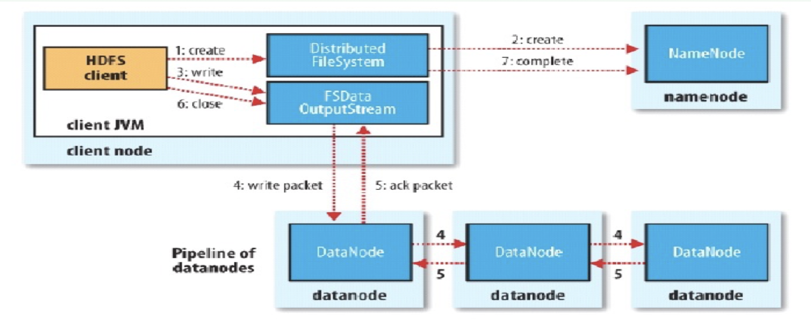

   Hadoop HDFS 架构

## 一、HDFS 整体架构模型
HDFS 数据分为两类：**文件元数据 MetaData**、**文件实际数据**
1. 主节点 NameNode：统一保存文件元数据，单节点部署
2. 从节点 DataNode：分布式存储文件 Block 数据，集群多节点
3. 通信机制
    - DataNode 与 NameNode 维持心跳，定时上报自身 Block 列表
    - HdfsClient ↔ NameNode：交互元数据信息（文件名、权限、块位置等）
    - HdfsClient ↔ DataNode：传输文件真实 Block 数据

## 二、NameNode（NN 名称节点）
### 1. 存储特性
- 元数据**基于内存存储**，不与磁盘交换，读写速度快
- 内存元数据提供实时查询，同时磁盘做持久化保存

### 2. 核心功能
1. 接收客户端读写请求服务
2. 收集所有 DataNode 定时上报的 Block 块列表信息

### 3. 内存保存的 Metadata 元数据内容
- 文件归属者（owner）、访问权限 permissions
- 文件大小、创建/修改时间
- 文件对应的 Block 列表、块偏移量
- 每个 Block 的所有副本位置（由 DataNode 心跳上报）

### 4. NameNode 元数据持久化机制
1. NameNode 启动时会将全部元数据加载至内存
2. `fsimage`：磁盘持久化镜像文件，保存完整文件目录结构、权限、文件大小等静态元数据
    - **不存储 Block 块位置信息**（块位置仅存于内存，由DN实时上报）
3. `edits`：编辑日志，记录所有增删改元数据的操作流水
4. NN 重启流程：合并 `fsimage` + `edits`，还原最新完整元数据至内存

### 5. NameNode 安全模式
1. NN 启动流程：加载 `fsimage` 到内存 → 回放 `edits` 日志构建完整元数据 → 生成新 `fsimage` + 空 `edits`
2. 启动后自动进入**安全模式**：文件系统只读
    - 允许：查看目录、读取文件内容
    - 禁止：写、删除、重命名文件
3. 安全模式退出条件
    - DataNode 上报本机所有 Block 信息
    - 集群内达到配置比例的数据块副本数满足最小副本要求
    - 等待指定延时后自动退出安全模式
4. 副本修复：检测到副本数不足的 Block，NN 自动调度复制至其他DN，补齐副本数

## 三、DataNode（DN 数据节点）
1. 存储介质：本地磁盘目录，以文件形式存储 Block 数据，同时保存对应Block简易元数据文件
2. 启动行为：DN 启动后主动向 NN 上报本机全部 Block 信息
3. 心跳机制
    - 默认3秒一次心跳，持续和 NN 保持通信
    - NN 超过10分钟未收到DN心跳，判定该DN宕机丢失
    - 自动复制该DN上所有Block副本至其他存活DN，保证副本数量

## 四、SecondaryNameNode（SNN 第二名称节点）
1. 定位：**不是 NameNode 高可用备份节点**，核心作用是辅助NN合并 edits 日志，缩短NN重启加载元数据耗时；仅可手动作为临时备份使用
2. 触发合并 Checkpoint 时机（满足其一即执行）
    - 时间阈值：配置 `fs.checkpoint.period`，默认3600秒（1小时）
    - 日志大小阈值：配置 `fs.checkpoint.size`，edits 文件最大64MB

## 五、Block 块副本放置策略（默认3副本）
1. 第1副本：
    - 客户端本集群上传：放置当前上传文件的DN
    - 集群外部提交文件：随机挑选磁盘、CPU负载较低节点
2. 第2副本：放置与第一副本**不同机架**的节点
3. 第3副本：放置与第二副本**同一机架**的其他节点
4. 超过3个副本：随机分配集群任意节点

## 六、HDFS 读写流程
### 1. HDFS 写流程（Client 上传文件）
<!-- 图片单独占行，与列表空行分隔 -->

  

<!-- 列表与图片之间空一行，保证渲染分隔 -->
1. Client 先和 NameNode 通信，传递元数据请求，获取第一个Block对应的3个副本DN节点列表（按副本策略分配）
2. 建立 Pipeline 流水线传输
    - Client 与第一个DN建立Socket通道；第一个DN与第二个DN建立Socket，依次串联所有副本节点
3. 分片传输：数据切分为4K小包
    - Client发送小包给首DN；DN本地缓存同时同步向下游DN转发
4. 单个Block传输完成后，对应DN向NN上报新增Block信息
5. Client 向NN申请下一个Block的节点存储信息，循环直至全部数据上传完成
6. 全部Block上传完毕，NN更新元数据，标记文件状态为可用

### 2. HDFS 读流程（Client 读取文件）
1. Client 向 NN 请求文件对应部分Block的副本位置列表
2. 就近优选规则：优先读取同节点、同机架DN的数据，减少网络开销
3. 线性逐个读取Block数据，最终在客户端合并为完整文件
4. NN 不会一次性返回全部Block位置，分段分批下发

## 七、HDFS 文件权限模型
1. 遵循 **POSIX 权限标准**，逻辑和 Linux 文件权限一致
    - r：读权限；w：写权限；x：执行权限
    - 文件的x权限无作用；文件夹x权限代表能否访问文件夹内部内容
2. 文件归属规则：Linux 系统登录用户执行hadoop命令创建文件，文件owner为该登录用户
3. 权限设计定位：仅防止误操作，不做安全认证；HDFS默认信任客户端上报身份

## 八、HDFS 优缺点
### 优点
1. 高容错性
    - 数据自动多副本存储
    - 节点/磁盘故障后，副本自动恢复复制
2. 适配大数据批处理
    - 计算向数据移动，减少大量数据传输
    - 对外暴露Block偏移量，供计算框架优化调度
3. 支持超大尺度数据
    - 支持GB/TB/PB级文件
    - 可存储百万级文件
    - 集群支持上万节点（10K+）
4. 低成本集群
    - 可搭建在普通廉价服务器
    - 多副本机制保障数据可靠，内置容错恢复机制

### 缺点
1. 不适合低延迟毫秒级实时数据访问，高吞吐牺牲低延迟
2. 大量小文件场景性能极差
    - 每个文件元数据占用NN内存，海量小文件耗尽NN内存
    - 磁盘寻道耗时大于文件读取耗时，效率极低
3. 文件修改限制严格
    - 同一文件仅支持单一写入者，不支持多并发写入
    - 仅支持文件追加append，不支持随机修改、随机覆盖

## 九、集群三大核心角色（进程）
### 1. NameNode
- 负责管理全集群文件元数据
- 元数据常驻内存，无磁盘交换，磁盘通过 fsimage + edits 持久化
- 磁盘不持久化Block位置信息，块位置由DN心跳实时上报
- Block有固定偏移量，Block大小固定不可调整，HDFS不支持文件随机修改

### 2. DataNode
- 存储真实Block数据块，数据落地本地磁盘
- 默认块大小128M，统一固定尺寸不可调整，配套环形缓冲区100M
- 支持自定义副本数量，依靠多副本实现高可用、容错
- 实现“计算向数据移动”的底层数据存储载体

### 3. SecondaryNameNode
- 辅助合并edits日志，做Checkpoint，减轻NN压力

### NN与DN交互核心机制
1. 心跳机制定时通信
2. DN定期向NN上报本机所有Block清单
3. NN启动存在安全模式机制

## 十、Client 客户端整体作用
### 写操作逻辑
1. 分块线性上传Block
2. 先与NN交互获取元数据、Block存储节点列表
3. 通过Pipeline流水线串行向多个DN同步副本数据
4. 小包异步转发，利用时间重叠优化网络IO耗时
5. 单块传输完成后申请下一块存储节点，全部完成后NN更新元数据

### 读操作逻辑
1. 线性依次读取各个Block，单网卡串行读取
2. 依据网络距离优选最近DN读取数据
3. NN分段返回Block位置信息，不会一次性下发全部块信息