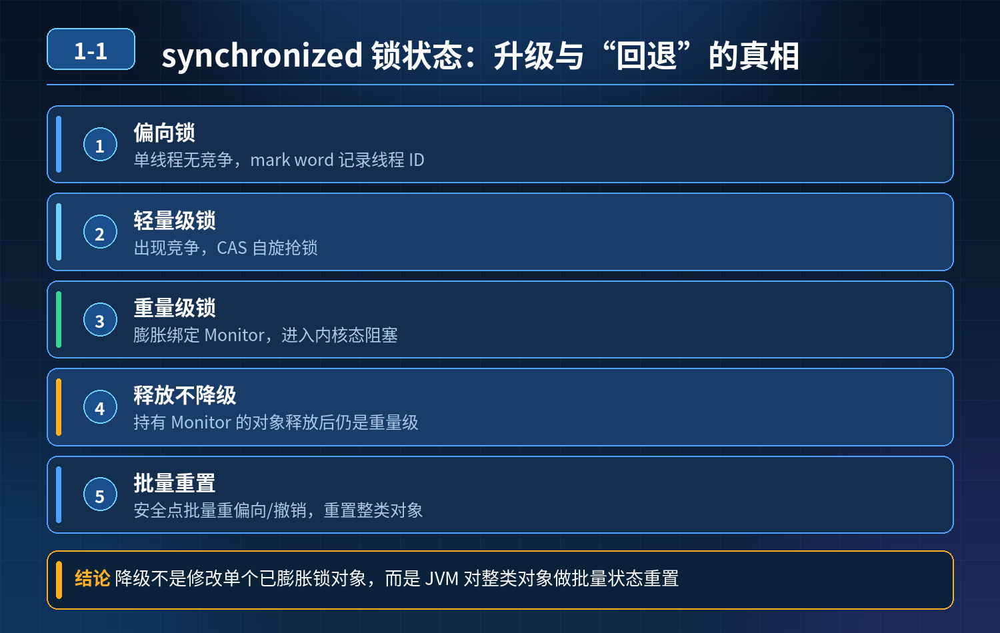

<div class="essay-image ">
     synchronized 锁只能从轻往重单向升级、不能反向降级，为什么压测高峰过后锁状态又变回轻量级？
</div>

## 第 1-1 题　synchronized 锁只能从轻往重单向升级、不能反向降级，为什么压测高峰过后锁状态又变回轻量级？

**候选人浅层回答：** 锁一旦升级成重量级锁就永远不能降级。

## 核心拆解一句话结论
HotSpot 中：已经膨胀绑定 Monitor 的重量级锁对象，线程释放锁之后，**该对象不会自动降级为轻量级 / 偏向锁**。但 JVM 有「批量重偏向、批量撤销」安全点机制，
针对**同一个 Class 下尚未膨胀为重量级的对象**批量重置偏向标记；监控看到 “锁变回轻量级”，并不是旧重量级对象降级，而是**同类新对象 / 未膨胀对象**的锁状态变化，这是观测现象的根本原因。

## 区分两个极易混淆的概念：

 **1.** **单个锁对象（实例维度）**：已经膨胀成重量级锁、绑定 ObjectMonitor；锁释放之后，**不会自动降级**。该对象 Mark Word 依旧指向 Monitor；ObjectMonitor 会放入内部缓存池复用，不会立刻归还操作系统。
⚠️注意：ObjectMonitor 缓存池的复用 / 回收，和批量重偏向、批量撤销完全无关。
 **2.** **批量重偏向 / 批量撤销（Class 维度，偏向锁专属机制）**：JVM 在全局安全点 STW，扫描处理当前类下对象头 Mark Word；**只修改还没有膨胀为重量级锁的对象的偏向标记，不会触碰已经膨胀为重量级的对象**。这是面试的核心陷阱。

## 锁状态流转基础（偏向锁 → 轻量级锁 → 重量级锁）

 **1.** 偏向锁：  单线程无竞争，mark word 记录线程 ID；
 **2.** 轻量级锁：多线程交替竞争，CAS 自旋，不进入 OS 内核；
 **3.** 重量级锁：自旋失败，向 OS 申请 Monitor，线程进入内核态阻塞。

升级触发：竞争加剧单向往上走。**单个对象一旦膨胀重量级，不会自动回落降级**。

## 两个关键机制（面试重点，仅在开启偏向锁 -XX:+UseBiasedLocking 才生效，JDK15 默认关闭偏向锁）

**1.** 批量重偏向（Bias Rebiasing）
    - JVM 统计同一个 Class 下偏向锁被撤销的次数，达到阈值触发批量重偏向。
    - 在安全点 STW，把该类下还没有膨胀成重量级的对象，重新偏向新的活跃线程。
    - 作用：业务线程交替访问大量同类对象，避免频繁撤销偏向锁、反复生成轻量级锁，降低开销。
    - 本质：重置偏向标记；不会把重量级锁降级。

**2.** 批量撤销（Bias Revocation）
    - 当偏向撤销次数继续增大，超过批量撤销阈值，JVM 判断该类对象偏向锁竞争剧烈。
    - 在安全点 STW：撤销该 Class 所有对象的偏向标记，将对象置为无锁状态（01，无偏向）。
    - ❗重点修正：批量撤销不回收 ObjectMonitor，不会处理已经膨胀重量级的对象；它只管偏向标记位。无锁 ≠ 轻量级锁；后续线程来竞争无锁对象，才会通过 CAS 生成轻量级锁。
    - 现象解释：压测高峰，大量对象竞争膨胀为重量级锁；高峰结束，触发批量撤销，同类未膨胀对象被清除偏向标记变为无锁；后续线程竞争这些无锁对象，生成轻量级锁。监控统计全量对象，看起来就像是锁发生了 “降级”。**已经膨胀重量级的老对象依旧保持重量级标记，没有发生降级**。

## 连环追问要点整理

**1.** 为什么单个重量级锁释放后不自动降级？
   降级成本很高：需要 STW、修改对象头 Mark Word、处理内核相关 Monitor；频繁升降级会带来严重锁震荡性能抖动。HotSpot 采用保守策略，不实现单对象重量级锁自动降级。ObjectMonitor 释放后放入缓存池复用，避免频繁向操作系统申请释放。

**2.** 那压测低峰看到锁变回轻量级是什么？
   不是同一个重量级对象发生降级。是同类其他未膨胀 / 新建对象，经过批量撤销后处于无锁状态，后续发生竞争时生成轻量级锁；老的已经膨胀成重量级的对象仍然维持重量级标记。

**3.** 安全点在这里的角色？
   批量重偏向、批量撤销只能在全局安全点执行，触发 STW 短暂停顿；不会在业务线程运行过程中随时执行，扫描对象头批量修改 Mark Word。

参数相关:
```java
-XX:+UseBiasedLocking 开启偏向锁（JDK15 默认关闭）
-XX:BiasedLockingBiasThreshold 批量重偏向阈值
-XX:BiasedLockingRevocationThreshold 批量撤销阈值
```

**面试回答完整话术**
很多资料说 synchronized 锁单向升级、不能降级，这个结论有限定范围：针对单个对象实例。同一个对象一旦膨胀为重量级锁，释放锁之后不会自动降级。
JVM 的批量重偏向、批量撤销是偏向锁专属、Class 维度的机制，运行在安全点 STW 下，只会重置还没有膨胀重量级的对象的偏向标记，不会处理已经绑定 Monitor 的重量级对象。批量撤销仅仅清除偏向位，把对象置为无锁，并不会回收 ObjectMonitor。
压测高峰期大量对象竞争膨胀重量级；流量下降触发批量撤销，同类未膨胀对象变为无锁；后续线程竞争这些对象，会重新生成轻量级锁。监控观测到的 “锁降级”，是这批新 / 未膨胀对象的状态，不是原来重量级对象降级。
设计取舍：不做单对象即时降级，避免反复膨胀降级带来高昂内核切换与锁震荡；批量偏向操作放在安全点统一处理，做性能权衡。

**追问：本题考察核心是什么？**

**参考答案：**
初级开发者只会背诵一句话 “锁单向升级，不能降级”，分不清单个对象实例锁状态和同类 Class 批量偏向标记重置，无法解释压测低峰观测现象，不清楚批量重偏向、批量撤销依赖安全点 STW，还会混淆偏向批量机制和 ObjectMonitor 缓存回收逻辑。

**高级工程师要分清：**
1. 单向升级不可降级的适用边界：针对单个对象实例；
2. 批量重偏向 / 批量撤销是偏向锁专属的 Class 维度重置，不是单对象锁降级，不操作 ObjectMonitor；
3. MarkWord 状态区分：无锁≠轻量级锁；
4. 理解 JVM 取舍：不实现重量级锁即时降级是为了避免锁震荡；
5. 解释压测波峰波谷观测现象，明白锁状态观测要区分对象实例，不能只记笼统结论。
核心思想：本题典型面试陷阱，混淆「单个实例锁状态」和「同 Class 批量偏向标记重置」；重量级锁本身不会降级，观测到的现象来自其他对象的状态变化。
<div class="img-wrap-left">
   
 </div> 