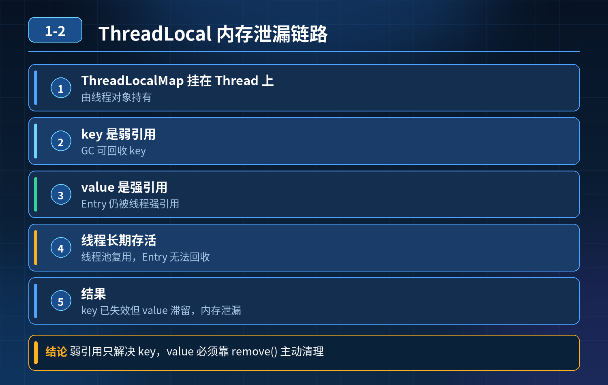

<div class="essay-image ">
    ThreadLocal 使用不当会内存泄漏，背后根本原因是什么？
</div>

## 第 1-2 题　ThreadLocal 使用不当会内存泄漏，背后根本原因是什么？

**候选人浅层回答：** ThreadLocalMap 的 key 是弱引用，GC 回收 key，但 value 是强引用无法释放，造成内存泄漏，用完调用 remove 即可。

## 核心拆解一句话结论
内存泄漏的元凶不是弱引用，弱引用恰恰是 JDK 用来缓解泄漏的保护手段。真正的根因是**线程长期存活 + 忘记 remove**：ThreadLocalMap 的 Entry 被 Thread 强引用持有，外部 ThreadLocal 引用置空后 key 被 GC 回收变成 null，而 value 是强引用无法释放，形成「key 为 null、value 还活着」的脏 Entry，越堆越多。

## 举例说明
一个下单接口用 ThreadLocal 存用户上下文，线程池核心线程常驻不销毁。每次请求往里放约 1KB 的上下文对象却忘了 remove，一天 100 万次请求后，这些对象一直挂在线程的 Entry 上无法回收，堆内存缓慢上涨，最终触发 Full GC，而泄漏对象依然回收不掉。

## 基础结构回顾
Thread 内部持有 ThreadLocalMap，map 的 Entry 节点为 Entry(ThreadLocal<?> k, Object v)：

**1.** key：ThreadLocal 实例，弱引用 WeakReference；
**2.** value：存入的业务对象，强引用。

注意：内存泄漏元凶不是弱引用，恰恰相反，弱引用是 JDK 用来缓解内存泄漏的保护手段。

## 内存泄漏完整原理
当外部 ThreadLocal 引用被置为 null，没有强引用指向这个 ThreadLocal 对象：

**1.** key 是弱引用：下次 GC 时 key（ThreadLocal 实例）会被回收，Entry 的 key 变成 null；
**2.** value 是强引用：Entry 本身被 Thread 对象强引用（Thread → ThreadLocalMap → Entry → value）。只要线程不退出，Entry 和 value 就一直存活，出现 key 为 null 但 value 无法释放的脏 Entry，也就是内存泄漏。

一句话：线程长期存活 + 没有手动 remove + ThreadLocal 外部引用失效 → 脏 Entry 堆积泄漏。

## 区分三个极易混淆的取舍

**1.** **为什么 key 不设计成强引用？**
      -  如果 key 是强引用：外部把 ThreadLocal 引用置 null，但 ThreadLocalMap.Entry 还持有 key 的强引用，只要线程不销毁，ThreadLocal 实例永远无法被 GC 回收，key 和 value 全部泄漏，泄漏会更严重，完全无法自动缓解。
      -  弱引用的目的：外部不再持有 ThreadLocal 引用时，GC 至少能把 key 回收掉，给后续清理 value 留下机会。

**2.** **value 为什么不设计成弱引用？**
      -  value 若做弱引用会带来业务灾难：ThreadLocal 的设计目标是「只要线程还在用这个 ThreadLocal，value 就必须存活」，而弱引用的规则是「只要没有强引用，GC 随时回收」。
      -   一旦 value 弱引用，哪怕业务线程正在使用，GC 也可能随机把 value 干掉，业务代码拿到 null，引发诡异空指针。value 的生命周期应由业务逻辑控制，不能交给 GC 随机回收，所以 value 必须是强引用。

**3.** **ThreadLocal 有没有内置清理机制？有，为什么还会泄漏？**
      -   有自动清理：调用 set() / get() 时，ThreadLocalMap 会扫描 table，发现 key == null 的脏 Entry，自动把 Entry 和 value 清理掉。
      -  ❌ 局限性：只有调用 get/set 才会触发清理。若后续不再调用 get/set，清理逻辑永远不会执行，脏 Entry 永久留在 map 里。核心矛盾是——自动清理不是后台定时任务，而是被动触发。

## 线程池场景泄漏风险更高的原因

 **1.** 普通临时线程：任务执行完毕，线程直接退出销毁，Thread 对象被 GC，整个 ThreadLocalMap 连同 Entry、value 全部释放，基本不会泄漏。
 **2.** 线程池：线程复用、长期存活、不会销毁。任务 A 往线程的 ThreadLocalMap 写入数据，执行完没有 remove；线程还给线程池，下一次复用该线程时，旧 Entry 还保存在 ThreadLocalMap 中。长期反复提交任务，脏 Entry 持续堆积，内存泄漏风险急剧放大。

## 连环追问要点整理

 **1.** 既然担心泄漏，为什么 key 不设计成强引用？
   强引用会导致 ThreadLocal 实例与 value 永久无法回收，泄漏更严重；弱引用是缓解手段，让 key 至少能被 GC 掉。

 **2.** 弱引用是帮忙回收 key，为什么还会出现泄漏？
   弱引用只解决了 key，value 仍是强引用，被 Thread 的强引用链持有；线程不退出，value 就释放不了。

 **3.** value 为什么不设计成弱引用，让 GC 一并回收？
   业务正在使用的 value 会被 GC 随机回收，拿到的数据可能为 null，破坏业务正确性。

 **4.** ThreadLocal 有没有内置自动清理机制？有机制为什么依然会泄漏？
   有，但只在 get/set 时被动触发；不再访问该 ThreadLocal 时，清理永远不会发生。

 **5.** 线程池场景下，ThreadLocal 内存泄漏风险为什么远高于普通一次性线程？
   线程复用、长期存活，ThreadLocalMap 跟着线程一起常驻，脏 Entry 跨任务累积。

正确使用规范:
```java
// 1. 用完必须手动 remove，从根源删除 Entry
try {
    USER_CONTEXT.set(user);
    handle();
} finally {
    USER_CONTEXT.remove();
}

// 2. 用 static final 修饰 ThreadLocal，减少实例创建
private static final ThreadLocal<UserContext> USER_CONTEXT = new ThreadLocal<>();

// 3. 线程池是高危场景，任务执行结束强制 remove
 ```

**面试回答完整话术**
ThreadLocal 内存泄漏根本原因不是弱引用，而是线程长期存活，ThreadLocalMap 里 Entry 的 value 被线程强引用持有；当外部 ThreadLocal 引用丢失，key 被 GC 回收变成 null，但 value 无法释放，形成脏 Entry。
JDK 把 key 设计为弱引用，是为了避免 key 永久无法回收；如果 key 是强引用，ThreadLocal 对象会永久无法 GC，泄漏更严重。value 不能做成弱引用，因为 GC 会随机回收业务数据，破坏业务逻辑。
ThreadLocalMap 存在被动清理机制，在 get/set 时扫描清除 key 为 null 的 Entry；但如果之后不再执行 get/set，清理逻辑不会触发。
普通线程执行完直接销毁，Map 跟着释放；线程池线程复用、长期存活，任务结束忘记 remove，脏 Entry 不断累积，所以泄漏风险大很多。最佳实践是使用完成后调用 remove。
设计取舍：弱 key 只做到「尽量不拖累」，真正的闭环必须靠编码规范里的手动 remove。

**追问：本题考察核心是什么？**

**参考答案：**
初级开发只背「key 弱引用造成内存泄漏」这个错误因果，分不清弱引用是保护手段而不是泄漏根源，不知道内置清理是被动触发，解释不了线程池场景风险更高的本质。
高级工程师要分清：
1. 理清引用链路，分清弱引用的设计目的；
2. 区分 key、value 引用类型不同的取舍，理解为什么 value 不能弱引用；
3. 理解被动清理的局限性；
4. 解释线程复用对 ThreadLocal 生命周期的影响；
5. 给出生产环境安全编码方案。
核心思想：弱引用是缓解手段，长期存活的线程 + 忘记 remove，才是内存泄漏真正元凶。
<div class="img-wrap-left"> 
   
</div>