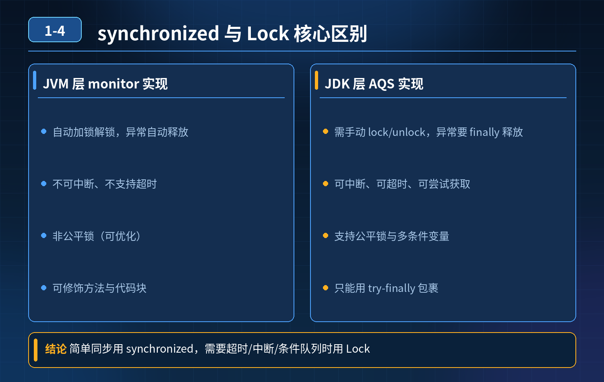

<div class="essay-image ">
    多线程并发场景 synchronized 和 Lock 的底层原理、功能特性、适用场景有什么核心区别？
</div>

## 第 1-4 题　多线程并发场景 synchronized 和 Lock 的底层原理、功能特性、适用场景有什么核心区别？

**候选人浅层回答：** 两者都是锁，保证线程安全，用法差别不大。

## 核心拆解一句话结论
synchronized 是 JVM 内置关键字，靠 MarkWord + Monitor 实现，自动加锁释放、只能非公平、不可中断、无超时；Lock（ReentrantLock）是 API 层实现，基于 AQS + CAS + CLH 队列，必须手动释放，换来公平锁、超时、可中断、多条件队列等能力。两者都可重入，选型就看是否需要那些扩展能力。

## 区分两个极易混淆的概念

1. **实现层面**：synchronized 是 JVM 层面（关键字，编译为 monitorenter / monitorexit，重量级依赖操作系统内核态 Monitor）；Lock 是 Java API 层面（工具类，纯用户态，竞争激烈时才挂起线程）。
2. **释放责任**：synchronized 自动释放（代码块结束或抛异常，JVM 自动 monitorexit）；Lock 手动释放（异常不会自动释放，必须写在 finally，否则锁泄漏、永久死锁）——这是生产事故的高发点。

## 一、底层原理

1. synchronized 属于 JVM 层面的内置锁，关键字，由 HotSpot 对象头 MarkWord + Monitor 监视器实现。锁状态分：偏向锁 → 轻量级锁 → 重量级锁，锁升级单向，重量级依赖操作系统内核态 Monitor。编译后生成 monitorenter / monitorexit 字节码指令。
2. Lock（以 ReentrantLock 为代表）是 Java API 层面的锁，属于工具类，基于 AQS（AbstractQueuedSynchronizer）实现。底层是 CAS + volatile 修饰的 state 状态变量 + CLH 双向等待队列，完全在用户态实现，竞争激烈时才会挂起线程。

## 二、核心特性对比

1. **锁的释放**
   - synchronized：自动释放。代码执行完成或者抛出异常，JVM 自动执行 monitorexit 释放锁，不会死锁；
   - Lock：手动释放，必须显式调用 unlock()。异常不会自动释放锁，必须写在 finally 块里面执行 unlock，否则会锁泄漏，永久死锁。
2. **公平锁**
   - synchronized：只能是非公平锁，没有公平选项；
   - ReentrantLock：支持公平 / 非公平锁，构造参数传入 true 开启公平锁；公平锁按队列 FIFO 顺序获取锁，性能略低。
3. **等待是否可中断**
   - synchronized：不可中断。线程阻塞在锁等待队列时，调用 interrupt() 只会标记中断状态，线程依旧卡在等待锁，不会停止等待；
   - Lock：支持可中断获取锁 lockInterruptibly()，等待锁的过程可以响应中断，抛出 InterruptedException。
4. **其他能力**
   - Lock 支持尝试获取锁：tryLock() 无阻塞尝试拿锁，拿不到直接返回 false；tryLock(time, unit) 带超时时间的锁等待。synchronized 一旦抢不到锁就阻塞，没有超时机制；
   - Lock 支持多条件变量 Condition，可以绑定多个等待队列（一个锁可以多个 await/signal 分组等待唤醒）；synchronized 只有一个等待队列（wait/notify）；
   - 两者都是可重入锁，同一个线程可以多次获取锁。

## 三、适用场景

- 优先使用 synchronized 的场景：简单同步、代码块短、普通并发保护，代码简洁不易出错，JVM 自带锁升级优化，低竞争场景性能好。
- 优先使用 Lock（ReentrantLock）场景：
  1. 需要公平锁；
  2. 需要锁等待超时、非阻塞尝试获取锁；
  3. 需要等待过程可中断；
  4. 需要多条件变量 Condition，精细控制线程唤醒；
  5. 长时间持有锁的场景。

注意：JDK1.6 之后 synchronized 经过锁升级优化，性能和 ReentrantLock 差距很小，不再像早期版本差距巨大，选型更多看业务功能，而不是单纯性能。

## 连环追问要点整理

1. 底层实现有什么不同？
   - synchronized 是 JVM 内置，MarkWord + Monitor，编译成 monitorenter/monitorexit；ReentrantLock 是 API 层，AQS（volatile state + CAS + CLH 队列）。
2. 是否支持公平锁？
   - synchronized 只能非公平；ReentrantLock 构造传 true 可变公平，代价是吞吐下降。
3. 线程等待是否可以中断？
   - synchronized 不可中断；Lock 的 lockInterruptibly() 可响应中断并抛 InterruptedException。
4. 异常情况下锁会不会自动释放？
   - synchronized 会（monitorexit 由 JVM 保证）；Lock 不会，必须在 finally 里 unlock，否则锁泄漏。

ReentrantLock 标准写法:
```java
lock.lock();
try {
    // 业务
} finally {
    lock.unlock(); // 必须放 finally
}
```

## 面试回答完整话术
  - synchronized 是 JVM 内置关键字，底层依靠对象头 MarkWord 和 Monitor，自动加锁释放，异常自动释放锁，只能非公平锁，等待不可中断，不支持超时获取锁，只有一个等待队列。
  - Lock 是 API 层面的锁实现，典型实现 ReentrantLock，底层基于 AQS，CAS + CLH 队列；需要手动 unlock，异常不会自动释放，支持公平 / 非公平、锁超时、可中断获取锁，支持多个 Condition 条件队列。两者都是可重入锁。
  - 选型上，简单短临界区用 synchronized；需要超时、中断、公平锁、多条件唤醒场景选用 Lock，使用 Lock 务必在 finally 中 unlock，防止锁泄漏。

  设计取舍：synchronized 用「少能力」换「零管理成本、零泄漏风险」；Lock 用「手动管理」换「更多控制手段」，能力与风险成正比。

## 追问：本题考察核心是什么？
  参考答案：
  初级开发只知道两者都能实现加锁，分不清 JVM 内置锁和 AQS API 锁的本质差异，不清楚自动 / 手动释放的巨大风险，不知道中断、tryLock、公平锁、Condition 这些扩展能力。

###  高级工程师要分清：
  1. 分清底层实现：MarkWord + Monitor vs AQS + CAS；
  2. 清晰区分锁释放机制带来的风险（Lock 容易锁泄漏）；
  3. 掌握公平锁、中断、超时、多条件队列这些独有特性；
  4. 能根据业务场景选型，清楚各自优缺点和坑点。
  核心思想：synchronized 胜在简洁安全、自动管理；Lock 胜在功能丰富、灵活可控，但开发负担更高，必须手动释放锁。

<div class="img-wrap-left">
    
</div>
