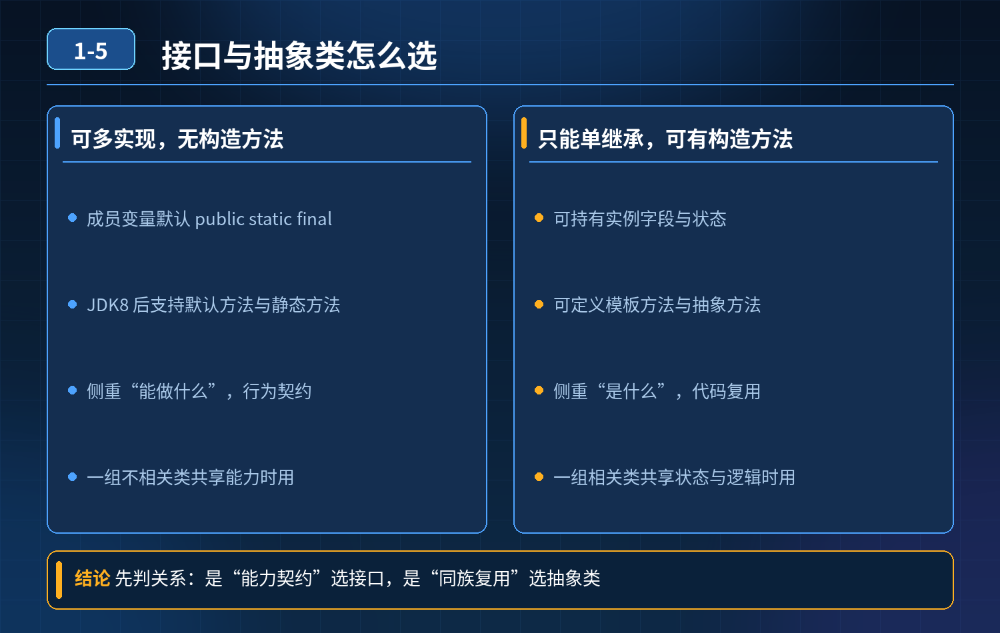

<div class="essay-image ">
    面试题之接口与抽象类
</div>

## 第 1-5 题　接口和抽象类到底有什么区别？项目里该怎么选？

**候选人浅层回答：** 两者都能定义抽象方法，差不多随便用。

## 核心拆解一句话结论
抽象类表达 is-a，是「抽取共性、复用代码与状态」；接口表达 can-do，是「定义能力契约、解耦规范」。语法上抽象类单继承、有构造器、成员变量自由，接口可多实现、无构造器、成员默认常量；JDK8/9 接口新增 default、static、private 方法后，接口也能带实现。项目里最常见的组合是「接口定义契约 + 抽象类提供骨架」。

## 举例说明
支付渠道接入用接口合适——微信、支付宝、银联是多套彼此独立、没有共享状态的实现；而订单状态流转更适合抽象类——待支付、已支付、已取消共享同一份状态字段和公共校验逻辑，只在差异步骤上留抽象方法交给子类实现。

## 一、基础定义

- 抽象类 abstract class：是类，描述一类事物的共性特征与部分实现，表达「is-a」是一个什么东西；
- 接口 interface：是行为契约，描述一类能力，表达「can-do」能做什么。

## 二、语法层面对比

1. **继承实现**
   - 抽象类：类只能单继承，一个类只能 extends 一个抽象类；
   - 接口：一个类可以多实现 implements 多个接口；接口本身也可以多继承其他接口。
2. **构造方法**
   - 抽象类：可以有构造器，供子类实例化时调用，用来初始化抽象类内部成员；抽象类本身不能 new；
   - 接口：没有构造方法，不能实例化。
3. **成员变量**
   - 抽象类：变量和普通类一样，可以是 private/protected/public，可以是静态 / 实例变量，变量值可修改；
   - 接口：默认是 public static final，常量，必须初始化，不能修改。
4. **方法（重点，JDK 版本变化）**
   - JDK7 及更早：接口只能有 public abstract 抽象方法，不能有方法体；
   - JDK8：接口新增 default 默认方法（有方法体，实例调用）、static 静态方法（接口名调用）；
   - JDK9：接口增加 private 私有方法，供内部 default 方法复用；
   - 抽象类：可以包含抽象方法（无方法体），也可以有普通实例方法、静态方法、private 方法，不受限制；
   - 访问修饰符：抽象类方法可以 private/protected/public；JDK8 之前接口方法隐式 public abstract，JDK8+ 的 default/static 也是 public。

## 三、设计思想（面试高分关键点）

- 抽象类：is-a，抽取子类的公共代码、公共状态，复用。多个子类有大量相同字段、相同逻辑，只部分行为不一样，抽成抽象类，代码复用优先；
- 接口：can-do，定义能力契约。不同类型的类，互不相关，但具备同一个能力，比如序列化、可比较、可回调，解耦、定义规范优先。

## 四、项目选型原则

- 优先选接口：
  1. 定义对外 API、行为规范、能力标准；
  2. 一个类需要具备多种能力（多契约）；
  3. 不想绑定类继承关系，降低耦合。
- 优先选抽象类：
  1. 多个子类有大量共同成员变量、公共业务逻辑，需要复用代码；
  2. 需要维护子类共享的内部状态。

注意：Java 类是单继承，抽象类会占用唯一继承名额，慎用。

## 五、项目经典搭配模式

模板方法模式常用组合：接口定义契约，抽象类实现接口并提供通用骨架实现，具体子类继承抽象类，重写个性化方法。

示例：
```java
// 接口：定义能力契约
public interface PayService {
    void pay();
}

// 抽象类：实现接口，封装通用公共逻辑
public abstract class AbstractPayService implements PayService {
    // 公共通用逻辑
    public void preCheck() { ... }
}

// 具体实现类：继承抽象类，只实现差异化逻辑
public class AliPay extends AbstractPayService {
    @Override
    public void pay() { ... }
}
```

好处：

1. 接口面向外部，做规范定义，方便扩展、多实现；
2. 抽象类承担公共代码复用，避免所有实现类重复写相同代码；
3. 子类只需要关心自己独有的业务逻辑。

## 连环追问要点整理

1. 能不能多继承？
   - 抽象类只能单继承；接口可以多实现、也可以多继承接口。
2. 能不能有构造方法？
   - 抽象类可以有构造器（供子类调用初始化成员），但不能 new；接口没有构造方法。
3. 成员变量有什么限制？
   - 抽象类成员变量同普通类；接口成员默认 public static final 常量。
4. JDK8 以后接口有哪些变化？
   - JDK8 加 default 默认方法、static 静态方法；JDK9 加 private 私有方法。
5. 项目中抽象类和接口一般怎么搭配使用？
   - 接口定义契约，抽象类实现接口并封装公共骨架，子类只写差异化逻辑。

## 面试回答完整话术
  - 从本质上，抽象类代表 is-a，描述事物是什么；接口代表 can-do，代表具备什么能力。
  - 语法上：抽象类是类，只能单继承，可以有构造器，成员变量自由；接口可以多实现，没有构造器，成员默认是常量。
  - JDK8 对接口做了增强，新增 default 默认方法和 static 静态方法，JDK9 增加私有方法，接口不再只能只有抽象方法。
  - 选型上：如果是定义能力、对外规范，用接口；多个子类存在大量公共状态、公共代码，需要代码复用，用抽象类。
  - 项目里最常用搭配：接口定义契约，抽象类实现接口并封装通用骨架，子类继承抽象类实现差异化逻辑，兼顾规范和解耦，同时复用公共代码。

  设计取舍：接口解决「能不能」的横向扩展，抽象类解决「像不像」的纵向复用；单继承名额有限，不要为了复用而滥用抽象类。

## 追问：本题考察核心是什么？
  参考答案：
  初级开发只记得两者都有抽象方法，分不清 is-a 和 can-do，不知道 JDK8 接口新增特性，项目不会合理搭配。

###  高级工程师要分清：
  1. 语法差异；
  2. 核心设计思想的区别，而不是单纯语法背诵；
  3. 理解单继承限制带来的选型约束；
  4. 能说出项目常用的「接口 + 抽象类」骨架模板写法。
  核心思想：接口定义契约，抽象类复用实现；接口做能力，抽象类做模板。

<div class="img-wrap-left">
    
</div>
