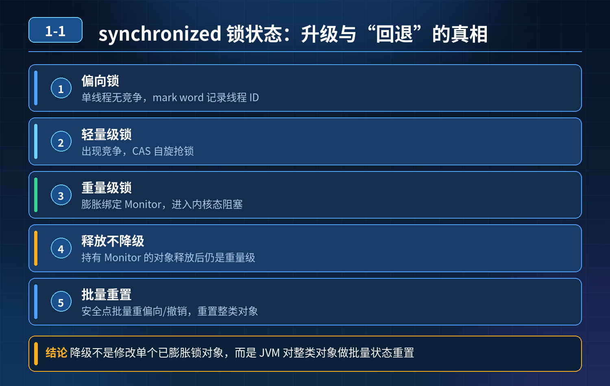
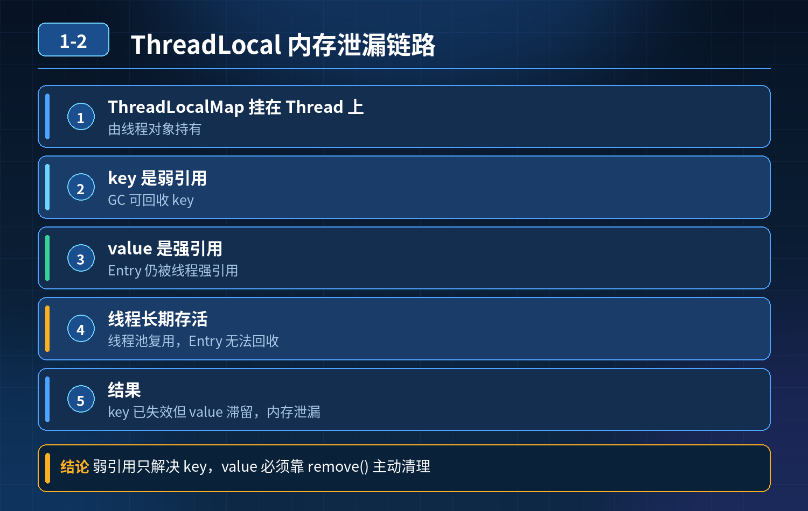
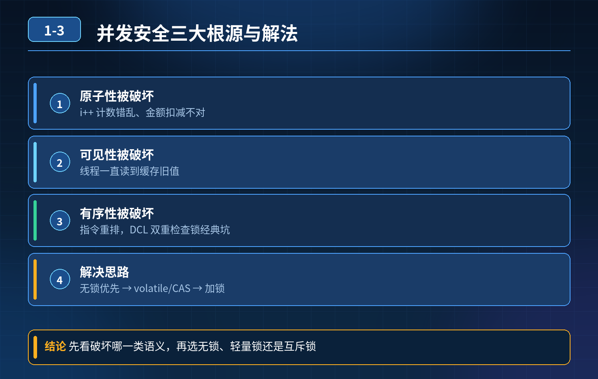
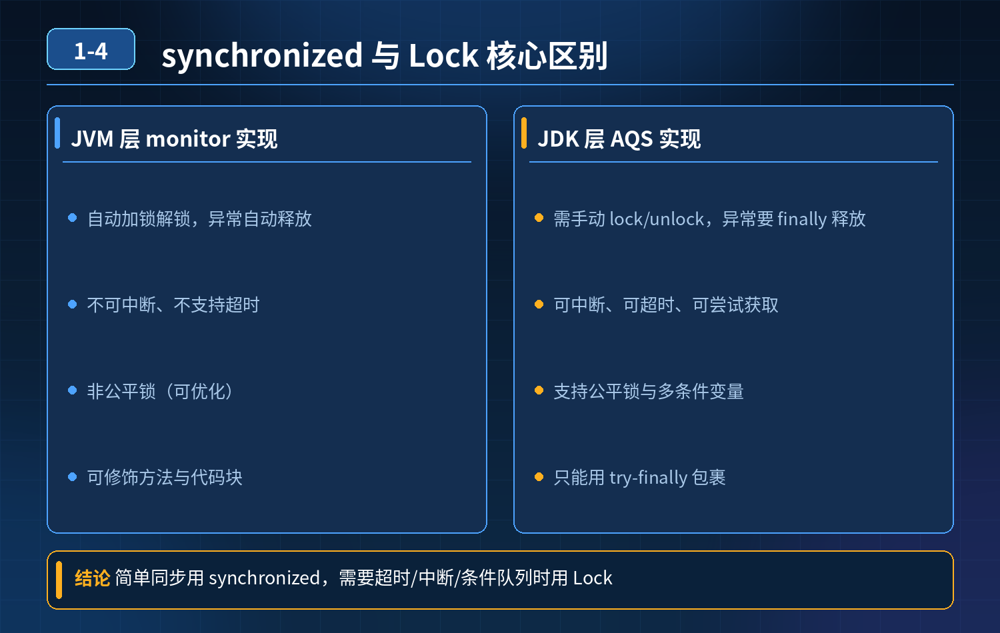
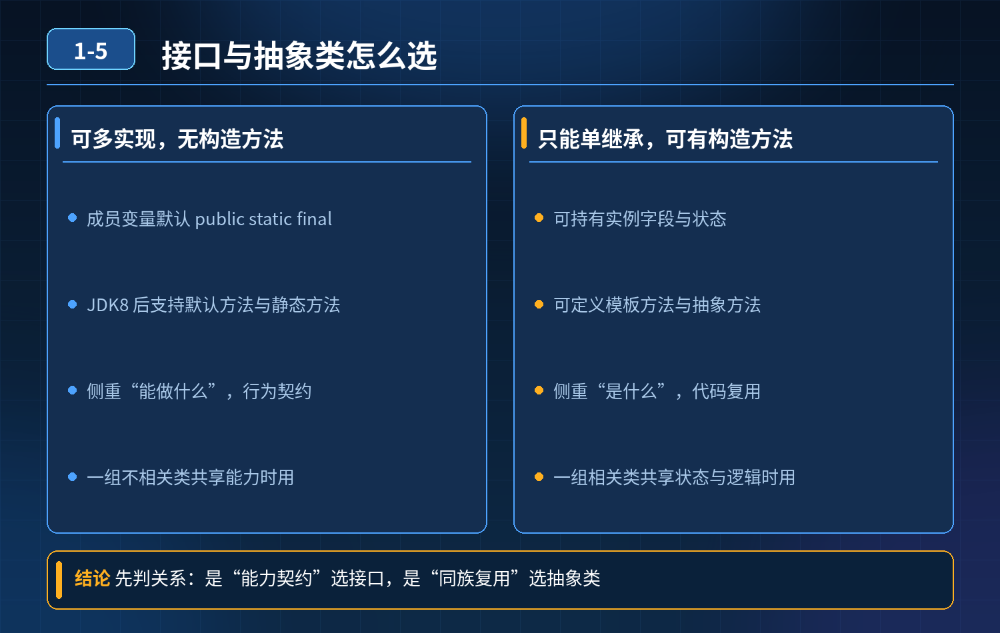
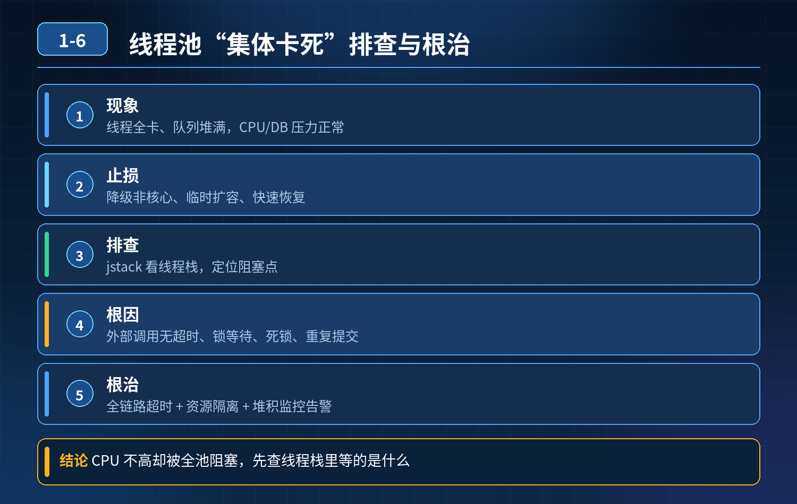

<div class="essay-chapter-header essay-image1">
    1. Java 基础 & 并发编程
</div>

## 第 1 题　synchronized 锁只能从轻往重单向升级、不能反向降级，为什么压测高峰过后锁状态又变回轻量级？

<strong>候选人浅层回答：</strong>锁一旦升级成重量级锁就永远不能降级。

核心拆解一句话结论HotSpot 中：正在持有 Monitor 的重量级锁，不会在正常线程释放锁之后，自动降级为轻量级 / 偏向锁。但存在「批量重偏向、批量撤销」这类全局安全点机制，可以把同类其他对象的锁状态重置回偏向 / 无锁，看起来像是 “降级”，这也是压测低峰看到锁变回轻量的根本原因。

区分两个极易混淆的概念：

1. 单个锁对象，已经膨胀成重量级锁（已经绑定 Monitor）：锁释放之后，不会自动降级。这个对象的 mark word 仍然标记为重量级，Monitor 不会立刻归还，默认保留。
2. 批量重偏向 / 批量撤销：JVM 在安全点做一类对象的批量状态重置，不是修改当前这个已经膨胀的锁对象，而是重置这个 Class 下大量其他对象的 mark word，把它们从偏向锁撤销、或者重新偏向，回到轻量 / 偏向状态。这就是面试官陷阱所在。

锁状态流转基础（偏向锁 → 轻量级锁 → 重量级锁）

1. 偏向锁：单线程无竞争，mark word 记录线程 ID；
2. 轻量级锁：多线程交替竞争，CAS 自旋，不进入 OS 内核；
3. 重量级锁：自旋失败，向 OS 申请 Monitor，线程进入内核态阻塞。

升级触发：竞争加剧单向往上走。单个对象一旦膨胀重量级，不会自动回落。

两个关键机制（面试重点）① 批量重偏向（Bias Rebiasing）

- JVM 会统计同一个 Class 下偏向锁被撤销的次数。达到阈值后，进入批量重偏向。
- 在安全点，把该类下所有还没有膨胀成重量级的对象，重新偏向新的活跃线程。
- 作用：业务线程交替访问大量同类对象，避免每次切换线程都反复撤销偏向锁、频繁升级轻量级锁，降低开销。
- 它是重置偏向标记，不是把已经重量级的锁降级。

② 批量撤销（Bias Revocation）

- 当偏向撤销次数继续增大，超过批量撤销阈值，JVM 判定这个类的锁竞争很剧烈。
- 在安全点：撤销该 Class 所有对象的偏向标记，同时回收闲置的 Monitor，大量对象回到无锁状态。

压测高峰，大量对象膨胀重量级；高峰结束，没有线程继续争抢，安全点触发批量撤销，回收空闲 Monitor，同类新对象 / 未膨胀对象回到轻量 / 无锁。观测上就像锁降级了。

连环追问要点整理

1. 为什么单个重量级锁释放后不自动降级？ 降级成本很高：需要内核态、修改mark word、回收 Monitor，频繁升降级会带来巨大性能震荡。JVM 选择保守策略，不做即时降级。
2. 那压测低峰看到锁变回轻量级是什么？ 不是同一个对象的重量级锁降级，是同类其他对象在批量重偏向 / 批量撤销后，锁状态被重置。老的已经膨胀成重量级的对象依然保持重量级标记。
3. 安全点在这里的角色？ 批量重偏向、批量撤销只能在安全点执行，不会在业务线程运行中随时触发。安全点是全局 STW 短暂停顿，扫描所有对象头，批量修改 mark word。
4. 参数相关

- -XX:+UseBiasedLocking 开启偏向锁（JDK15 默认关闭）
- -XX:BiasedLockingBiasThreshold 批量重偏向阈值
- -XX:BiasedLockingRevocationThreshold 批量撤销阈值面试回答完整话术很多资料说 synchronized 锁单向升级、不能降级，这个结论要加限定：同一个对象一旦膨胀为重量级锁，释放锁后不会自动降级。但 JVM 提供批量重偏向和批量撤销机制，在安全点对同一个类下大量对象做锁状态重置，回收闲置 Monitor，让同类对象回到偏向或无锁状态，观测上看起来像锁降级。

原理：偏向锁有统计计数器。当一个类大量对象发生偏向撤销，达到阈值触发批量重偏向，允许同类对象重新偏向新线程；竞争更激烈达到批量撤销阈值，STW 安全点下撤销该类全部对象的偏向标记，回收空闲 Monitor。

所以压测高峰期，大量对象竞争膨胀重量级；流量下降后，安全点触发批量撤销，后续新建或者未膨胀的对象回到轻量 / 偏向。

不是已经变成重量级的那个对象自己降级，是一类锁对象做全局重置。

设计取舍：不做单个锁即时降级，是为了避免反复膨胀、降级带来高昂的内核切换开销；批量操作放在安全点统一处理，平衡性能。

<strong>追问：</strong>本题考察核心是什么？

<strong>参考答案：</strong> 初级开发者只会背一句话 “锁单向升级，不能降级”，分不清「单个对象锁状态」和「同类对象批量重置」，无法解释压测低峰锁变轻的现象，不知道批量重偏向、批量撤销依赖安全点 + STW。 高级工程师要分清：

1. 单向升级的适用边界：针对单个对象；
2. 批量重偏向 / 批量撤销是 Class 维度的全局状态重置，不是单对象降级；
3. 理解 JVM 的取舍：不即时降级是为了避免锁震荡；
4. 能够解释压测波峰波谷观测现象，知道锁状态观测要看对象头 markword，不能只记结论。

<strong>核心思想：</strong>这个题是典型面试陷阱，混淆「单个实例锁状态」和「同 Class 批量锁状态重置」；不是锁能自由降级，而是 JVM 在安全点做批量清理回收闲置 Monitor。

<!--  -->
<div class="img-wrap-left"></div>

## 第 2 题　ThreadLocal 使用不当会内存泄漏，背后根本原因是什么？

<strong>举例说明：</strong>一个下单接口用 ThreadLocal 存用户上下文，线程池核心线程常驻不销毁。每次请求往里放约 1KB 的上下文对象却忘了 remove，一天 100 万次请求后，这些对象一直挂在线程的 Entry 上无法回收，堆内存缓慢上涨，最终触发 Full GC，而泄漏对象依然回收不掉。

<strong>候选人浅层回答：</strong>ThreadLocalMap 的 key 是弱引用，GC 回收 key，但 value是强引用无法释放，造成内存泄漏，用完调用 remove 即可。

### 连环追问

1. 既然担心泄漏，为什么 key 不设计成强引用？
2. 弱引用是帮忙回收 key，为什么还会出现泄漏？
3. value 为什么不设计成弱引用，让 GC 一并回收？
4. ThreadLocal 有没有内置自动清理机制？有机制为什么依然会泄漏？
5. 线程池场景下，ThreadLocal 内存泄漏风险为什么远高于普通一次性线程？

### 参考答案：

基础结构回顾Thread 内部持有ThreadLocalMap，map 的 Entry 节点：Entry(ThreadLocal<?> k, Object v)

- key：ThreadLocal 实例，弱引用 WeakReference
- value：存入的业务对象，强引用注意：内存泄漏元凶不是弱引用，恰恰相反，弱引用是 JDK 用来缓解内存泄漏的保护手段。

1. 内存泄漏完整原理当外部 ThreadLocal 引用被置为 null，没有强引用指向这个 ThreadLocal 对象。

- key 是弱引用：下次 GC 时，key（ThreadLocal 实例）会被回收，Entry 的 key变成 null
- 但value 是强引用：Entry 本身被 Thread 对象强引用（Thread →ThreadLocalMap → Entry → value）。只要线程不退出，Entry 和 value 就一直存活，出现key 为 null，但 value 无法释放的脏 Entry，也就是内存泄漏。

一句话：线程长期存活 + 没有手动 remove + ThreadLocal 外部引用失效 → 脏 Entry 堆积泄漏。

2. 为什么 key 不设计成强引用？

如果 key 是强引用： 外部把 ThreadLocal 引用置 null，但是ThreadLocalMap.Entry 还持有 key 的强引用。只要线程不销毁，ThreadLocal 实例永远无法被 GC 回收。key 和 value 全部泄漏，泄漏会更严重，完全无法自动缓解。 弱引用的目的：当外部不再持有 ThreadLocal 引用时，GC 可以把 key 回收，至少能清理掉 ThreadLocal 对象本身，给后续清理 value 留下机会。

3. value 为什么不设计成弱引用？

如果 value 做成弱引用，会带来业务逻辑灾难： ThreadLocal 的设计目标是：只要线程还在使用这个 ThreadLocal，value 就必须存活。 弱引用规则是：只要没有强引用，GC 随时回收。 一旦 value 弱引用，哪怕业务线程正在使用这个 value，GC 也可能随机把 value 干掉，业务代码拿到 null，引发诡异空指针。

value 的生命周期应该由业务逻辑控制，不能交给 GC 随机回收，所以 value 必须是强引用。

4. ThreadLocal 有没有内置清理机制？有，为什么还会泄漏？

- 有自动清理： 调用set() / get() 的时候，ThreadLocalMap 会扫描 table，发现key == null 的脏 Entry，自动把 Entry 和 value 清理掉。 ❌ 局限性： 只有调用 get/set 才会触发清理。如果后续不再调用 get/set，自动清理逻辑永远不会执行，脏 Entry 会永久留在 map 里。 这就是核心矛盾：自动清理不是后台定时任务，是被动触发。

5. 线程池场景泄漏风险更高的原因普通临时线程：任务执行完毕，线程直接退出销毁。Thread 对象被 GC，整个 ThreadLocalMap 连同 Entry、value 全部释放，基本不会泄漏。 线程池：线程复用，线程长期存活，不会销毁。任务 A 往线程的 ThreadLocalMap 写入数据，任务执行完没有 remove；线程还给线程池，下一次复用该线程时，旧 Entry 还保存在 ThreadLocalMap 中。长期反复提交任务，脏 Entry 持续堆积，内存泄漏风险急剧放大。

正确使用规范

1. 用完必须手动调用threadLocal.remove()，优先推荐，从根源删除Entry；
2. 尽量使用static final 修饰 ThreadLocal 变量，减少实例创建；
3. 线程池场景是高危场景，任务执行结束强制 remove。

面试标准话术ThreadLocal 内存泄漏根本原因不是弱引用，而是线程长期存活，ThreadLocalMap 里 Entry 的 value 被线程强引用持有，当外部 ThreadLocal 引用丢失，key 被 GC 回收变成 null，但 value 无法释放，形成脏 Entry。 JDK 把 key 设计为弱引用，是为了避免 key 永久无法回收；如果 key 是强引用，ThreadLocal 对象会永久无法 GC，泄漏更严重。value 不能做成弱引用，因为 GC 会随机回收业务数据，破坏业务逻辑。 ThreadLocalMap 存在被动清理机制，在 get/set 的时候会扫描清除 key 为 null 的 Entry；但如果之后不再执行 get/set，清理逻辑不会触发。 普通线程执行完直接销毁，Map 跟着释放；线程池线程复用、长期存活，任务结束忘记 remove，脏 Entry 不断累积，所以泄漏风险大很多。最佳实践是使用完成后调用 remove。

<strong>追问：</strong>本题考察核心是什么？

<strong>参考答案：</strong> 初级开发只背 “key 弱引用造成内存泄漏” 这个错误因果，分不清弱引用是保护手段而不是泄漏根源，不知道内置清理是被动触发，解释不了线程池场景风险更高的本质。 高级工程师需要：

1. 理清引用链路，分清弱引用的设计目的；
2. 区分 key、value 引用类型不同的取舍，理解为什么 value 不能弱引用；
3. 理解被动清理的局限性；
4. 解释线程复用对 ThreadLocal 生命周期的影响；
5. 给出生产环境安全编码方案。

<strong>核心思想：</strong>弱引用是缓解手段，长期存活的线程 + 忘记remove，才是内存泄漏真正元凶。

<!--  -->
<div class="img-wrap-left"></div>

## 第 3 题　Java 并发全套连环问（线程安全、synchronized vs Lock、乐观悲观锁、线程池、线程池耗尽、死锁）

### 一、线程安全表现、解决手段

线程安全问题三大根源原子性、可见性、有序性被破坏；对应的现象：

1. 原子性破坏：计数错乱、金额扣减不对（i++）

2. 可见性破坏：一个线程修改变量，其他线程一直读到旧值（缓存、寄存器）

3. 有序性破坏：指令重排，出现意料之外的执行顺序（DCL 双重检查锁经典坑）解决思路（不是只有加锁）

1. 无锁方案（优先）

1. 不可变对象（final）、线程私有（ThreadLocal）

2. CAS：Atomic 系列、LongAdder（乐观锁）

2. 锁方案

1. synchronized（内置锁、悲观）

2. ReentrantLock（显式 Lock、悲观）

3. 工具类：CountDownLatch、Semaphore、CyclicBarrier

4. 并发容器：ConcurrentHashMap、CopyOnWriteArrayList，避开同步容器Hashtable优先无锁、隔离；锁是兜底，锁会带来竞争、阻塞、死锁风险。

### 二、synchronized 和 ReentrantLock 本质区别

1. 底层实现 synchronized：JVM 内置，对象头 MarkWord，偏向锁→轻量级锁→重量级锁，自动升级；解锁自动释放。 ReentrantLock：AQS 队列同步器，Java 代码层面实现。
2. 可中断 synchronized：阻塞之后不可中断； Lock：lockInterruptibly () 支持中断等待。
3. 公平锁 synchronized：只能非公平； Lock：支持公平 / 非公平自选。
4. 条件队列 synchronized 只有一个 wait 队列； Lock 可以多个 Condition，精准唤醒，避免 “叫醒错人”。
5. 释放 synchronized：代码块结束 / 异常自动释放； Lock：必须手动 unlock ()，一般放在 finally，忘记释放直接死锁。
6. 可重入：两者都支持可重入。

一句话总结：synchronized 简单省心，Lock 能力更强、粒度更灵活，代价是手动管理。

### 三、乐观锁、悲观锁，适用场景

- 悲观锁：默认一定会发生竞争，访问前先上锁，阻塞其他线程。 代表：synchronized、ReentrantLock、数据库 select ... for update 适合：写多、竞争激烈，冲突概率很高的场景。
- 乐观锁：默认竞争很少，不上锁；修改时校验版本，失败重试。 代表：CAS、版本号 version、时间戳 适合：读多写少，冲突概率低；冲突多了重试风暴，不适合。

注意：CAS 有 ABA 问题，要用版本号、AtomicStampedReference解决。

### 四、线程池七大参数、拒绝策略选型

七大参数：

1. corePoolSize：核心线程数，创建后常驻不销毁（默认空闲不回收；若设置 allowCoreThreadTimeOut=true，核心线程空闲超时也会被回收）

2. maximumPoolSize：最大线程数

3. keepAliveTime：非核心线程空闲存活时间

4. unit：时间单位

5. workQueue：阻塞队列，存放待执行任务

6. threadFactory：线程工厂，自定义线程名、优先级，方便排查

7. handler：拒绝策略4 种拒绝策略：

1. AbortPolicy（默认）：抛 RejectedExecutionException，业务感知明显；适合核心任务，不能静默丢失。

2. DiscardPolicy：直接丢任务，无异常；不推荐，丢任务无感知。

3. DiscardOldestPolicy：丢掉队列最老任务，放新任务；适合非核心、可丢弃的消息。

4. CallerRunsPolicy：交给提交任务的调用线程自己跑；削峰，减缓提交速度；适合允许主线程变慢，不能丢任务。

生产禁止直接用 Executors 快捷创建（无界队列 / OOM 风险），必须手动 new ThreadPoolExecutor。

线程池参数配置思路分两类：

1. CPU 密集（计算为主）：核心≈CPU 核心数 + 1，队列短；避免大量上下文切换。
2. IO 密集（DB、RPC、Redis 等待）：核心数可以给到 2~4*CPU 核；因为大量时间线程在等待，CPU 空闲，可以多开线程。

不要无脑调大 maxPoolSize，线程太多会上下文切换爆炸、OOM、打满下游连接。

### 五、线上线程池耗尽：排查 + 除了调大参数之外的优化

排查步骤

1. 先看监控：线程池活跃线程、队列堆积、拒绝次数；
2. jstack 导出线程栈，看线程卡在什么地方：RPC 超时、DB 慢查询、锁等待、外部接口阻塞；
3. 区分：是任务来得太快，还是任务执行太慢卡住。

优化（重点：调大线程数只是临时应急，不是根治）

1. 给阻塞调用加超时：RPC、http、数据库必须设置超时，防止线程永久卡死；
2. 任务拆分、异步解耦：耗时任务丢 MQ 异步，不进同步线程池；
3. 资源隔离：不同业务、不同下游单独线程池，一个下游拖垮全部；
4. 限流：入口限流，控制任务流入速度；
5. 优化慢任务：索引、缓存，减少执行耗时；
6. 队列监控告警，堆积提前告警，而不是等耗尽；
7. 业务上做降级，非核心任务直接丢弃。

### 六、死锁：定位步骤、规避方案

死锁 4 必要条件（全部满足才会死锁）互斥、持有并等待、不可剥夺、循环等待。打破任意一个即可。

定位步骤

1. jps 拿到进程 pid；
2. jstack pid 打印线程栈；
3. 搜索 Found one Java-level deadlock，直接输出死锁线程、锁顺序；
4. 看两个线程各自持有的锁、等待的锁，定位代码位置。

规避方案（工程上最实用）

1. 统一锁获取顺序（最有效），所有线程都按固定顺序拿锁，杜绝循环等待；
2. 加锁超时：tryLock (timeout)，拿不到直接放弃，避免永久阻塞；
3. 降低锁粒度，少同时持有多把锁；
4. 避免嵌套锁；
5. 不在线程持有锁的情况下调用外部未知方法、RPC。

- 连贯面试高分回答版本线程安全本质是原子性、可见性、有序性问题；现象是数据错乱、读到脏数据、诡异重排结果。优先用无锁方案：不可变、ThreadLocal、CAS；竞争高的时候再用悲观锁。

synchronized 是 JVM 内置锁，自动释放，能力简单；ReentrantLock 基于 AQS，可以中断、公平锁、多条件队列，但是必须手动 unlock。乐观锁适合读多写少，冲突低；悲观锁适合写竞争激烈的场景，CAS 要注意 ABA。

线程池七大参数核心是核心线程、最大线程、阻塞队列、拒绝策略；CPU 密集少线程，IO 密集可以适当放大；拒绝策略按业务取舍，核心任务优先 Abort，削峰用 CallerRuns。生产不要用 Executors。

线程池耗尽优先排查任务阻塞：RPC、DB 有没有超时，而不是盲目调大线程数；优化手段是超时控制、资源隔离、限流、异步 MQ、慢 SQL 优化。

死锁四个条件，排查用 jstack；工程上最好的办法就是统一锁顺序，其次 tryLock 超时，尽量不要嵌套多锁。

<!--  -->
<div class="img-wrap-left"></div>

## 第 4 题　多线程并发场景，synchronized 和 Lock 的底层原理、功能特性、适用场景有什么核心区别？

<strong>候选人浅层回答：</strong>两者都是锁，保证线程安全，用法差别不大。

### 连环追问

1. 底层实现有什么不同？
2. 是否支持公平锁？
3. 线程等待是否可以中断？
4. 异常情况下锁会不会自动释放？

### 参考答案：

### 一、底层原理

1. synchronized 属于 JVM 层面的内置锁，关键字，由 HotSpot 对象头 MarkWord + Monitor 监视器实现。 锁状态分：偏向锁 → 轻量级锁 → 重量级锁，锁升级单向，重量级依赖操作系统内核态 Monitor。 编译后生成 monitorenter /monitorexit 字节码指令。
2. Lock（以 ReentrantLock 为代表） 是Java API 层面的锁，属于工具类，基于 AQS（AbstractQueuedSynchronizer）实现。 底层是CAS + volatile 修饰的 state 状态变量 + CLH 双向等待队列，完全在用户态实现，竞争激烈时才会挂起线程。

### 二、核心特性对比

1. 锁的释放

- synchronized：自动释放。代码执行完成或者抛出异常，JVM 自动执行monitorexit 释放锁，不会死锁。
- Lock：手动释放，必须显式调用unlock()。异常不会自动释放锁，必须写在finally 块里面执行 unlock，否则会锁泄漏，永久死锁。

```
lock.lock();try{
    //业务}finally {
    lock.unlock(); //必须放finally}
```

2. 公平锁

- synchronized：只能是非公平锁，没有公平选项。
- ReentrantLock：支持公平 / 非公平锁，构造参数传入 true 开启公平锁；公平锁按队列 FIFO 顺序获取锁，性能略低。

3. 等待是否可中断

- synchronized：不可中断。线程阻塞在锁等待队列时，调用 interrupt () 只会标记中断状态，线程依旧卡在等待锁，不会停止等待。
- Lock：支持可中断获取锁：lockInterruptibly()，等待锁的过程可以响应中断，抛出 InterruptedException。

4. 其他能力

- Lock 支持尝试获取锁：tryLock()无阻塞尝试拿锁，拿不到直接返回 false；tryLock(time,unit)带超时时间的锁等待。synchronized 一旦抢不到锁就阻塞，没有超时机制。
- Lock 支持多条件变量 Condition，可以绑定多个等待队列（一个锁可以多个await/signal 分组等待唤醒）；synchronized 只有一个等待队列（wait/notify）。
- 两者都是可重入锁，同一个线程可以多次获取锁。

### 三、适用场景

- 优先使用 synchronized 的场景 简单同步、代码块短、普通并发保护，代码简洁不易出错，JVM 自带锁升级优化，低竞争场景性能好。
- 优先使用 Lock（ReentrantLock）场景

1. 需要公平锁；
2. 需要锁等待超时、非阻塞尝试获取锁；
3. 需要等待过程可中断；
4. 需要多条件变量 Condition，精细控制线程唤醒；
5. 长时间持有锁的场景。

注意：JDK1.6 之后 synchronized 经过锁升级优化，性能和ReentrantLock 差距很小，不再像早期版本差距巨大，选型更多看业务功能，而不是单纯性能。

### 面试标准回答话术

synchronized 是 JVM 内置关键字，底层依靠对象头 MarkWord和 Monitor，自动加锁释放，异常自动释放锁，只能非公平锁，等待不可中断，不支持超时获取锁，只有一个等待队列。 Lock 是 API 层面的锁实现，典型实现 ReentrantLock，底层基于 AQS，CAS+CLH 队列；需要手动 unlock，异常不会自动释放，支持公平 / 非公平、锁超时、可中断获取锁，支持多个 Condition 条件队列。两者都是可重入锁。 选型上，简单短临界区用 synchronized；需要超时、中断、公平锁、多条件唤醒场景选用 Lock，使用 Lock 务必在 finally 中 unlock，防止锁泄漏。

<strong>追问：</strong>本题考察核心是什么？

<strong>参考答案：</strong> 初级开发只知道两者都能实现加锁，分不清 JVM 内置锁和 AQSAPI 锁的本质差异，不清楚自动 / 手动释放的巨大风险，不知道中断、tryLock、公平锁、Condition 这些扩展能力。 高级工程师需要：

1. 分清底层实现：MarkWord+Monitor vs AQS+CAS；
2. 清晰区分锁释放机制带来的风险（Lock 容易锁泄漏）；
3. 掌握公平锁、中断、超时、多条件队列这些独有特性；
4. 能根据业务场景选型，清楚各自优缺点和坑点。

<strong>核心思想：</strong>synchronized 胜在简洁安全、自动管理；Lock 胜在功能丰富、灵活可控，但开发负担更高，必须手动释放锁。

<!--  -->
<div class="img-wrap-left"></div>

## 第 5 题　接口和抽象类到底有什么区别？项目里该怎么选？

<strong>举例说明：</strong>支付渠道接入用接口合适——微信、支付宝、银联是多套彼此独立、没有共享状态的实现；而订单状态流转更适合抽象类——待支付、已支付、已取消共享同一份状态字段和公共校验逻辑，只在差异步骤上留抽象方法交给子类实现。

<strong>候选人浅层回答：</strong>两者都能定义抽象方法，差不多随便用。

### 连环追问

1. 能不能多继承？
2. 能不能有构造方法？
3. 成员变量有什么限制？
4. JDK8 以后接口有哪些变化？
5. 项目中抽象类和接口一般怎么搭配使用？

### 参考答案：

### 一、基础定义

- 抽象类 abstract class：是类，描述一类事物的共性特征与部分实现，表达「is-a」是一个什么东西。
- 接口 interface：是行为契约，描述一类能力，表达「can-do」能做什么。

### 二、语法层面对比

1. 继承实现

- 抽象类：类只能单继承，一个类只能 extends 一个抽象类；
- 接口：一个类可以多实现 implements 多个接口；接口本身也可以多继承其他接口。

2. 构造方法

- 抽象类：可以有构造器，供子类实例化时调用，用来初始化抽象类内部成员；抽象类本身不能 new。
- 接口：没有构造方法，不能实例化。

3. 成员变量

- 抽象类：变量和普通类一样，可以是private/protected/public，可以是静态 / 实例变量，变量值可修改。
- 接口：默认是 public static final，常量，必须初始化，不能修改。

4. 方法（重点，JDK 版本变化）JDK7 及更早：接口只能有public abstract 抽象方法，不能有方法体。 JDK8：接口新增 default 默认方法（有方法体，实例调用）、static 静态方法（接口名调用）。 JDK9：接口增加private 私有方法，供内部 default 方法复用。

- 抽象类：可以包含抽象方法（无方法体），也可以有普通实例方法、静态方法、private 方法，不受限制。
- 访问修饰符：
- 抽象类方法：可以 private/protected/public；
- JDK8 之前接口方法隐式 public abstract；JDK8+default/static 也是 public。

### 三、设计思想（面试高分关键点）

- 抽象类：is-a，抽取子类的公共代码、公共状态，复用。多个子类有大量相同字段、相同逻辑，只部分行为不一样，抽成抽象类，代码复用优先。
- 接口：can-do，定义能力契约。不同类型的类，互不相关，但具备同一个能力，比如序列化、可比较、可回调，解耦、定义规范优先。

### 四、项目选型原则

- 优先选接口：

1. 定义对外 API、行为规范、能力标准；
2. 一个类需要具备多种能力（多契约）；
3. 不想绑定类继承关系，降低耦合。

- 优先选抽象类：

4. 多个子类有大量共同成员变量、公共业务逻辑，需要复用代码；

5. 需要维护子类共享的内部状态；

<strong>注意：</strong>Java 类是单继承，抽象类会占用唯一继承名额，慎用。

### 五、项目经典搭配模式（最后一问：怎么搭配使用）

模板方法模式常用组合：接口定义契约，抽象类实现接口并提供通用骨架实现，具体子类继承抽象类，重写个性化方法。 示例：

```java
// 接口：定义能力契约
public interface PayService{
    void pay();
}
// 抽象类：实现接口，封装通用公共逻辑
public abstract class AbstractPayService implements
PayService{
    // 公共通用逻辑
    public void preCheck(){...}
}
// 具体实现类，继承抽象类，只实现差异化逻辑
public class AliPay extends AbstractPayService{
    @Override
    public void pay(){ ... }
}
```

好处：

1. 接口面向外部，做规范定义，方便扩展、多实现；
2. 抽象类承担公共代码复用，避免所有实现类重复写相同代码；
3. 子类只需要关心自己独有的业务逻辑。

### 面试标准回答话术

从本质上，抽象类代表 is-a，描述事物是什么；接口代表 can-do，代表具备什么能力。 语法上：抽象类是类，只能单继承，可以有构造器，成员变量自由；接口可以多实现，没有构造器，成员默认是常量。 JDK8 对接口做了增强，新增 default 默认方法和 static 静态方法，JDK9 增加私有方法，接口不再只能只有抽象方法。 选型上：如果是定义能力、对外规范，用接口；多个子类存在大量公共状态、公共代码，需要代码复用，用抽象类。 项目里最常用搭配：接口定义契约，抽象类实现接口并封装通用骨架，子类继承抽象类实现差异化逻辑，兼顾规范和解耦，同时复用公共代码。

### 考察核心

初级开发只记得两者都有抽象方法，分不清 is-a 和 can-do，不知道 JDK8 接口新增特性，项目不会合理搭配。 高级工程师要区分：

1. 语法差异；
2. 核心设计思想的区别，而不是单纯语法背诵；
3. 理解单继承限制带来的选型约束；
4. 能说出项目常用的「接口 + 抽象类」骨架模板写法。

<strong>核心思想：</strong>接口定义契约，抽象类复用实现；接口做能力，抽象类做模板。

<!--  -->
<div class="img-wrap-left"></div>

## 第 6 题　线程池线程集体卡住、队列堆满、CPU/DB 压力正常，服务假死，只能重启恢复

### 问题 1：线程池参数按最佳实践配置、压测通过；大促流量在预估范围内、任务逻辑简单，但线程池线程全部卡住、队列打满、服务超时假死，如何排查、如何根治？

<strong>候选人浅层回答：</strong>流量超预期了，加大线程池参数。

### 连环追问

1. 流量在预估范围，两倍流量压测都正常，业务任务本身是毫秒级，无慢 SQL；为什么线上会偶发全池线程阻塞卡死？
2. 线上遇到这类无声卡死，怎么快速定位根因、紧急止损？
3. 怎么设计方案，避免以后每次故障只能重启续命？

### 参考答案

根因分析这类现象典型特征：CPU 不高、数据库空闲、线程数量充足，但线程全部处于 WAITING/BLOCKED 状态，不推进任务，队列持续堆积。 常见根因分几类（线上高频）：

1. 任务内部存在无超时的同步阻塞调用 第三方 RPC、HTTP 接口、Redis / 中间件调用、锁获取，没有设置超时。远端服务僵住、连接挂死，线程就永久卡在等待，不会抛出异常、不会主动释放。压测时第三方服务正常，复现不出来；线上依赖抖动才触发。
2. 死锁、循环等待 多个任务之间互相持有对方需要的锁（synchronized、ReentrantLock、分布式锁），形成等待环，线程全部卡死。没有报错日志，只是停在锁等待。
3. 连接池耗尽阻塞 任务里使用 HTTP 连接池、数据库连接池、Redis 连接池，连接拿不到，一直阻塞等待获取连接；线程卡在获取连接这一步，不是业务逻辑慢。连接池耗尽是非常容易被忽略的坑。
4. 无界等待的 Future、CountDownLatch、锁条件等待 异步编排、多任务协作时，依赖其他任务信号，信号因为异常永远不会发出，线程无限 await。

误区：单纯调大线程数、队列容量，只会让卡死的线程变多，故障更严重；队列放大只是推迟雪崩时间，不能解决阻塞。

第一步：应急排查定位（线上止损流程）

1. 立刻导出线程栈（jstack），这是最核心手段 看所有池内线程的栈状态：

- 大量卡在 waiting for lock → 死锁 / 热点锁排队；
- 卡在 http client /dubbo/redis client 等待响应 → 下游调用无超时；
- 卡在获取连接（getConnection） → 连接池耗尽；
- 卡在 await()、countDownLatch.await() → 信号丢失。

2. 区分：是单个依赖慢，还是死锁环；

3. 临时止损方案：

- 优先：熔断 / 切流、隔离该下游依赖；
- 兜底：重启实例（治标）；
- 配套：把堆积的任务捞出来（落库 / MQ），避免任务丢失。

第二层：三层防御体系（根治方案）第一层：所有阻塞点强制超时 + 超时兜底，杜绝永久等待任何会阻塞的调用，一律强制设置超时时间，不能用默认无超时：

- RPC、HTTP、Redis、MQ、DB 查询都配置超时；
- 锁获取也设置超时（tryLock(timeout)，不要无限 lock）；
- CompletableFuture、CountDownLatch、CyclicBarrier 等待都加超时； 超时触发后抛出异常，线程释放回池子，而不是永久卡住。

第二层：资源池隔离，连接池、线程池分开管控

4. 业务线程池 和 下游调用线程池 / 连接池 解耦： HTTP 连接池、Dubbo 连接池单独设置上限，并且有空闲连接回收、连接保活、失效检测；防止连接僵死不释放；

5. 业务按强弱依赖、不同下游，拆分独立线程池：A 下游卡住，只耗尽它专属池，不会把订单主线程池全部卡死；

6. 连接池、线程池都做监控：连接等待时长、连接获取失败数、线程 WAITING数量，提前告警，不等卡死。

第三层：任务生命周期管控、监控与熔断防护

1. 任务埋点：每个任务进入、执行结束、耗时记录，超长任务告警；
2. 线程池指标不能只监控队列大小、活跃线程数；必须监控线程状态分布（RUNNABLE / WAITING / BLOCKED），WAITING 线程持续上涨就是卡死前兆；
3. 增加任务级熔断：同一个下游持续超时，触发熔断，不再发起调用，快速失败；
4. 持久化兜底：内存线程池只处理短时任务；核心异步流程上游使用 MQ，任务落地，就算线程池全挂，消息不会丢，换实例后继续消费。

补充避坑压测很难复现这类问题：压测环境依赖稳定、连接健康；这类故障是依赖偶发僵死、连接半开、锁竞争时序问题，属于时序类隐蔽 bug。 不能靠压测完全覆盖，必须靠代码规范：任何阻塞操作，必须带超时。

<strong>追问：</strong>本题考察核心是什么？

<strong>参考答案：</strong>初级工程师只关注线程池七个参数，认为线程池问题就是线程大小、队列、拒绝策略的问题。高阶工程师明白：

1. 线程池最大风险不是流量大，而是线程被永久阻塞无法归还；这种故障静默、无报错日志，极具迷惑性；
2. jstack 是定位这类假死事故的第一工具，具备线上快速排障思路；
3. 超时不是可选配置，是阻塞调用的强制规范；
4. 线程池只是执行载体，它的稳定性，受制于里面每一处依赖、每一个锁、每一个连接池；
5. 架构上不能把核心异步流程完全寄托在内存线程池，必须有消息队列做持久化兜底。

<strong>核心思想：</strong>线程池管控不是调参，是对线程生命周期、所有阻塞依赖、外部资源池的全链路风险管控，提前切断无限等待的可能性。

<!--  -->
<div class="img-wrap-left"></div>

