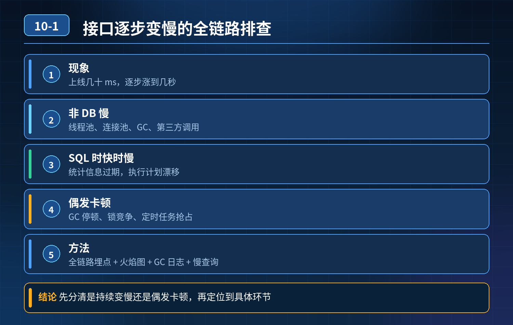

    接口逐步变慢、偶发卡顿

## 第 10-1 题　接口逐步变慢、偶发卡顿

**候选人浅层回答：** 背诵表面结论，没有深入到原理和线上场景。

## 核心拆解一句话结论

本题考察对底层原理和线上实战能力的综合理解，不能只停留在背结论。

## 题干梳理

面试官：同样接口刚上线几十 ms，慢慢涨到几秒；索引、机器配置都拉满还是慢。 追加灵魂拷问：

1. 接口根本没查库，为什么依旧很慢？
2. 同一条 SQL 白天快、晚上慢是什么原因？
3. 不是持续慢、只是偶尔卡顿，怎么定位？
4. 线程池、连接池、GC、第三方调用分别带来什么影响？

核心认知：接口慢不只有数据库一个源头；要按请求链路分层排查，区分 CPU 密集、IO 等待、资源池耗尽、锁竞争、外部依赖这几大类。很多时候接口慢不是在算，而是在等。

三层高分链路拆解第一层：应用内部（不查库也会慢的根源）

1. GC 问题：老年代持续涨、频繁 Full GC、GC 停顿；堆内存泄漏（集合没清理、线程常驻持有对象），越跑越卡。看 GC 日志、GC 面板、堆 dump。
2. 线程池 / 连接池耗尽：HTTP 线程池、数据库连接池、Redis 连接池打满；请求排队等待资源，队列堆积，RT 持续上涨。常见于没有设置合理超时、慢请求占住连接不释放。
3. 锁竞争、串行等待：synchronized、ReentrantLock 锁粒度太大；全局锁把并发打成串行；或者死锁、长时间持有锁。抓线程栈（jstack、Arthas thread）看阻塞线程。
4. CPU 密集逻辑：循环、大对象序列化、复杂计算、大 JSON 序列化反序列化，CPU 跑满。

- 对策：监控 GC 指标、池队列长度；缩小锁粒度；拆分重计算逻辑、异步化；限制序列化对象大小。

第二层：外部依赖调用（最容易被忽略）RPC、HTTP、Redis、MQ、第三方支付 / 风控接口串行调用：

5\. 下游服务负载高、响应抖动，同步串行等待，一个慢依赖拖垮整个接口；

6\. 没有超时、熔断，慢请求占住本端线程 / 连接；

7\. 同 SQL 白天快晚上慢：晚上备份任务、统计报表、定时任务、大量慢事务抢占数据库 IO、锁资源，不是 SQL 本身有问题。

- 对策：所有远程调用配置超时、熔断、降级；串行改并行编排或者异步 MQ 解耦；隔离慢依赖资源；错开数据库统计、备份任务窗口。

第三层：数据库与存储层（大家最先想到，但不是全部）就算索引建好，依然会慢：

8\. 锁等待、事务长事务：行锁、表锁、gap lock；事务开太久，锁住资源；

9\. 数据量持续膨胀：表越来越大，索引扫描页变多，Buffer Pool 命中率下降；冷热数据混在一起；

10\. 统计信息不准、执行计划漂移；

11\. 磁盘 IO 打满，不是 CPU 瓶颈。

- 对策：抓慢日志、show engine innodb status 看锁等待；控制事务时长；冷热分离、分库分表、归档历史数据；定期 analyze 更新统计信息。

补充：偶发卡顿怎么定位？

持续慢很好查；偶发毛刺卡顿优先抓快照：Arthas（trace、watch、thread）、线程栈、GC 日志、链路追踪 SkyWalking/Pinpoint，看慢请求在链路哪一段耗时突增，区分是偶发 GC 停顿、网络抖动、下游瞬时峰值、数据库锁争用。

- 30

秒口述精简版（面试直接背诵）接口变慢要按全链路分层排查，不能只盯着数据库。第一层看应用本身：GC 停顿、内存泄漏、线程池连接池排队、锁竞争，这类场景就算不查库接口也会卡；第二层看外部依赖，串行远程调用没有熔断超时，下游抖动就会传导，SQL 白天快晚上慢大多是夜间定时任务抢占数据库 IO 和锁；第三层才是数据库，除索引外重点排查长事务、锁等待、数据膨胀导致缓存命中率下滑。偶发卡顿靠链路追踪、线程栈、GC 快照定位，核心思路是先区分 CPU 忙还是在等待资源。

## 高频追问

Q：线程池满了是什么现象？ A：新请求进入队列排队，RT 逐步拉长；队列满触发拒绝策略直接报错。 Q：长事务危害？ A：持有 MVCC 快照，undo 日志膨胀；行锁长时间不释放，阻塞其他写入，锁等待堆积。 Q：Arthas 一般用什么命令排查？ A：trace 看方法耗时，thread 找阻塞线程，gc 看 GC 情况，heapdump 排查内存泄漏。

## 连环追问要点整理

1. 底层核心原理是什么？为什么这么设计？
2. 线上出现相关故障如何快速止损、定位根因？
3. 高并发场景下有哪些坑点，性能、一致性、可用性如何权衡？

## 面试回答完整话术

  - **一句话结论**：本题考察对底层原理和线上实战能力的综合理解，不能只停留在背结论。
  - **题干梳理**：面试官：同样接口刚上线几十 ms，慢慢涨到几秒；索引、机器配置都拉满还是慢。 追加灵魂拷问：
  - **高频追问**：Q：线程池满了是什么现象？ A：新请求进入队列排队，RT 逐步拉长；队列满触发拒绝策略直接报错。 Q：长事务危害？ A：持有 MVCC 快照，undo 日志膨胀；行锁长时间不释放，阻塞其他写入，锁等待
  - **收尾**：线上问题按「先止损保可用性 → 再定位根因 → 最后从架构规范层面根治」三段论闭环。

## 追问：本题考察核心是什么？

###  高级工程师要分清：

1. **不能只停留在背结论**：要能回答「为什么这样设计、不这样会怎样、线上踩坑怎么排查」；
2. **具备止损→定位→根治三段论**：先止血保业务，再定位根因，最后从架构与规范层面根治；
3. **给出工程取舍**：性能、一致性、可用性三者权衡，说清代价与适用场景。

  核心思想：这道题考察原理理解 + 线上实战 + 架构思维，真正的工程答案是「现象 → 根因 → 止损 → 定位 → 根治」五段式闭环。

