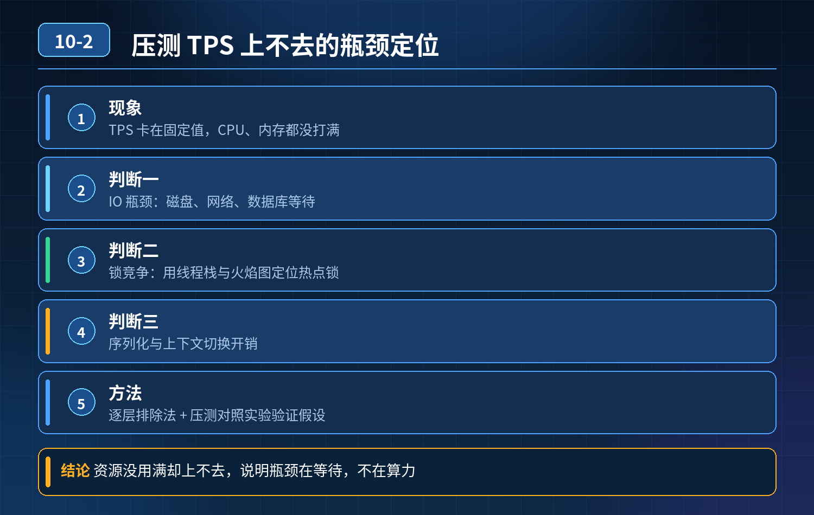

    压测 TPS 上不去、CPU/内存没跑满

## 第 10-2 题　压测 TPS 上不去、CPU/内存没跑满

**候选人浅层回答：** 背诵表面结论，没有深入到原理和线上场景。

## 核心拆解一句话结论

本题考察对底层原理和线上实战能力的综合理解，不能只停留在背结论。

## 场景复盘

核心交易接口压测，TPS 卡在 1000 无法继续上涨，服务器 CPU、内存都没打满。 候选人笼统猜连接池、缓存，无法证明到底是 IO、锁竞争、序列化、还是别的瓶颈。

## 面试官追问：

1. 怎么区分是 IO 瓶颈还是 CPU 瓶颈？
2. 如果是锁竞争，如何定位热点锁？
3. 如果是序列化开销，怎么验证、怎么优化？

核心认知：CPU / 内存空闲但 TPS 上不去，典型是阻塞型瓶颈，线程大量时间不是在计算，而是在等待；等待的对象分为：锁、IO（DB/Redis/ 网络）、池资源排队、序列化 / 反序列化串行、上下文切换。思路是先看线程状态，而不是先猜组件。

## 三层高分体系

第一层：定性分层，先判断线程在干什么（定位阶段）拿到压测现场，优先抓线程快照（jstack / Arthas thread -n），看线程的状态分布：

1\. 大量线程处于 WAITING / BLOCKED → 锁竞争瓶颈

1\. 定位：Arthas thread -b 抓阻塞栈，找到锁对象和持有锁的代码；看是synchronized、ReentrantLock，还是分布式锁。

2\. 特征：CPU 低，并发上不去，线程互相排队串行。

2\. 大量线程处于 TIMED_WAITING（等待 IO、远程调用） → IO 类瓶颈

1\. 磁盘 IO：iostat 看await、% util；数据库侧看慢日志、连接池排队、行锁等待。

2\. 网络 IO：Redis、RPC、MQ 调用耗时高；看链路追踪里各段耗时，看 TCP 重传、RTT。

3\. 线程是 RUNNABLE，但 CPU 利用率低：大概率是串行序列化、大对象编解码、复杂计算被串行化；或者线程池核心数设置过小，并发上不去。

1\. 验证：Arthas trace 抓方法耗时，重点看 JSON 序列化、大对象拷贝。

简单区分口诀：

- IO 瓶颈：线程在等外部资源，线程栈卡在 JDBC、Redis、Netty 调用；
- 锁瓶颈：线程卡在 lock 等待；
- 序列化 / 计算瓶颈：RUNNABLE 状态，但单段方法耗时长，多线程跑不起来。

第二层：针对性验证 + 优化（根治阶段）

2\. 锁竞争场景

- 优化：缩小锁粒度、读写锁分离、分段锁；把锁移出热点路径；避免锁内做远程调用、DB 查询；改用 CAS 无锁结构；本地缓存减少锁争抢。

3\. IO 阻塞场景（DB/Redis/RPC）

- 验证：SkyWalking/Pinpoint 看每个外部调用占比；看连接池队列长度、获取连接等待耗时。
- 优化：缓存前置、批量操作、异步化、并行编排；拆分热点 SQL；读写分离；合理设置超时避免线程长时间挂住。

4\. 序列化瓶颈

- 验证：trace 看到writeValue/readValue 占很高耗时，CPU 不高但是串行。
- 优化：Protobuf、Kryo、Hessian 替代 JSON；减少大对象传输；复用对象、减少反射；开启序列化池。

5\. 线程池配置陷阱（非常高频） 业务线程池核心线程数过小，队列短、拒绝策略激进，压测直接被压住；不是机器 CPU 不够，是并发通路给的太少。

第三层：压测侧的隔离验证手段（用来排除、确认瓶颈，面试加分）隔离法是证明瓶颈最有力的方式：

1. 短路外部依赖：把 DB、Redis 调用 mock 返回，TPS 如果立刻飙升，证明瓶颈在外部 IO；
2. 去掉锁：临时注释热点锁，TPS 上涨，证明锁是瓶颈；
3. 替换序列化器：换 Protobuf 对比基准，耗时明显下降，确认序列化瓶颈；
4. 单链路隔离压测：单独压接口的某一段，缩小范围。

重点：不能只靠监控指标猜，隔离对照实验是工程师证明瓶颈的标准做法。

- 30

## 秒口述精简版

CPU 内存没打满但 TPS 上不去，说明是等待阻塞瓶颈。第一步抓线程栈看状态区分大类：大量 BLOCKED 是锁竞争，TIMED_WAITING 是 IO 等待，RUNNABLE 但串行耗时高是序列化或者单线程池通路不足。第二步用链路追踪、Arthas trace 定位具体代码；还可以用 mock 外部依赖、替换序列化器这种隔离压测来验证猜想。锁问题就缩小锁粒度、避免锁内 IO；IO 瓶颈走缓存、批量、异步；序列化换成 Protobuf/Kryo，同时核对业务线程池容量，避免并发通路被限制住。

## 高频追问

Q：线程池核心数怎么配？ A：IO 密集型核心数可以大于 CPU 核数；CPU 密集型贴近核数；还要结合链路等待时长，不是越大越好，防止上下文切换暴涨。

Q：分布式锁导致 TPS 上不去怎么处理？ A：优先本地缓存 + 异步削峰，尽量减少热点争抢同一把分布式锁；拆分资源 key，打散锁粒度。 Q：JSON 序列化为什么会卡住 TPS，CPU 却不高？ A：很多老框架序列化是单线程串行、反射很重，热点路径串行，并发上不去，CPU 无法被打满。

## 连环追问要点整理

1. 底层核心原理是什么？为什么这么设计？
2. 线上出现相关故障如何快速止损、定位根因？
3. 高并发场景下有哪些坑点，性能、一致性、可用性如何权衡？

## 面试回答完整话术

  - **一句话结论**：本题考察对底层原理和线上实战能力的综合理解，不能只停留在背结论。
  - **面试官追问：**：怎么区分是 IO 瓶颈还是 CPU 瓶颈？
  - **三层高分体系**：第一层：定性分层，先判断线程在干什么（定位阶段）拿到压测现场，优先抓线程快照（jstack / Arthas thread -n），看线程的状态分布：
  - **秒口述精简版**：CPU 内存没打满但 TPS 上不去，说明是等待阻塞瓶颈。第一步抓线程栈看状态区分大类：大量 BLOCKED 是锁竞争，TIMED_WAITING 是 IO 等待，RUNNABLE 但串行耗时高是序列
  - **高频追问**：Q：线程池核心数怎么配？ A：IO 密集型核心数可以大于 CPU 核数；CPU 密集型贴近核数；还要结合链路等待时长，不是越大越好，防止上下文切换暴涨。
  - **收尾**：线上问题按「先止损保可用性 → 再定位根因 → 最后从架构规范层面根治」三段论闭环。

## 追问：本题考察核心是什么？

###  高级工程师要分清：

1. **不能只停留在背结论**：要能回答「为什么这样设计、不这样会怎样、线上踩坑怎么排查」；
2. **具备止损→定位→根治三段论**：先止血保业务，再定位根因，最后从架构与规范层面根治；
3. **给出工程取舍**：性能、一致性、可用性三者权衡，说清代价与适用场景。

  核心思想：这道题考察原理理解 + 线上实战 + 架构思维，真正的工程答案是「现象 → 根因 → 止损 → 定位 → 根治」五段式闭环。

