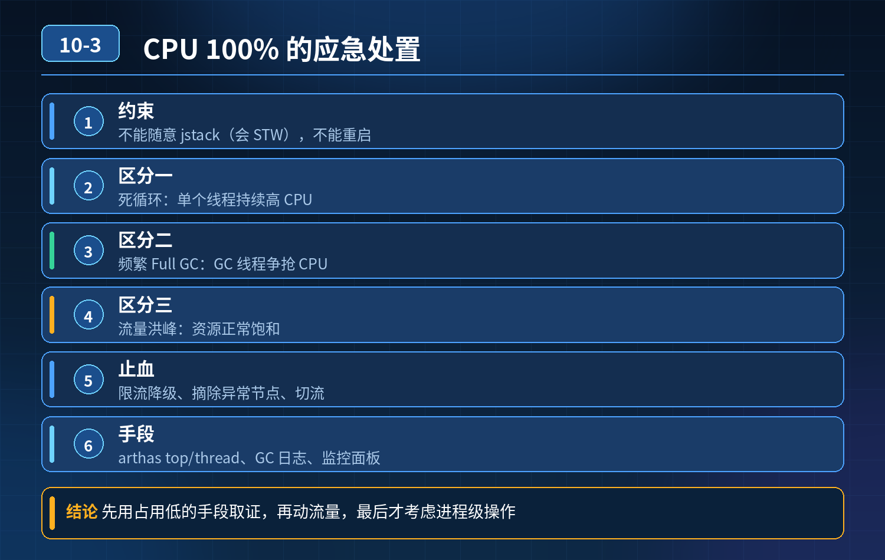

    高峰期服务 CPU 100%，接口全线超时，不能随意 jstack、不能重启，如何排查+快速止损

## 第 10-3 题　高峰期服务 CPU 100%，接口全线超时，不能随意 jstack、不能重启，如何排查+快速止损

**举例说明：**一台服务 CPU 打满，用 arthas 的 thread 命令看到某线程持续占用 90% CPU，定位到一段死循环重试代码；而另一台同样 CPU 高，jstat 显示是频繁 Full GC 导致——现象一样，根因完全不同，处置手段也不同。

**候选人浅层回答：** 看进程，打 jstack 线程栈，找到耗时代码修改，不行就扩容重启。

## 核心拆解一句话结论

<strong>核心思想：</strong>线上故障处理分为两个阶段：先快速降低负载止损，再低风险采集证据定位根因；

## 连环追问

1. 线上压力很大时，直接 jstack 本身会 STW、加重负载，不能随便打栈，不重启怎么快速止损？
2. 怎么快速区分：是死循环、频繁 Full GC、还是正常流量洪峰把 CPU 打满？
3. 流量洪峰导致 CPU 饱和，怎么设计分级降级策略？
4. 还原一次 CPU 打满引发全链路雪崩的故障时序。

## 参考答案

三类 CPU 打满特征区分（先分类，再行动）
1. 死循环（CPU 跑满，GC 频率正常） 现象：CPU 持续 100%，GC 次数、耗时正常，老年代内存稳定。线程持续在 RUNNABLE 状态，一直在执行计算逻辑，不阻塞、不等待。 常见原因：while (true) 无退出条件、集合遍历死循环、递归无终止、正则回溯灾难性回溯。
2. 频繁 Full GC 导致 CPU 打满 现象：GC 指标疯狂告警，Full GC 频繁、每次Full GC 耗时很长；CPU 消耗大量在 GC 线程；内存忽高忽低，老年代快速占满，回收后很快又涨上去；业务线程停顿，接口大面积超时。 常见：内存泄漏、大对象疯狂创建、集合没有清理、缓存不淘汰。
3. 流量洪峰，正常业务计算把 CPU 吃满 现象：GC 平稳，没有频繁 FullGC；线程池队列持续上涨，CPU 随 QPS 同步抬升；没有异常死循环线程，每一条请求都是正常业务逻辑，只是请求总量超过机器承载上限。
重点：高负载下直接执行 jstack 会触发安全点 STW，瞬间加剧服务停顿，流量大的时候属于高危操作。优先靠监控大盘做初判，而不是上来就抓栈。
4\. 第一步：不重启、不抓栈的应急止损（优先级最高，先保业务）止损思路：降负载，而不是先定位 bug
1\. 入口限流 / 网关熔断：网关侧对该接口调低配额，直接挡住外部流量，快速降低进入服务的请求量；优先拦截匿名、低优先级、爬虫流量，保留会员、付费用户流量。
2\. 弱依赖降级：自动下线非核心逻辑：埋点统计、推荐、积分、短信、日志上报等弱依赖，直接返回 mock 结果，砍掉这部分 CPU 开销。
3\. 摘流隔离：负载均衡侧摘除部分实例，把流量切走；或者灰度切流量到备用集群。
4\. 临时关闭非必要定时任务、异步任务：定时任务、消费线程暂停，释放 CPU。
止损完成、压力降下来之后，服务恢复稳定，此时再去抓线程栈、dump 堆，风险低很多。
第二步：低成本指标初判，区分故障类型
- 看 GC 监控：Full GC 次数、GC 耗时、老年代使用率
- Full GC 飙升 → GC 问题；
- GC 平稳，CPU 高、QPS 上涨 → 流量洪峰；
- GC 平稳、QPS 没有暴涨，但 CPU 持续跑满 → 死循环 / 密集计算 bug。
- 线程指标：RUNNABLE 线程数量异常持续走高，且集中在同一个方法栈，大概率死循环。
第三步：分级降级体系（长效方案，三层防御）第一层：网关层全局流量管控基于单机压测容量设置单机配额，不是固定全局阈值；大促自动动态限流，区分用户优先级，恶意 IP 直接封禁。
第二层：应用内强弱依赖熔断降级区分强依赖（下单、扣库存）、弱依赖（通知、画像、埋点）；CPU、线程池、延迟达到阈值，自动触发弱依赖降级，不执行对应逻辑，快速返回，节约 CPU。 配置 Sentinel/Resilience4j 的基于 CPU 使用率的自适应限流，而不是固定 QPS。
第三层：兜底保护与观测体系
5\. 告警前置：CPU 使用率、GC 耗时、RUNNABLE 线程数、方法耗时、线程死循环检测，阈值提前告警，不等 100%；
6\. 线上预采集：平时开启轻量的火焰图采样、持续 profiler（async-profiler），不是故障时才临时抓；async-profiler 相比 jstack 对业务影响小很多，适合生产采样；
7\. 预案演练：压测演练 CPU 过载场景，演练降级、摘流流程，避免故障时手忙脚乱；
8\. 雪崩阻断：上游调用本服务超时后快速失败、熔断，防止上游不断重试，持续放大流量。
典型 CPU 打满雪崩时间线示例
1. 某接口存在正则灾难性回溯 bug；少量特殊入参触发死循环，单线程占满一个核；
2. 持续进来同类请求，多个线程进入死循环，多核逐步被打满；
3. CPU 满载，正常业务请求处理变慢，响应延迟飙升；
4. 上游 RPC 客户端超时，触发重试机制，重试流量进一步压入本服务；
5. 下游 DB、缓存连接被慢请求占住，资源耗尽；
6. 多个依赖服务超时，连锁熔断、重试风暴，整条链路雪崩；
7. 处理手段错误：直接扩容，扩容后的新实例收到流量，同样触发死循环，越扩越崩。
避坑：死循环类故障扩容是无效的，根源是代码逻辑 bug，扩容只会多几个被打满的节点；流量洪峰场景扩容才有效。
<strong>追问：</strong>本题考察核心是什么？
<strong>参考答案：</strong>初级工程师思维是 “找到代码 bug，改代码”，把排查等同于抓栈定位代码。高级工程师具备稳定性思维：
1. 故障第一原则是止损优先，定位排障排在业务恢复之后；知道 jstack 在高 CPU场景下有 STW 副作用，不能无脑使用；
2. 能通过监控指标快速区分三类 CPU 打满，知道哪些场景扩容有效、哪些扩容完全没用；
3. 理解自适应限流、强弱依赖降级不是锦上添花，是 CPU 过载时的保命机制；
4. 懂得故障时序推演，预判重试风暴、连锁雪崩，而不是只盯着当前这一个服务。

## 连环追问要点整理

1. 底层核心原理是什么？为什么这么设计？
2. 线上出现相关故障如何快速止损、定位根因？
3. 高并发场景下有哪些坑点，性能、一致性、可用性如何权衡？

## 面试回答完整话术

  - **场景举例**：一台服务 CPU 打满，用 arthas 的 thread 命令看到某线程持续占用 90% CPU，定位到一段死循环重试代码；而另一台同样 CPU 高，jstat 显示是频繁 Fu
  - **一句话结论**：<strong>核心思想：</strong>线上故障处理分为两个阶段：先快速降低负载止损，再低风险采集证据定位根因；
  - **连环追问**：线上压力很大时，直接 jstack 本身会 STW、加重负载，不能随便打栈，不重启怎么快速止损？
  - **参考答案**：三类 CPU 打满特征区分（先分类，再行动）
  - **收尾**：线上问题按「先止损保可用性 → 再定位根因 → 最后从架构规范层面根治」三段论闭环。

## 追问：本题考察核心是什么？

###  高级工程师要分清：

1. **不能只停留在背结论**：要能回答「为什么这样设计、不这样会怎样、线上踩坑怎么排查」；
2. **具备止损→定位→根治三段论**：先止血保业务，再定位根因，最后从架构与规范层面根治；
3. **给出工程取舍**：性能、一致性、可用性三者权衡，说清代价与适用场景。

  核心思想：这道题考察原理理解 + 线上实战 + 架构思维，真正的工程答案是「现象 → 根因 → 止损 → 定位 → 根治」五段式闭环。

