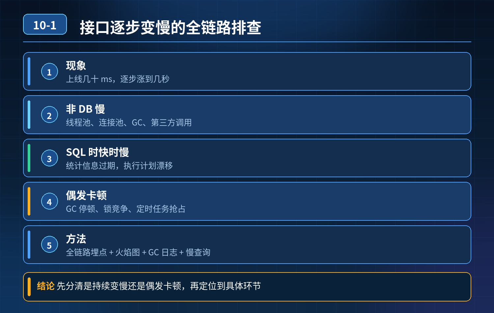
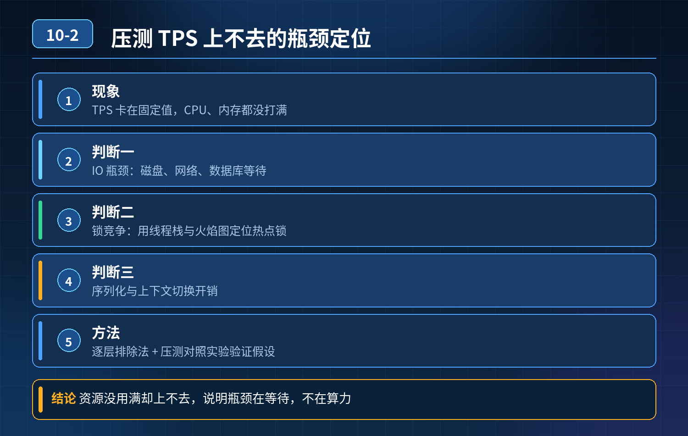
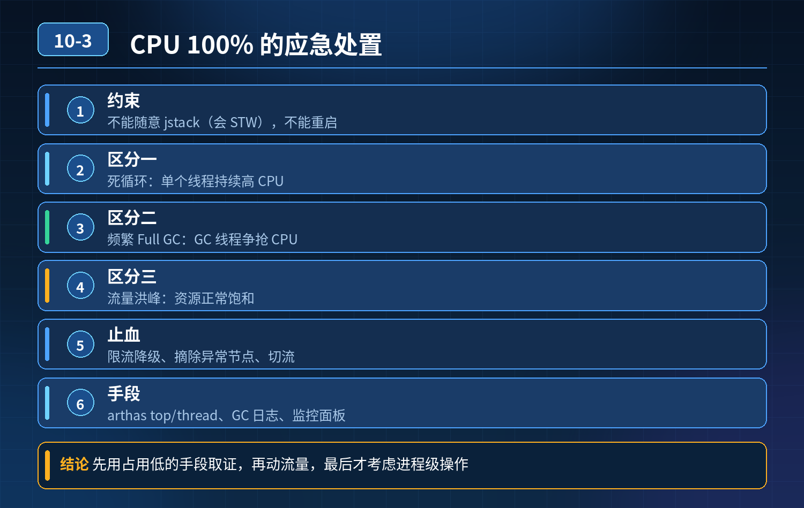

    10. 线上故障排查 & 复盘

## 第 1 题　接口逐步变慢、偶发卡顿

### 题干梳理:

面试官：同样接口刚上线几十 ms，慢慢涨到几秒；索引、机器配置都拉满还是慢。

### 追加灵魂拷问:

1. 接口根本没查库，为什么依旧很慢？
2. 同一条 SQL 白天快、晚上慢是什么原因？
3. 不是持续慢、只是偶尔卡顿，怎么定位？
4. 线程池、连接池、GC、第三方调用分别带来什么影响？

### 核心认知：
接口慢不只有数据库一个源头；要按请求链路分层排查，区分 CPU 密集、IO 等待、
资源池耗尽、锁竞争、外部依赖这几大类。很多时候接口慢不是在算，而是在等。

**三层高分链路拆解:**

**第一层：应用内部（不查库也会慢的根源）**

1. GC 问题：老年代持续涨、频繁 Full GC、GC 停顿；堆内存泄漏（集合没清理、线程常驻持有对象），越跑越卡。看 GC 日志、GC 面板、堆 dump。
2. 线程池 / 连接池耗尽：HTTP 线程池、数据库连接池、Redis 连接池打满；请求排队等待资源，队列堆积，RT 持续上涨。常见于没有设置合理超时、慢请求占住连接不释放。
3. 锁竞争、串行等待：synchronized、ReentrantLock 锁粒度太大；全局锁把并发打成串行；
   或者死锁、长时间持有锁。抓线程栈（jstack、Arthas thread）看阻塞线程。
4. CPU 密集逻辑：循环、大对象序列化、复杂计算、大 JSON 序列化反序列化，CPU 跑满。

- 对策：监控 GC 指标、池队列长度；缩小锁粒度；拆分重计算逻辑、异步化；限制序列化对象大小。

**第二层：外部依赖调用（最容易被忽略）RPC、HTTP、Redis、MQ、第三方支付 / 风控接口串行调用：**

5. 下游服务负载高、响应抖动，同步串行等待，一个慢依赖拖垮整个接口；

6. 没有超时、熔断，慢请求占住本端线程 / 连接；

7. 同 SQL 白天快晚上慢：晚上备份任务、统计报表、定时任务、大量慢事务抢占数据库 IO、锁资源，不是 SQL 本身有问题。

- 对策：所有远程调用配置超时、熔断、降级；串行改并行编排或者异步 MQ 解耦；隔离慢依赖资源；错开数据库统计、备份任务窗口。

**第三层：数据库与存储层（大家最先想到，但不是全部）就算索引建好，依然会慢：**

8. 锁等待、事务长事务：行锁、表锁、gap lock；事务开太久，锁住资源；

9. 数据量持续膨胀：表越来越大，索引扫描页变多，Buffer Pool 命中率下降；冷热数据混在一起；

10. 统计信息不准、执行计划漂移；

11. 磁盘 IO 打满，不是 CPU 瓶颈。

- 对策：抓慢日志、show engine innodb status 看锁等待；控制事务时长；冷热分离、分库分表、归档历史数据；定期 analyze 更新统计信息。

### 补充：偶发卡顿怎么定位？

持续慢很好查；偶发毛刺卡顿优先抓快照：Arthas（trace、watch、thread）、线程栈、GC 日志、链路追踪 SkyWalking/Pinpoint，看慢请求在链路哪一段耗时突增，区分是偶发 GC 停顿、网络抖动、下游瞬时峰值、数据库锁争用。

### **30秒口述精简版（面试直接背诵）**
  接口变慢要按全链路分层排查，不能只盯着数据库。
  第一层看应用本身：GC 停顿、内存泄漏、线程池连接池排队、锁竞争，这类场景就算不查库接口也会卡；
  第二层看外部依赖，串行远程调用没有熔断超时，下游抖动就会传导，SQL 白天快晚上慢大多是夜间定时任务抢占数据库 IO 和锁；
  第三层才是数据库，除索引外重点排查长事务、锁等待、数据膨胀导致缓存命中率下滑。偶发卡顿靠链路追踪、线程栈、GC 快照定位，
  核心思路是先区分 CPU 忙还是在等待资源。

### 高频追问

Q：线程池满了是什么现象？ 
A：新请求进入队列排队，RT 逐步拉长；队列满触发拒绝策略直接报错。 
Q：长事务危害？ A：持有 MVCC 快照，undo 日志膨胀；行锁长时间不释放，阻塞其他写入，锁等待堆积。 
Q：Arthas 一般用什么命令排查？ A：trace 看方法耗时，thread 找阻塞线程，gc 看 GC 情况，heapdump 排查内存泄漏。

<!--  -->

## 第 2 题　压测 TPS 上不去、CPU/内存没跑满

### 场景复盘

核心交易接口压测，TPS 卡在 1000 无法继续上涨，服务器 CPU、内存都没打满。

### 候选人笼统猜:
连接池、缓存，无法证明到底是 IO、锁竞争、序列化、还是别的瓶颈。

### 面试官追问：

1. 怎么区分是 IO 瓶颈还是 CPU 瓶颈？
2. 如果是锁竞争，如何定位热点锁？
3. 如果是序列化开销，怎么验证、怎么优化？

### 核心认知：
 CPU / 内存空闲但 TPS 上不去，典型是阻塞型瓶颈，线程大量时间不是在计算，而是在等待；等待的对象分为：锁、IO（DB/Redis/ 网络）、池资源排队、序列化 / 反序列化串行、上下文切换。思路是先看线程状态，而不是先猜组件。

**三层高分体系**

**第一层：定性分层，先判断线程在干什么（定位阶段）拿到压测现场，优先抓线程快照（jstack/Arthas thread -n），看线程的状态分布：**

1. 大量线程处于 WAITING / BLOCKED → 锁竞争瓶颈

2. 定位：Arthas thread -b 抓阻塞栈，找到锁对象和持有锁的代码；看是synchronized、ReentrantLock，还是分布式锁。

3. 特征：CPU 低，并发上不去，线程互相排队串行。

4. 大量线程处于 TIMED_WAITING（等待 IO、远程调用） → IO 类瓶颈

5. 磁盘 IO：iostat 看await、% util；数据库侧看慢日志、连接池排队、行锁等待。

6. 网络 IO：Redis、RPC、MQ 调用耗时高；看链路追踪里各段耗时，看 TCP 重传、RTT。

7. 线程是 RUNNABLE，但 CPU 利用率低：大概率是串行序列化、大对象编解码、复杂计算被串行化；或者线程池核心数设置过小，并发上不去。

8. 验证：Arthas trace 抓方法耗时，重点看 JSON 序列化、大对象拷贝。

### 简单区分口诀：

- IO 瓶颈：线程在等外部资源，线程栈卡在 JDBC、Redis、Netty 调用；
- 锁瓶颈：线程卡在 lock 等待；
- 序列化 / 计算瓶颈：RUNNABLE 状态，但单段方法耗时长，多线程跑不起来。

**第二层：针对性验证 + 优化（根治阶段）**

2. 锁竞争场景

- 优化：缩小锁粒度、读写锁分离、分段锁；把锁移出热点路径；避免锁内做远程调用、DB 查询；改用 CAS 无锁结构；本地缓存减少锁争抢。

3. IO 阻塞场景（DB/Redis/RPC）

- 验证：SkyWalking/Pinpoint 看每个外部调用占比；看连接池队列长度、获取连接等待耗时。
- 优化：缓存前置、批量操作、异步化、并行编排；拆分热点 SQL；读写分离；合理设置超时避免线程长时间挂住。

4. 序列化瓶颈

- 验证：trace 看到writeValue/readValue 占很高耗时，CPU 不高但是串行。
- 优化：Protobuf、Kryo、Hessian 替代 JSON；减少大对象传输；复用对象、减少反射；开启序列化池。

5. 线程池配置陷阱（非常高频） 业务线程池核心线程数过小，队列短、拒绝策略激进，压测直接被压住；不是机器 CPU 不够，是并发通路给的太少。

**第三层：压测侧的隔离验证手段（用来排除、确认瓶颈，面试加分）隔离法是证明瓶颈最有力的方式：**

1. 短路外部依赖：把 DB、Redis 调用 mock 返回，TPS 如果立刻飙升，证明瓶颈在外部 IO；
2. 去掉锁：临时注释热点锁，TPS 上涨，证明锁是瓶颈；
3. 替换序列化器：换 Protobuf 对比基准，耗时明显下降，确认序列化瓶颈；
4. 单链路隔离压测：单独压接口的某一段，缩小范围。

**重点：不能只靠监控指标猜，隔离对照实验是工程师证明瓶颈的标准做法。**

**30秒口述精简版:**

CPU 内存没打满但 TPS 上不去，说明是等待阻塞瓶颈。
第一步:抓线程栈看状态区分大类：大量 BLOCKED 是锁竞争，TIMED_WAITING 是 IO 等待，RUNNABLE 但串行耗时高是序列化或者单线程池通路不足。
第二步:用链路追踪、Arthas trace 定位具体代码；还可以用 mock 外部依赖、替换序列化器这种隔离压测来验证猜想。锁问题就缩小锁粒度、避免锁内 IO；IO 瓶颈走缓存、批量、异步；序列化换成 Protobuf/Kryo，同时核对业务线程池容量，避免并发通路被限制住。

### 高频追问

### Q：线程池核心数怎么配？

A：IO 密集型核心数可以大于 CPU 核数；CPU 密集型贴近核数；还要结合链路等待时长，不是越大越好，防止上下文切换暴涨。

### Q：分布式锁导致 TPS 上不去怎么处理？ 

A：优先本地缓存 + 异步削峰，尽量减少热点争抢同一把分布式锁；拆分资源 key，打散锁粒度。 Q：JSON 序列化为什么会卡住 TPS，CPU 却不高？ A：很多老框架序列化是单线程串行、反射很重，热点路径串行，并发上不去，CPU 无法被打满。

<!--  -->

## 第 3 题　高峰期服务 CPU 100%，接口全线超时，不能随意 jstack、不能重启，如何排查+快速止损

**举例说明：**
一台服务 CPU 打满，用 arthas 的 thread 命令看到某线程持续占用 90% CPU，定位到一段死循环重试代码；
而另一台同样 CPU 高，jstat 显示是频繁 Full GC 导致——现象一样，根因完全不同，处置手段也不同。

### 问题 1：高峰期 CPU 打满，接口超时，你怎么排查处理？

**候选人浅层回答：** 看进程，打 jstack 线程栈，找到耗时代码修改，不行就扩容重启。

### 连环追问

1. 线上压力很大时，直接 jstack 本身会 STW、加重负载，不能随便打栈，不重启怎么快速止损？
2. 怎么快速区分：是死循环、频繁 Full GC、还是正常流量洪峰把 CPU 打满？
3. 流量洪峰导致 CPU 饱和，怎么设计分级降级策略？
4. 还原一次 CPU 打满引发全链路雪崩的故障时序。

### 参考答案

**三类 CPU 打满特征区分:（先分类，再行动）**

1. 死循环（CPU 跑满，GC 频率正常） 现象：CPU 持续 100%，GC 次数、耗时正常，老年代内存稳定。线程持续在 RUNNABLE 状态，一直在执行计算逻辑，不阻塞、不等待。 常见原因：while (true) 无退出条件、集合遍历死循环、递归无终止、正则回溯灾难性回溯。

2. 频繁 Full GC 导致 CPU 打满 现象：GC 指标疯狂告警，Full GC 频繁、每次Full GC 耗时很长；CPU 消耗大量在 GC 线程；内存忽高忽低，老年代快速占满，回收后很快又涨上去；业务线程停顿，接口大面积超时。 常见：内存泄漏、大对象疯狂创建、集合没有清理、缓存不淘汰。

3. 流量洪峰，正常业务计算把 CPU 吃满 现象：GC 平稳，没有频繁 FullGC；线程池队列持续上涨，CPU 随 QPS 同步抬升；没有异常死循环线程，每一条请求都是正常业务逻辑，只是请求总量超过机器承载上限。

**重点：**高负载下直接执行 jstack 会触发安全点 STW，瞬间加剧服务停顿，流量大的时候属于高危操作。优先靠监控大盘做初判，而不是上来就抓栈。

**第一步：不重启、不抓栈的应急止损（优先级最高，先保业务）止损思路：降负载，而不是先定位 bug**

1. 入口限流 / 网关熔断：网关侧对该接口调低配额，直接挡住外部流量，快速降低进入服务的请求量；优先拦截匿名、低优先级、爬虫流量，保留会员、付费用户流量。

2. 弱依赖降级：自动下线非核心逻辑：埋点统计、推荐、积分、短信、日志上报等弱依赖，直接返回 mock 结果，砍掉这部分 CPU 开销。

3. 摘流隔离：负载均衡侧摘除部分实例，把流量切走；或者灰度切流量到备用集群。

4. 临时关闭非必要定时任务、异步任务：定时任务、消费线程暂停，释放 CPU。

止损完成、压力降下来之后，服务恢复稳定，此时再去抓线程栈、dump 堆，风险低很多。

**第二步：低成本指标初判，区分故障类型**

- 看 GC 监控：Full GC 次数、GC 耗时、老年代使用率
- Full GC 飙升 → GC 问题；
- GC 平稳，CPU 高、QPS 上涨 → 流量洪峰；
- GC 平稳、QPS 没有暴涨，但 CPU 持续跑满 → 死循环 / 密集计算 bug。
- 线程指标：RUNNABLE 线程数量异常持续走高，且集中在同一个方法栈，大概率死循环。

**第三步：分级降级体系（长效方案，三层防御）**

**第一层：**
网关层全局流量管控基于单机压测容量设置单机配额，不是固定全局阈值；大促自动动态限流，区分用户优先级，恶意 IP 直接封禁。

**第二层：**
应用内强弱依赖熔断降级区分强依赖（下单、扣库存）、弱依赖（通知、画像、埋点）；CPU、线程池、延迟达到阈值，自动触发弱依赖降级，不执行对应逻辑，快速返回，节约 CPU。 配置 Sentinel/Resilience4j 的基于 CPU 使用率的自适应限流，而不是固定 QPS。

**第三层：兜底保护与观测体系**

1. 告警前置：CPU 使用率、GC 耗时、RUNNABLE 线程数、方法耗时、线程死循环检测，阈值提前告警，不等 100%；

2. 线上预采集：平时开启轻量的火焰图采样、持续 profiler（async-profiler），不是故障时才临时抓；async-profiler 相比 jstack 对业务影响小很多，适合生产采样；

3. 预案演练：压测演练 CPU 过载场景，演练降级、摘流流程，避免故障时手忙脚乱；

4. 雪崩阻断：上游调用本服务超时后快速失败、熔断，防止上游不断重试，持续放大流量。

### 典型 CPU 打满雪崩时间线示例

1. 某接口存在正则灾难性回溯 bug；少量特殊入参触发死循环，单线程占满一个核；
2. 持续进来同类请求，多个线程进入死循环，多核逐步被打满；
3. CPU 满载，正常业务请求处理变慢，响应延迟飙升；
4. 上游 RPC 客户端超时，触发重试机制，重试流量进一步压入本服务；
5. 下游 DB、缓存连接被慢请求占住，资源耗尽；
6. 多个依赖服务超时，连锁熔断、重试风暴，整条链路雪崩；
7. 处理手段错误：直接扩容，扩容后的新实例收到流量，同样触发死循环，越扩越崩。

避坑：死循环类故障扩容是无效的，根源是代码逻辑 bug，扩容只会多几个被打满的节点；流量洪峰场景扩容才有效。

### 追问：本题考察核心是什么？

**参考答案：**

初级工程师思维是 “找到代码 bug，改代码”，把排查等同于抓栈定位代码。

**高级工程师具备稳定性思维：**

1. 故障第一原则是止损优先，定位排障排在业务恢复之后；知道 jstack 在高 CPU场景下有 STW 副作用，不能无脑使用；
2. 能通过监控指标快速区分三类 CPU 打满，知道哪些场景扩容有效、哪些扩容完全没用；
3. 理解自适应限流、强弱依赖降级不是锦上添花，是 CPU 过载时的保命机制；
4. 懂得故障时序推演，预判重试风暴、连锁雪崩，而不是只盯着当前这一个服务。

**核心思想：**
线上故障处理分为两个阶段：先快速降低负载止损，再低风险采集证据定位根因；稳定性架构要提前设计基于 CPU、
延迟的自适应降级能力，而不是故障来了只能重启扩容。

<!--  -->

