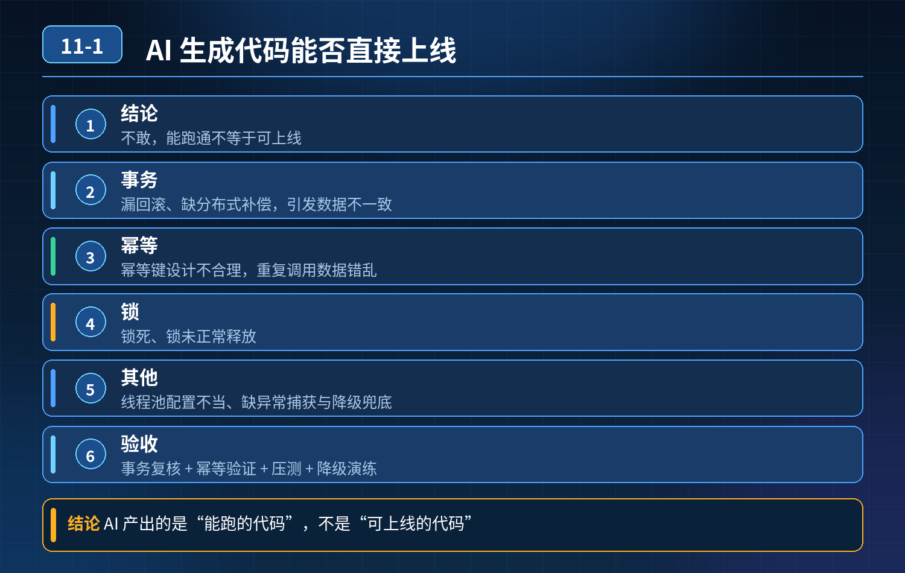

    现在开发经常用 AI 生成 SpringBoot 接口、分布式事务、幂等性相关代码，接口规范、参数齐全，事务注解也加上了

## 第 11-1 题　现在开发经常用 AI 生成 SpringBoot 接口、分布式事务、幂等性相关代码，接口规范、参数齐全，事务注解也加上了

**举例说明：**AI 生成的支付回调接口，@Transactional 加在了 private 方法上，异常又被 try-catch 吞掉后返回成功。接口能调通、日志也正常，但线上一旦量上来，就出现大量“回调成功却订单未更新”的脏数据。

**候选人浅层回答：** 背诵表面结论，没有深入到原理和线上场景。

## 核心拆解一句话结论

代码人工审核 重点核对业务逻辑，检查分层、工具类、异常处理、安全校验、分布式协调相关代码，保证代码不偏离业务需求，符合安全规范；

## 参考答案：

2. 遵循完整上线流程 固定流程：AI 生成初稿 → 人工审核修正 → 代码评审 →压测验证 → 上线，禁止 AI 产出的代码不做任何校验直接上线。

<strong>追问：</strong>在 AI 辅助开发的时代，你觉得一名高级后端工程师需要具备什么样的

3\. 核心能力？

<strong>参考答案：</strong> 不只是简单使用 AI 生成代码，核心能力是能够识别 AI 产出代码的缺陷，能够对 AI 生成的代码做校验、修正，把控业务逻辑、分布式场景、异常兜底、安全规范，保障生产环境系统稳定可靠。

## 连环追问要点整理

1. 底层核心原理是什么？为什么这么设计？
2. 线上出现相关故障如何快速止损、定位根因？
3. 高并发场景下有哪些坑点，性能、一致性、可用性如何权衡？

## 面试回答完整话术

  - **场景举例**：AI 生成的支付回调接口，@Transactional 加在了 private 方法上，异常又被 try-catch 吞掉后返回成功。接口能调通、日志也正常，但线上一旦量上来，就出
  - **一句话结论**：代码人工审核 重点核对业务逻辑，检查分层、工具类、异常处理、安全校验、分布式协调相关代码，保证代码不偏离业务需求，符合安全规范；
  - **参考答案：**：代码人工审核 重点核对业务逻辑，检查分层、工具类、异常处理、安全校验、分布式协调相关代码，保证代码不偏离业务需求，符合安全规范；重点覆盖事务、幂等、分布式锁过往踩过的坑，区分可以直接使用的代码和需要修
  - **收尾**：线上问题按「先止损保可用性 → 再定位根因 → 最后从架构规范层面根治」三段论闭环。

## 追问：本题考察核心是什么？

###  高级工程师要分清：

1. **不能只停留在背结论**：要能回答「为什么这样设计、不这样会怎样、线上踩坑怎么排查」；
2. **具备止损→定位→根治三段论**：先止血保业务，再定位根因，最后从架构与规范层面根治；
3. **给出工程取舍**：性能、一致性、可用性三者权衡，说清代价与适用场景。

  核心思想：这道题考察原理理解 + 线上实战 + 架构思维，真正的工程答案是「现象 → 根因 → 止损 → 定位 → 根治」五段式闭环。

