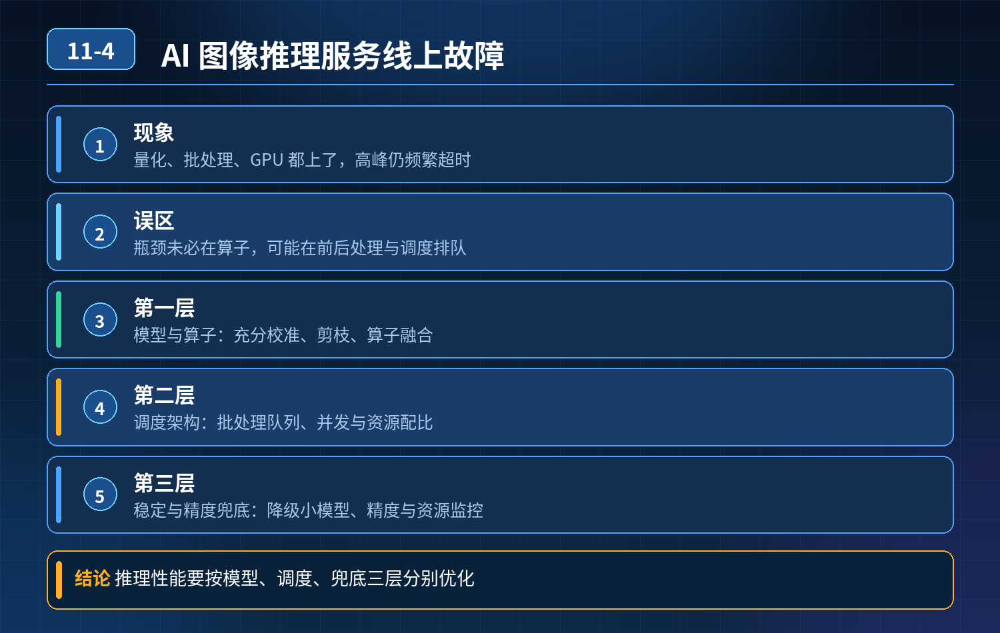

    AI 图像推理服务线上故障

## 第 11-4 题　AI 图像推理服务线上故障

**候选人浅层回答：** 背诵表面结论，没有深入到原理和线上场景。

## 核心拆解一句话结论

本题考察对底层原理和线上实战能力的综合理解，不能只停留在背结论。

## 场景复盘

电商瑕疵检测图像推理服务，已经做了 INT8 量化、开启 batch 批量推理、跑在 GPU 上。 线上现象：高峰期接口频繁超时、GPU 利用率抖动、部分结果误判漏判、请求失败；低峰单图推理耗时也偏高，达不到实时要求。

核心误区：量化、batch、GPU 只是基础手段；很多瓶颈不在算子本身，而在预处理 / 后处理、调度排队、量化校准缺陷、资源争抢、请求流量形态不匹配 batch 机制。GPU 利用率忽高忽低最典型原因就是batch 凑批机制的等待和流量毛刺。

三层高分体系（模型层｜调度架构层｜稳定 & 精度兜底层）第一层：模型 & 算子预处理优化（算力底座，解决基础耗时、量化误判）

1. 量化校准：只做 INT8 量化、不做充分校准是误判漏判的头号原因。直接简单量化会带来精度损失；需要用真实业务数据集做校准，选敏感层（输出层、卷积尾部）保留 FP16，混合精度量化，平衡速度和精度。
2. 模型结构优化：剪枝、蒸馏；去掉冗余分支、无用后处理算子；算子融合（Conv+BN+ReLU 合并），用 TensorRT/ONNX Runtime/TorchScript 做图优化，消除内存读写开销。
3. 预处理下沉：大部分人把 resize、归一、转通道、颜色空间转换放在 CPU 业务代码串行处理，单图开销大。把预处理放到 GPU 侧（GPU decode、GPU preprocess），或者预处理批量并行；统一输入尺寸，避免动态 shape。动态 shape 会破坏 TensorRT 优化，拖慢推理。
4. Batch 策略不是越大越好：固定 batch、动态 batch（batching queue）是两种路线。固定 batch 容易低峰空等；动态 batch 有凑批超时参数。凑批等待时间不能无限长 —— 等待太久就会接口超时，这就是低峰慢、利用率抖动的根源。

第二层：推理调度与部署架构层（解决排队、负载不均、利用率毛刺）

1. 推理队列管理：独立的请求队列 + 批汇聚线程；设置 max_batch、batch_timeout 两个阈值：攒够数量立刻送 GPU，超时直接用当前已有小批量推理，避免无限等待凑批导致超时。
2. GPU 资源隔离：单卡多进程 / 多推理实例容易 CUDA 上下文争抢；用 MPS、CUDA Stream、TensorRT 多流，或者按卡拆分服务实例；不要一个实例无限制堆积请求。
3. 缓存：重复图片、重复特征直接缓存推理结果，规避重复计算，适合商品图这种重复命中场景。
4. 负载均衡 & 扩缩容：GPU 集群负载均衡，按卡利用率调度；K8s+GPU 共享调度；限流熔断，防止突发流量把队列打爆。

一句话：GPU 利用率忽高忽低，大多是流量是突发离散的，凑批等待和空转交替出现。

第三层：容错、监控、兜底（防止超时、精度漂移、线上事故）

1. 超时隔离 + 重试策略：推理阶段单独设置超时，区分预处理超时、GPU 推理超时；重试不能无脑重推，防止越重试越压垮 GPU；超时降级（降级到轻量小模型或者返回兜底标记）。
2. 精度监控：不能只看性能，要在线抽样校验推理结果，监控召回、漏判率，量化漂移告警；量化版本上线必须灰度对比 FP32 基线。
3. 全链路指标：监控 GPU 利用率、显存占用、CUDA 报错、队列长度、凑批等待时长、预处理耗时、推理耗时、后处理耗时；区分慢是卡在 CPU 预处理、排队，还是 GPU 算子。
4. 限流、熔断、优雅拒绝：队列长度超限直接拒绝新请求，保护 GPU 不雪崩。

- 30

## 秒口述标准答案

这个故障不只是 batch 大小的问题，是只做了量化、GPU 加速，但忽略了全链路。分三层优化：第一层模型与预处理，量化要基于业务数据校准，必要混合精度避免误判；做算子融合、模型剪枝蒸馏，把图像预处理下沉 GPU，规避 CPU 串行瓶颈，同时合理设置动态 batch 的最大等待时间，避免低峰长时间凑批；第二层调度架构，用独立队列动态攒批，CUDA 多流隔离资源，集群负载均衡、热点结果缓存，平滑 GPU 利用率；第三层稳定性兜底，推理链路加超时熔断、限流，线上持续抽样监控推理精度，防止量化带来的漏判误判，同时监控队列、显存、CUDA 异常。量化和 GPU 只是基础，预处理开销、排队等待、量化精度漂移是高频踩坑点。

## 高频追问

Q：动态 batch 的 tradeoff 是什么？ A：batch 越大单图平均推理越快，但凑批等待时延上升；batch_timeout 是核心参数，是吞吐和延迟的权衡。 Q：为什么 INT8 量化之后出现漏判？ A：量化误差，激活值分布偏移，校准集和线上真实分布不一致；解决：KL 校准、部分层保留 FP16、量化感知训练 QAT。 Q：GPU 利用率上不去怎么办？ A：优先排查：预处理在 CPU、动态 shape、batch 太小、流没有并行、请求流量稀疏。

## 连环追问要点整理

1. 底层核心原理是什么？为什么这么设计？
2. 线上出现相关故障如何快速止损、定位根因？
3. 高并发场景下有哪些坑点，性能、一致性、可用性如何权衡？

## 面试回答完整话术

  - **一句话结论**：本题考察对底层原理和线上实战能力的综合理解，不能只停留在背结论。
  - **场景复盘**：电商瑕疵检测图像推理服务，已经做了 INT8 量化、开启 batch 批量推理、跑在 GPU 上。 线上现象：高峰期接口频繁超时、GPU 利用率抖动、部分结果误判漏判、请求失败；低峰单图推理耗时也偏高
  - **秒口述标准答案**：这个故障不只是 batch 大小的问题，是只做了量化、GPU 加速，但忽略了全链路。分三层优化：第一层模型与预处理，量化要基于业务数据校准，必要混合精度避免误判；做算子融合、模型剪枝蒸馏，把图像预处理
  - **高频追问**：Q：动态 batch 的 tradeoff 是什么？ A：batch 越大单图平均推理越快，但凑批等待时延上升；batch_timeout 是核心参数，是吞吐和延迟的权衡。 Q：为什么 INT8 量化
  - **收尾**：线上问题按「先止损保可用性 → 再定位根因 → 最后从架构规范层面根治」三段论闭环。

## 追问：本题考察核心是什么？

###  高级工程师要分清：

1. **不能只停留在背结论**：要能回答「为什么这样设计、不这样会怎样、线上踩坑怎么排查」；
2. **具备止损→定位→根治三段论**：先止血保业务，再定位根因，最后从架构与规范层面根治；
3. **给出工程取舍**：性能、一致性、可用性三者权衡，说清代价与适用场景。

  核心思想：这道题考察原理理解 + 线上实战 + 架构思维，真正的工程答案是「现象 → 根因 → 止损 → 定位 → 根治」五段式闭环。

