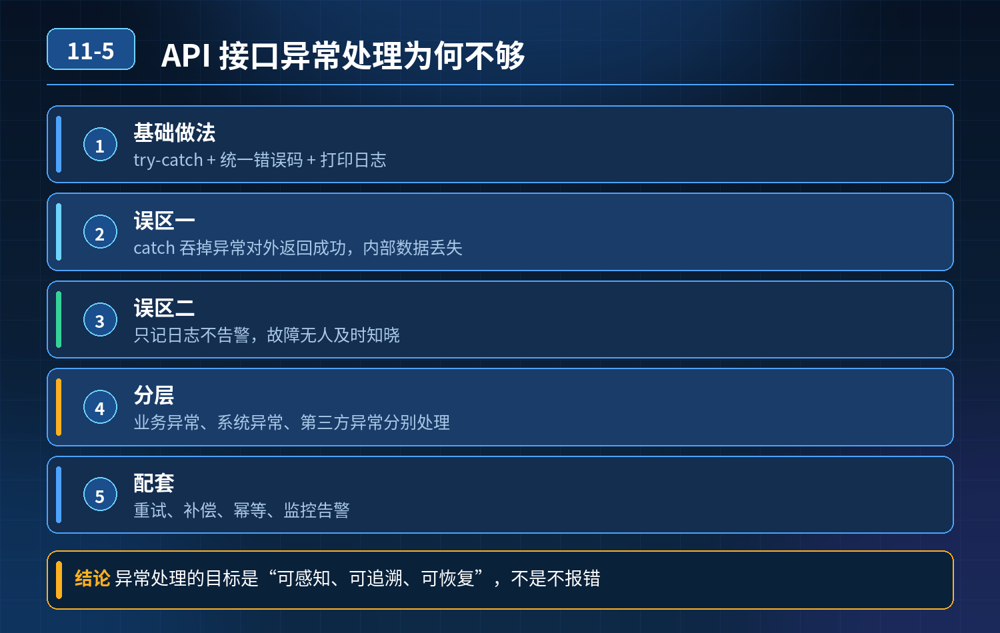

    API 接口异常处理：try-catch + 统一错误码为什么还不够？

## 第 11-5 题　API 接口异常处理：try-catch + 统一错误码为什么还不够？

**举例说明：**第三方订单同步接口的 catch 块把内部落库异常吞掉后对外返回成功码，合作方以为订单已处理完毕，实际内部丢了单；直到几天后对账才发现差异，追溯和修复成本都很高。

**候选人浅层回答：** 背诵表面结论，没有深入到原理和线上场景。

## 核心拆解一句话结论

本题考察对底层原理和线上实战能力的综合理解，不能只停留在背结论。

## 连环追问要点整理

1. 底层核心原理是什么？为什么这么设计？
2. 线上出现相关故障如何快速止损、定位根因？
3. 高并发场景下有哪些坑点，性能、一致性、可用性如何权衡？

## 面试回答完整话术

  - **场景举例**：第三方订单同步接口的 catch 块把内部落库异常吞掉后对外返回成功码，合作方以为订单已处理完毕，实际内部丢了单；直到几天后对账才发现差异，追溯和修复成本都很高。
  - **一句话结论**：本题考察对底层原理和线上实战能力的综合理解，不能只停留在背结论。
  - **收尾**：线上问题按「先止损保可用性 → 再定位根因 → 最后从架构规范层面根治」三段论闭环。

## 追问：本题考察核心是什么？

###  高级工程师要分清：

1. **不能只停留在背结论**：要能回答「为什么这样设计、不这样会怎样、线上踩坑怎么排查」；
2. **具备止损→定位→根治三段论**：先止血保业务，再定位根因，最后从架构与规范层面根治；
3. **给出工程取舍**：性能、一致性、可用性三者权衡，说清代价与适用场景。

  核心思想：这道题考察原理理解 + 线上实战 + 架构思维，真正的工程答案是「现象 → 根因 → 止损 → 定位 → 根治」五段式闭环。

