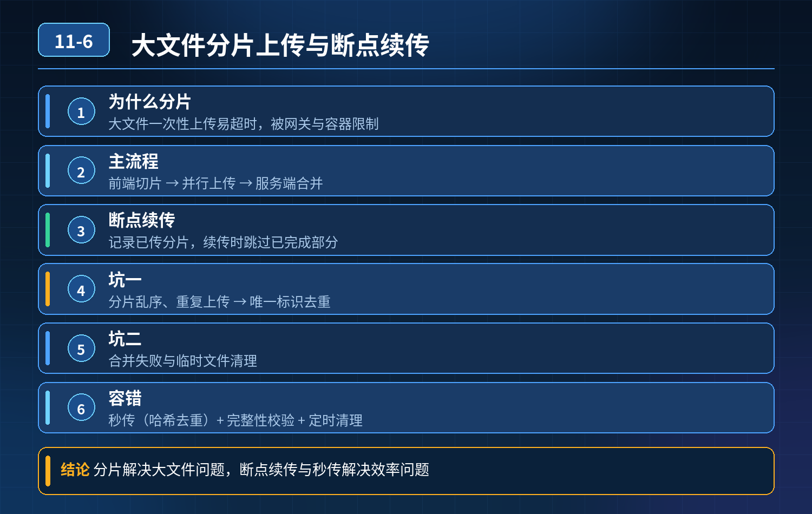

    大文件分片上传+断点续传，原理、坑点、异常容错完整解析

## 第 11-6 题　大文件分片上传+断点续传，原理、坑点、异常容错完整解析

**举例说明：**一个 2GB 的视频切成 200 个 10MB 分片上传，其中某个分片因网络中断失败，前端根据已传分片清单从第 87 片续传而不是从头再来；合并时按分片序号拼接，并对最终文件做一次整体 MD5 校验。

**候选人浅层回答：** 背诵表面结论，没有深入到原理和线上场景。

## 核心拆解一句话结论

本题考察对底层原理和线上实战能力的综合理解，不能只停留在背结论。

## 一、为什么大文件不能直接一次性上传

1. 内存 OOM 风险：SpringMVC 默认会把请求文件加载进内存（未配置临时文件阈值时），超大文件会占用大量 JVM 内存，触发 OOM。
2. 网关 / 容器请求体限制：Nginx 有client_max_body_size，Tomcat 有maxPostSize，超大文件直接上传会返回413 Request Entity Too Large。
3. 网络失败成本高：一旦网络中断，整个文件需要从头重传，体验极差。

分片思路：前端按固定大小切割文件块，分多次 http 上传；后端接收分片临时存储，全部分片接收完成后，后端按顺序合并成完整文件。

## 二、分片上传核心流程

1. 前端计算整个文件的全局 MD5（文件指纹），作为该文件唯一 ID；
2. 前端把文件切分成固定大小分片，每个分片带上：文件全局 MD5、分片序号、分片 MD5；
3. 后端接收分片，以全局 MD5 作为目录，将分片临时写入磁盘 / 对象存储临时目录；
4. 全部分片上传完毕，前端发起合并请求；后端校验分片完整性、校验每个分片md5，按分片序号顺序合并；
5. 合并成功后，删除临时分片文件，返回文件访问地址。

## 三、分片上传三大核心坑

坑 1：分片乱序到达

- 网络原因，分片不一定按序号顺序抵达后端。

解决方案：不能依赖接收顺序，必须保存分片序号。合并时按序号从小到大拼接，而不是按落地顺序。

坑 2：分片重复上传（前端重试，同一分片多次投递）

- 网络超时，前端重试，同一个分片重复提交。

方案：后端存储分片时，以【文件 MD5 + 分片序号】做唯一键，分片已存在直接返回成功，不重复写入磁盘，幂等处理。

坑 3：分片丢失、分片损坏

- 网络丢包、传输过程文件比特错误。

方案：每个分片单独计算分片MD5，后端接收完成校验分片 md5，校验失败则丢弃分片，返回前端，前端重传该分片。

## 四、断点续传原理与坑点

断点续传核心：用文件全局指纹（MD5）标记同一个文件，前端上传前先请求后端查询该文件已上传分片列表，只上传还不存在的分片，不用从头上传。

两个核心坑：

1\. 大文件全量 MD5 计算前端耗时：超大文件前端一次性算完整 MD5 会卡住页面。 优化方案：

1\. 方案 A：先算文件摘要快速 MD5；

2\. 方案 B：预上传接口，前端先上传文件基础信息 + 文件大小，后端返回上传任务 ID；分片上传完成后，最后校验完整文件 md5。

2\. 过期垃圾分片：用户上传到一半放弃，临时分片永久留在磁盘，占用存储空间。

- 方案：后台定时清理任务。维护分片上传记录表，记录创建时间；超过过期时间（例如 24 小时）未完成合并的任务，删除对应的临时分片 + 数据库上传记录。

## 五、合并阶段的原子性与并发问题

1. 合并中途宕机，文件损坏 不要直接在原目录边读分片边写最终文件。

策略：合并写入临时命名文件，合并全部成功后，原子 rename 重命名为正式文件名；rename 失败直接删除临时文件。如果宕机，残留临时文件由定时任务清理。

2\. 多端并发触发合并接口（多人同时点合并） 加分布式锁（Redis），以文件 MD5 为锁 key，同一文件同一时间只允许一次合并任务；防止多次合并，生成重复文件、覆盖文件。

## 连环追问要点整理

1. 底层核心原理是什么？为什么这么设计？
2. 线上出现相关故障如何快速止损、定位根因？
3. 高并发场景下有哪些坑点，性能、一致性、可用性如何权衡？

## 面试回答完整话术

  - **场景举例**：一个 2GB 的视频切成 200 个 10MB 分片上传，其中某个分片因网络中断失败，前端根据已传分片清单从第 87 片续传而不是从头再来；合并时按分片序号拼接，并对最终文件做一次
  - **一句话结论**：本题考察对底层原理和线上实战能力的综合理解，不能只停留在背结论。
  - **一、为什么大文件不能直接一次性上传**：内存 OOM 风险：SpringMVC 默认会把请求文件加载进内存（未配置临时文件阈值时），超大文件会占用大量 JVM 内存，触发 OOM。
  - **二、分片上传核心流程**：前端计算整个文件的全局 MD5（文件指纹），作为该文件唯一 ID；
  - **三、分片上传三大核心坑**：网络原因，分片不一定按序号顺序抵达后端。
  - **四、断点续传原理与坑点**：断点续传核心：用文件全局指纹（MD5）标记同一个文件，前端上传前先请求后端查询该文件已上传分片列表，只上传还不存在的分片，不用从头上传。
  - **五、合并阶段的原子性与并发问题**：合并中途宕机，文件损坏 不要直接在原目录边读分片边写最终文件。
  - **收尾**：线上问题按「先止损保可用性 → 再定位根因 → 最后从架构规范层面根治」三段论闭环。

## 追问：本题考察核心是什么？

###  高级工程师要分清：

1. **不能只停留在背结论**：要能回答「为什么这样设计、不这样会怎样、线上踩坑怎么排查」；
2. **具备止损→定位→根治三段论**：先止血保业务，再定位根因，最后从架构与规范层面根治；
3. **给出工程取舍**：性能、一致性、可用性三者权衡，说清代价与适用场景。

  核心思想：这道题考察原理理解 + 线上实战 + 架构思维，真正的工程答案是「现象 → 根因 → 止损 → 定位 → 根治」五段式闭环。

