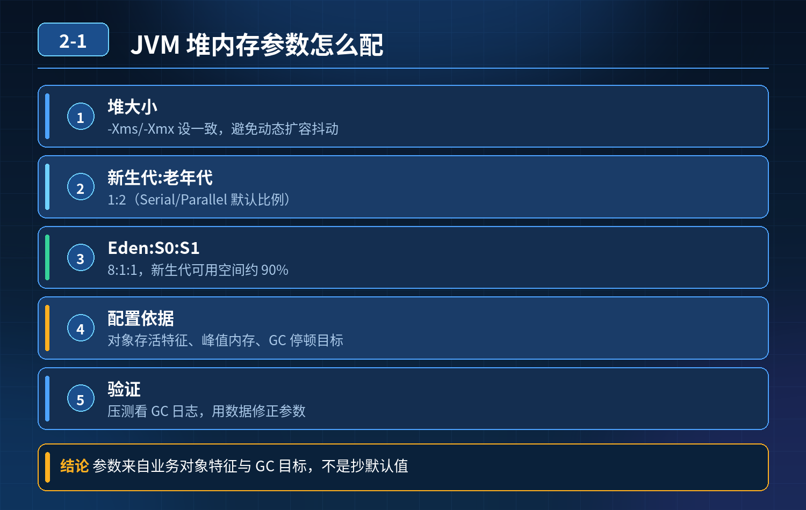

    JVM 堆内存参数配置

## 第 02-1 题　JVM 堆内存参数配置

**举例说明：**一个日均 2000 万请求的订单服务，峰值常驻对象约 1.2GB，因此堆设 4GB；新生代占 1/3 是因为绝大多数对象是请求级短生命周期对象；Eden:Survivor 保持 8:1:1，是为了让 Survivor 装得下 Minor GC 后的存活对象，避免过早晋升到老年代。

**候选人浅层回答：** 堆内存设置 4G，新生代老年代比例 1:2，Eden 和 Survivor 比例 8:1:1。

## 核心拆解一句话结论

新生代老年代 1:2 是 HotSpot 经典分代收集器（Serial、Parallel Scavenge + Parallel Old 等）下 NewRatio=2 的默认比值，代表新生代占整个堆 1/3，老年代占 2/3。

## 参考答案：

很多候选人只会背诵默认比例，认为是业界通用模板，不知道背后原理，属于知其然不知其所以然。

1. 新生代老年代 1:2 是 HotSpot 经典分代收集器（Serial、Parallel Scavenge + Parallel Old 等）下 NewRatio=2 的默认比值，代表新生代占整个堆 1/3，老年代占 2/3。 这个只是 JVM 的默认值，不是业务最佳值，不能直接照搬。G1 下官方不建议手动设置 -Xmn / NewRatio（仍可生效但会干扰 G1 自适应停顿预测），新生代比例会根据停顿目标动态调整；ZGC 在 JDK 21 之前是不分代的（无年轻代/老年代概念），JDK 21 引入分代 ZGC 后由收集器自动管理比例，都不建议手动固定。
2. Eden:Survivor = 8:1:1 是 Parallel Scavenge 新生代收集器的默认分配比例。

Eden 占 8 份，两个 Survivor 各占 1 份。 设计初衷：大部分对象朝生夕死，在 Eden 区创建，Minor GC 就被回收；存活对象移入 Survivor 区。两个 Survivor 用来复制拷贝，保证 GC 复制算法正常工作。 同样，G1 下该比例不再固定，由收集器根据停顿目标动态计算；ZGC（JDK 21 前不分代）也无此固定比例。

3\. 业务堆内存大小怎么判断，不能拍脑袋设置 4G

- 先线上采集监控数据：看活跃对象大小、GC 日志、FullGC 频率、YGC 耗时、内存占用峰值；
- 根据业务对象存活特征，预估业务常驻内存大小；
- 堆不要设置过大，堆太大会导致 Full GC 的时候 STW 停顿时间变长；
- 还要结合机器物理内存，预留系统、缓冲区、直接内存的开销，不能把机器内存全部给到堆。

4\. 堆内存调大不一定提升性能

- 如果业务本身对象不多，堆调大，GC 扫描的范围变大，GC 耗时增加，STW时间变长，性能反而变差；
- 堆过大，一旦发生 FullGC，停顿时间会急剧上涨；
- 如果存在内存泄漏，堆越大 OOM 来的越晚，但一次故障造成的影响会更严重。

## 连环追问要点整理

1. 底层核心原理是什么？为什么这么设计？
2. 线上出现相关故障如何快速止损、定位根因？
3. 高并发场景下有哪些坑点，性能、一致性、可用性如何权衡？

## 面试回答完整话术

  - **场景举例**：一个日均 2000 万请求的订单服务，峰值常驻对象约 1.2GB，因此堆设 4GB；新生代占 1/3 是因为绝大多数对象是请求级短生命周期对象；Eden:Survivor 保持 8
  - **一句话结论**：新生代老年代 1:2 是 HotSpot 经典分代收集器（Serial、Parallel Scavenge + Parallel Old 等）下 NewRatio=2 的默认比值，代表新生代占整个堆 1/3，老年代占 2/3。
  - **参考答案：**：新生代老年代 1:2 是 HotSpot 经典分代收集器（Serial、Parallel Scavenge + Parallel Old 等）下 NewRatio=2 的默认比值，代表新生代占整个堆 
  - **参考答案：**：使用 G1、ZGC 等现代垃圾收集器，不依赖固定代大小比例，由收集器自适应分代（ZGC JDK 21 前不分代）；
  - **收尾**：线上问题按「先止损保可用性 → 再定位根因 → 最后从架构规范层面根治」三段论闭环。

## 追问：本题考察核心是什么？

###  高级工程师要分清：

1. **不能只停留在背结论**：要能回答「为什么这样设计、不这样会怎样、线上踩坑怎么排查」；
2. **具备止损→定位→根治三段论**：先止血保业务，再定位根因，最后从架构与规范层面根治；
3. **给出工程取舍**：性能、一致性、可用性三者权衡，说清代价与适用场景。

  核心思想：这道题考察原理理解 + 线上实战 + 架构思维，真正的工程答案是「现象 → 根因 → 止损 → 定位 → 根治」五段式闭环。

