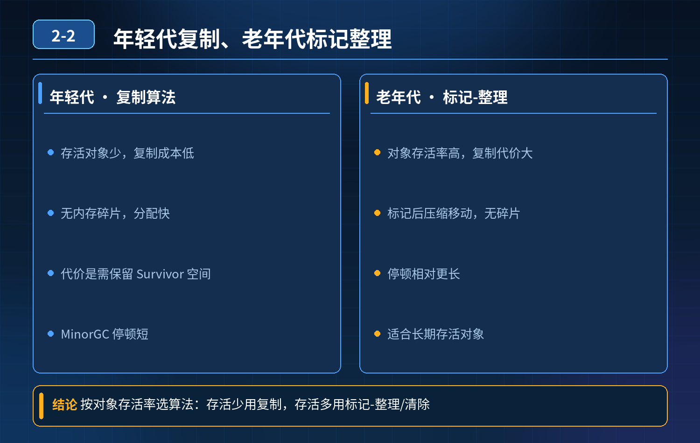

    JVM 垃圾回收算法选型

## 第 02-2 题　JVM 垃圾回收算法选型

**候选人浅层回答：** 年轻代大部分对象都是临时对象，MinorGC 之后存活对象很少。复制算法把存活对象复制到另一块区域，直接清空原区域，执行速度快，而且不会产生内存碎片。

## 核心拆解一句话结论

1）对象特征：朝生夕死，存活对象占比极低 绝大部分对象在 Eden 创建，Minor GC 就死亡，真正需要复制转移的对象数量很少，复制成本很低。

## 参考答案：

1. 年轻代选用复制算法的完整逻辑

2）为什么不用标记‑清除 标记‑清除会产生大量内存碎片。年轻代对象创建非常频繁，如果产生碎片，后续分配大对象的时候，会出现明明总内存充足，但没有连续内存块，分配失败的情况。标记‑清除虽然不用移动对象，但是碎片问题对于高频分配对象的年轻代不可接受。

3）8:1:1 的设计，缓解复制算法浪费一半内存的痛点 标准复制算法需要预留同等大小 to 空间，直接浪费 50% 内存。 HotSpot 没有直接用简单的两块相等内存，而是设计 1 个 Eden + 2 块 Survivor (From、To)，比例 8:1:1。

同一时刻只使用一块 Survivor 作为 to 空间，只浪费 10% 的新生代内存，而不是 50%，大幅降低空间损耗；同时保留复制算法速度快、无碎片的优点。

注意：8:1:1 是 HotSpot 经典分代收集器（Serial、Parallel Scavenge 等）默认 SurvivorRatio=8 时的比例；G1 下 Survivor 比例由收集器动态计算，ZGC（JDK 21 前不分代）没有该固定比例。

2. 老年代不适合复制算法的原因老年代特点：对象存活率高、对象数量多。 如果老年代使用复制算法，需要复制大量存活对象，复制开销会急剧上涨；同时还需要预留一块和老年代同等大小的 to 空间，内存成本巨大，无法接受。 所以老年代选用：

- 标记‑清除：速度快，但产生碎片；
- 标记‑整理：移动对象，消除碎片，但 STW 开销更高； G1 的思路是把堆拆成多个 Region，做局部复制回收，只对部分 Region 执行复制，既利用复制算法高效的优势，又避免整代复制带来巨大内存与性能开销。

<strong>追问：</strong>这道题考察点是什么？

<strong>参考答案：</strong> 不只是背 “复制算法速度快、无碎片” 这个结论。面试官希望理解算法选型是由对象存活特征、内存成本、碎片风险三者权衡出来的结果。

- 年轻代：对象死得多，牺牲少量内存换速度 + 无碎片；
- 老年代：存活对象多，复制代价太高，放弃复制算法； 很多开发只会调堆大小，没有思考垃圾收集算法背后取舍，遇到连环追问就答不上来。

## 连环追问要点整理

1. 底层核心原理是什么？为什么这么设计？
2. 线上出现相关故障如何快速止损、定位根因？
3. 高并发场景下有哪些坑点，性能、一致性、可用性如何权衡？

## 面试回答完整话术

  - **一句话结论**：1）对象特征：朝生夕死，存活对象占比极低 绝大部分对象在 Eden 创建，Minor GC 就死亡，真正需要复制转移的对象数量很少，复制成本很低。
  - **参考答案：**：1）对象特征：朝生夕死，存活对象占比极低 绝大部分对象在 Eden 创建，Minor GC 就死亡，真正需要复制转移的对象数量很少，复制成本很低。
  - **收尾**：线上问题按「先止损保可用性 → 再定位根因 → 最后从架构规范层面根治」三段论闭环。

## 追问：本题考察核心是什么？

###  高级工程师要分清：

1. **不能只停留在背结论**：要能回答「为什么这样设计、不这样会怎样、线上踩坑怎么排查」；
2. **具备止损→定位→根治三段论**：先止血保业务，再定位根因，最后从架构与规范层面根治；
3. **给出工程取舍**：性能、一致性、可用性三者权衡，说清代价与适用场景。

  核心思想：这道题考察原理理解 + 线上实战 + 架构思维，真正的工程答案是「现象 → 根因 → 止损 → 定位 → 根治」五段式闭环。

