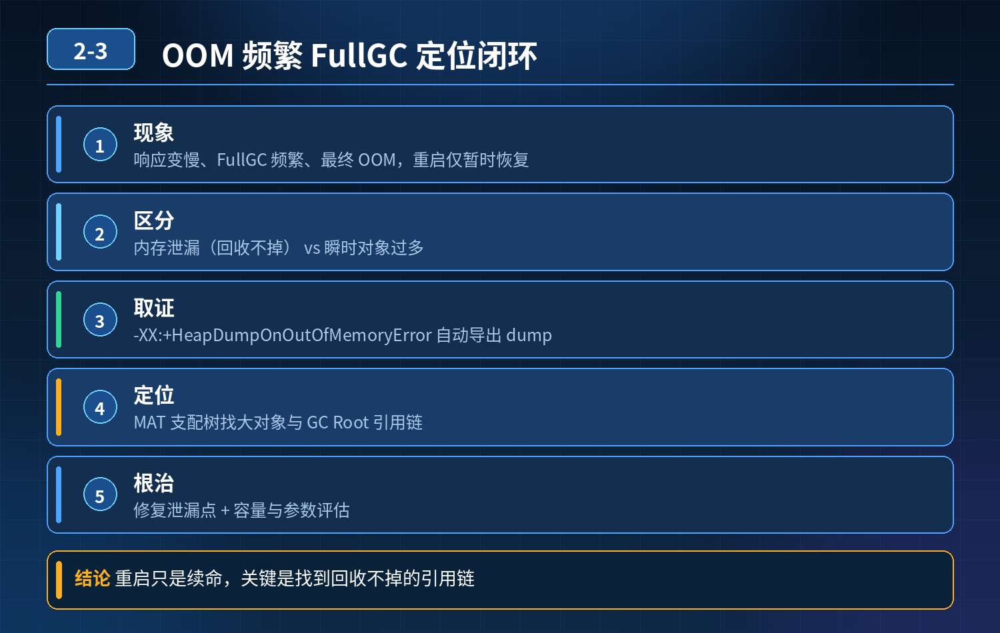

<div class="essay-image ">
    线上 JVM OOM，堆参数配置合理，运行一段时间 FullGC 频繁、最终OOM，重启只能临时恢复，定位与解决方案
</div>

## 第 02-3 题　线上 JVM OOM，堆参数配置合理，运行一段时间 FullGC 频繁、最终OOM，重启只能临时恢复，定位与解决方案

**候选人浅层回答：** 调大堆内存、重启、少创建对象。

## 核心拆解一句话结论

本题考察对底层原理和线上实战能力的综合理解，不能只停留在背结论。

## 连环追问

1. 内存泄漏的本质是什么？和普通 OOM（瞬时对象过多）有什么区别？
2. 线上怎么保留现场，获取 dump 文件？什么参数能在 OOM 自动导出堆快照？
3. 拿到 heap dump 后，用什么工具分析？重点看哪些指标？
4. 列举几个 Java 项目最常见的内存泄漏场景。
5. 怎么区分是堆内存泄漏、元空间溢出，还是直接内存 OOM？
6. 线上如何做前置监控，提前发现内存泄漏，避免等到 OOM 宕机？

## 面试高分话术

这个故障属于内存泄漏，不是堆内存配置不足。代码里存在无效的强引用，对象持续堆积无法被 GC 回收，老年代内存持续单向上涨，FullGC 越来越频繁，最终 OOM。单纯调大堆内存只能推迟宕机时间，泄漏还在，问题一定会复现。

整套排查体系分为三层。第一层是事前监控和预置 JVM 参数。监控重点观察老年代内存趋势，内存泄漏典型特征就是 GC 后内存只降一点点，长期持续上涨，提前告警；配置 HeapDumpOnOutOfMemoryError，OOM 时自动导出堆 dump，保留现场。 第二层是故障定位，拿到 dump 文件用 MAT 分析，看直方图、支配树、泄漏嫌疑报告，顺着 GC 引用链找到是谁持有对象的强引用。最常见泄漏点是 ThreadLocal 不清理、static 静态集合无限添加对象、资源未关闭、第三方 SDK 缓存泄漏，还要区分堆 OOM、元空间溢出、直接内存溢出三种不同 OOM。 第三层是代码修复，修复之后需要长时间压测验证，观察内存曲线不再持续上升，确认 FullGC 平稳。 故障现场的重启只是临时止血手段，不能解决根本问题。

## 连环追问要点整理

1. 底层核心原理是什么？为什么这么设计？
2. 线上出现相关故障如何快速止损、定位根因？
3. 高并发场景下有哪些坑点，性能、一致性、可用性如何权衡？

## 代码示例

```java
-XX:+HeapDumpOnOutOfMemoryError
-XX:HeapDumpPath=/data/dump
```

## 面试回答完整话术

  - **一句话结论**：本题考察对底层原理和线上实战能力的综合理解，不能只停留在背结论。
  - **连环追问**：内存泄漏的本质是什么？和普通 OOM（瞬时对象过多）有什么区别？
  - **面试高分话术**：这个故障属于内存泄漏，不是堆内存配置不足。代码里存在无效的强引用，对象持续堆积无法被 GC 回收，老年代内存持续单向上涨，FullGC 越来越频繁，最终 OOM。单纯调大堆内存只能推迟宕机时间，泄漏还
  - **收尾**：线上问题按「先止损保可用性 → 再定位根因 → 最后从架构规范层面根治」三段论闭环。

## 追问：本题考察核心是什么？

###  高级工程师要分清：

1. **不能只停留在背结论**：要能回答「为什么这样设计、不这样会怎样、线上踩坑怎么排查」；
2. **具备止损→定位→根治三段论**：先止血保业务，再定位根因，最后从架构与规范层面根治；
3. **给出工程取舍**：性能、一致性、可用性三者权衡，说清代价与适用场景。

  核心思想：这道题考察原理理解 + 线上实战 + 架构思维，真正的工程答案是「现象 → 根因 → 止损 → 定位 → 根治」五段式闭环。

<div class="img-wrap-left"></div>
