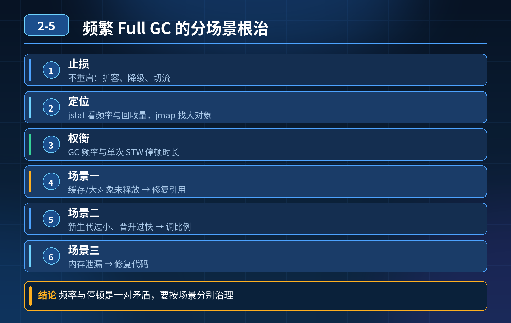

    线上核心服务频繁 Full GC，卡顿超时、吞吐量腰斩，如何快速止损、定位、权衡 GC 频率与停顿、分场景根治

## 第 02-5 题　线上核心服务频繁 Full GC，卡顿超时、吞吐量腰斩，如何快速止损、定位、权衡 GC 频率与停顿、分场景根治

**候选人浅层回答：** 背诵表面结论，没有深入到原理和线上场景。

## 核心拆解一句话结论

核心：GC 治理不是无脑加堆。GC 抖动分四类典型诱因：内存泄漏、瞬时大对象、分代参数失衡、短生命周期对象疯狂晋升；

## 候选人浅层回答

调大堆内存、加大新生代比例；不行手动 GC，最后重启。

## 连环追问汇总

1. 大促高峰频繁 FullGC，重启十几秒断流，怎么不重启先止损缓解卡顿？
2. 调大堆，FullGC 次数变少，但单次 STW 停顿飙升、用户超时，频率和停顿时长怎么权衡？
3. YoungGC 一秒多次、回收量很小，反复分配回收，是新生代太小还是对象晋升太快，怎么判断？
4. 代码频繁创建大对象 / 大数组，直接进老年代触发 FullGC，怎么规避？
5. 参数配置错误：晋升阈值过小、老年代回收触发比例太低，流量上来就 GC 抖动，如何调优？
6. 集群几十节点同时 GC 抖动，怎么找共性根因，不逐个 dump？

## 一、先做：不停机应急止损（优先级最高）

目标：降低对象分配速率，减少往老年代灌入对象，压下 FullGC 频率

1. 网关限流、优先级流量裁剪 限制总 QPS，优先保核心下单支付链路，切掉报表导出、全量列表查询、非实时统计、埋点上报这类极易产生大对象、大量临时对象的弱依赖接口。
2. 业务侧临时降级 关闭批量导出、大分页查询、全量数据加载逻辑；强制分页、流式读取，禁止一次性把数据集全部加载进堆。
3. 流量摘流、实例隔离 把部分故障节点摘流，流量切到健康实例；摘流后的节点压力降下来，再做 histo 采样、dump 取证，避免高负载下 dump 加重 STW。
4. 临时关闭消费 / 定时任务 MQ 消费、定时统计、异步任务是对象创建大户，高峰 GC 抖动时暂停非核心消费任务。

- ❌ 禁止线上手动 System.gc ()：CMS/G1 下不一定立刻 FullGC，还会打乱 GC 调度、加剧停顿。

## 二、指标区分，快速定位 GC 抖动类型（看 GC 大盘日志）

先看三个核心指标：YGC 频率、每次 YGC 存活大小、老年代占用曲线、GC 后是否回落

1. 内存泄漏型 FullGC 特征：每次 FullGC 之后老年代内存无法回落到底，持续缓慢上涨，越来越频繁；存活对象越来越多。 根因：ThreadLocal 未清理、静态集合无限 add、缓存无淘汰、连接 / 对象池只增不减。
2. 大对象直接分配到老年代 特征：YGC 很平稳，突然一次 FullGC，老年代瞬间被填满；GC 后内存可以回落。 CMS 下超过 PretenureSizeThreshold 的对象直接分配到老年代，绕过新生代；G1 下大小超过单个 Region 50% 的对象被判定为 Humongous 对象（大对象），直接分配在 Humongous Region（逻辑上属于老年代，但不参与 Young GC，回收时机受限，分配失败也会触发 Full GC）。比如一次性 new 大数组、读取全量文件到 byte[]，是典型大对象来源。
3. 新生代过小 / 晋升阈值不合理，短对象提前晋升 特征：YGC 极频繁（每秒多次），每次 YGC 存活对象不多，但是存活对象持续晋升到老年代，老年代慢慢堆满。 区分判断：

- 新生代容量太小：eden 很快打满，频繁 YGC；
- 晋升阈值（动态年龄判定）太小：对象还属于短期对象，几次 YGC 就晋升到老年代，本该在新生代回收的对象跑到老年代。

4\. 老年代触发回收阈值配置过低 比如 CMS 的 InitiatingOccupancyFraction 设太小，老年代刚到 60% 就开始并发 GC；流量上来分配变快，并发 GC 跟不上分配速度，变成 FullGC。

## 三、关键矛盾权衡：堆越大 ≠ 越好

堆变大的收益：FullGC 触发次数变少 堆变大的代价：一次 GC 需要扫描、标记的存活对象更多，STW 停顿时间显著拉长，大量请求卡在 GC 阶段超时。 取舍方案：

1. 优先小堆 + 多实例横向扩容，而不是单实例超大堆；分摊流量，每个实例对象分配量可控，单次 GC 停顿短；
2. 选用低停顿收集器：G1 优先，高延迟敏感场景 ZGC；
3. 控制老年代增长率，把触发 GC 的水位合理调高，给并发标记预留充足时间；
4. 源头减少对象创建，才是最优解，而不是靠堆内存硬扛。

## 连环追问要点整理

1. 底层核心原理是什么？为什么这么设计？
2. 线上出现相关故障如何快速止损、定位根因？
3. 高并发场景下有哪些坑点，性能、一致性、可用性如何权衡？

## 面试回答完整话术

  - **一句话结论**：核心：GC 治理不是无脑加堆。GC 抖动分四类典型诱因：内存泄漏、瞬时大对象、分代参数失衡、短生命周期对象疯狂晋升；
  - **候选人浅层回答**：调大堆内存、加大新生代比例；不行手动 GC，最后重启。
  - **连环追问汇总**：大促高峰频繁 FullGC，重启十几秒断流，怎么不重启先止损缓解卡顿？
  - **参考答案**：核心：GC 治理不是无脑加堆。GC 抖动分四类典型诱因：内存泄漏、瞬时大对象、分代参数失衡、短生命周期对象疯狂晋升；处理顺序：先止损降负载 → 指标分类定位 → 参数调优兜底 → 代码根治 + 长效监
  - **一、先做：不停机应急止损（优先级最高）**：目标：降低对象分配速率，减少往老年代灌入对象，压下 FullGC 频率
  - **二、指标区分，快速定位 GC 抖动类型（看 GC 大盘日志）**：先看三个核心指标：YGC 频率、每次 YGC 存活大小、老年代占用曲线、GC 后是否回落
  - **收尾**：线上问题按「先止损保可用性 → 再定位根因 → 最后从架构规范层面根治」三段论闭环。

## 追问：本题考察核心是什么？

###  高级工程师要分清：

1. **不能只停留在背结论**：要能回答「为什么这样设计、不这样会怎样、线上踩坑怎么排查」；
2. **具备止损→定位→根治三段论**：先止血保业务，再定位根因，最后从架构与规范层面根治；
3. **给出工程取舍**：性能、一致性、可用性三者权衡，说清代价与适用场景。

  核心思想：这道题考察原理理解 + 线上实战 + 架构思维，真正的工程答案是「现象 → 根因 → 止损 → 定位 → 根治」五段式闭环。

