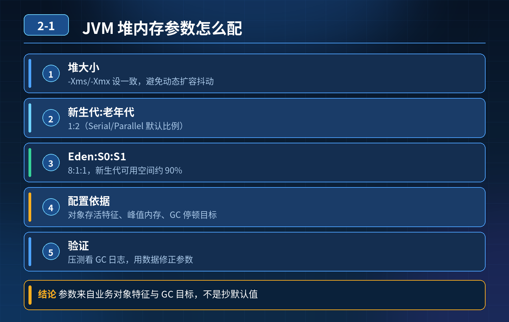
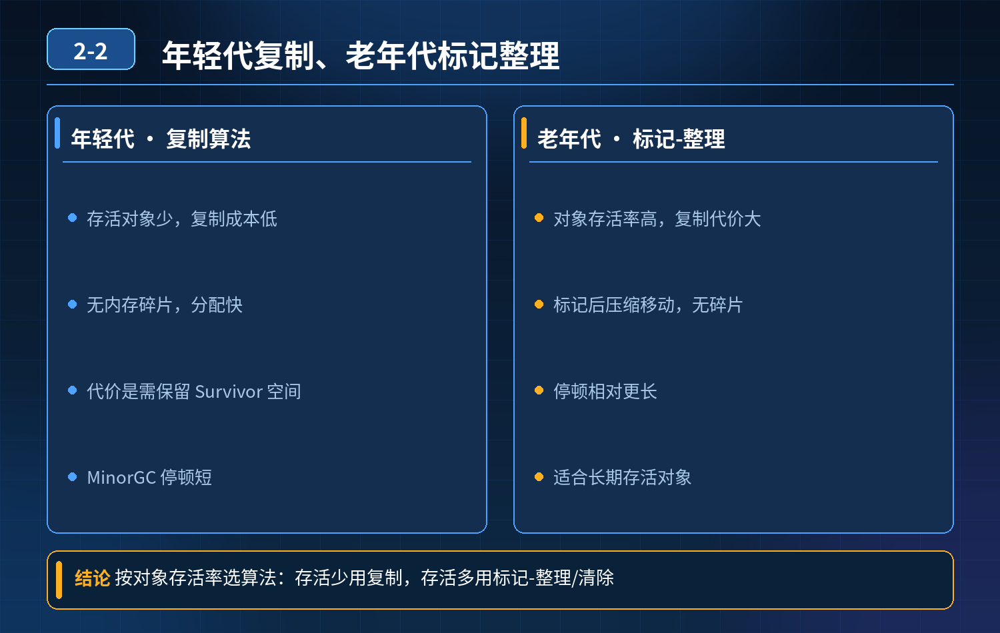
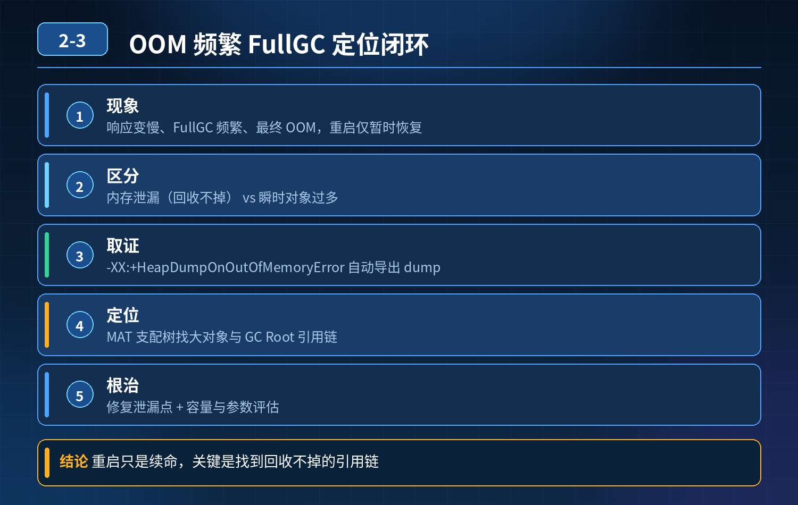
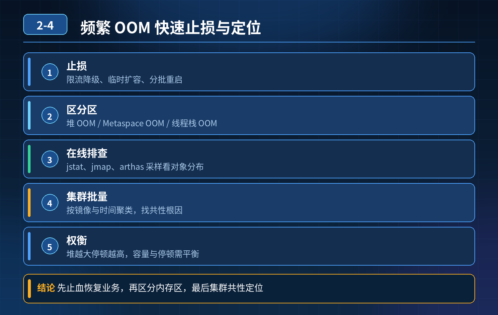
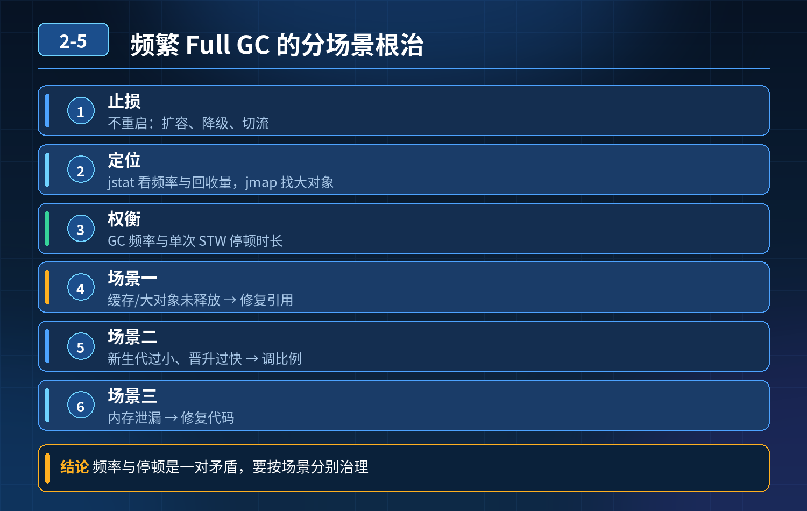

<div class="essay-chapter-header essay-image2">
    2. JVM
</div>

## 第 1 题　JVM 堆内存参数配置

<strong>举例说明：</strong>一个日均 2000 万请求的订单服务，峰值常驻对象约 1.2GB，因此堆设 4GB；新生代占 1/3 是因为绝大多数对象是请求级短生命周期对象；Eden:Survivor 保持 8:1:1，是为了让 Survivor 装得下 Minor GC 后的存活对象，避免过早晋升到老年代。

### 问题 1：你们项目 JVM 堆内存设置多少？核心参数是怎么配置出来的？

<strong>候选人回答：</strong> 堆内存设置 4G，新生代老年代比例 1:2，Eden 和 Survivor 比例 8:1:1。

追问 1：新生代老年代 1:2 这个比例是怎么来的？Eden:Survivor 8:1:1 底层依据是什么？你们业务堆内存大小是如何判断的？堆内存调大就一定可以提升性能吗？

### 参考答案：

很多候选人只会背诵默认比例，认为是业界通用模板，不知道背后原理，属于知其然不知其所以然。

1. 新生代老年代 1:2 是 HotSpot 经典分代收集器（Serial、Parallel Scavenge + Parallel Old 等）下 NewRatio=2 的默认比值，代表新生代占整个堆 1/3，老年代占 2/3。 这个只是 JVM 的默认值，不是业务最佳值，不能直接照搬。G1 下官方不建议手动设置 -Xmn / NewRatio（仍可生效但会干扰 G1 自适应停顿预测），新生代比例会根据停顿目标动态调整；ZGC 在 JDK 21 之前是不分代的（无年轻代/老年代概念），JDK 21 引入分代 ZGC 后由收集器自动管理比例，都不建议手动固定。
2. Eden:Survivor = 8:1:1 是 Parallel Scavenge 新生代收集器的默认分配比例。

Eden 占 8 份，两个 Survivor 各占 1 份。 设计初衷：大部分对象朝生夕死，在 Eden 区创建，Minor GC 就被回收；存活对象移入 Survivor 区。两个 Survivor 用来复制拷贝，保证 GC 复制算法正常工作。 同样，G1 下该比例不再固定，由收集器根据停顿目标动态计算；ZGC（JDK 21 前不分代）也无此固定比例。

3. 业务堆内存大小怎么判断，不能拍脑袋设置 4G

- 先线上采集监控数据：看活跃对象大小、GC 日志、FullGC 频率、YGC 耗时、内存占用峰值；
- 根据业务对象存活特征，预估业务常驻内存大小；
- 堆不要设置过大，堆太大会导致 Full GC 的时候 STW 停顿时间变长；
- 还要结合机器物理内存，预留系统、缓冲区、直接内存的开销，不能把机器内存全部给到堆。

4. 堆内存调大不一定提升性能

- 如果业务本身对象不多，堆调大，GC 扫描的范围变大，GC 耗时增加，STW时间变长，性能反而变差；
- 堆过大，一旦发生 FullGC，停顿时间会急剧上涨；
- 如果存在内存泄漏，堆越大 OOM 来的越晚，但一次故障造成的影响会更严重。

追问 2：什么样的场景不适合直接使用默认 1:2、8:1:1？

### 参考答案：

1. 使用 G1、ZGC 等现代垃圾收集器，不依赖固定代大小比例，由收集器自适应分代（ZGC JDK 21 前不分代）；
2. 短生命周期对象极多的业务，可以适当调大新生代，减少对象晋升到老年代；
3. 长期存活大对象多的业务，要控制新生代大小，避免大对象直接进入老年代，触发频繁 FullGC。

追问 3：这道题考察核心是什么？

<strong>参考答案：</strong> 考察是不是死记硬背 JVM 参数模板。面试官要看你是否理解参数背后的 GC 原理，能不能结合业务、监控、GC 日志做配置，而不是网上抄一套参数直接上线。真正调优是依据线上监控、GC 日志反向推导参数，而不是直接套用教科书默认比例。

<!--  -->
<div class="img-wrap-left"></div>

## 第 2 题　JVM 垃圾回收算法选型

### 问题 1：年轻代为什么选择复制算法，不使用标记‑清除、标记‑整理算法？

候选人基础回答： 年轻代大部分对象都是临时对象，MinorGC 之后存活对象很少。复制算法把存活对象复制到另一块区域，直接清空原区域，执行速度快，而且不会产生内存碎片。

追问 1：复制算法会浪费一半内存空间，现在服务器内存很大，为什么依然保留 Eden + 两个 Survivor 的 8:1:1 结构？标记‑清除不需要移动对象，速度也很快，年轻代为什么不用它？

追问 2：既然复制算法几乎没有内存碎片，优势这么明显，老年代为什么不用复制算法，反而选择开销更大的标记‑整理？

### 参考答案：

1、年轻代选用复制算法的完整逻辑

1）对象特征：朝生夕死，存活对象占比极低 绝大部分对象在 Eden 创建，Minor GC 就死亡，真正需要复制转移的对象数量很少，复制成本很低。

2）为什么不用标记‑清除 标记‑清除会产生大量内存碎片。年轻代对象创建非常频繁，如果产生碎片，后续分配大对象的时候，会出现明明总内存充足，但没有连续内存块，分配失败的情况。标记‑清除虽然不用移动对象，但是碎片问题对于高频分配对象的年轻代不可接受。

3）8:1:1 的设计，缓解复制算法浪费一半内存的痛点 标准复制算法需要预留同等大小 to 空间，直接浪费 50% 内存。 HotSpot 没有直接用简单的两块相等内存，而是设计 1 个 Eden + 2 块 Survivor (From、To)，比例 8:1:1。

同一时刻只使用一块 Survivor 作为 to 空间，只浪费 10% 的新生代内存，而不是 50%，大幅降低空间损耗；同时保留复制算法速度快、无碎片的优点。

注意：8:1:1 是 HotSpot 经典分代收集器（Serial、Parallel Scavenge 等）默认 SurvivorRatio=8 时的比例；G1 下 Survivor 比例由收集器动态计算，ZGC（JDK 21 前不分代）没有该固定比例。

2、老年代不适合复制算法的原因老年代特点：对象存活率高、对象数量多。 如果老年代使用复制算法，需要复制大量存活对象，复制开销会急剧上涨；同时还需要预留一块和老年代同等大小的 to 空间，内存成本巨大，无法接受。 所以老年代选用：

- 标记‑清除：速度快，但产生碎片；
- 标记‑整理：移动对象，消除碎片，但 STW 开销更高； G1 的思路是把堆拆成多个 Region，做局部复制回收，只对部分 Region 执行复制，既利用复制算法高效的优势，又避免整代复制带来巨大内存与性能开销。

<strong>追问：</strong>这道题考察点是什么？

<strong>参考答案：</strong> 不只是背 “复制算法速度快、无碎片” 这个结论。面试官希望理解算法选型是由对象存活特征、内存成本、碎片风险三者权衡出来的结果。

- 年轻代：对象死得多，牺牲少量内存换速度 + 无碎片；
- 老年代：存活对象多，复制代价太高，放弃复制算法； 很多开发只会调堆大小，没有思考垃圾收集算法背后取舍，遇到连环追问就答不上来。

<!--  -->
<div class="img-wrap-left"></div>

## 第 3 题　线上 JVM OOM，堆参数配置合理，运行一段时间 FullGC 频繁、最终OOM，重启只能临时恢复，定位与解决方案

### 问题

线上服务运行一段时间后，响应变慢、频繁 FullGC，最后 OOM 宕机，重启短暂恢复，堆内存参数本身配置合理。单纯调大堆内存为什么不能根治？如何定位内存泄漏根源，彻底解决？

<strong>候选人回答：</strong>调大堆内存、重启、少创建对象。

### 连环追问

1. 内存泄漏的本质是什么？和普通 OOM（瞬时对象过多）有什么区别？
2. 线上怎么保留现场，获取 dump 文件？什么参数能在 OOM 自动导出堆快照？
3. 拿到 heap dump 后，用什么工具分析？重点看哪些指标？
4. 列举几个 Java 项目最常见的内存泄漏场景。
5. 怎么区分是堆内存泄漏、元空间溢出，还是直接内存 OOM？
6. 线上如何做前置监控，提前发现内存泄漏，避免等到 OOM 宕机？

### 参考答案

### 问题根源

这是内存泄漏（Memory Leak），不是堆内存不够。 代码中对象本应被 GC 回收，但存在无效强引用，对象一直存活无法释放；随着服务运行，存活对象越来越多，堆被缓慢占满，GC 频率持续上升，FullGC 越来越频繁，STW 变长，服务卡顿；最终堆耗尽抛出 OOM。

单纯调大堆内存，只是推迟 OOM 到来的时间，泄漏还在持续，过一段时间依旧会再次宕机，不能根治。

三层防御体系（监控 → 故障现场采集 → 定位修复）第一层：事前监控与 JVM 参数预置（提前预警，保留现场）

1. 监控指标：重点监控堆内存使用率、老年代内存趋势、FullGC 次数、FullGC 耗时、元空间使用。 内存泄漏典型特征：老年代内存持续单向上涨，GC 后内存下降很少，随时间缓慢爬升，这个是最核心特征。设置告警，老年代持续上涨提前告警，不等 OOM。
2. 预置 JVM 参数，OOM 自动 dump

```
-XX:+HeapDumpOnOutOfMemoryError
-XX:HeapDumpPath=/data/dump
```

OOM 发生时自动生成堆快照 dump 文件，保存现场；同时开启 GC 日志，记录GC 过程。

注意：dump 文件很大，磁盘要预留足够空间，生产不要长期一直开启，按需配置。

第二层：故障发生后，定位泄漏根源拿到 heap dump，使用 MAT（Memory Analyzer Tool）或者 JProfiler、JVisualVM 分析。 分析重点步骤：

1. 查看Histogram 直方图：按类统计实例数量、占用内存，找出异常大对象；
2. 看Dominator Tree 支配树：找出占用大量内存的对象，以及它的 GC 引用链；
3. 查找Leak Suspects（泄漏嫌疑报告），工具会自动给出可疑泄漏点；
4. 顺着引用链逆向查找：是谁持有这个对象的强引用，为什么无法被 GC 回收。

常见内存泄漏场景

1. 静态集合（static List/Map），全局静态容器不断 add 对象，没有清理；
2. 长生命周期对象持有短生命周期对象强引用，例如 ThreadLocal 用完不remove；线程池线程长期存活，ThreadLocal 变量不清理是高频泄漏点；
3. 未关闭资源：流、连接、数据库连接、IO 流，连接池泄漏；
4. 集合 remove 逻辑错误，对象无法被移除；
5. 第三方库缺陷，如网络、序列化、OSS 客户端等 SDK 内部缓存泄漏；
6. 元空间泄漏：大量动态生成类、反射、CGLIB 动态代理，类无法卸载，Metaspace 溢出。

区分 OOM 类型：

- Java heap space：堆泄漏；
- Metaspace：元空间，类加载过多；
- Direct buffer memory：NIO 直接内存泄漏。

第三层：代码修复 + 验证定位引用链后修复代码：

- ThreadLocal：使用完必须 remove；
- 全局缓存容器设置过期淘汰策略（LRU），设置最大容量；
- IO、连接资源使用 try-with-resources 自动关闭；
- 线程池合理设置，避免无界队列。

修复完成后，压测验证：长时间压测观察老年代内存曲线，确认内存不再持续上涨，FullGC 平稳，才算修复完成。

临时应急方案（故障期间）

7. 滚动重启实例，快速恢复服务；但只是临时止血；

8. 紧急扩容实例，分担流量，延缓内存上涨；应急手段不能替代根因修复。

### 面试高分话术

这个故障属于内存泄漏，不是堆内存配置不足。代码里存在无效的强引用，对象持续堆积无法被 GC 回收，老年代内存持续单向上涨，FullGC 越来越频繁，最终 OOM。单纯调大堆内存只能推迟宕机时间，泄漏还在，问题一定会复现。

整套排查体系分为三层。第一层是事前监控和预置 JVM 参数。监控重点观察老年代内存趋势，内存泄漏典型特征就是 GC 后内存只降一点点，长期持续上涨，提前告警；配置 HeapDumpOnOutOfMemoryError，OOM 时自动导出堆 dump，保留现场。 第二层是故障定位，拿到 dump 文件用 MAT 分析，看直方图、支配树、泄漏嫌疑报告，顺着 GC 引用链找到是谁持有对象的强引用。最常见泄漏点是 ThreadLocal 不清理、static 静态集合无限添加对象、资源未关闭、第三方 SDK 缓存泄漏，还要区分堆 OOM、元空间溢出、直接内存溢出三种不同 OOM。 第三层是代码修复，修复之后需要长时间压测验证，观察内存曲线不再持续上升，确认 FullGC 平稳。 故障现场的重启只是临时止血手段，不能解决根本问题。

### 考察核心

初级工程师只会调堆大小、重启服务，分不清普通 OOM 和内存泄漏，不知道dump 文件、MAT 分析，识别不出 ThreadLocal、静态集合这类高频泄漏场景。

高级工程师重点体现：

1. 理解内存泄漏本质：强引用导致对象无法回收，调大堆只是延缓故障；
2. 掌握 OOM 现场保留参数、dump 分析流程；
3. 能识别线上典型泄漏场景；
4. 会通过 GC 指标（老年代趋势、FullGC）提前预警；
5. 具备应急止血 + 根因定位 + 回归验证完整故障处理思路。

<strong>核心思想：</strong>OOM 排查核心不是改 - Xmx，而是找到无效强引用链，切断对象引用，让 GC 正常回收。

<!--  -->
<div class="img-wrap-left"></div>

## 第 4 题　核心服务频繁 OOM 宕机，如何快速止损、区分不同内存区 OOM、在线排查、集群批量定位、权衡堆大小与 GC 停顿

候选人回答（短板版）配置 -XX:+HeapDumpOnOutOfMemoryError，宕机后 dump 堆快照，MAT 分析；调大堆内存、扩容机器，低峰期慢慢排查。

### 连环追问汇总

1. 大促高峰期 OOM，dump 几 GB，分析半小时，核心业务不能长时间等，如何先止损恢复？
2. 如果不是内存泄漏，只是流量上来瞬时对象太多撑满堆；盲目加大堆会让 FullGC 停顿暴涨、用户超时，怎么权衡？
3. 如何快速区分：堆 OOM / 元空间 Metaspace OOM / 线程栈 OOM（线程数量爆炸）？
4. 集群几十个节点轮流 OOM，怎么批量定位共性根因，不逐个 dump？
5. 链路不能停、禁止重启、禁止 dump（dump 会 STW 加重压力），有没有在线低侵入排查手段？

### 参考答案

第一步：先区分 OOM 类型（先看监控 / 日志报错，不着急 dump）日志里的报错信息是第一判断依据：

1. Java heap space（堆溢出） 堆内存不足，分两类：

- 内存泄漏：对象被长生命周期集合、缓存、ThreadLocal、静态集合持有，GC 无法回收，内存持续单向上涨；
- 瞬时流量冲击：无泄漏，QPS 突增，短时创建大量短生命周期对象，堆上限不够；调大堆的代价：单次 Full GC 扫描范围变大，STW 时间拉长，超时变多。

2. Metaspace（元空间溢出） 堆内存监控正常，类加载区满。常见：动态生成类、Groovy / 脚本、CGLIB 大量动态代理、热加载循环创建类。看堆快照完全找不到问题。

3. unable to create new native thread（无法创建新线程，栈溢出） 和堆无关。代码无控创建线程、线程池无界队列疯狂新建线程；每个线程占用操作系统栈内存，线程数打满系统线程上限，JVM 报 OOM。监控看线程总数指标飙升即可识别。

重点：不是所有 OOM 都是堆的问题，一上来 dump 堆快照属于无效操作。

第二步：高峰期应急止损（优先保业务，排在定位前面）核心思路：降内存生成速度，而不是先 dump 分析

1. 网关限流、流量裁剪 网关 / 限流组件调低该服务配额；优先拦截爬虫、非核心渠道、低优先级请求，保住付费、下单等核心链路，减少对象创建。
2. 弱依赖快速降级 关闭埋点、统计、非必要导出、大列表查询、全量查询等消耗大量内存的接口 / 逻辑；分页、限制返回条数，禁止一次性加载全量数据到内存。
3. 集群摘流，滚动替换 轮流摘除故障实例，流量切到健康节点；故障节点下线后再 dump，避免故障节点持续影响业务。不要盲目扩容：泄漏类 OOM，新实例收到流量同样会慢慢 OOM，扩容只是延长死亡时间。
4. 临时开关：关闭动态类加载、动态脚本、异步任务消费 针对元空间溢出场景，直接关停动态类生成逻辑。
5. ThreadLocal 专项：代码层面兜底清理，防止长生命周期线程持有对象。

止损完成、流量压下去之后，压力降低，再做采样、dump、分析，风险更小。

第三步：在线低侵入排查（不重启、不强制 dump）dump 本身会 STW、IO 压力大，高峰不能随便执行，优先用轻量工具：

1. JDK 自带轻量采样：jmap -histo:live 只输出对象统计直方图，不会生成完整dump 文件，开销远小于 dump，快速看哪些类实例数、占用内存暴涨，判断是大对象 / 集合泄漏。
2. async-profiler 持续采样 提前预埋，低开销采样内存分配热点，看哪些方法在疯狂分配对象，定位内存分配热点，不需要等 OOM。
3. 监控大盘指标持续观测： 堆使用率、元空间使用率、线程总数、老年代增长率、FullGC 频率、单次 GC 耗时；

- 老年代匀速持续上涨，GC 之后无法回落 → 泄漏；
- GC 后内存可以回落，只是峰值打满 → 流量冲击；
- 线程数持续飙升 → 线程爆炸；
- Metaspace 持续上涨不释放 → 动态类加载问题。

第四步：权衡堆大小与 FullGC 停顿的矛盾如果是流量冲击型（无泄漏）： 不要一味加大 Xmx。堆越大，Full GC 扫描存活对象耗时越长，STW 越长，大量请求卡在 GC 阶段超时。 方案组合：

4. 适度缩小单实例堆，多实例横向扩容；小堆 GC 更快，分摊流量，避免长停顿；

5. 优化对象：对象复用、池化、减少临时大对象、分页、流式处理，避免全量加载；

6. 使用 G1/ZGC 等低停顿收集器，而不是 CMS；

7. 配合限流，把峰值流量削平。

如果是内存泄漏型：调大堆只是延迟爆炸，根治必须找到泄漏点，清理引用。

第五步：集群批量 OOM，定位共性根因集群轮流 OOM，一般是共性逻辑触发，不是单台机器问题：

1. 聚合监控：查看所有实例的趋势，看 OOM 时刻是不是同一类接口、同一类入参、同一版本发布后开始；
2. 聚合 histo 对象统计，对比多台机器的 top 占用对象，找共同暴涨的类；
3. 查看变更记录：上线、配置变更、脚本开启、定时任务开启；很多元空间 / 泄漏 OOM 都伴随版本发布；
4. 日志聚合：搜索所有节点的 OOM 报错堆栈，统一归类。

第六步：三层长效治理方案（架构层面）第一层：预警前置，不等 OOM 爆发监控告警不是等到 100% 堆才告警：堆使用率、元空间使用率、线程数、老年代增速、单次 GC 耗时提前告警；设置水位，达到阈值自动触发限流、降级。

第二层：编码 & 中间件约束，从源头控内存

1. 禁止无界线程池、禁止无限 List/Map 缓存数据；缓存设置淘汰策略（LRU）；
2. ThreadLocal 用完必须 remove；
3. 大数据场景流式读取，不要加载全量数据入堆；
4. 动态代理、动态脚本、动态类加载做数量上限控制，元空间做上限；
5. 异步消费做好限流，消息堆积时不能无限制加载消息进内存。

第三层：故障兜底机制

1. 开启 HeapDumpOnOutOfMemoryError，但配置 dump 落盘到独立磁盘，避免磁盘打满；低峰期或者摘流后再收集；
2. 隔离：核心、非核心业务使用独立实例，非核心内存爆炸不拖垮核心集群；
3. 版本灰度发布，小流量验证内存趋势；
4. 压测包含内存压测、长时间稳定性压测（泄漏需要长时间运行才能暴露）。

### 考察核心

初级工程师的思路：OOM = 堆内存不够，加内存、加机器、dump 分析。 高级工程师的思路：

1. OOM 分区域，堆、元空间、线程栈是完全不同故障，处理手段不一样；
2. 故障顺序：止损优先，定位在后；dump 是取证手段，不是急救手段；
3. 理解堆大小的取舍：大堆不等于更好，会带来 GC 停顿的副作用；
4. 集群故障看共性，而不是单机逐个排查；
5. 有低侵入在线观测手段，而不是只有宕机 dump 这一种方案；
6. 形成闭环：应急止损 → 低风险取证定位 → 代码修复 + 监控预警 + 架构约束，防止复现。

<!--  -->
<div class="img-wrap-left"></div>

## 第 5 题　线上核心服务频繁 Full GC，卡顿超时、吞吐量腰斩，如何快速止损、定位、权衡 GC 频率与停顿、分场景根治

### 候选人浅层回答

调大堆内存、加大新生代比例；不行手动 GC，最后重启。

### 连环追问汇总

1. 大促高峰频繁 FullGC，重启十几秒断流，怎么不重启先止损缓解卡顿？
2. 调大堆，FullGC 次数变少，但单次 STW 停顿飙升、用户超时，频率和停顿时长怎么权衡？
3. YoungGC 一秒多次、回收量很小，反复分配回收，是新生代太小还是对象晋升太快，怎么判断？
4. 代码频繁创建大对象 / 大数组，直接进老年代触发 FullGC，怎么规避？
5. 参数配置错误：晋升阈值过小、老年代回收触发比例太低，流量上来就 GC 抖动，如何调优？
6. 集群几十节点同时 GC 抖动，怎么找共性根因，不逐个 dump？

### 参考答案

核心：GC 治理不是无脑加堆。GC 抖动分四类典型诱因：内存泄漏、瞬时大对象、分代参数失衡、短生命周期对象疯狂晋升；处理顺序：先止损降负载 → 指标分类定位 → 参数调优兜底 → 代码根治 + 长效监控。

### 一、先做：不停机应急止损（优先级最高）

目标：降低对象分配速率，减少往老年代灌入对象，压下 FullGC 频率

1. 网关限流、优先级流量裁剪 限制总 QPS，优先保核心下单支付链路，切掉报表导出、全量列表查询、非实时统计、埋点上报这类极易产生大对象、大量临时对象的弱依赖接口。
2. 业务侧临时降级 关闭批量导出、大分页查询、全量数据加载逻辑；强制分页、流式读取，禁止一次性把数据集全部加载进堆。
3. 流量摘流、实例隔离 把部分故障节点摘流，流量切到健康实例；摘流后的节点压力降下来，再做 histo 采样、dump 取证，避免高负载下 dump 加重 STW。
4. 临时关闭消费 / 定时任务 MQ 消费、定时统计、异步任务是对象创建大户，高峰 GC 抖动时暂停非核心消费任务。

- ❌ 禁止线上手动 System.gc ()：CMS/G1 下不一定立刻 FullGC，还会打乱 GC 调度、加剧停顿。

### 二、指标区分，快速定位 GC 抖动类型（看 GC 大盘日志）

先看三个核心指标：YGC 频率、每次 YGC 存活大小、老年代占用曲线、GC 后是否回落

1. 内存泄漏型 FullGC 特征：每次 FullGC 之后老年代内存无法回落到底，持续缓慢上涨，越来越频繁；存活对象越来越多。 根因：ThreadLocal 未清理、静态集合无限 add、缓存无淘汰、连接 / 对象池只增不减。
2. 大对象直接分配到老年代 特征：YGC 很平稳，突然一次 FullGC，老年代瞬间被填满；GC 后内存可以回落。 CMS 下超过 PretenureSizeThreshold 的对象直接分配到老年代，绕过新生代；G1 下大小超过单个 Region 50% 的对象被判定为 Humongous 对象（大对象），直接分配在 Humongous Region（逻辑上属于老年代，但不参与 Young GC，回收时机受限，分配失败也会触发 Full GC）。比如一次性 new 大数组、读取全量文件到 byte[]，是典型大对象来源。
3. 新生代过小 / 晋升阈值不合理，短对象提前晋升 特征：YGC 极频繁（每秒多次），每次 YGC 存活对象不多，但是存活对象持续晋升到老年代，老年代慢慢堆满。 区分判断：

- 新生代容量太小：eden 很快打满，频繁 YGC；
- 晋升阈值（动态年龄判定）太小：对象还属于短期对象，几次 YGC 就晋升到老年代，本该在新生代回收的对象跑到老年代。

4. 老年代触发回收阈值配置过低 比如 CMS 的 InitiatingOccupancyFraction 设太小，老年代刚到 60% 就开始并发 GC；流量上来分配变快，并发 GC 跟不上分配速度，变成 FullGC。

### 三、关键矛盾权衡：堆越大 ≠ 越好

堆变大的收益：FullGC 触发次数变少 堆变大的代价：一次 GC 需要扫描、标记的存活对象更多，STW 停顿时间显著拉长，大量请求卡在 GC 阶段超时。 取舍方案：

1. 优先小堆 + 多实例横向扩容，而不是单实例超大堆；分摊流量，每个实例对象分配量可控，单次 GC 停顿短；
2. 选用低停顿收集器：G1 优先，高延迟敏感场景 ZGC；
3. 控制老年代增长率，把触发 GC 的水位合理调高，给并发标记预留充足时间；
4. 源头减少对象创建，才是最优解，而不是靠堆内存硬扛。

### 四、分场景调优 & 代码根治方案

场景 1：频繁 YGC，短对象提前晋升

- 调大 Eden 区，提升新生代占比；
- 合理调整对象晋升年龄阈值，避免短命对象过早进入老年代；
- 代码：减少循环内临时对象创建，字符串拼接用 StringBuilder、对象复用池。

场景 2：大对象直接进老年代

- G1 大对象判定阈值为单个 Region 大小的 50%（固定比例，不可直接调）；可通过调整 -XX:G1HeapRegionSize（1MB–32MB）间接改变大对象判定边界，大对象多时适当调大 RegionSize 可减少 Humongous 分配。
- 业务层面根治：禁止一次性读取全量数据，改成流式处理、分片迭代；大 byte[]、大 List 拆分；
- 大报文 MQ 消费，不要把整个报文全部加载到内存。

场景 3：内存泄漏调参只能延缓爆炸，不能根治。 手段：低侵入 jmap -histo:live、async-profiler 分配采样，定位持续增长的对象； 常见修复：ThreadLocal 用完 remove、缓存加 LRU 淘汰上限、静态容器清理逻辑。

场景 4：CMS/G1 参数失衡（并发 GC 跟不上分配速度）CMS：合理设置 InitiatingOccupancyFraction + UseCMSInitiatingOccupancyOnly，避免动态预判不准； G1：调整 MaxGCPauseMillis 预期停顿目标，G1 会根据目标自动调整分区大小；不要设置太小的停顿目标导致 GC 过度频繁。

### 五、集群批量 GC 抖动，共性定位思路

几十个节点同时出现，大概率是版本发布、配置变更、上游流量突增、某个公共接口 / MQ 消息体变更带来的共性问题：

1. 聚合监控：统一对比所有实例的老年代增速、YGC 频率、峰值时间；
2. 聚合 histo 直方图，看所有节点 Top 占用的对象是否一致；
3. 核对变更链：版本、配置、MQ 消息体、第三方回调；
4. 先摘流一台节点取证，不用全部 dump。

### 六、三层长效治理体系

第一层：告警前置，不等 FullGC 雪崩告警不是等到 FullGC 才触发：监控老年代增速、YGC 频率、单次 GC 停顿、并发 GC 耗时，提前预警。

第二层：编码规范约束（治本）

- 禁止无上限集合、无淘汰缓存；
- ThreadLocal、池化资源用完清理；
- 大数据场景强制流式、分片，拒绝全量加载；
- 循环内部减少临时对象创建。

第三层：压测验证与预案上线前做稳定性压测（长时间压测暴露泄漏）、峰值压测验证 GC 曲线； 预案：限流开关、弱依赖降级开关，故障时一键切。

### 考察核心

初级思路：GC 频繁 = 内存不够，加大堆、重启兜底。 高级工程师理解：

1. FullGC 有不同根因，泄漏、大对象、参数失衡处理方案完全不一样；调堆只是延缓手段，不是根治；
2. 懂得权衡 GC 频率和 STW 停顿，明白超大堆带来的超时风险；
3. 故障流程：先限流降级止损，再低开销采样定位，而不是上来 dump、重启；
4. 整套闭环：应急 → 定位 → 参数调优临时缓解 → 代码修复 + 前置监控压测，防止复现。

<!--  -->
<div class="img-wrap-left"></div>

