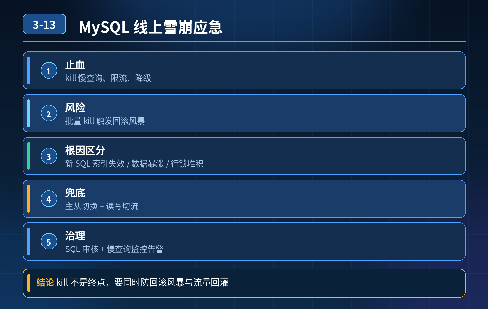

    MySQL 线上雪崩应急止损、索引失效排查治理

## 第 03-13 题　MySQL 线上雪崩应急止损、索引失效排查治理

**候选人浅层回答：** 直接 kill 掉所有慢查询，重启 MySQL 服务恢复。

## 核心拆解一句话结论

本题考察对底层原理和线上实战能力的综合理解，不能只停留在背结论。

## 连环追问

1. 批量 kill 慢查询会不会触发大事务回滚风暴？流量没有下降故障再次复现，如何快速降级？
2. 如何区分故障根因：新上线 SQL 索引失效、数据量暴涨导致索引退化、行锁冲突堆积连锁反应？
3. 如果同时存在主从延迟叠加慢查询，读写分离架构如何做切流兜底？
4. 请描述慢 SQL 引发 MySQL 全链路雪崩完整故障时间线。

## 一、慢 SQL 引发 MySQL 雪崩完整故障时间线

1. 触发点：一条 / 多条 SQL 发生索引失效，由索引扫描变成全表扫描；
2. SQL 执行消耗大量 CPU，执行耗时变长，数据库连接被长时间占用不释放；
3. 业务请求不断过来，新连接持续创建，数据库连接池被快速打满；
4. 新业务请求拿不到 DB 连接，接口大量超时；大量超时请求堆积在应用服务线程池；
5. 上游继续发起流量，形成恶性循环；数据库 CPU 持续 100%，正常业务 SQL也被拖慢；
6. 如果开启读写分离，主库压力暴涨，产生大量 binlog，从库同步跟不上，主从延迟飙升；从库查询也会受影响，整个读写分离链路全部异常；
7. 严重时锁等待堆积，锁超时，进一步放大故障，引发全链路雪崩。

风险点：直接批量 kill 正在执行的大事务慢 SQL，MySQL 需要执行回滚，回滚会消耗大量 CPU、IO，产生回滚风暴，数据库压力会进一步飙升，故障反而恶化，不能无脑全部 kill。

## 二、故障现场：优先应急止损（先保业务，再定位根因）

1\. 流量层面优先降级限流，而不是上来 kill、重启数据库

1\. 非核心业务直接开关降级关闭；核心接口限流，削减打到 DB 的 QPS；

2\. 热点查询尽可能切缓存，减少数据库访问；

3\. 读写分离场景：如果是从库慢查询导致故障，把读流量切回主库或者切换到其

2\. 他健康从节点；主库故障，优先切读流量，写流量做好降级保护。

3\. 谨慎处理慢 SQL

1\. 通过show processlist/performance_schema 找出慢 SQL；

2\. 优先 kill 小事务慢查询；谨慎 kill 大事务 SQL，避免回滚风暴；大事务尽量等

3\. 待执行完毕，配合流量压制。

3\. 重启 MySQL 是最后兜底手段，重启会断开全部连接，未提交事务全部回滚，业务中断时间长，尽量不优先使用。

5\. 临时业务止损手段

1\. 如果是新上线版本引入的 SQL 问题，立刻回滚发布版本；

2\. 通过临时开关屏蔽问题接口，阻断异常 SQL 持续涌入数据库。

## 三、根因区分定位

1\. 新上线 SQL 索引失效：故障时间点刚好对应版本发布；抓执行计划 explain，

2\. 确认 SQL 走全表扫描；属于上线引入问题。

2\. 数据量暴涨导致索引退化：SQL 本身有索引，随着表数据增长，索引选择性下降；MySQL 优化器判定全表扫描代价更低，主动放弃索引；表统计信息失真。

3\. 行锁冲突堆积连锁反应：慢查询本身性能不差，但是长事务持有行锁，大量业务 SQL 锁等待；连接堆积，CPU 升高；查看show engine innodb status 看锁等待信息。

排查工具：慢查询日志、performance_schema、explain、innodb状态、binlog，结合发布记录、监控指标（CPU、连接数、主从延迟、锁等待）综合判断。

## 四、索引失效长效治理完整方案

1. 上线前阶段

- 评审 SQL，使用 explain 校验执行计划；重点校验联合索引最左前缀、隐式转换、范围条件；
- 大表变更禁止业务高峰期 DDL；
- 压测使用生产量级仿真数据，不要只拿少量测试数据验证（小数据量执行计划和生产海量数据会不一样）。

2\. 线上监控告警

- 开启慢查询日志，监控慢查询数量、执行时间；
- 监控数据库 CPU、连接数、主从延迟、锁等待，设置告警；
- 监控表统计信息，大表定期analyze table 更新统计信息，防止优化器选错索引。

3\. 故障事后治理

- 修复失效索引，改写问题 SQL；
- 区分故障等级：
- 低风险：报表类非核心查询慢，优化索引即可；
- 中风险：核心业务接口 SQL 性能随数据量下降，改写 SQL、优化索引、必要时分表；
- 高风险：引发雪崩的 SQL，增加限流、缓存、熔断，增加防护。

4\. 架构兜底 读写分离、热点数据缓存；数据库连接池做好最大连接限制，防止DB 连接被耗尽；业务设置 SQL 执行超时时间，避免单 SQL 长时间占用连接。

<strong>追问：</strong>本题考察核心是什么？

<strong>参考答案：</strong> 区分测试环境和生产环境。很多开发以为建索引、上线看一眼explain 就万事大吉。 但测试环境数据量小，和线上海量高并发场景完全不一样。 考察点：

1. 故障发生懂得先止损，而不是上来 kill、重启数据库，理解 kill 大事务带来回滚风暴的副作用；
2. 能够区分索引失效、数据量退化、锁等待堆积这几类雪崩诱因；
3. 读写分离架构下懂得切流兜底；
4. 不止会应急，还要有完整长效治理手段，建立上线‑监控‑故障复盘闭环。 高级后端工程师需要懂得数据库故障连锁反应，不能只靠数据库本身扛住一切，业务层、架构层也要做防护。

## 连环追问要点整理

1. 底层核心原理是什么？为什么这么设计？
2. 线上出现相关故障如何快速止损、定位根因？
3. 高并发场景下有哪些坑点，性能、一致性、可用性如何权衡？

## 面试回答完整话术

  - **一句话结论**：本题考察对底层原理和线上实战能力的综合理解，不能只停留在背结论。
  - **连环追问**：批量 kill 慢查询会不会触发大事务回滚风暴？流量没有下降故障再次复现，如何快速降级？
  - **一、慢 SQL 引发 MySQL 雪崩完整故障时间线**：触发点：一条 / 多条 SQL 发生索引失效，由索引扫描变成全表扫描；
  - **二、故障现场：优先应急止损（先保业务，再定位根因）**：1\. 流量层面优先降级限流，而不是上来 kill、重启数据库
  - **三、根因区分定位**：1\. 新上线 SQL 索引失效：故障时间点刚好对应版本发布；抓执行计划 explain，
  - **四、索引失效长效治理完整方案**：评审 SQL，使用 explain 校验执行计划；重点校验联合索引最左前缀、隐式转换、范围条件；
  - **收尾**：线上问题按「先止损保可用性 → 再定位根因 → 最后从架构规范层面根治」三段论闭环。

## 追问：本题考察核心是什么？

###  高级工程师要分清：

1. **不能只停留在背结论**：要能回答「为什么这样设计、不这样会怎样、线上踩坑怎么排查」；
2. **具备止损→定位→根治三段论**：先止血保业务，再定位根因，最后从架构与规范层面根治；
3. **给出工程取舍**：性能、一致性、可用性三者权衡，说清代价与适用场景。

  核心思想：这道题考察原理理解 + 线上实战 + 架构思维，真正的工程答案是「现象 → 根因 → 止损 → 定位 → 根治」五段式闭环。

