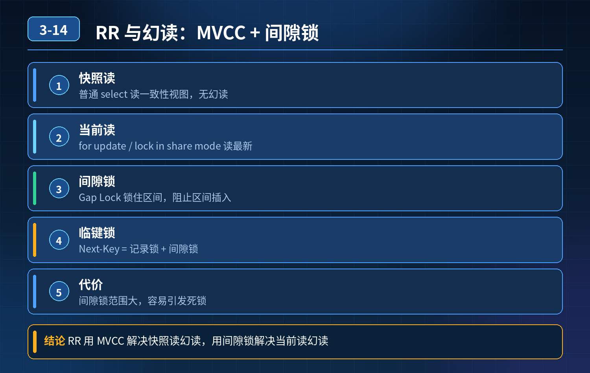

    MySQL InnoDB RR 可重复读与幻读

## 第 03-14 题　MySQL InnoDB RR 可重复读与幻读

**候选人浅层回答：** RR 级别依靠 MVCC 就可以解决幻读，串行化完全没有幻读，普通项目直接用默认 RR 就够用；遇到幻读直接改成串行化。

## 核心拆解一句话结论

RR 可重复读到底能不能解决幻读SQL 标准定义的 RR 隔离级别不能解决幻读。

## 连环追问

1. SQL 标准中 RR 是无法解决幻读的，为什么 InnoDB 的 RR 可以？依靠什么机制？
2. 事务先执行普通 select（快照读），紧接着 update 做范围更新，会不会更新到别的事务刚刚插入的新行？算不算幻读？
3. select ... for update 当前读，锁定的是单行还是整个范围区间？间隙锁、临键锁区别？间隙锁为什么容易产生死锁？
4. 如果业务要求绝对杜绝幻读，直接改成串行化行不行？有什么性能代价？生产什么场景才使用串行化？
5. 不依赖数据库锁，业务层面如何规避幻读？线上幻读导致数据异常，如何定位复现？

## 参考答案：

1\. MVCC 快照读（普通 select）：事务内快照建立之后，看不到其他事务新插入的数据，快照读层面看不到幻读。

2\. 临键锁 (Next‑Key Lock，间隙锁 + 行锁)：针对当前读（update、delete、selectfor update），锁住范围间隙，阻止其他事务在这个区间插入新数据，解决当前读的幻读。

- 重要坑点：同一个事务混合快照读 + 当前读，会出现幻读现象。 示例：事务先普通 select（快照读，看不到别人新插入记录）；接着执行 update 范围更新（当前读），会读到并且更新其他事务刚刚插入的新行。同事务前后结果不一致，业务上表现出幻读。MVCC 快照无法阻挡 update 当前读写入新数据。

3. 间隙锁、临键锁概念

- 行锁：锁住索引上已经存在的记录。
- 间隙锁 (Gap Lock)：锁住索引记录之间的空隙，禁止其他事务往间隙插入新数据，专门用来防止幻读；间隙锁不锁定记录本身，只锁空隙。
- 临键锁 Next‑Key Lock = 行锁 + 间隙锁，InnoDB RR 级别下范围当前读默认使用临键锁。

注意：如果查询条件命中唯一索引，能够精确匹配到一条记录，临键锁会退化为单纯行锁，不再加间隙锁。

间隙锁带来副作用： 间隙锁锁定的是索引空隙，不是真实数据，多个事务可以互不冲突持有不同间隙锁，互相等待对方释放间隙，极易产生死锁。这也是 RR 级别死锁概率高于 RC 的原因。

4. 业务要求绝对不能幻读，直接改成串行化可行吗？

串行化（SERIALIZABLE）隔离级别下，InnoDB 会对所有读操作加锁（自动提交关闭、显式事务内的普通 SELECT 会隐式转为锁定读），完全杜绝幻读。 代价巨大： 并发能力急剧下降，大量锁等待，性能很差。 生产极少使用串行化，仅用于数据一致性要求极高、并发很低的小众场景，绝大多数业务不推荐。

5. 线上幻读异常根因分析 & 复现定位常见根因：

1\. 事务内部混合快照读与当前读，快照看不到新插入行，但 update/delete 当前读可以操作新插入行，业务逻辑错乱；

2\. 加锁 SQL 没有命中索引，临键锁失效，没有锁住间隙，其他事务成功插入数据产生幻读；

3\. 业务逻辑错误，误认为 MVCC 可以阻止 update 操作看到新数据。

定位排查手段：

1\. 开启 binlog、观察锁等待日志，复现业务事务执行完整顺序；

2\. 区分 SQL 是快照读还是当前读；

3\. 确认加锁 SQL 是否命中索引，判断间隙锁是否生效。

5. 规避幻读的方案，分为数据库层 + 业务层数据库层面

1\. RR 级别下，如果业务需要防止范围插入，做范围操作必须使用select ...for update 当前读，并且一定要命中索引，让临键锁生效；

2\. RC 隔离级别：没有间隙锁，并发高、死锁少，但是 RC 本身无法解决幻读；适合业务可以容忍幻读的场景；

3\. 串行化：一致性最强，放弃并发，极少使用。

业务层面（不依赖数据库锁）

1. 使用唯一业务约束：业务唯一键，从数据库层面禁止重复插入；
2. 悲观逻辑改为乐观锁：版本号 version 机制；
3. 尽量缩小事务范围，避免长事务中做多次范围查询；
4. 避免同一个事务混合普通快照 select 和范围 update/delete；
5. 业务增加幂等校验，即使出现幻读新增数据，业务可以自动修正。

<strong>追问：</strong>这道题考察核心是什么？

<strong>参考答案：</strong> 不考察死记隔离级别名词。很多人误以为 RR 的 MVCC 就彻底解决全部幻读。面试官想看你理解：MVCC 只作用快照读；当前读靠临键锁；混合快照读与当前读依然会出现业务幻读；清楚间隙锁带来死锁副作用；懂得权衡隔离级别一致性与性能；不止会调数据库参数，还能给出业务层兜底方案。

高级工程师认知：没有万能隔离级别，根据业务并发、一致性要求做取舍，优先业务层规避，而不是一味靠数据库锁硬扛。

## 连环追问要点整理

1. 底层核心原理是什么？为什么这么设计？
2. 线上出现相关故障如何快速止损、定位根因？
3. 高并发场景下有哪些坑点，性能、一致性、可用性如何权衡？

## 面试回答完整话术

  - **一句话结论**：RR 可重复读到底能不能解决幻读SQL 标准定义的 RR 隔离级别不能解决幻读。
  - **连环追问**：SQL 标准中 RR 是无法解决幻读的，为什么 InnoDB 的 RR 可以？依靠什么机制？
  - **参考答案：**：RR 可重复读到底能不能解决幻读SQL 标准定义的 RR 隔离级别不能解决幻读。 InnoDB 的 RR 做了增强，依靠两套机制配合：
  - **收尾**：线上问题按「先止损保可用性 → 再定位根因 → 最后从架构规范层面根治」三段论闭环。

## 追问：本题考察核心是什么？

###  高级工程师要分清：

1. **不能只停留在背结论**：要能回答「为什么这样设计、不这样会怎样、线上踩坑怎么排查」；
2. **具备止损→定位→根治三段论**：先止血保业务，再定位根因，最后从架构与规范层面根治；
3. **给出工程取舍**：性能、一致性、可用性三者权衡，说清代价与适用场景。

  核心思想：这道题考察原理理解 + 线上实战 + 架构思维，真正的工程答案是「现象 → 根因 → 止损 → 定位 → 根治」五段式闭环。

