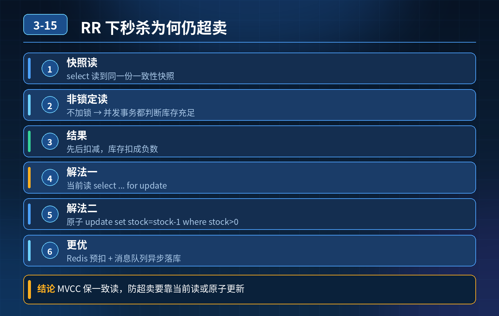

<div class="essay-image ">
    RR 隔离级别下秒杀库存超卖问题
</div>

## 第 03-15 题　RR 隔离级别下秒杀库存超卖问题

**候选人浅层回答：** RR 级别依靠 MVCC + 间隙锁已经彻底解决幻读，不会出现这种现象，应该是事务配置写错。

## 核心拆解一句话结论

业务代码使用普通 select 快照读查询库存，MVCC 快照读不会加任何行锁。

## 连环追问

1. 事务开启正常，隔离级别配置无误，为什么并发下多个事务都读到同一份库存快照，并且先后完成扣减？
2. 线上遇到该问题如何定位根因？是不是所有写业务都要加排他锁串行执行？

## 参考答案：

根因剖析

多个并发事务，同一时刻读取到同一个快照版本，都看到库存 \> 0，全部通过库存充足的校验。 快照读只解决当前事务内的视图一致性，不会阻止其他事务同时修改这行数据。

2\. 随后执行 update 属于当前读，会加行排他锁。事务排队依次执行扣减。 第一个事务扣完库存，但是其他事务已经基于旧快照做过 “库存充足” 的业务判断，后续排队执行 update 依旧会继续扣减，最终库存扣成负数，出现超卖。

关键点：这不是传统意义的幻读（插入新数据），属于快照读做业务判断带来的并发写冲突。RR 的 MVCC 只能保证本事务查询视图不变，不能用来做并发下的业务条件校验。间隙锁 / 临键锁在这里不会生效，因为 select 是快照读，没有加锁。

3\. 几种解决方案方案 1：悲观锁，查询阶段使用当前读把普通 select 改为select ... for update，查询时加排他行锁。

注意：这是当前读，会加行锁。并发请求排队拿到锁，拿到锁之后读取的是最新已提交库存，再做库存充足判断，再扣减。 缺点：高并发秒杀场景大量锁等待，数据库压力大，性能差。

方案 2：update 原子条件更新（推荐，无锁，数据库层面原子操作）放弃先查询再判断再更新的逻辑，直接一条 update 语句完成条件判断 + 扣减。

```sql
update stock set count = count‑1 where id=xxx and count >
0;
```

数据库单条 SQL 是原子执行。返回受影响行数，如果等于 0，代表库存不足，业务返回秒杀失败。 优势：不需要手动加锁，利用 SQL 原子性，避免快照读带来的判断失效，并发性能好。

方案 3：乐观锁版本号机制增加 version 版本字段。

```sql
update stock set count=count‑1,version=version+1 where
id=xxx and count>0 and version=#{oldVersion};
```

更新行数为 0 代表更新失败，业务捕获重试或返回失败。 适合并发没那么极端的场景；秒杀极高并发会出现大量更新失败，需要业务处理重试。

方案 4：前置限流 + Redis 预扣库存高并发秒杀，流量挡在 MySQL 之外。Redis 先预扣库存，库存耗尽直接返回失败；数据库做最终扣减，降低 DB 并发压力。

线上定位排查思路

1. 区分 SQL 是快照读还是当前读，看业务是否拿普通 select 返回结果做业务条件判断；
2. 观察 binlog，看多条事务 update 的执行顺序，确认多个事务读取的是旧快照；
3. 复现：开启多个会话，模拟并发，复现 “快照读判断，update 扣减” 的现象。

不建议全部业务无脑加排他锁串行执行，会严重降低吞吐量，优先使用原子 update。

<strong>追问：</strong>这道题考察点是什么？

<strong>参考答案：</strong> 考察是否真正理解 MVCC 快照读的边界。很多人死记硬背 RR 解决幻读，误以为 RR 隔离级别就可以搞定并发业务校验。 MVCC 快照读只能保证查询视图一致性，快照读到的数据不能直接拿来做并发业务条件判断。 高级后端需要具备并发数据一致性工程思维：隔离级别只是基础，不能完全依赖数据库隔离级别解决业务并发问题，要结合原子 SQL、乐观锁、悲观锁、缓存限流做整套防护，避免资损事故。

## 三层防御总结

1. 数据库层：优先使用原子条件 update，避免快照读做业务判断；必要时使用悲观锁 / 乐观锁；
2. 业务层：扣减之后校验库存结果，失败直接返回；
3. 架构层：高并发场景上层限流、Redis 预扣，削减打到 DB 的并发压力。

## 连环追问要点整理

1. 底层核心原理是什么？为什么这么设计？
2. 线上出现相关故障如何快速止损、定位根因？
3. 高并发场景下有哪些坑点，性能、一致性、可用性如何权衡？

## 代码示例

```sql
update stock set count = count‑1 where id=xxx and count >
0;
```

## 面试回答完整话术

  - **一句话结论**：业务代码使用普通 select 快照读查询库存，MVCC 快照读不会加任何行锁。
  - **连环追问**：事务开启正常，隔离级别配置无误，为什么并发下多个事务都读到同一份库存快照，并且先后完成扣减？
  - **参考答案：**：业务代码使用普通 select 快照读查询库存，MVCC 快照读不会加任何行锁。
  - **三层防御总结**：数据库层：优先使用原子条件 update，避免快照读做业务判断；必要时使用悲观锁 / 乐观锁；
  - **收尾**：线上问题按「先止损保可用性 → 再定位根因 → 最后从架构规范层面根治」三段论闭环。

## 追问：本题考察核心是什么？

###  高级工程师要分清：

1. **不能只停留在背结论**：要能回答「为什么这样设计、不这样会怎样、线上踩坑怎么排查」；
2. **具备止损→定位→根治三段论**：先止血保业务，再定位根因，最后从架构与规范层面根治；
3. **给出工程取舍**：性能、一致性、可用性三者权衡，说清代价与适用场景。

  核心思想：这道题考察原理理解 + 线上实战 + 架构思维，真正的工程答案是「现象 → 根因 → 止损 → 定位 → 根治」五段式闭环。

<div class="img-wrap-left"></div>
