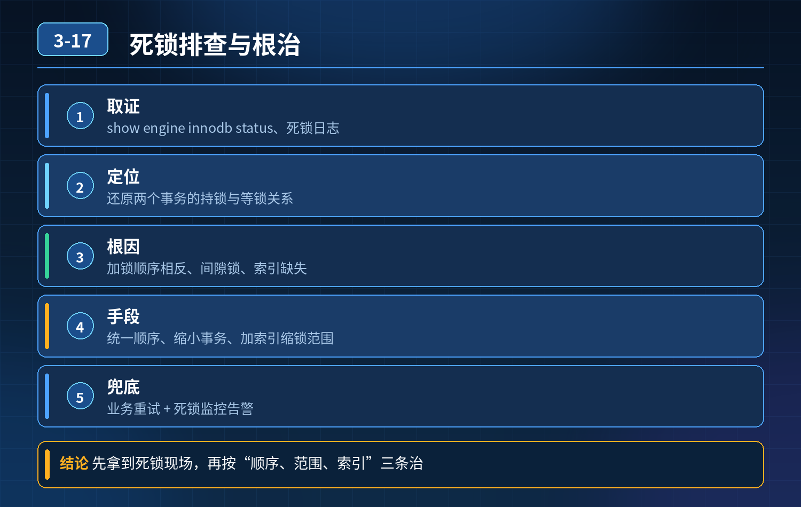

    MySQL 线上死锁故障排查与根治治理

## 第 03-17 题　MySQL 线上死锁故障排查与根治治理

**候选人浅层回答：** 给查询加索引缩小锁范围；不行就上分布式锁让事务串行执行。

## 核心拆解一句话结论

本题考察对底层原理和线上实战能力的综合理解，不能只停留在背结论。

## 连环追问

1. 线上突发死锁，执行什么命令拿到完整死锁现场？只看业务日志能不能分清两个事务各自持有锁、等待锁的情况？
2. 两个事务更新同一张表两行，操作顺序相反触发循环等待死锁，不靠开发人工自觉，代码层面如何统一规避？
3. 间隙锁导致死锁：两个事务做范围加锁查询，并发插入，互相等待间隙锁。如何识别、如何解决？
4. 高并发场景，不能完全串行（性能暴跌），不能上分布式锁，不能改业务操作顺序，还有什么手段降低死锁概率？有没有不用改代码的临时方案？调低隔离级别能不能解决间隙锁死锁？副作用是什么？
5. 多表事务，跨表锁交叉等待，如何系统性治理，而不是出现一例改一例？

## 一、线上死锁现场定位

1. 核心命令：show engine innodb status;，输出结果中LATESTDETECTED DEADLOCK 模块，保存最近一次死锁完整现场。

- 重点：业务应用日志只会报死锁异常，看不到锁信息、SQL、事务持有 / 等待关系，不能用来分析锁冲突；必须依赖 InnoDB 死锁日志。 死锁日志可以看到：两个事务分别执行什么 SQL、已经拿到什么锁、正在等待什么锁、锁类型（行锁 / 间隙锁）。

2\. 配套辅助信息：binlog、慢查询日志、业务代码事务逻辑；监控死锁次数、事务回滚率，死锁指标飙升及时告警。

注意：MySQL 只会保存最近一次死锁，如果死锁频繁发生，要定时采集 innodb 状态，防止现场被覆盖丢失。

## 二、两类典型死锁场景识别

场景 1：行锁循环等待（不同更新顺序）事务 A：更新 id=1，再更新 id=2 事务 B：更新 id=2，再更新 id=1 互相持有对方需要的行锁，循环等待触发死锁。 根治手段：统一资源加锁顺序，所有业务更新记录，按照主键 ID 升序（或降序）固定顺序操作，从根源破坏死锁「循环等待」必要条件。

不能依靠开发自觉：封装公共更新工具、代码 CR 阶段检查多记录更新顺序，强制排序。

场景 2：间隙锁 / 临键锁带来的死锁（RR 隔离级别特有）RR 级别范围select ... for update 会加临键锁（行锁 + 间隙锁）；间隙锁锁住索引空隙，多个事务可以同时持有互不冲突的间隙锁，后续插入时互相等待，形成死锁。 识别特征：死锁日志中出现gap lock 关键字，SQL 是范围加锁查询。 解决方案：

1. 能命中唯一索引，就用等值查询，临键锁退化为普通行锁，消除间隙锁；
2. 临时方案：隔离级别从 RR 调整为 RC，RC 没有间隙锁，可以彻底消除间隙锁类死锁；RC 副作用：会出现幻读；业务要接受 RC 带来的隔离级别变化，业务层做好幂等、唯一约束兜底。

## 三、通用降死锁手段（不能改顺序、不能加分布式锁、高并发场景）

1. 缩小事务粒度（最重要） 事务尽量短小，不要在事务内部做 RPC、大查询；尽快 commit，缩短锁持有时间，降低锁冲突概率。长事务会放大死锁发生概率。
2. 索引一定要命中 加锁 SQL 必须命中索引；没命中索引会升级为表级意向锁，锁范围急剧放大，死锁概率暴涨。
3. 业务捕获死锁异常，有限次数重试 重试只是补救，不能根治死锁；只适合少量偶发死锁场景。
4. 不推荐直接上分布式锁处理数据库行锁死锁：会引入新组件，复杂度上升，性能损耗，属于重方案，优先数据库层优化。

## 四、多表跨表事务死锁系统性治理

1\. 梳理所有跨多张表的事务，统一表的访问顺序，例如固定先操作 A 表，再 B

2\. 表，再 C 表；禁止不同业务颠倒表操作顺序。

2\. 尽量拆分大事务，把跨表大事务拆成多个小事务；

3\. 代码评审卡点：对于多表更新、批量更新逻辑，重点评审锁顺序、事务大小，防止新增逻辑引入交叉锁；

4\. 线上监控死锁指标，定期复盘死锁日志，提前发现隐患，不要等故障爆发再修复。

<strong>追问：</strong>本题考察核心是什么？

<strong>参考答案：</strong> 不是考察背诵死锁四个必要条件。

1. 知道怎么抓取真实死锁现场，明白业务日志不足以分析锁冲突；
2. 区分普通行锁死锁和间隙锁死锁，理解 RR/RC 隔离级别对间隙锁的影响以及取舍；
3. 区分补救手段（重试）和根治手段（锁顺序、缩小事务、优化索引）；
4. 具备系统性治理思维，遇到跨表死锁，不是修单个 case，而是从编码规范、CR评审、监控告警整套体系规避。

高级工程师认知：分布式锁不是万能解药，优先在数据库、业务代码层面解决；隔离级别调整是临时手段，要清楚带来的业务风险。

## 连环追问要点整理

1. 底层核心原理是什么？为什么这么设计？
2. 线上出现相关故障如何快速止损、定位根因？
3. 高并发场景下有哪些坑点，性能、一致性、可用性如何权衡？

## 面试回答完整话术

  - **一句话结论**：本题考察对底层原理和线上实战能力的综合理解，不能只停留在背结论。
  - **连环追问**：线上突发死锁，执行什么命令拿到完整死锁现场？只看业务日志能不能分清两个事务各自持有锁、等待锁的情况？
  - **一、线上死锁现场定位**：核心命令：show engine innodb status;，输出结果中LATESTDETECTED DEADLOCK 模块，保存最近一次死锁完整现场。
  - **二、两类典型死锁场景识别**：场景 1：行锁循环等待（不同更新顺序）事务 A：更新 id=1，再更新 id=2 事务 B：更新 id=2，再更新 id=1 互相持有对方需要的行锁，循环等待触发死锁。 根治手段：统一资源加锁顺序，所
  - **三、通用降死锁手段（不能改顺序、不能加分布式锁、高并发场景）**：缩小事务粒度（最重要） 事务尽量短小，不要在事务内部做 RPC、大查询；尽快 commit，缩短锁持有时间，降低锁冲突概率。长事务会放大死锁发生概率。
  - **四、多表跨表事务死锁系统性治理**：1\. 梳理所有跨多张表的事务，统一表的访问顺序，例如固定先操作 A 表，再 B
  - **收尾**：线上问题按「先止损保可用性 → 再定位根因 → 最后从架构规范层面根治」三段论闭环。

## 追问：本题考察核心是什么？

###  高级工程师要分清：

1. **不能只停留在背结论**：要能回答「为什么这样设计、不这样会怎样、线上踩坑怎么排查」；
2. **具备止损→定位→根治三段论**：先止血保业务，再定位根因，最后从架构与规范层面根治；
3. **给出工程取舍**：性能、一致性、可用性三者权衡，说清代价与适用场景。

  核心思想：这道题考察原理理解 + 线上实战 + 架构思维，真正的工程答案是「现象 → 根因 → 止损 → 定位 → 根治」五段式闭环。

