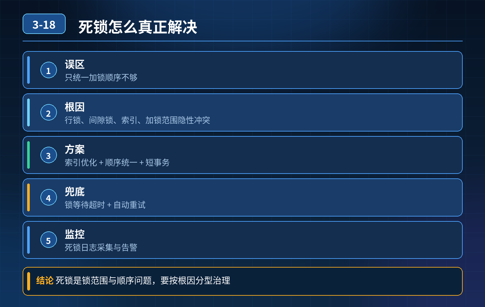

    MySQL 数据库死锁，电商大促死锁线上故障复盘

## 第 03-18 题　MySQL 数据库死锁，电商大促死锁线上故障复盘

**候选人浅层回答：** 统一加锁顺序；设置锁超时，配合死锁检测自动回滚，基本就能避开死锁问题。

## 核心拆解一句话结论

本题考察对底层原理和线上实战能力的综合理解，不能只停留在背结论。

## 连环追问

电商有两条核心链路： 下单链路：先扣库存，再更新订单状态； 退款链路：先回滚订单状态，再返还库存。 两套逻辑都会对订单表、库存表加行锁。 大促高峰期突然大面积报错，大量下单、退款请求失败；用户付款后订单状态不更新，退款长时间处理卡住。查看数据库日志，频繁出现死锁。 两条链路加锁顺序相反，高并发下形成循环等待；但单独看每一条链路，执行顺序都符合业务逻辑。

1. 问题根源是什么？
2. 业务场景复杂，不同链路天然有不一样的操作流程，难道要强行把所有业务改成同一个加锁顺序，才能杜绝死锁吗？

## 一、死锁形成四大必要条件

死锁必须同时满足四个条件：互斥、持有并等待、不可剥夺、循环等待。 统一加锁顺序，本质就是破坏循环等待，也是大家最常用的方案。 但这个方案有局限性：业务复杂时，不同业务链路业务流程本身就不一样，强行统一顺序会非常别扭，甚至改不动业务流程，只靠统一顺序无法覆盖全部场景。

本次事故根源： 下单：锁库存 → 锁订单 退款：锁订单 → 锁库存 高并发交错执行，事务 A 拿到库存锁等待订单锁，事务 B 拿到订单锁等待库存锁，形成循环等待，触发死锁。

## 二、三层防御体系（根源治理方案）

第一层：事前预防（优先做，成本最低）

1. 梳理全链路锁资源清单，对公共资源约定全局加锁优先级，优先锁优先级编号小的资源。如果业务允许，尽量对齐加锁顺序，破坏循环等待条件。
2. 缩小事务粒度，事务尽量短小，不要在事务内部做 RPC、等待外部接口、长时间业务计算；事务持有锁的时间越短，死锁概率指数下降。
3. 避免在同一个事务里，交叉更新多张无关的热点表；热点资源尽量收敛。
4. 能不加行锁就不加行锁：优先使用乐观锁（版本号 / 时间戳），version 版本控制，不加排他锁，从源头规避行锁竞争。适合库存扣减这类场景。

第二层：事中控制（并发冲突发生时兜底）

1. 锁超时：innodb_lock_wait_timeout，等待超时主动回滚，避免事务无限阻塞。
2. 死锁检测：InnoDB 默认开启死锁检测，检测到死锁自动选择代价更小的事务回滚，释放锁资源。

注意：高并发热点场景，死锁检测本身有性能开销；超高吞吐场景可以关闭死锁检测，依靠锁超时兜底，需要权衡。

1. 排队串行化：热点资源引入分布式锁，把对同一个资源的并发更新串行化，避免数据库层面行锁交叉竞争。比如同一个商品库存的扣减排队。

第三层：事后兜底（死锁依然发生时）

1. 捕获死锁异常（Deadlock found when trying to get lock），做有限次数重试，重试失败进入异常流程；禁止无限重试，防止风暴。
2. 死锁日志常态化采集、监控告警，定时分析死锁栈，定位新增冲突链路，持续优化锁逻辑。
3. 异常消息走死信队列，人工核对订单、库存数据，防止数据不一致。

## 三、方案选型对比

1. 统一加锁顺序：简单可靠，适合新业务、链路少的场景；老业务多链路耦合时改造难度大。
2. 乐观锁：无锁竞争，性能好；适合允许版本冲突重试的场景，不适合强阻塞、高冲突场景。
3. 缩小短事务：普适最优实践，任何锁场景都应该遵守。
4. 分布式锁串行热点：适合秒杀、库存这类超高竞争热点资源。

## 四、电商案例优化落地

原逻辑： 下单：begin；扣库存；更新订单；commit 退款：begin；更新订单；返还库存；commit优化方案可选其一： 方案 A（统一顺序）：两条链路都改成【先锁库存、再锁订单】，退款逻辑调整，优先操作库存回补，再更新订单。 方案 B（乐观锁改造）：库存表增加 version 版本号，扣减、回补库存使用乐观锁，不再加排他行锁，消除锁竞争。 方案 C（拆分事务）：把跨表更新拆成短事务，或者引入分布式锁对同一个商品 ID 串行处理。

<strong>追问：</strong>本题考察核心是什么？

<strong>参考答案：</strong>初级开发只会背统一加锁顺序、死锁检测、锁超时。高级工程师要有前置治理思维：

1. 明白统一加锁顺序只是手段，不是万能银弹，有业务落地局限性；
2. 理解死锁四大条件，所有解决方案本质都是破坏其中任意一个条件；
3. 不是死锁出现了才去查日志，而是提前梳理全链路锁资源、评估锁竞争；
4. 懂得分层设计：事前预防 \> 事中控制 \> 事后重试兜底，优先用乐观锁、短事务降低锁冲突；
5. 能结合电商下单退款真实业务，权衡改造成本，给出可落地的多种方案，而不是只有一套标准答案。

<strong>核心思想：</strong>死锁治理不是只靠事后回滚，锁的风险要在业务设计阶段就纳入考量，短事务、少加锁，优先规避而不是事后补救。

## 连环追问要点整理

1. 底层核心原理是什么？为什么这么设计？
2. 线上出现相关故障如何快速止损、定位根因？
3. 高并发场景下有哪些坑点，性能、一致性、可用性如何权衡？

## 面试回答完整话术

  - **一句话结论**：本题考察对底层原理和线上实战能力的综合理解，不能只停留在背结论。
  - **连环追问**：电商有两条核心链路： 下单链路：先扣库存，再更新订单状态； 退款链路：先回滚订单状态，再返还库存。 两套逻辑都会对订单表、库存表加行锁。 大促高峰期突然大面积报错，大量下单、退款请求失败；用户付款后订
  - **一、死锁形成四大必要条件**：死锁必须同时满足四个条件：互斥、持有并等待、不可剥夺、循环等待。 统一加锁顺序，本质就是破坏循环等待，也是大家最常用的方案。 但这个方案有局限性：业务复杂时，不同业务链路业务流程本身就不一样，强行统一
  - **二、三层防御体系（根源治理方案）**：梳理全链路锁资源清单，对公共资源约定全局加锁优先级，优先锁优先级编号小的资源。如果业务允许，尽量对齐加锁顺序，破坏循环等待条件。
  - **三、方案选型对比**：统一加锁顺序：简单可靠，适合新业务、链路少的场景；老业务多链路耦合时改造难度大。
  - **四、电商案例优化落地**：原逻辑： 下单：begin；扣库存；更新订单；commit 退款：begin；更新订单；返还库存；commit优化方案可选其一： 方案 A（统一顺序）：两条链路都改成【先锁库存、再锁订单】，退款逻辑调
  - **收尾**：线上问题按「先止损保可用性 → 再定位根因 → 最后从架构规范层面根治」三段论闭环。

## 追问：本题考察核心是什么？

###  高级工程师要分清：

1. **不能只停留在背结论**：要能回答「为什么这样设计、不这样会怎样、线上踩坑怎么排查」；
2. **具备止损→定位→根治三段论**：先止血保业务，再定位根因，最后从架构与规范层面根治；
3. **给出工程取舍**：性能、一致性、可用性三者权衡，说清代价与适用场景。

  核心思想：这道题考察原理理解 + 线上实战 + 架构思维，真正的工程答案是「现象 → 根因 → 止损 → 定位 → 根治」五段式闭环。

