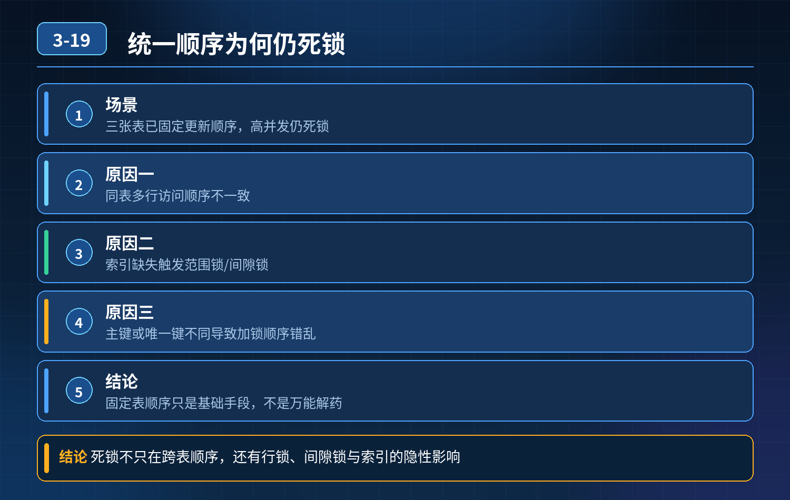

<div class="essay-image ">
    明明统一了表更新顺序，依然发生 InnoDB 死锁
</div>

## 第 03-19 题　明明统一了表更新顺序，依然发生 InnoDB 死锁

**候选人浅层回答：** 背诵表面结论，没有深入到原理和线上场景。

## 核心拆解一句话结论

本题考察对底层原理和线上实战能力的综合理解，不能只停留在背结论。

## 场景复盘

电商支付事务，同时操作三张表：订单表、支付流水表、用户余额表。 开发已经统一规定表更新顺序，但是高并发下仍然出现死锁，接口阻塞、支付失败，只能重启数据库恢复。

核心考点：死锁不只是跨表顺序问题，还有行锁、间隙锁、索引、加锁范围、隔离级别带来的隐性死锁；固定表顺序只是基础手段，不是万能解药。

先回答核心问题：为什么表顺序统一了，还会死锁？

InnoDB 是行级锁，锁的是索引记录，不是整张表。 常见几个高频原因：

1. 同一张表内多行更新，行的访问顺序不一致 只控制 “表的先后”，但是事务A 更新行 1、行 2；事务 B 更新行 2、行 1。单表内部行顺序交叉，依然循环等待。
2. 索引缺失，触发范围锁 / 间隙锁（最常见幽灵陷阱） 更新条件没命中唯一索引，InnoDB 退化成扫描，锁住一大片间隙（gap lock）。间隙锁互相抢占，很容易形成死锁；RR 隔离级别下这个问题尤为突出。
3. 主键 / 唯一键不同，加锁顺序错乱 不同事务操作不同行，虽然表顺序一样，但命中的索引记录锁交叉等待。
4. 事务内多段 SQL、分支逻辑导致动态加锁顺序 if/else 分支，不同支付场景走不同更新逻辑，部分分支偷偷改变行加锁顺序，代码评审很难一眼看出来。
5. 悲观锁 select ... for update 的坑 查询没命中索引，锁范围放大；或者两条select for update 锁定行互相交叉。

一句话总结：锁是锁索引行，不是锁表；统一表顺序 ≠ 统一行锁顺序。

## 一、死锁精准排查方法

开启 InnoDB 死锁日志，核心命令：

```sql
show engine innodb status;
```

找到 LATEST DETECTED DEADLOCK 区块，里面会写明：

- 两个事务分别持有什么锁、等待什么锁
- SQL 语句、等待的索引记录
- 锁类型：record lock /gap lock /next-key lock排查步骤：

1. 拿到死锁日志，定位两条冲突 SQL；
2. 检查 where 条件有没有命中唯一索引；
3. 打印两条事务分别锁住的行主键；
4. 核对代码分支，确认是否存在分支导致行顺序颠倒；
5. 核对隔离级别：RR（默认）存在间隙锁，RC 无间隙锁。

配套监控： 采集 information_schema.innodb_locks、innodb_lock_waits，对接告警；死锁发生立刻推送日志。

## 二、三层防御体系（面试官想要的标准答案）

第一层：编码与 SQL 层（事前，从源头减少锁交叉）

1. 优先固定【行主键顺序】，而不只是表顺序 更新多行时，统一按主键 id 升序排序之后再执行更新，避免行逆序抢占锁。
2. 杜绝无索引更新、范围更新 update 条件必须命中主键 / 唯一索引，把锁精准限制在单行记录，消除间隙锁风险。
3. 精简事务，缩小锁持有时间 事务短小，快开快提交；不要在事务里面放 RPC、sleep、复杂计算，减少锁持有窗口。
4. 谨慎使用 select ... for update 能后置更新就不用悲观锁；如果一定要用，同样保证索引命中、行顺序统一。
5. 隔离级别取舍：

- 业务可以接受幻读：改成 RC，消除间隙锁，死锁概率大幅下降；
- 需要防幻读：保留 RR，严格控制索引，避免大范围扫描。

第二层：限流、重试、超时兜底（事中，死锁发生时避免雪崩）即使规范做好，极端并发下死锁依然小概率出现，不能让请求卡死排队：

6\. 设置合理 innodb_lock_wait_timeout，不要无限等待；锁等待超时自动回滚事务，释放锁；

7\. 业务侧捕获死锁异常（Deadlock found when trying to get lock），做短延迟重试（有限次数，比如最多 2 次），重试时依然保证行顺序；

8\. 高并发支付链路做流量削峰限流，避免瞬时流量打爆数据库锁竞争；

9\. 死锁不要频繁重试，防止越重试越锁。

重点：数据库重启是最后的急救手段，绝对不能当成常规方案；重启会强制回滚所有活跃事务，极易造成订单、余额状态错乱。

第三层：监控、审计、对账兜底（事后）

1. 监控指标：死锁次数、锁等待时长、锁等待会话数；死锁突增立刻告警；
2. SQL 审核平台拦截无索引 update、大范围 DML；上线前校验事务内多条更新的加锁顺序；
3. 定时对账：订单、余额、流水三方核对，捕获死锁回滚带来的数据不一致，自动告警补偿。

## 三、补充优化方案（进阶）

1. 业务拆分：把余额扣减、订单状态变更拆成串行异步，通过 MQ 串行化，同一用户的支付操作排队执行，从根源消除并发争抢；
2. 状态机设计：依靠状态流转，减少多表同时更新；先落流水，再异步更新余额；
3. 乐观锁替代悲观锁：版本号 version，update ... where version = ?，避免行锁争抢，适合冲突不密集场景。

初级 vs 高级工程师差异初级工程师：只记住 “统一表顺序 + 超时”，以为万事大吉，无法解释顺序统一后仍然死锁，遇到间隙锁、行锁交叉场景就卡壳。 高级工程师：

1. 理解 InnoDB 锁锁索引行，不是锁表，区分表顺序、行顺序两个概念；
2. 看得懂 innodb 死锁日志，能定位间隙锁、索引缺失这类隐性诱因；
3. 方案是组合体系：索引优化、行顺序控制、隔离级别选型、异常重试、限流、对账补偿；
4. 明白死锁只能降低概率，无法 100% 消灭，必须配套容错机制，而不是单纯依赖编码规范。

## 连环追问要点整理

1. 底层核心原理是什么？为什么这么设计？
2. 线上出现相关故障如何快速止损、定位根因？
3. 高并发场景下有哪些坑点，性能、一致性、可用性如何权衡？

## 代码示例

```sql
show engine innodb status;
```

## 面试回答完整话术

  - **一句话结论**：本题考察对底层原理和线上实战能力的综合理解，不能只停留在背结论。
  - **场景复盘**：电商支付事务，同时操作三张表：订单表、支付流水表、用户余额表。 开发已经统一规定表更新顺序，但是高并发下仍然出现死锁，接口阻塞、支付失败，只能重启数据库恢复。
  - **一、死锁精准排查方法**：开启 InnoDB 死锁日志，核心命令：
  - **二、三层防御体系（面试官想要的标准答案）**：第一层：编码与 SQL 层（事前，从源头减少锁交叉）
  - **三、补充优化方案（进阶）**：业务拆分：把余额扣减、订单状态变更拆成串行异步，通过 MQ 串行化，同一用户的支付操作排队执行，从根源消除并发争抢；
  - **收尾**：线上问题按「先止损保可用性 → 再定位根因 → 最后从架构规范层面根治」三段论闭环。

## 追问：本题考察核心是什么？

###  高级工程师要分清：

1. **不能只停留在背结论**：要能回答「为什么这样设计、不这样会怎样、线上踩坑怎么排查」；
2. **具备止损→定位→根治三段论**：先止血保业务，再定位根因，最后从架构与规范层面根治；
3. **给出工程取舍**：性能、一致性、可用性三者权衡，说清代价与适用场景。

  核心思想：这道题考察原理理解 + 线上实战 + 架构思维，真正的工程答案是「现象 → 根因 → 止损 → 定位 → 根治」五段式闭环。

<div class="img-wrap-left"></div>
