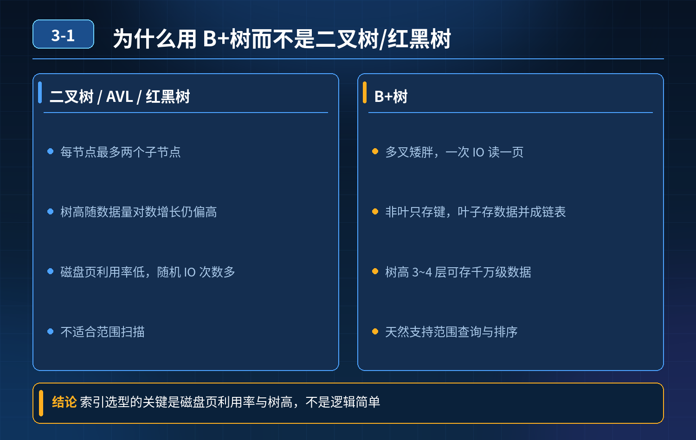

    为什么 InnoDB 索引选用 B+树，不用二叉树、AVL、红黑树

## 第 03-1 题　为什么 InnoDB 索引选用 B+树，不用二叉树、AVL、红黑树

**举例说明：**一张 2000 万行的订单表，主键 bigint 占 8 字节，一个 16KB 的页大约能放上千个键值对，三层 B+树就能覆盖十亿级记录；同样数据量换成二叉树，树高接近 25 层，一次查询最多要做 25 次磁盘 IO。

**候选人浅层回答：** 二叉树树高度太高，查询慢；B + 树高度低，磁盘 IO 次数更少。

## 核心拆解一句话结论

数据库索引的核心矛盾：磁盘 IO 很慢，内存很快，要尽可能减少磁盘读取次数。

## 连环追问

1. AVL 树、红黑树也是平衡树，也可以控制树的高度，为什么不用它们做数据库索引？
2. 数据库数据存储在磁盘上，请讲清楚 B + 树适配磁盘存储的核心逻辑，磁盘页、页分裂、页合并关键点。

## 参考答案：

1. 为什么不用普通二叉树普通二叉树在极端情况下会退化成链表，树高等于数据行数；千万级数据树高千万级别，千万次磁盘 IO，性能完全不可用。

2. 为什么不用 AVL 平衡树、红黑树AVL、红黑树是二叉平衡树，每个节点最多两个子节点。 千万级数据，二叉平₂衡树树高大约 log (1000w) ≈ 24，一次查询最坏需要 24 次磁盘 IO。 而磁盘一次 IO 会读取一整页（InnoDB 页默认 16KB），只存两个子节点，页内大量空间浪费，没有充分利用磁盘页的读写特性，IO 次数还是太高，不适合磁盘存储场景。

3. B + 树（多路平衡查找树）适配磁盘的核心优势

1\. 多路多叉，压低树高度，减少磁盘 IO B + 树一个节点可以存放大量索引键与子节点指针。InnoDB 一页 16KB，可以存放成百上千个索引项。千万级数据，B + 树树高通常只有3‑4 层。根节点常驻内存，查找只需要 2~3 次磁盘 IO，IO 次数被压到很低。

2\. 非叶子节点只存索引键，不存完整行数据 非叶子节点只做路由，不保存真实数据，一页可以存放更多索引，进一步降低树高度；全部真实行数据都存放在叶子节点。

3\. 叶子节点双向链表串联 所有叶子节点通过双向有序链表连接。范围查询、order by 排序、limit 分页，不需要再回到上层树做遍历，直接顺着链表扫描叶子节点，范围查询性能极强。红黑树、AVL 做范围查询需要递归遍历，效率很低。

4\. 页分裂、页合并机制，适配磁盘页存储 B + 树按页管理数据，新增数据页满就触发页分裂；删除数据页利用率过低触发页合并，保证每一页尽量填满，减少空间浪费，维持树的多路平衡。

对比：红黑树 / AVL 主要适合内存场景，例如 Java TreeMap；不适合磁盘 IO 频繁的数据库索引场景。

5\. 补充：B 树和 B + 树简单区分B 树每个节点既存索引 key，又存数据；B + 树数据只存在叶子。B + 树非叶子节点可以存更多索引，树更矮；叶子链表对范围查询友好，所以 InnoDB 选择 B + 树。

<strong>追问：</strong>本题考察核心是什么？

<strong>参考答案：</strong> 不只是记住 “B + 树高度低” 这个结论。面试官想看理解磁盘IO 是主要矛盾。 很多开发只停留在会建索引，不理解数据结构和硬件特性之间的取舍：二叉平衡树适合内存，B + 树是专门针对磁盘设备设计的多路平衡树。理解页、页分裂、双向链表这些关键点，才真正懂索引底层。

核心设计思想：利用磁盘页批量读取的特性，用多叉降低树高，减少 IO；叶子链表优化范围查询

## 连环追问要点整理

1. 底层核心原理是什么？为什么这么设计？
2. 线上出现相关故障如何快速止损、定位根因？
3. 高并发场景下有哪些坑点，性能、一致性、可用性如何权衡？

## 面试回答完整话术

  - **场景举例**：一张 2000 万行的订单表，主键 bigint 占 8 字节，一个 16KB 的页大约能放上千个键值对，三层 B+树就能覆盖十亿级记录；同样数据量换成二叉树，树高接近 25 层，
  - **一句话结论**：数据库索引的核心矛盾：磁盘 IO 很慢，内存很快，要尽可能减少磁盘读取次数。
  - **连环追问**：AVL 树、红黑树也是平衡树，也可以控制树的高度，为什么不用它们做数据库索引？
  - **参考答案：**：数据库索引的核心矛盾：磁盘 IO 很慢，内存很快，要尽可能减少磁盘读取次数。每访问树的一个节点，大概率发生一次磁盘 IO。
  - **收尾**：线上问题按「先止损保可用性 → 再定位根因 → 最后从架构规范层面根治」三段论闭环。

## 追问：本题考察核心是什么？

###  高级工程师要分清：

1. **不能只停留在背结论**：要能回答「为什么这样设计、不这样会怎样、线上踩坑怎么排查」；
2. **具备止损→定位→根治三段论**：先止血保业务，再定位根因，最后从架构与规范层面根治；
3. **给出工程取舍**：性能、一致性、可用性三者权衡，说清代价与适用场景。

  核心思想：这道题考察原理理解 + 线上实战 + 架构思维，真正的工程答案是「现象 → 根因 → 止损 → 定位 → 根治」五段式闭环。

