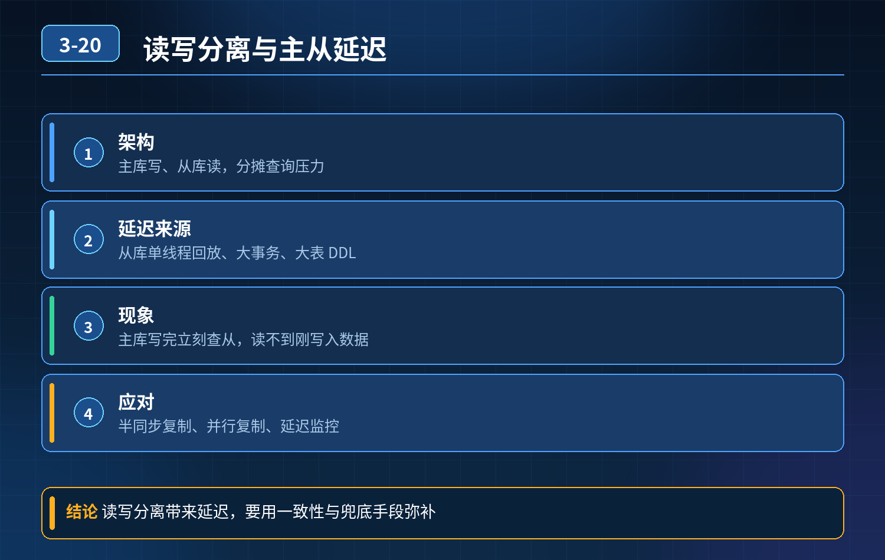

    MySQL 读写分离，主从延迟线上故障复盘

## 第 03-20 题　MySQL 读写分离，主从延迟线上故障复盘

**候选人浅层回答：** 做主从复制、读写分离；主库负责写，从库负责读，分摊查询压力，性能直接翻倍。

## 核心拆解一句话结论

本题考察对底层原理和线上实战能力的综合理解，不能只停留在背结论。

## 连环追问

电商业务做了主从读写分离，订单查询全部走从库。 大促当天大量用户付款之后，进入订单详情页提示订单不存在，多次刷新才能刷出来，客诉暴涨； 还有用户下单后查看库存页面，库存没有变少，误以为下单失败，反复提交订单造成重复下单。 排查发现：主库订单、库存写入已经成功，但是从库数据延迟数秒才同步完成，用户查询刚好落在这个延迟窗口里面。

1. 故障根本原因是什么？
2. 如果业务要求写入之后马上能查到最新数据，难道所有查询全部强制走主库吗？

## 一、故障根源：主从同步延迟带来的一致性问题

MySQL 默认异步复制，主库写完事务直接返回成功，Binlog 异步推送给从库回放。 大促流量大、事务多、SQL 执行慢、从库硬件资源不足、大事务，都会放大主从延迟。 读写分离天然牺牲强一致性，换取读能力水平扩展；它适合可以容忍短暂旧数据的查询场景，不适合写后立刻读自己刚提交数据的场景。 很多同学只知道读写分离能分担压力，忽略一致性代价，这就是读写分离最经典的隐形陷阱。

## 二、三层防御体系，兼顾并发性能与一致性

第一层：业务路由层（优先方案，落地成本最低）做请求路由区分，不是一刀切所有读请求都丢到从库：

1. 强一致性查询（写后立刻读）走主库：用户刚下单查自己订单、扣减库存后查库存、支付状态校验，这类请求路由到主库查询；
2. 最终一致性查询走从库：商品列表、历史订单、榜单、统计报表，允许短暂延迟，继续利用从库分摊压力；实现方式：ThreadLocal 标记、注解 AOP、中间件（Sharding-JDBC、MyCat）读写路由。

第二层：缓存兜底方案（最常用，减轻主库压力）热点数据增加 Redis 缓存，写数据库同时更新缓存：

1. 下单成功，订单数据写入主库后，同步写入 Redis；用户查询优先读 Redis，绕开主从延迟；
2. 缓存设置合理过期时间，缓存失效再去查询数据库；
3. 注意缓存更新策略（更新数据库 + 更新缓存 / 更新数据库 + 删除缓存），保证缓存和数据库最终一致。

第三层：复制模式与架构优化（底层缩短延迟）

1. 半同步复制（rpl_semi_sync）：主库至少等待一个从库收到 Binlog 应答之后，再返回客户端成功，降低延迟概率，但依然不是实时，会损失部分写入吞吐；
2. 并行复制、优化从库回放线程，拆分大事务，避免单条超大事务阻塞从库回放；
3. 资源隔离：从库单独高配，报表、统计类慢查询单独隔离到专用从库，防止慢SQL 拖垮所有从库同步；
4. 监控主从延迟：监控 Seconds_Behind_Master，延迟超过阈值，自动把读流量切回主库，做动态路由降级。

## 三、方案取舍说明

1. 全部查询强制走主库：简单粗暴，解决一致性，但是读写分离失去意义，主库压力很容易被打满，高并发场景不可取；
2. 半同步复制：只能降低延迟发生概率，无法彻底消除延迟，不能当成强一致性方案；
3. 缓存 + 读写路由组合：互联网电商主流方案，性能、一致性、成本平衡最好；
4. 如果业务要求严格强一致、极高并发：可以考虑分布式数据库（TiDB 等），天然分布式强一致。

## 四、电商场景优化落地流程

1. 下单事务在主库提交成功；
2. 订单、库存数据同步写入 Redis；
3. 用户立刻查询订单、库存，优先读取 Redis；
4. 普通历史订单、商品列表走从库；
5. 持续监控主从延迟，延迟过高自动切流保护；
6. 缓存异步失效，保证最终数据一致。

<strong>追问：</strong>本题考察核心是什么？

<strong>参考答案：</strong>初级开发只会知道读写分离可以分担查询压力，把它当成提升性能的万能方案。高级工程师要理解取舍：

1. 读写分离是牺牲强一致性换读扩展能力，异步复制天然存在延迟，这是架构特性，不是 bug；
2. 数据库架构没有万能方案，核心是识别业务查询的一致性诉求，区分强一致 /最终一致性流量，做差异化路由；
3. 懂分层组合：路由策略、缓存、复制模式、监控降级搭配使用，而不是单一靠主从；
4. 能预判架构陷阱：上线前就要识别 “写后马上读” 这类场景，提前规避线上客诉故障。

<strong>核心思想：</strong>读写分离不是简单配置主从，性能和一致性永远需要权衡，根据业务诉求做流量隔离才是架构关键。

## 连环追问要点整理

1. 底层核心原理是什么？为什么这么设计？
2. 线上出现相关故障如何快速止损、定位根因？
3. 高并发场景下有哪些坑点，性能、一致性、可用性如何权衡？

## 面试回答完整话术

  - **一句话结论**：本题考察对底层原理和线上实战能力的综合理解，不能只停留在背结论。
  - **连环追问**：电商业务做了主从读写分离，订单查询全部走从库。 大促当天大量用户付款之后，进入订单详情页提示订单不存在，多次刷新才能刷出来，客诉暴涨； 还有用户下单后查看库存页面，库存没有变少，误以为下单失败，反复提
  - **一、故障根源：主从同步延迟带来的一致性问题**：MySQL 默认异步复制，主库写完事务直接返回成功，Binlog 异步推送给从库回放。 大促流量大、事务多、SQL 执行慢、从库硬件资源不足、大事务，都会放大主从延迟。 读写分离天然牺牲强一致性，换取
  - **二、三层防御体系，兼顾并发性能与一致性**：第一层：业务路由层（优先方案，落地成本最低）做请求路由区分，不是一刀切所有读请求都丢到从库：
  - **三、方案取舍说明**：全部查询强制走主库：简单粗暴，解决一致性，但是读写分离失去意义，主库压力很容易被打满，高并发场景不可取；
  - **四、电商场景优化落地流程**：用户立刻查询订单、库存，优先读取 Redis；
  - **收尾**：线上问题按「先止损保可用性 → 再定位根因 → 最后从架构规范层面根治」三段论闭环。

## 追问：本题考察核心是什么？

###  高级工程师要分清：

1. **不能只停留在背结论**：要能回答「为什么这样设计、不这样会怎样、线上踩坑怎么排查」；
2. **具备止损→定位→根治三段论**：先止血保业务，再定位根因，最后从架构与规范层面根治；
3. **给出工程取舍**：性能、一致性、可用性三者权衡，说清代价与适用场景。

  核心思想：这道题考察原理理解 + 线上实战 + 架构思维，真正的工程答案是「现象 → 根因 → 止损 → 定位 → 根治」五段式闭环。

