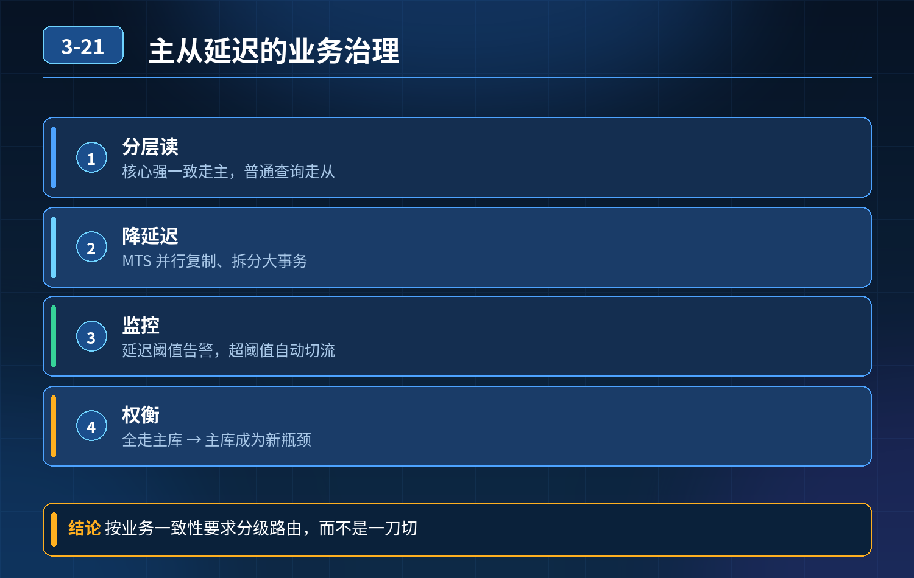

    MySQL 主从读写分离，主从延迟业务治理

## 第 03-21 题　MySQL 主从读写分离，主从延迟业务治理

**候选人浅层回答：** 一致性要求高的场景直接读主库，普通查询走从库，监控主从延迟时间。

## 核心拆解一句话结论

本题考察对底层原理和线上实战能力的综合理解，不能只停留在背结论。

## 连环追问

1. 如果所有强一致业务全部强制读主，主库读压力持续上涨，主库成为性能瓶颈怎么办？
2. 主库执行几十秒大事务，提交之后从库延迟数分钟，大量业务读到旧数据，库存、金额类业务逻辑出错，如何处理？
3. 大表 DDL 引发主从延迟，业务高峰期如何避免？
4. 用户付款成功立刻跳转订单详情，必须读到最新数据，不想全部读主消耗主库性能，有没有精细化方案，不做一刀切强制读主？
5. 半同步复制、并行复制，能不能彻底根除主从延迟？
6. 某一台从库延迟超过阈值，读写分离组件如何自动切换流量，避免用户持续读取旧数据？

## 一、主从延迟产生根源

binlog 同步是异步行为。主库执行完写操作立刻返回，binlog 传递到从库、从库重放 SQL 需要时间。

- 大事务：主库大事务提交，大量 binlog 瞬间推送从库，从库重放跟不上，产生巨大延迟；
- 从库硬件性能弱、单线程重放 binlog（老版本）；
- 大表 DDL，DDL 语句同步到从库阻塞执行；半同步、并行复制只能降低延迟概率，不能彻底消除主从延迟，极端场景依然会出现延迟，不能当作银弹。

## 二、多种业务解决方案（区分一刀切读主 和精细化策略）

方案 1：简单粗暴：强一致场景强制读主优点简单直接；缺点：大量场景读主，主库读压力上升，容易把主库打满，不能大规模滥用。

方案 2：精细化读主策略，避免一刀切（付款后立刻查订单场景）

1. 写后短时读主：用户本次会话，刚刚完成写操作，短时间窗口内（比如 1‑2s）该业务请求强制读主；超过时间之后切回从库。

例如：创建订单、支付成功之后，跳转详情页这一次请求走主库；后续用户再刷新页面，走从库。既保证刚写完能读到最新数据，又不会永久占用主库读流量。

1. 按业务维度路由：订单、资金这类强一致性业务走主；统计、报表、历史查询走从库。

方案 3：缓存兜底写主库成功之后，同步写入 Redis 缓存；查询优先读缓存；缓存命中拿到最新数据，减少对主库的读取压力。注意缓存和数据库的一致性问题。

方案 4：复制层优化，减少延迟发生概率

1. 开启半同步复制：主库等待至少一个从库收到 binlog 再返回；

<strong>注意：</strong>只是收到binlog，不等从库执行完成，依然会延迟；网络抖动会降级退化为异步复制。

2\. 开启并行复制，从库多线程重放 binlog，提升从库回放速度。

重点：二者只能缓解，不能彻底消灭主从延迟。

## 三、监控 + 读写分离自动降级机制

1. 持续监控每个从库Seconds_Behind_Master 延迟指标；
2. 当单个从库延迟超过预设阈值，读写分离中间件（Sharding‑Jdbc、MyCat）自动把该从库摘除，不再分配读流量；流量转发给其他健康从库；全部从库都延迟超标，全部读请求自动切到主库；
3. 配置告警，延迟超标触发告警通知运维。

## 四、长效治理，从源头避免大延迟

1. 严禁大事务：业务禁止超大事务，拆分长事务，避免提交瞬间大量 binlog 压垮从库；
2. DDL 避开业务高峰期：大表 DDL 使用 pt‑online‑schema‑change /gh‑ost，不要高峰期直接执行 alter，防止 DDL 同步造成从库长时间阻塞；
3. 保证从库硬件配置不能弱于主库，避免从库本身性能瓶颈拖慢回放；

## 连环追问要点整理

1. 底层核心原理是什么？为什么这么设计？
2. 线上出现相关故障如何快速止损、定位根因？
3. 高并发场景下有哪些坑点，性能、一致性、可用性如何权衡？

## 面试回答完整话术

  - **一句话结论**：本题考察对底层原理和线上实战能力的综合理解，不能只停留在背结论。
  - **连环追问**：如果所有强一致业务全部强制读主，主库读压力持续上涨，主库成为性能瓶颈怎么办？
  - **一、主从延迟产生根源**：binlog 同步是异步行为。主库执行完写操作立刻返回，binlog 传递到从库、从库重放 SQL 需要时间。
  - **二、多种业务解决方案（区分一刀切读主 和精细化策略）**：方案 1：简单粗暴：强一致场景强制读主优点简单直接；缺点：大量场景读主，主库读压力上升，容易把主库打满，不能大规模滥用。
  - **三、监控 + 读写分离自动降级机制**：持续监控每个从库Seconds_Behind_Master 延迟指标；
  - **四、长效治理，从源头避免大延迟**：严禁大事务：业务禁止超大事务，拆分长事务，避免提交瞬间大量 binlog 压垮从库；
  - **收尾**：线上问题按「先止损保可用性 → 再定位根因 → 最后从架构规范层面根治」三段论闭环。

## 追问：本题考察核心是什么？

###  高级工程师要分清：

1. **不能只停留在背结论**：要能回答「为什么这样设计、不这样会怎样、线上踩坑怎么排查」；
2. **具备止损→定位→根治三段论**：先止血保业务，再定位根因，最后从架构与规范层面根治；
3. **给出工程取舍**：性能、一致性、可用性三者权衡，说清代价与适用场景。

  核心思想：这道题考察原理理解 + 线上实战 + 架构思维，真正的工程答案是「现象 → 根因 → 止损 → 定位 → 根治」五段式闭环。

