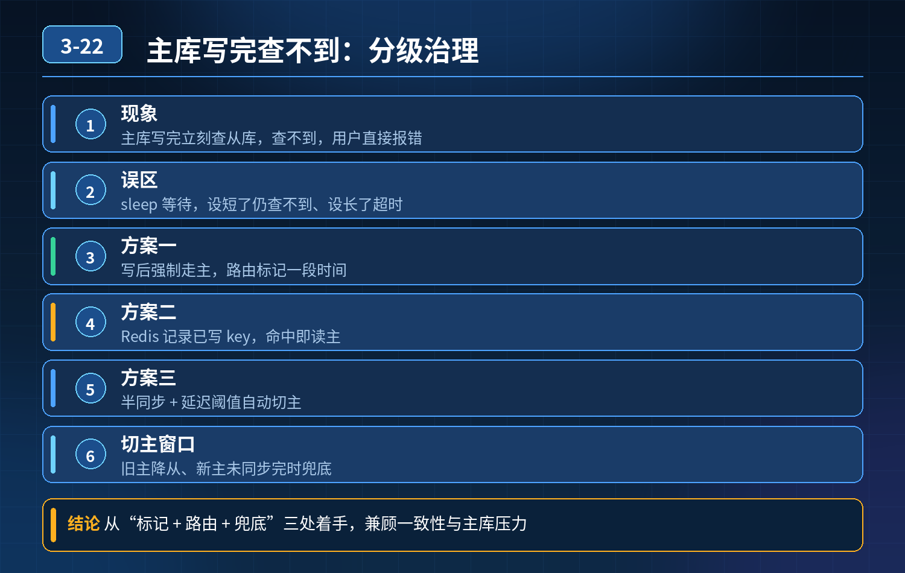

    读写分离架构，主库写入后从库查不到数据，全链路分级治理方案

## 第 03-22 题　读写分离架构，主库写入后从库查不到数据，全链路分级治理方案

**候选人浅层回答：** 写完 sleep 一段时间再查；关键数据强制走主库；再加一个主从延迟监控。

## 核心拆解一句话结论

本题考察对底层原理和线上实战能力的综合理解，不能只停留在背结论。

## 连环追问

1. sleep 多久合适？延迟波动大，设短了依然查不到，设长了接口超时，这个时间标准怎么定？
2. 如果所有核心请求全部强制走主库，读写分离就失去意义，主库连接池被打满，矛盾怎么权衡？
3. 主从切换场景：旧主降为从，新主的数据还没同步完成，流量切过去大量读请求查不到数据，切换窗口如何兜底？
4. 一条下单长链路，主库写入后，后续多个步骤都要读数据，哪些走主、哪些走从？不能整条链路都走主库。
5. 从库延迟突然飙升几秒，读到旧数据引发超卖、订单状态错乱，如何自动降级，而不是人工切流量？
6. 分库分表 + 读写分离，多个从库延迟参差不齐，怎么路由？如何保证能读到本次事务自己刚写入的数据？

## 一、核心根源

异步复制模式下，主库事务提交返回成功时，Binlog 是异步投递到从库回放，天然存在时间窗口的不一致。 sleep 是伪方案：延迟不是固定值，受大事务、流量、从库负载影响，无法设置一个稳定可靠的等待时长，生产禁止使用。 一刀切全部强行走主库，会耗尽主库资源，读写分离的水平扩展收益直接归零。

核心思路：不区分主库 / 从库，而是对读请求做一致性分级，配套路由标记、会话跟踪、延迟感知、自动降级一整套体系。

## 二、三层核心治理体系

第一层：会话级一致性标记（最核心，解决 “读自己写的数据”）同一个请求 / 同一个会话内，写入主库之后，本次链路后续的读请求，带上路由标记，优先路由到主库；跨会话、非强一致查询，正常走从库。 实现方案：

- ThreadLocal / 请求上下文埋标记：当前链路有写操作，标记为【本次需要强一致读】；
- 只在本次调用链内生效，不会全局放大主库流量；
- 适合下单、支付、退款这类长事务链路，只让这条链路的后续读走主，历史查询、列表查询继续走从库。

特点：精准收敛强一致流量，而不是整个业务一刀切走主库。

第二层：按业务语义分级，定义三类读流量

1. 强一致读（Read Your Writes，读己之写）：用户刚提交订单、支付校验、库存扣减校验、退款状态校验，必须看到本次写入结果 → 路由主库。
2. 单调读：用户已经看到版本 A，不能再读到更早的旧版本，比如用户刷新订单页，不能一会新一会旧；可以结合 GTID 位点做位点路由：写入后记录 GTID，从库必须回放位点≥该 GTID 才允许读。
3. 最终一致读：商品列表、历史订单、统计报表、榜单，允许短暂延迟 → 正常路由从库，享受读写分离扩容红利。

GTID 位点路由进阶：写入主库拿到本次事务 GTID，读从库前，筛选已经追上该 GTID 的从库，只向追上位点的从库分发请求。完美适配多从库延迟参差不齐、分库分表场景。

第三层：延迟感知 + 自动降级兜底（故障和切换场景）

1. 持续采集每个从库的延迟指标（Seconds_Behind_Master、GTID 回放位点），维护每个从库健康状态；
2. 阈值策略：单个从库延迟超过阈值，自动摘除路由池，不再分配读流量；
3. 全局降级：当大部分从库延迟持续飙升，自动把最终一致性流量，按比例灰度切回主库，熔断异常从库；
4. 主从切换窗口期兜底：切换完成后，等待从库追上切换时刻位点，再放量读流量，或者切换后短时间窗口内所有流量临时走新主，等同步追上再切回从库；
5. 半同步复制：至少一个从库收到 Binlog 才返回写入成功，降低延迟概率；

<strong>注意：</strong>半同步只是降低概率，依然不能保证强一致，不能替代分级路由。

## 三、缓存配套补充方案（降低强一致主库压力）

热点写后强读场景，写入主库成功后同步更新 Redis 缓存；查询优先读取缓存，绕开数据库主从延迟问题。 适用：订单详情、库存余额这类高频写后立刻查的场景，大幅减少打到主库的强一致读请求。

## 四、方案对比，避坑总结

- ❌

1. sleep 等待： 不推荐，不稳定，极易引发故障；

- ❌

2\. 全部强行走主库： 极端兜底手段，不能常态化；

3\. 会话标记 + 业务分级路由： 主流首选，精准控制主库流量；

4\. GTID 位点路由： 多从、分库分表复杂架构首选；

5\. 半同步复制： 辅助降低延迟发生概率，不是一致性方案；

6\. 缓存： 高频热点场景减负神器。

<strong>追问：</strong>本题考察核心是什么？

<strong>参考答案：</strong>初级开发只会想到强制走主库、sleep 等待，只知道现象，没有体系化思路。高级工程师要具备架构权衡能力：

1. 明白主从异步复制的本质就是最终一致性，不存在免费的强一致；
2. 一致性不是非黑即白，学会对读请求分级：读己之写、单调读、最终读；
3. 流量精细化治理：只把必须强一致的少量请求打到主库，保护读写分离扩容收益；
4. 覆盖全场景：普通流量、长业务链路、多从库延迟不均、主从切换、故障自动降级；
5. 拒绝简单粗暴的应急手段，设计可自动化、可灰度、可监控的闭环方案。

<strong>核心思想：</strong>读写分离的一致性治理，不是 “要不要走主库”，而是谁、什么时候、在什么条件下可以走从库，用分级策略把强一致流量控制在最小范围。

## 连环追问要点整理

1. 底层核心原理是什么？为什么这么设计？
2. 线上出现相关故障如何快速止损、定位根因？
3. 高并发场景下有哪些坑点，性能、一致性、可用性如何权衡？

## 面试回答完整话术

  - **一句话结论**：本题考察对底层原理和线上实战能力的综合理解，不能只停留在背结论。
  - **连环追问**：sleep 多久合适？延迟波动大，设短了依然查不到，设长了接口超时，这个时间标准怎么定？
  - **一、核心根源**：异步复制模式下，主库事务提交返回成功时，Binlog 是异步投递到从库回放，天然存在时间窗口的不一致。 sleep 是伪方案：延迟不是固定值，受大事务、流量、从库负载影响，无法设置一个稳定可靠的等待时
  - **二、三层核心治理体系**：第一层：会话级一致性标记（最核心，解决 “读自己写的数据”）同一个请求 / 同一个会话内，写入主库之后，本次链路后续的读请求，带上路由标记，优先路由到主库；跨会话、非强一致查询，正常走从库。 实现方案
  - **三、缓存配套补充方案（降低强一致主库压力）**：热点写后强读场景，写入主库成功后同步更新 Redis 缓存；查询优先读取缓存，绕开数据库主从延迟问题。 适用：订单详情、库存余额这类高频写后立刻查的场景，大幅减少打到主库的强一致读请求。
  - **四、方案对比，避坑总结**：sleep 等待： 不推荐，不稳定，极易引发故障；
  - **收尾**：线上问题按「先止损保可用性 → 再定位根因 → 最后从架构规范层面根治」三段论闭环。

## 追问：本题考察核心是什么？

###  高级工程师要分清：

1. **不能只停留在背结论**：要能回答「为什么这样设计、不这样会怎样、线上踩坑怎么排查」；
2. **具备止损→定位→根治三段论**：先止血保业务，再定位根因，最后从架构与规范层面根治；
3. **给出工程取舍**：性能、一致性、可用性三者权衡，说清代价与适用场景。

  核心思想：这道题考察原理理解 + 线上实战 + 架构思维，真正的工程答案是「现象 → 根因 → 止损 → 定位 → 根治」五段式闭环。

