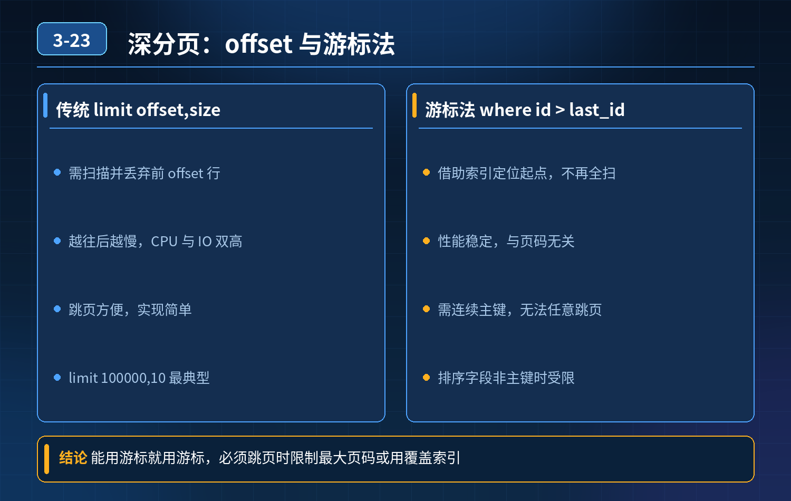

<div class="essay-image ">
    MySQL limit 大偏移深分页优化
</div>

## 第 03-23 题　MySQL limit 大偏移深分页优化

**举例说明：**limit 1000000,10 要先扫描并丢弃前 100 万行，再取 10 行；改写成 where id \> 1000000 order by id limit 10 后，优化器通过索引直接定位到起点，扫描量从百万行降到 10 行。

**候选人浅层回答：** offset 越大，MySQL 需要扫描并丢弃前面十万条无效行，所以性能差；用主键游标方案，改写为 where id \> 100000 limit 10，利用主键索引直接定位，性能大幅提升。

## 核心拆解一句话结论

基础游标（keyset‑pagination，键集分页）优缺点原理：记录上一页最后一条的排序字段值，用where 排序字段 \> last_val

## 连环追问

1. 如果排序字段不是主键、存在多维度筛选条件，ID 不连续；业务需要支持跳页，拿不到上一页最后一条 ID，游标方案还能用吗？
2. 筛选条件十几个可选维度，不可能为每一种查询组合都建立联合索引，怎么办？

雪花 ID/UUID，同时支持多种排序规则，要写多少套游标？

3\. 运营后台需要直接跳转到第几百页，游标方案直接失效，怎么处理？

4\. 使用 ES 可以解决分页，但要考虑运维成本、数据同步延迟；如果只允许使用MySQL，不能引入外部中间件，还有哪些通用优化手段？

## 参考答案：

- limit pageSize，避免大 offset 扫描丢弃大量数据。

优点：性能极高，利用索引快速定位，适合 APP、前端只允许上一页、下一页，不支持跳页的场景。

- ❌局限：

2\. 不支持任意跳页，无法直接跳到第几百页；必须拿到上一页末尾的排序值；

3\. 如果有多组筛选、多种排序，每种组合都要对应一套索引；筛选维度太多，索引爆炸，成本不可接受；

4\. 如果排序字段非唯一，要带上唯一主键做二级排序，避免重复、漏行。

示例：按创建时间倒序，where create_time \< #{last_time}and id \< #{last_id} limit 10，id 用来解决时间重复的场景。

2. 只使用 MySQL，不引入 ES 的几种方案方案 A：覆盖索引子查询优化（适合允许跳页，单表场景）利用覆盖索引，先在索引层完成 offset 偏移定位主键，再回表拿完整行数据，减少回表次数。

```sql
select * from t where id in (
    select id from t where status=1 order by create_time
desc limit 100000,10);
```

注意：子查询只扫描索引（覆盖索引），不需要回表，快速拿到10 条主键，外层再回表读取完整行；比直接limit 100000,10 性能好很多。 局限：offset 特别巨大时依然会扫描很多索引行，只是比全表回表快。

方案 B：业务层面限制，产品规避深分页（成本最低，优先推荐）

1. 产品禁止直接跳转到很高页码，只提供上一页、下一页；
2. 限制最大查询页码，例如最多允许查询前 1000 页，超过提示用户缩小筛选条件；真实业务中，运营、用户几乎不会真的浏览几万页数据；大量深分页请求本身属于不合理业务访问。

方案 C：分区表按时间范围做分区，筛选条件带上时间，缩小扫描的数据范围，降低 offset 需要扫描的数据总量。

方案 D：预计算（适合后台统计类固定查询）定时任务把高频复杂分页结果预计算落地到一张中间结果表，业务直接查询中间表；适合查询条件固定、允许短暂数据延迟，不适合动态任意筛选。

3. ES 方案权衡（允许引入中间件场景）ES 的from/size 同样有深分页问题，也不能无限跳页；ES 推荐用search_after 对应 MySQL 游标；

- 优势：支持多维度任意筛选、多字段排序；
- 代价：要维护双写、处理数据同步延迟、运维 ES 集群；并不是上了 ES 就万事大吉，ES 也有深分页限制。

4. 不同场景选型总结

1\. 移动端 APP，只上一页下一页，无跳页 → 优先使用键集游标（keyset）分页，排序字段 + 唯一主键，建立联合索引；

2\. 后台管理系统，需要跳页，但页码不会特别大 → 覆盖索引子查询优化，同时业务限制最大页码；

3\. 后台需要任意条件、任意页码、海量数据 → MySQL 很难完美支撑，考虑ES；同时接受同步延迟；

4\. 筛选维度爆炸，组合极多：不要试图建立所有组合联合索引；产品上做约束，强制用户必须传入时间、状态等过滤条件，缩小扫描数据集。

<strong>追问：</strong>本题考察核心是什么？

<strong>参考答案：</strong> 不能只背id\>xxx limit 这个标准答案。很多人只记住游标法，忽略它的业务约束。面试官想看：

1. 清楚游标分页的适用边界和短板（不能跳页、多筛选维度索引成本）；
2. 不只一个解法，区分：产品约束、MySQL 索引层面、预计算、引入中间件多种方案；
3. 具备业务思维：很多分页性能问题，最优解是产品层面做限制，而不是一味靠SQL 硬扛；
4. 知道 ES 也不是银弹，要权衡运维成本与数据一致性。

高级工程师要结合业务场景做取舍，没有万能 SQL，不同业务场景选择不同方案。

## 连环追问要点整理

1. 底层核心原理是什么？为什么这么设计？
2. 线上出现相关故障如何快速止损、定位根因？
3. 高并发场景下有哪些坑点，性能、一致性、可用性如何权衡？

## 代码示例

```sql
select * from t where id in (
    select id from t where status=1 order by create_time
desc limit 100000,10);
```

## 面试回答完整话术

  - **场景举例**：limit 1000000,10 要先扫描并丢弃前 100 万行，再取 10 行；改写成 where id \> 1000000 order by id limit 10 后，优化
  - **一句话结论**：基础游标（keyset‑pagination，键集分页）优缺点原理：记录上一页最后一条的排序字段值，用where 排序字段 \> last_val
  - **连环追问**：如果排序字段不是主键、存在多维度筛选条件，ID 不连续；业务需要支持跳页，拿不到上一页最后一条 ID，游标方案还能用吗？
  - **参考答案：**：基础游标（keyset‑pagination，键集分页）优缺点原理：记录上一页最后一条的排序字段值，用where 排序字段 \> last_val
  - **收尾**：线上问题按「先止损保可用性 → 再定位根因 → 最后从架构规范层面根治」三段论闭环。

## 追问：本题考察核心是什么？

###  高级工程师要分清：

1. **不能只停留在背结论**：要能回答「为什么这样设计、不这样会怎样、线上踩坑怎么排查」；
2. **具备止损→定位→根治三段论**：先止血保业务，再定位根因，最后从架构与规范层面根治；
3. **给出工程取舍**：性能、一致性、可用性三者权衡，说清代价与适用场景。

  核心思想：这道题考察原理理解 + 线上实战 + 架构思维，真正的工程答案是「现象 → 根因 → 止损 → 定位 → 根治」五段式闭环。

<div class="img-wrap-left"></div>
