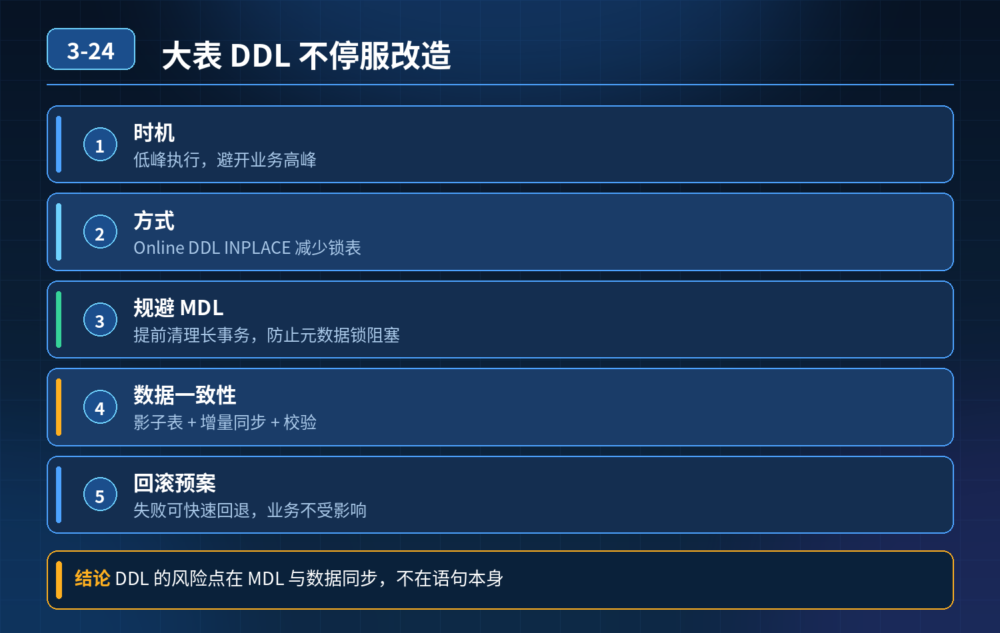

    千万级订单大表，加联合索引、修改字段长度，如何做到不停业务、全程尽量不锁表，数据不出错

## 第 03-24 题　千万级订单大表，加联合索引、修改字段长度，如何做到不停业务、全程尽量不锁表，数据不出错

**候选人浅层回答：** 用 MySQL Online DDL 或者 pt-online-schema-change，影子表同步，不停服。

## 核心拆解一句话结论

本题考察对底层原理和线上实战能力的综合理解，不能只停留在背结论。

## 连环追问

1. Online DDL 申请 MDL 元数据锁那一刻，如果存在长事务持有 MDL，后续所有读写全部阻塞，连接数打满、库雪崩，如何提前规避？
2. 全量拷贝历史数据的同时，业务持续写入，增量同步丢数据、重复执行，怎么做一致性校验？
3. 如果变更涉及主键 / 唯一键、外键，pt-osc 这类第三方工具不能直接使用，有什么不停机替代方案？
4. 新增索引后，统计信息没有及时更新，优化器选错执行计划，查询性能恶化，如何兜底？
5. 禁止使用任何第三方 DDL 工具，只靠业务代码层面，怎么做字段扩展，完全不影响线上？

## 一、基础概念

MySQL InnoDB Online DDL：大部分操作允许 DDL 执行期间正常读写，但 DDL开始的瞬间，需要短暂申请排他 MDL 锁。 MDL（元数据锁）：只要事务未提交，就持有 MDL 读锁；DDL 需要 MDL 写锁。长事务是 Online DDL 最大杀手。

pt-online-schema-change（pt-osc）原理：建影子新表，拷贝原表全量数据，通过触发器捕获原表的增删改增量，同步到影子表；同步完成后原子 rename 交换新旧表。

注意：pt-osc 依赖触发器，遇到主键修改、外键、部分唯一键场景会受限，无法直接使用。

1. MDL 锁、长事务导致库雪崩的规避方案风险根源：DDL 发起后，等待 MDL 排他锁；只要有一个长事务不提交，DDL 持续阻塞，后续所有新的查询请求都需要 MDL 读锁，全部排队阻塞，连接堆积打满，数据库雪崩。

前置防护手段：

1. 变更前巡检：查询information_schema.innodb_trx，抓长时间运行事务，提前告警、kill 长事务；监控慢事务、事务执行时长。
2. 设置 DDL 等待超时参数 lock_wait_timeout，不要无限等待 MDL 锁。等待超时直接放弃本次 DDL，不持续阻塞后续 SQL。
3. 限流熔断：数据库侧监控连接数、等待队列。一旦出现大量 MDL 等待的会话，自动告警，必要时阻断 DDL。
4. 选择低峰窗口，同时低峰窗口也不能忽略长事务；低峰只是降低概率，不是解决 MDL 阻塞。
5. 读写分离：DDL 操作在从库先执行验证，主库执行时如果阻塞，可快速切换读流量到从库。

核心：Online DDL 不是完全无锁，只是拷贝数据阶段不锁表；获取 MDL 写锁的瞬间，会被长事务卡住。

2\. 全量拷贝 + 增量同步，数据一致性校验（pt-osc /gh-ost）pt-osc 靠触发器捕获 DML，gh-ost 是解析 binlog 做增量，两者都有一致性校验机制：

1\. 全量阶段分批分片拷贝，避免一次性大事务；

2\. 增量阶段持续同步 binlog / 触发器捕获的新增、更新、删除；

3\. 双校验：

1\. 行数校验：新旧表总行数对比；

2\. 校验和：对分片数据做 CRC32/MD5 哈希，对比新旧表分片数据；

3\. 最终切换 rename 前，短暂锁表做最后一小段增量补齐，确认数据完全一致，再原子 rename。

4\. 兜底：业务层做数据对账任务，定时对比新旧表订单数据，发现差异告警。

风险点：触发器方案（pt-osc）在高写入场景有额外性能开销；gh-ost 无触发器，对业务影响更小。

3\. 主键 / 唯一键 / 外键场景，pt-osc 无法直接使用的替代不停机方案pt-osc 限制：外键、主键修改场景，触发器方案容易出错，工具会直接拒绝。

可选方案：

1\. gh-ost：binlog 解析方式，对外键支持相对更好，但依然要评估约束；

2\. 业务双写方案（自研影子表）：业务代码同时写原表 + 新影子表，双写。双写一段时间，数据对齐后，灰度切读流量到新表；验证无误后，再切写流量；旧表保留一段时间作为回滚基线；

3\. 分阶段改造：先删除外键（业务层做约束校验，数据库去掉外键），再执行DDL；生产环境一般不推荐数据库外键，本身就容易锁表。

4\. 新增索引，统计信息陈旧，优化器选错执行计划的兜底方案MySQL 索引创建后，不会立刻更新统计信息，优化器可能误判基数，选错索引，查询性能暴跌。 兜底策略：

1\. 变更前，在预发环境压测，验证 SQL 执行计划（explain）；

2\. 新增索引后，手动执行ANALYZE TABLE，主动更新统计信息；

3\. 监控慢查询、QPS、RT，监控索引使用情况sys.schema_unused_indexes；

4\. 业务层 SQL 可以加FORCE_INDEX 做临时强制索引兜底（慎用，作为应急手段）；

5\. 准备回滚脚本：索引性能恶化，立刻DROP INDEX 删除索引回滚。

5\. 禁止第三方 DDL 工具，业务层面实现字段扩展，零锁表业务双写 + 影子表方案，纯业务代码实现，完全绕开大表 DDL 适合场景：新增字段、扩展字段长度。

1\. 阶段 1：业务代码兼容：代码同时兼容新旧字段逻辑，新字段允许为 null；

2\. 阶段 2：创建影子新表（带新字段）；

3\. 阶段 3：业务开启双写：写入订单时，同时写入旧表和新影子表；读请求依然读旧表；后台异步任务，全量迁移历史数据到新表，持续增量对齐；

4\. 阶段 4：灰度切读：逐步切一部分流量读新表，做数据校验、监控；

5\. 阶段 5：全量切写读，全部流量切换到新表；旧表保留一段时间用于回滚；

6\. 下线旧表（等待一段时间确认无问题）。

优点：全程不执行任何大表 DDL，完全不会触发 MDL 锁阻塞，风险可控，可灰度，可随时回滚。缺点：业务代码改动量大，要维护双写逻辑、数据对账任务。

面试完整高分话术千万级订单大表 DDL，核心难点不是能不能执行 Online DDL，核心风险是MDL 元数据锁被长事务阻塞，引发全局阻塞雪崩，以及全量 + 增量同步的数据一致性、变更后执行计划退化问题。

第一，Online DDL 只是拷贝数据阶段不锁表，申请 MDL 排他锁那一瞬间，如果存在未提交长事务，DDL 会卡住，所有后续读写排队，数据库雪崩。规避手段：变更前巡检并 kill 长事务、设置 DDL 锁等待超时，增加监控告警，优先在业务低峰窗口执行。

第二，pt-osc/gh-ost 做影子表迁移，全量分批拷贝，增量通过触发器或者 binlog 捕获 DML。切换前做行数 + CRC 分片校验，保证新旧表一致；同时业务侧增加定时对账，作为兜底。pt-osc 依赖触发器，遇到主键、外键场景受限，这时可以改用 gh-ost 或者自研业务双写影子表方案。

第三，新增索引后统计信息不及时更新，优化器选错索引，我们可以预发压测验证执行计划，DDL 完成后手动 ANALYZE 更新统计信息，监控慢查询，准备 drop 索引回滚脚本。

如果不能使用任何第三方 DDL 工具，就采用业务双写影子表方案：业务同时写入新旧两张表，后台异步迁移存量，灰度切换读流量，验证无误后全量切流。全程不执行大表 DDL，无 MDL 锁风险，随时可以回滚。

整体流程遵循：前置巡检 -\> 预发验证 -\> 低峰执行 -\> 过程监控 + 数据校验 -\> 灰度切换 -\> 回滚预案。

## 连环追问要点整理

1. 底层核心原理是什么？为什么这么设计？
2. 线上出现相关故障如何快速止损、定位根因？
3. 高并发场景下有哪些坑点，性能、一致性、可用性如何权衡？

## 面试回答完整话术

  - **一句话结论**：本题考察对底层原理和线上实战能力的综合理解，不能只停留在背结论。
  - **连环追问**：Online DDL 申请 MDL 元数据锁那一刻，如果存在长事务持有 MDL，后续所有读写全部阻塞，连接数打满、库雪崩，如何提前规避？
  - **一、基础概念**：MySQL InnoDB Online DDL：大部分操作允许 DDL 执行期间正常读写，但 DDL开始的瞬间，需要短暂申请排他 MDL 锁。 MDL（元数据锁）：只要事务未提交，就持有 MDL 读锁
  - **收尾**：线上问题按「先止损保可用性 → 再定位根因 → 最后从架构规范层面根治」三段论闭环。

## 追问：本题考察核心是什么？

###  高级工程师要分清：

1. **不能只停留在背结论**：要能回答「为什么这样设计、不这样会怎样、线上踩坑怎么排查」；
2. **具备止损→定位→根治三段论**：先止血保业务，再定位根因，最后从架构与规范层面根治；
3. **给出工程取舍**：性能、一致性、可用性三者权衡，说清代价与适用场景。

  核心思想：这道题考察原理理解 + 线上实战 + 架构思维，真正的工程答案是「现象 → 根因 → 止损 → 定位 → 根治」五段式闭环。

