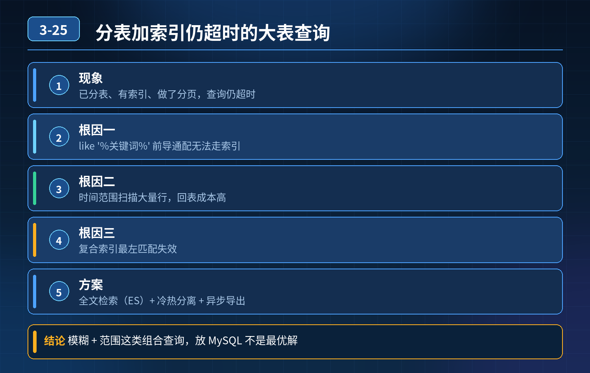

    大表查询优化，分表、索引、分页都做了，带用户昵称模糊+时间范围查询依然 CPU 飙升超时

## 第 03-25 题　大表查询优化，分表、索引、分页都做了，带用户昵称模糊+时间范围查询依然 CPU 飙升超时

**候选人浅层回答：** 加索引、分库分表、分页就够了，模糊查询慢。

## 核心拆解一句话结论

本题考察对底层原理和线上实战能力的综合理解，不能只停留在背结论。

## 连环追问

1. 为什么已经分表、有索引，like '%关键词%'模糊查询依然会扫大量数据？
2. 复合索引最左匹配原则在这里失效的原因是什么？
3. 分页大偏移量 limit 100000,10 有什么性能问题，如何优化？
4. 时间分表场景，跨多年查询会发生什么问题？
5. 哪些查询不适合直接走 MySQL 主库，该用什么方案？
6. 数据库侧如何做保护，防止这种慢 SQL 拖垮整个库？

## 事故根源

1. like '%昵称%' 前后通配模糊查询，无法命中 B + 树索引，即使用户 ID 有索引，昵称没有合适索引，只能全表扫描；
2. 按创建时间分表，查询跨 3 年时间范围，需要扫描多个分表，多表聚合、合并结果集，开销放大；
3. 管理员后台这类复杂检索，属于多条件、任意字段检索场景，MySQL B + 树索引天生不擅长全文检索；
4. 分库分表、索引只能优化高并发、确定性等值 / 范围查询，不是万能方案；复杂模糊检索、多维度筛选，不能指望靠 MySQL 硬扛。

一句话：分表解决的是单表数据量过大问题，解决不了复杂检索、模糊全文检索的场景。

三层优化体系（SQL 与表结构优化 → 检索架构改造 → 数据库防护兜底）第一层：SQL 与表结构优化（MySQL 内部优化，治标手段）

1\. 避免前置通配%xxx%

1\. 尽量改成右模糊 like 'xxx%'，才能使用前缀索引；

2\. 如果业务必须按昵称任意模糊检索，MySQL 索引解决不了，不能硬扛。

2\. 合理设计复合索引，遵循最左匹配。 当前场景：时间范围 + 用户昵称。索引的首列是时间，后面带上昵称，但前缀通配会终止索引使用。

3\. 分页优化： 禁止大偏移 limit offset,size。 优化方案：主键书签分页（seek 分页），where id\>上一页最大id limit size，避免数据库扫描前面大量行。

4\. 分表策略优化： 时间分表，跨多年查询需要遍历全部匹配分表；可以限制管理员查询时间范围，禁止一次性查询 3 年超大跨度，拆成分片查询。

5\. 表结构瘦身： 大订单表只保留查询需要字段，大文本、长描述字段拆到扩展表，减少单行数据大小，减少 IO。

局限：只要业务要求任意昵称模糊检索，MySQL 再怎么调索引、分表，性能上限很低，依然容易 CPU 打满。

第二层：架构改造（治本，推荐方案）把复杂多条件检索从 MySQL 剥离，交给搜索引擎。

1\. 引入 Elasticsearch：订单数据同步到 ES，把订单号、用户 ID、用户昵称、创建时间等字段建立索引；

1\. 管理员后台的多条件筛选、昵称模糊检索，全部走 ES；

2\. ES 擅长全文检索、多维度组合筛选；MySQL 只做业务写入、明细查询（按订单号 / 用户 ID 等值查询）；

3\. 通过 binlog 同步 / 双写，保证 ES 与 MySQL 数据最终一致性。

2\. 冷热数据分离：历史订单归档。

1\. 近期热订单保留在在线分表；超过一定时间的冷订单归档到归档库 / 归档表，不参与日常后台检索。管理员查归档数据走单独归档实例，不占用主业务数据库资源。

2\. 读写分离：复杂后台检索走从库，绝对不要在主库执行后台报表、历史查询。

第三层：数据库防护兜底（防止一条慢 SQL 拖垮整个系统）

1\. SQL 限流、超时设置：数据库设置 SQL 最大执行时间，超过阈值直接终止；

2\. 资源隔离：后台查询使用独立从库，和交易主库物理隔离，后台慢查询不会影响线上交易接口；

3\. 网关 / 应用层防护：

1\. 限制查询时间跨度，禁止一次性查询 3 年范围；

2\. 限制返回最大条数；

3\. 慢 SQL 监控告警，捕获慢查询及时发现；

4\. 熔断降级：后台检索接口单独做熔断，慢查询异常时快速返回提示，避免连锁熔断影响核心订单交易。

## 面试高分话术

事故根源：虽然做了时间分表和普通索引，但是用户昵称 % 关键词 % 的前后模糊查询无法使用 B + 树索引，触发全表扫描；再加上查询跨度 3 年，需要扫描多张分表，多表合并计算，CPU 压力急剧升高。分库分表只能解决单表数据量过大，适合等值、范围类查询，不能解决多维度、全文模糊检索场景，不是万能方案。

整套优化分三层。第一层是 SQL 和表结构优化，尽量规避前置通配符，使用书签分页替代大 offset limit，精简表字段，限制查询的时间跨度。但这个只是 MySQL 层面的优化，有天花板，如果业务必须支持昵称任意模糊检索，这个方案无法根治。

第二层是架构层面根治方案。把复杂检索能力剥离到Elasticsearch，订单数据同步 ES，管理员后台的多条件筛选、昵称模糊查询全部走 ES；MySQL 只负责交易写入和订单号、用户 ID 这类确定性查询。同时做冷热数据分离，久远历史订单归档到独立归档库；后台查询走从库，不和交易主库抢资源。

第三层是数据库防护兜底，做 SQL 超时、资源隔离，应用层限制查询范围和结果条数，加上监控告警和接口熔断，防止后台分析类查询拖垮核心交易链路。

## 连环追问要点整理

1. 底层核心原理是什么？为什么这么设计？
2. 线上出现相关故障如何快速止损、定位根因？
3. 高并发场景下有哪些坑点，性能、一致性、可用性如何权衡？

## 面试回答完整话术

  - **一句话结论**：本题考察对底层原理和线上实战能力的综合理解，不能只停留在背结论。
  - **连环追问**：为什么已经分表、有索引，like '%关键词%'模糊查询依然会扫大量数据？
  - **事故根源**：like '%昵称%' 前后通配模糊查询，无法命中 B + 树索引，即使用户 ID 有索引，昵称没有合适索引，只能全表扫描；
  - **面试高分话术**：事故根源：虽然做了时间分表和普通索引，但是用户昵称 % 关键词 % 的前后模糊查询无法使用 B + 树索引，触发全表扫描；再加上查询跨度 3 年，需要扫描多张分表，多表合并计算，CPU 压力急剧升高。
  - **收尾**：线上问题按「先止损保可用性 → 再定位根因 → 最后从架构规范层面根治」三段论闭环。

## 追问：本题考察核心是什么？

###  高级工程师要分清：

1. **不能只停留在背结论**：要能回答「为什么这样设计、不这样会怎样、线上踩坑怎么排查」；
2. **具备止损→定位→根治三段论**：先止血保业务，再定位根因，最后从架构与规范层面根治；
3. **给出工程取舍**：性能、一致性、可用性三者权衡，说清代价与适用场景。

  核心思想：这道题考察原理理解 + 线上实战 + 架构思维，真正的工程答案是「现象 → 根因 → 止损 → 定位 → 根治」五段式闭环。

