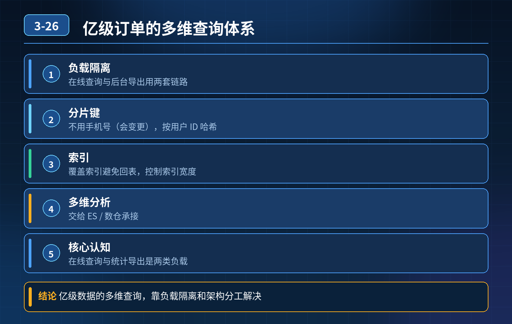

    亿级订单表，手机号+时间范围查询、手机号可变、跨多年、多表关联

## 第 03-26 题　亿级订单表，手机号+时间范围查询、手机号可变、跨多年、多表关联

**候选人浅层回答：** 背诵表面结论，没有深入到原理和线上场景。

## 核心拆解一句话结论

本题考察对底层原理和线上实战能力的综合理解，不能只停留在背结论。

## 场景复盘

订单表亿级数据，查询条件：手机号 + 时间范围；痛点：手机号可变更、时间跨度极大、还要关联多表；单纯联合索引会回表重、IO 爆炸；按用户 ID 哈希分库分表之后，又遇到跨分片分页、跨分片统计、运营导出全量订单的难题。

核心认知：在线用户查询、后台统计导出，是两类完全不同的负载，不能用同一套 MySQL 方案承载；索引、分表只是其中一环，必须做负载隔离。

## 三层体系

第一层：在线用户查询链路（C 端用户查自己订单，优先保障低延迟）

1. 不要直接拿手机号当分片键、不要手机号做索引主列 手机号会变更；一旦换号，

- 这条订单的索引、分片归属全部失效。

核心：以用户 ID 作为主维度，订单表按 uid 哈希分库分表；用户换手机号，只改用户表，订单归属不变。 用户查询逻辑：先用手机号查用户服务，拿到 uid，再用 uid + 时间范围查分片订单。 索引设计：分片内联合索引 (uid, create_time)，覆盖查询需要字段，做成覆盖索引，避免回表；禁止在线查询做多表 join。

2\. 多表关联解耦，冗余 + 宽表 在线接口不 join 订单、用户、商品、物流多表。

订单表冗余商品名称、状态、物流简要信息；详情页才按需单独查子表。

3\. 查询强约束保护数据库 强制时间窗口上限（比如最多查 1 年），跨多年的查询不直接走 MySQL；加 SQL 超时、接口限流；高频查询结果放 Redis 缓存。

为什么手机号不能直接建索引分片：手机号属于可变属性，uid是用户稳定唯一标识。

第二层：异构离线 / 检索层，承接宽范围、统计、导出场景（解决跨分片难题）哈希分表天然不擅长跨分片聚合、跨时间大范围检索、导出，这部分全部下沉到 ES 或者 ClickHouse：

1\. 订单写入 MySQL 的同时，通过 Binlog 同步到 ES/CK，构建检索宽表；字段包含 uid、手机号、create_time、商品、物流等全部需要检索维度；ES 支持手机号 + 时间范围检索、分页、筛选。

2\. C 端用户短时间查询走 MySQL 分片；跨多年、运营后台、导出、统计报表全部走 ES/ClickHouse，不碰主库 MySQL。

3\. 跨分片分页方案：

1\. 浅分页（前 N 页）：ES 天然支持；

2\. 必须在 MySQL 分片做的场景：游标分页（seek 分页，不用 offset），避免深分页开销；全局排序需要各分片查询后内存归并，代价高，尽量推到 ES。

第三层：冷热分离 + 导出隔离兜底（防止导出任务打爆集群）

1. 订单冷热分表 近期热数据（比如最近 3 个月）在在线分库；历史冷订单按时间归档到冷库，冷库降低配置、单独隔离；用户查跨多年订单，自动路由：热数据走在线分片，冷数据走归档库或者 ES。
2. 导出任务单独隔离 运营导出禁止在线同步查询：提交异步导出任务，任务消费ES/CK 的数据，生成文件后通知下载；限速、限流，单任务分批读取、分批写入，禁止一次性拉全量；夜间低峰期调度大批量导出。
3. 兜底防护：读写分离，查询走从库；主库只扛下单更新。

- 30

## 秒口述标准答案

首先，手机号是可变字段，不能直接作为分片和索引主 key，先通过手机号查用户拿到稳定的 uid，订单按 uid 哈希分库分表，分片内建立uid+create_time 覆盖索引，在线查询禁止多表 join，冗余字段做成宽表； 其次，哈希分片天生不适合跨分片统计、大范围时间查询、导出，用 binlog 同步订单数据到 ES 或者 ClickHouse，后台检索、跨多年查询、导出全部走异构引擎，不和在线 MySQL 争抢资源； 最后做冷热归档，热订单留在在线分片，历史订单归档；导出改成异步任务，限速调度；同时限制在线查询最大时间窗口，加超时和限流，保护主库不被慢查询打崩。

## 高频追问

Q：如果用户一定要用旧手机号查历史订单怎么办？ A：ES 里面同时保存历史手机号列表，用户换号时同步更新 ES 文档；MySQL 订单表不存历史手机号，保证分片稳定。 Q：ES 和 MySQL 数据不一致怎么处理？ A：Binlog 同步 + 定时校对任务，补偿不一致，后台检索场景允许短时间弱一致。 Q：为什么不直接按时间范围分表？ A：按时间分表，用户分散在各个时间片，一个用户查自己订单会扫大量分表，查询效率差；uid 哈希更适合 C 端 “查本人订单” 这个主流场景。

## 连环追问要点整理

1. 底层核心原理是什么？为什么这么设计？
2. 线上出现相关故障如何快速止损、定位根因？
3. 高并发场景下有哪些坑点，性能、一致性、可用性如何权衡？

## 面试回答完整话术

  - **一句话结论**：本题考察对底层原理和线上实战能力的综合理解，不能只停留在背结论。
  - **场景复盘**：订单表亿级数据，查询条件：手机号 + 时间范围；痛点：手机号可变更、时间跨度极大、还要关联多表；单纯联合索引会回表重、IO 爆炸；按用户 ID 哈希分库分表之后，又遇到跨分片分页、跨分片统计、运营导出
  - **三层体系**：第一层：在线用户查询链路（C 端用户查自己订单，优先保障低延迟）
  - **秒口述标准答案**：首先，手机号是可变字段，不能直接作为分片和索引主 key，先通过手机号查用户拿到稳定的 uid，订单按 uid 哈希分库分表，分片内建立uid+create_time 覆盖索引，在线查询禁止多表 jo
  - **高频追问**：Q：如果用户一定要用旧手机号查历史订单怎么办？ A：ES 里面同时保存历史手机号列表，用户换号时同步更新 ES 文档；MySQL 订单表不存历史手机号，保证分片稳定。 Q：ES 和 MySQL 数据不
  - **收尾**：线上问题按「先止损保可用性 → 再定位根因 → 最后从架构规范层面根治」三段论闭环。

## 追问：本题考察核心是什么？

###  高级工程师要分清：

1. **不能只停留在背结论**：要能回答「为什么这样设计、不这样会怎样、线上踩坑怎么排查」；
2. **具备止损→定位→根治三段论**：先止血保业务，再定位根因，最后从架构与规范层面根治；
3. **给出工程取舍**：性能、一致性、可用性三者权衡，说清代价与适用场景。

  核心思想：这道题考察原理理解 + 线上实战 + 架构思维，真正的工程答案是「现象 → 根因 → 止损 → 定位 → 根治」五段式闭环。

