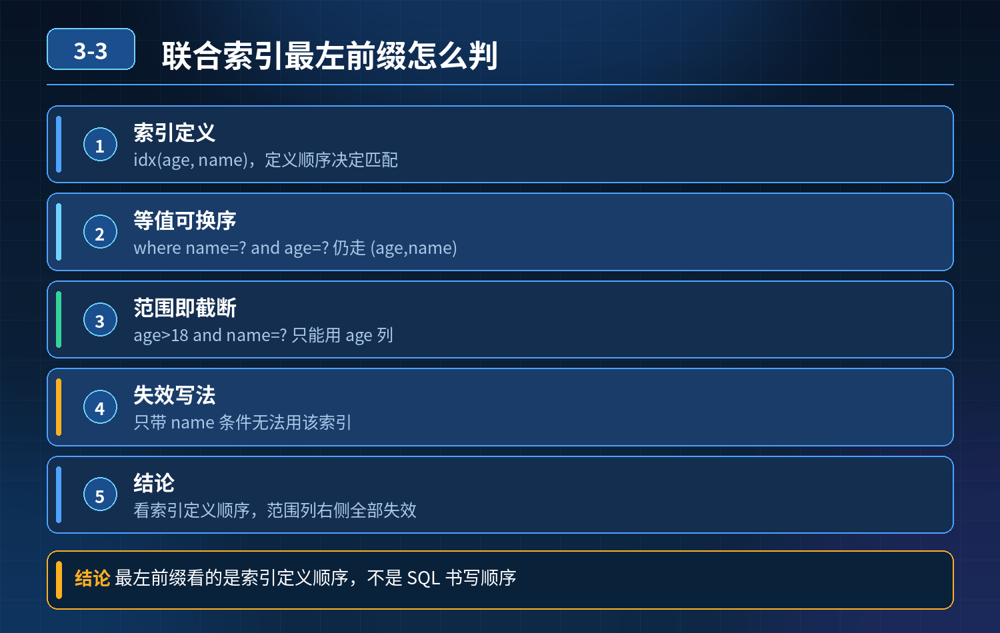

    MySQL 联合索引最左前缀

## 第 03-3 题　MySQL 联合索引最左前缀

**举例说明：**建了索引 idx(age, name)。where age=20 and name='张三' 可完整使用索引；where age\>18 and name='张三' 只有 age 列生效、name 列失效；而 where name='张三' 完全用不上这个索引，只能全表扫描或走别的索引。

**候选人浅层回答：** 背诵表面结论，没有深入到原理和线上场景。

## 核心拆解一句话结论

本题考察对底层原理和线上实战能力的综合理解，不能只停留在背结论。

## 前置约定

假设联合索引：idx_age_name(age, name)（索引顺序：age 在前，name 在后） 三条 SQL：

1. select \* from user where name='张三' and age=20;
2. select \* from user where age\>18 and name='张三';
3. select \* from user where name='张三' and age\>18;核心坑点：最左前缀原则看的是索引定义顺序，不是 where 里条件书写顺序；MySQL 优化器会自动调整等值条件顺序，很多人误以为 SQL 写的先后决定索引能否命中。

三层拆解回答第一层：SQL1：where name='张三' and age=20条件都是等值查询。 虽然 SQL 里先写 name、后写 age，但是优化器会自动调

- 换等值条件顺序，匹配索引 (age,name)。

索引可以完整使用：age + name

- 都走索引，能定位行； 但 select \*，不是覆盖索引，查到主键后会回表拿其他字段。

一句话：等值条件，where 书写顺序不影响索引命中。

第二层：SQL2：where age\>18 and name='张三'索引顺序 age,name，age 是范围\>。 规则：联合索引中，一旦遇到范围查询（\> \< between like 前缀模糊），范围之后的索引列无法使用索引过滤。

- age 可以走索引，快速筛出 age\>18 的数据；
- name 在 age 后面，无法利用索引做过滤；name=' 张三 ' 只能在 age 筛选出来的结果集里做内存过滤。

第三层：SQL3：where name='张三' and age\>18这是本题最大陷阱！ 索引定义：(age, name)，索引最左第一列是 age。 没有

- ❌age 等值前缀，直接用 name 查询，无法触发最左前缀。

这条SQL 不能走 idx_age_name 这个联合索引，几乎是全表扫描； 哪怕 where 里 name 写在最前面，也没用！索引的顺序是建表时定义的，和 SQL 条件顺序无关。

总结区分

- 等值条件：优化器自动重排，书写顺序无关；
- 范围条件：范围后面的索引列失效；
- 最左前缀：以索引定义顺序为准，不是 SQL where 书写顺序。
- 30

## 秒口述标准答案

首先要分清两件事：最左前缀看索引定义顺序，不是 SQL 条件书写顺序，等值条件 MySQL 优化器会自动调整。索引是 (age,name)： 第一条 where name=' 张三 ' and age=20，两个都是等值，优化器自动对齐索引顺序，可以正常使用 age+name 索引； 第二条 age\>18 and name=' 张三 '，age 是范围，age 能走索引，name 在范围之后，不能利用索引过滤； 第三条 name=' 张三 ' and age\>18，索引首列是 age，没有 age 前缀，这个联合索引完全用不上，会全表扫描。很多人踩坑就是把 where 写的顺序当成索引顺序。

## 高频追问

Q：如果索引改成 idx_name_age(name,age)，那第三条 where name='张三'and age\>18 是什么情况？ A：name 是等值，可以走索引；age 是范围，age 列无法再利用索引过滤，只能在 name 的结果集里过滤 age。

Q：为什么等值条件顺序可以被优化器调换？ A：等值条件是合取逻辑，a=?

and b=? 和 b=? and a=? 结果完全一样，优化器会根据索引选择合适的访问路径。

Q：覆盖索引在这里起到什么作用？ A：如果只查索引包含字段，不需要回表；select \* 一定会回表，增加 IO 开销。

## 连环追问要点整理

1. 底层核心原理是什么？为什么这么设计？
2. 线上出现相关故障如何快速止损、定位根因？
3. 高并发场景下有哪些坑点，性能、一致性、可用性如何权衡？

## 面试回答完整话术

  - **场景举例**：建了索引 idx(age, name)。where age=20 and name='张三' 可完整使用索引；where age\>18 and name='张三' 只有 age 
  - **一句话结论**：本题考察对底层原理和线上实战能力的综合理解，不能只停留在背结论。
  - **前置约定**：假设联合索引：idx_age_name(age, name)（索引顺序：age 在前，name 在后） 三条 SQL：
  - **秒口述标准答案**：首先要分清两件事：最左前缀看索引定义顺序，不是 SQL 条件书写顺序，等值条件 MySQL 优化器会自动调整。索引是 (age,name)： 第一条 where name=' 张三 ' and age
  - **高频追问**：Q：如果索引改成 idx_name_age(name,age)，那第三条 where name='张三'and age\>18 是什么情况？ A：name 是等值，可以走索引；age 是范围，age 
  - **收尾**：线上问题按「先止损保可用性 → 再定位根因 → 最后从架构规范层面根治」三段论闭环。

## 追问：本题考察核心是什么？

###  高级工程师要分清：

1. **不能只停留在背结论**：要能回答「为什么这样设计、不这样会怎样、线上踩坑怎么排查」；
2. **具备止损→定位→根治三段论**：先止血保业务，再定位根因，最后从架构与规范层面根治；
3. **给出工程取舍**：性能、一致性、可用性三者权衡，说清代价与适用场景。

  核心思想：这道题考察原理理解 + 线上实战 + 架构思维，真正的工程答案是「现象 → 根因 → 止损 → 定位 → 根治」五段式闭环。

