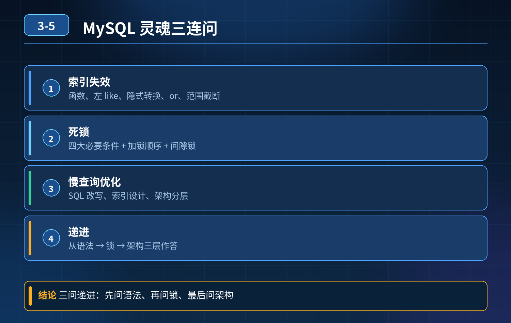

    MySQL 灵魂三连问

## 第 03-5 题　MySQL 灵魂三连问

**候选人浅层回答：** 查询没有命中索引，给慢查询加上索引就可以。

## 核心拆解一句话结论

避免 select ... for update 大范围加锁 查询条件务必命中索引；

## 连环追问

1. 联合索引失效有哪些规则？
2. 什么是隐式类型转换，为什么会造成索引失效？
3. 慢查询除了新增索引，还需要从哪些维度优化？
4. explain 执行计划关键字段怎么解读？

## 参考答案：

索引失效常见场景

1. 联合索引违反最左前缀原则 联合索引 (a,b,c)，查询条件缺少最左边 a 字段，索引失效；范围查询（\>、\<、between）之后的列会失效。

例：where a\>10 and b=20，b 字段无法使用索引。

1\. 隐式类型转换 索引字段和传入参数数据类型不一致。例如 varchar 字符串索引，传入数字；数据库做函数转换，索引列发生运算，索引失效。

2\. 索引列上使用函数、运算、逻辑运算 wheredate(create_time)='2026‑10‑23'，索引列包裹函数，索引失效；要改成表达式把计算放到参数一侧。

3\. like 通配符以 % 开头 like '%关键词'，前缀模糊查询无法使用 B + 树索引；后缀like 'key%'可以走索引。

4\. or 条件一侧字段无索引 or 连接的字段，只要其中一个字段没有索引，整条SQL 不走索引。

5\. MySQL 优化器判断全表扫描更快，主动放弃索引 比如数据量占表很大比例、统计信息不准，优化器认为全表扫描成本更低，即使存在索引也不会使用。

6\. 优化手段

1\. 设计联合索引遵循最左前缀，把等值条件放前面，范围条件放最后；

2\. 避免索引字段做函数、算术运算，杜绝隐式类型转换；

3\. 前缀模糊匹配走索引，避免前缀百分号；需要全文检索考虑 ES；

4\. or 两边字段都建立索引；

5\. 定期更新表统计信息，保证优化器判断准确；

6\. 慢查询不只加索引，还要优化业务 SQL 逻辑、分页、join 关联、避免大事务；

7\. 使用explain 执行计划分析，重点看type、key、rows、Extra，判断是否命中索引、是否回表。

## 连环追问要点整理

1. 底层核心原理是什么？为什么这么设计？
2. 线上出现相关故障如何快速止损、定位根因？
3. 高并发场景下有哪些坑点，性能、一致性、可用性如何权衡？

## 面试回答完整话术

  - **一句话结论**：避免 select ... for update 大范围加锁 查询条件务必命中索引；
  - **连环追问**：什么是隐式类型转换，为什么会造成索引失效？
  - **参考答案：**：联合索引违反最左前缀原则 联合索引 (a,b,c)，查询条件缺少最左边 a 字段，索引失效；范围查询（\>、\<、between）之后的列会失效。
  - **参考答案：**：死锁产生原因InnoDB 行锁，两个或多个事务，互相持有对方需要的行锁，又互相等待对方释放锁，循环等待，形成死锁。MySQL 会检测死锁，主动回滚代价更小的一个事务。
  - **参考答案：**：1\. SQL 层面：避免 select \*，只查需要字段；优化 join，减少关联大表；优化
  - **收尾**：线上问题按「先止损保可用性 → 再定位根因 → 最后从架构规范层面根治」三段论闭环。

## 追问：本题考察核心是什么？

###  高级工程师要分清：

1. **不能只停留在背结论**：要能回答「为什么这样设计、不这样会怎样、线上踩坑怎么排查」；
2. **具备止损→定位→根治三段论**：先止血保业务，再定位根因，最后从架构与规范层面根治；
3. **给出工程取舍**：性能、一致性、可用性三者权衡，说清代价与适用场景。

  核心思想：这道题考察原理理解 + 线上实战 + 架构思维，真正的工程答案是「现象 → 根因 → 止损 → 定位 → 根治」五段式闭环。

