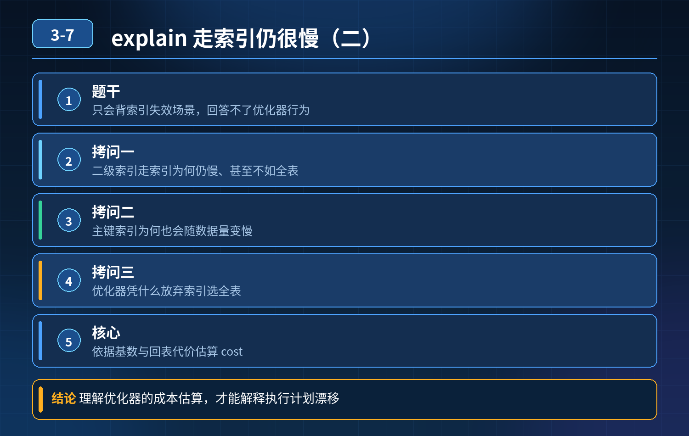

    MySQL 索引：explain 已经走二级索引，为什么查询还是慢？优化器凭什么放弃索引走全表扫描？

## 第 03-7 题　MySQL 索引：explain 已经走二级索引，为什么查询还是慢？优化器凭什么放弃索引走全表扫描？

**候选人浅层回答：** 背诵表面结论，没有深入到原理和线上场景。

## 核心拆解一句话结论

本题考察对底层原理和线上实战能力的综合理解，不能只停留在背结论。

## 题干梳理

很多人只会背索引失效场景：函数、左 like、隐式转换。 面试官的连环拷问核心三点：

1. explain 已经走二级索引，为什么查询还是慢，大范围二级索引甚至不如全表扫描？
2. 主键索引不会失效，为什么表从百万到千万，性能明显变差？
3. 优化器凭什么主动放弃索引、选择全表扫描？

核心认知：索引只是减少扫描行数的手段，索引本身有 IO 代价；优化器是代价模型驱动，不是 “有索引就优先用索引”。

三层核心逻辑第一层：二级索引 —— 回表带来大量随机 IOInnoDB 二级索引叶子节点只存主键。拿到主键后，需要回到聚簇索引读取完整行，这个动作叫回表。 如果满足大范围查询，命中数据占比偏高（经验阈值大约 10%~20%，不是固定值）：

- 二级索引：多次回表，大量随机磁盘 IO；
- 全表扫描：顺序读取数据页，顺序 IO 效率远高于随机 IO； 所以哪怕走了索
- 引，总开销更大。

解法：建立覆盖索引，查询字段全部放进联合索引，消除回表。

第二层：主键（聚簇索引）不会失效，但会随数据量变大而变慢主键就是聚簇索引，本身不存在失效一说，变慢原因：

4\. B + 树高度上升：百万数据一般 3 层；千万、亿级数据层数增加，多一次页读取；

5\. Buffer Pool 命中率下降：数据页太多，无法全部缓存到内存，大量请求落到磁盘；

6\. 如果是主键范围扫描，依然需要连续遍历大量数据页。

一句话：主键索引有效，只是扫描的数据页变多、磁盘 IO 上升，延迟增加。

第三层：优化器代价估算模型，决定要不要走索引MySQL 优化器基于统计信息（基数、行数、过滤比例）计算代价，代价 = IO 代价为主 + 少量 CPU 代价：

- 预估返回行数很少：索引 IO 更少，选择索引；
- 预估返回行数多：判定回表随机 IO 太贵，放弃索引，走全表扫描； 风险点：统计信息是采样估算的，数据倾斜、很久没 analyze，统计信息失真，就会选错执行计划。
- 30

秒口述精简版（面试直接背）索引失效只是一部分场景，就算执行计划显示走索引也可能很慢，分三层理解：第一，二级索引大范围查询会频繁回表，随机 IO 开销巨大，甚至慢于顺序的全表扫描，可以用覆盖索引解决；第二，主键聚簇索引不会失效，但千万级数据下 B + 树层数增加、缓存命中率下降，磁盘 IO 变高，性能下滑；第三，优化器依靠统计信息评估 IO 与 CPU 代价，扫描占比高就会主动放弃索引，如果统计信息不准还会出现错误的执行计划。

## 高频追问

Q：20% 是硬性阈值吗？ A：不是固定值，受 Buffer Pool 大小、单条行大小、磁盘性能影响，只是工程经验参考。 Q：统计信息不准怎么处理？ A：analyze table 更新；尽量避免极端数据倾斜；force index 只适合临时应急，不建议长期在线上使用。 Q：覆盖索引怎么理解？ A：查询所需要的全部字段都包含在二级联合索引中，查询不需要回表读取聚簇索引。

## 连环追问要点整理

1. 底层核心原理是什么？为什么这么设计？
2. 线上出现相关故障如何快速止损、定位根因？
3. 高并发场景下有哪些坑点，性能、一致性、可用性如何权衡？

## 面试回答完整话术

  - **一句话结论**：本题考察对底层原理和线上实战能力的综合理解，不能只停留在背结论。
  - **题干梳理**：很多人只会背索引失效场景：函数、左 like、隐式转换。 面试官的连环拷问核心三点：
  - **高频追问**：Q：20% 是硬性阈值吗？ A：不是固定值，受 Buffer Pool 大小、单条行大小、磁盘性能影响，只是工程经验参考。 Q：统计信息不准怎么处理？ A：analyze table 更新；尽量避免极
  - **收尾**：线上问题按「先止损保可用性 → 再定位根因 → 最后从架构规范层面根治」三段论闭环。

## 追问：本题考察核心是什么？

###  高级工程师要分清：

1. **不能只停留在背结论**：要能回答「为什么这样设计、不这样会怎样、线上踩坑怎么排查」；
2. **具备止损→定位→根治三段论**：先止血保业务，再定位根因，最后从架构与规范层面根治；
3. **给出工程取舍**：性能、一致性、可用性三者权衡，说清代价与适用场景。

  核心思想：这道题考察原理理解 + 线上实战 + 架构思维，真正的工程答案是「现象 → 根因 → 止损 → 定位 → 根治」五段式闭环。

