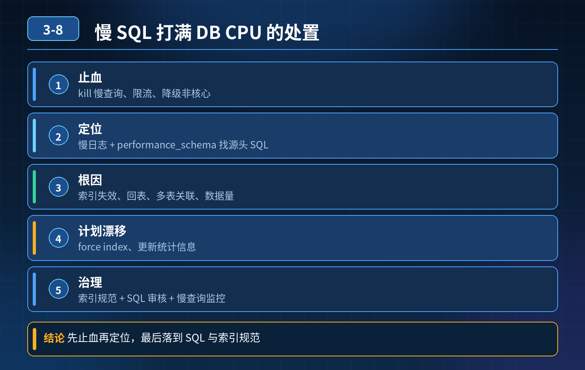

    线上慢 SQL 引发数据库 CPU 99% 故障

## 第 03-8 题　线上慢 SQL 引发数据库 CPU 99% 故障

**候选人浅层回答：** 背诵表面结论，没有深入到原理和线上场景。

## 核心拆解一句话结论

本题考察对底层原理和线上实战能力的综合理解，不能只停留在背结论。

## 场景复盘

线上核心接口超时，数据库 CPU 飙到 99%，定位到一条单次十几秒的慢 SQL，阻塞正常业务请求。

## 面试官连环追问：

1. 加索引是不是万能？函数、隐式转换造成索引失效怎么定位？
2. 索引加上依然慢，如何区分是回表、多表关联还是数据体量问题？
3. SQL 之前正常，高峰突然执行计划漂移不走索引怎么快速恢复？
4. 慢 SQL 持有行锁，堵塞其他写请求、连接打满，如何快速止血？
5. 大量历史散落在代码里的 SQL，怎么提前预警，而不是事后救火？
6. 是否存在不改 SQL、不加索引的临时防护手段？

核心认知：慢 SQL 治理分应急止血 → 根因定位修复 → 长效防控三层；很多故障不是缺索引，而是计划漂移、锁阻塞、统计信息不准、没有流量熔断防护。只懂 explain、只会加索引是远远不够的。

## 三层高分体系

第一层：应急止损层（优先，故障爆发第一时间操作，目标 1 分钟止血）核心目标：快速降低数据库压力，解除锁阻塞，恢复业务可用，不一定根治

1. 杀掉故障会话：show processlist 找到慢 SQL 会话 ID，killsession_id，立刻释放锁、CPU、连接资源；这是锁阻塞场景最直接手段。
2. 临时限流 / 熔断：网关或者应用层对这个接口降流量、降级、切缓存，阻断流量继续打入数据库；不需要改 SQL 和索引。
3. SQL hint 临时绑定执行计划：如果是执行计划漂移（之前走索引、突然全表扫描），紧急加FORCE INDEX hint，临时强制走正确索引，快速恢复，适合线上紧急止血。
4. 读写分离兜底：查询类慢 SQL 临时切到从库，保护主库写入。

重点：这一层就是面试官问的「不改 SQL、不加索引也能护住库」的方案：kill 会话、接口熔断限流、hint 强制索引、切从库。

第二层：根因定位与修复层（故障稳住之后，定位并根治这条 SQL）先用explain analyze 拿到真实执行计划，区分几类常见根因：

1. 索引失效类：where 条件上用函数、隐式类型转换、模糊前缀%xx、or 跨字段；修复：去掉字段函数、统一字段类型、调整索引结构。
2. 索引存在但效果差：回表过多（覆盖索引缺失）、联合索引顺序不对、基数低（区分度差）；修复：建立覆盖索引、调整索引顺序。
3. 多表 join / 子查询：关联顺序错误、驱动表选错、笛卡尔积；优化：小表驱动大表，简化 join，拆成分段查询。
4. 执行计划漂移：统计信息不准、数据分布突变，优化器误判选择全扫描；修复：analyze table 更新统计信息；长期方案：sql baseline 绑定稳定执行计划。
5. 数据膨胀：索引已经最优，但数据量太大；方案：冷热分离、分库分表、归档历史数据。
6. 长事务锁问题：慢查询是读，但长时间快照 / 事务持有，阻塞写入；缩短事务边界，查询尽量独立短事务。

第三层：长效防控体系（避免反复踩坑，事前发现隐患）

1. 上线卡点：SQL 审核平台，变更自动 explain 校验，禁止高危 SQL 上线；拦截无索引、大 limit、不带条件全扫 SQL。
2. 慢查询持续采集：慢日志、数据库审计，持续采集慢 SQL，告警入库；不是等CPU 炸了才发现。
3. 执行计划基线（SQL Baseline）：对核心 SQL 固化稳定执行计划，防止统计信息变化导致计划漂移。
4. 资源保护：数据库侧设置 SQL 最大执行时长（max_execution_time），超时自动终止；连接池、读写分离、热点缓存兜底，限制单 SQL 对库的破坏力。
5. 巡检复盘：定期分析 TOP 慢 SQL，表数据增长监控，提前归档；接口增加缓存，把高频查询挡在 DB 之外。

- 30

## 秒口述精简版

整套慢 SQL 治理分三层。第一层应急止血，故障上来优先 kill 慢会话、接口熔断限流，计划漂移可以临时加 hint 强制索引，快速释放 CPU 和锁，不用改索引；第二层定位根因，用 explain analyze 区分是索引失效、回表、join 不合理还是执行计划漂移，对应修复索引、改写 SQL、更新统计信息；第三层长效防控，上线 SQL 审核、慢查询告警、SQL 基线固化执行计划，给查询加超时限制，热点接口上缓存，做到提前预警，而不是每次等数据库 CPU 打满再救火。很多时候不是缺索引，而是锁阻塞、优化器计划漂移、缺少防护机制。

## 高频追问

Q：kill 慢 SQL 会不会丢数据？ A：只读查询 kill 没有影响；如果是 DML语句，kill 后事务回滚，不会产生脏数据，代价是回滚消耗一点资源，紧急场景收益远大于代价。 Q：什么时候不能直接加 FORCE INDEX？ A：数据分布持续变化的场景，hint 是临时急救手段，长期要用 baseline，避免索引随数据变化反而变差。 Q：max_execution_time 作用？ A：给 select 设置超时，防止单条失控 SQL 长时间霸占 CPU，属于数据库自我保护。

## 连环追问要点整理

1. 底层核心原理是什么？为什么这么设计？
2. 线上出现相关故障如何快速止损、定位根因？
3. 高并发场景下有哪些坑点，性能、一致性、可用性如何权衡？

## 面试回答完整话术

  - **一句话结论**：本题考察对底层原理和线上实战能力的综合理解，不能只停留在背结论。
  - **场景复盘**：线上核心接口超时，数据库 CPU 飙到 99%，定位到一条单次十几秒的慢 SQL，阻塞正常业务请求。
  - **面试官连环追问：**：加索引是不是万能？函数、隐式转换造成索引失效怎么定位？
  - **三层高分体系**：第一层：应急止损层（优先，故障爆发第一时间操作，目标 1 分钟止血）核心目标：快速降低数据库压力，解除锁阻塞，恢复业务可用，不一定根治
  - **秒口述精简版**：整套慢 SQL 治理分三层。第一层应急止血，故障上来优先 kill 慢会话、接口熔断限流，计划漂移可以临时加 hint 强制索引，快速释放 CPU 和锁，不用改索引；第二层定位根因，用 explain
  - **高频追问**：Q：kill 慢 SQL 会不会丢数据？ A：只读查询 kill 没有影响；如果是 DML语句，kill 后事务回滚，不会产生脏数据，代价是回滚消耗一点资源，紧急场景收益远大于代价。 Q：什么时候不能
  - **收尾**：线上问题按「先止损保可用性 → 再定位根因 → 最后从架构规范层面根治」三段论闭环。

## 追问：本题考察核心是什么？

###  高级工程师要分清：

1. **不能只停留在背结论**：要能回答「为什么这样设计、不这样会怎样、线上踩坑怎么排查」；
2. **具备止损→定位→根治三段论**：先止血保业务，再定位根因，最后从架构与规范层面根治；
3. **给出工程取舍**：性能、一致性、可用性三者权衡，说清代价与适用场景。

  核心思想：这道题考察原理理解 + 线上实战 + 架构思维，真正的工程答案是「现象 → 根因 → 止损 → 定位 → 根治」五段式闭环。

