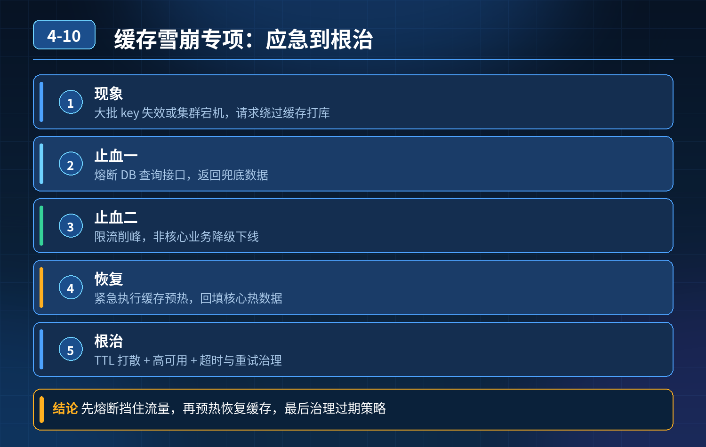

    缓存雪崩专项（应急+定位+根治）

## 第 04-10 题　缓存雪崩专项（应急+定位+根治）

**候选人浅层回答：** 背诵表面结论，没有深入到原理和线上场景。

## 核心拆解一句话结论

本题考察对底层原理和线上实战能力的综合理解，不能只停留在背结论。

## 场景回顾

<strong>现象：</strong>大批量缓存 key 同时失效 / Redis 集群宕机，大量请求绕过缓存打到数据库，DB 压力暴涨、接口大面积超时，整条微服务链路雪崩瘫痪。 很多候选人只会说：过期时间加随机偏移。但是忽略雪崩不止是过期集中这一种情况，还有Redis 集群故障、预热失误、主从切换、大 key 清理等都会引发雪崩，而且缺少故障发生后的应急止血流程。

## 三层高分逻辑

第一层：应急止损（故障爆发第一时间，优先保业务）

1. 立刻触发熔断降级：Sentinel 对 DB 查询接口熔断，直接返回兜底静态数据，阻止流量持续灌入数据库，防止数据库被打挂；
2. 快速恢复缓存：如果是 Redis 节点宕机，触发哨兵 / 集群自动切换；如果只是key 集中过期，紧急执行全量缓存预热脚本，把核心热点数据重新刷回 Redis；
3. 流量削峰：网关层临时限流，降低进入服务的 QPS；非核心业务直接降级下线，优先保障核心链路；
4. 临时读写隔离：DB 做只读保护，禁止非核心查询。

第二层：定位根因，区分雪崩类型

1. 过期集中雪崩：批量 key 设置了相同 TTL，到期一起失效；
2. Redis 故障雪崩：集群节点宕机、主从切换、内存满被驱逐、网络分区，整体缓存不可用；
3. 人为操作：上线清理缓存、批量删除 key、预热脚本写坏，一次性清空大量缓存；
4. 大 key 淘汰：Redis 内存淘汰策略一次性淘汰一大批 key，瞬间失效。 核对监控：Redis 节点状态、key 过期曲线、内存淘汰日志、变更记录、GC / 网络指标。

第三层：架构长效防护（多手段组合，不是单靠随机时间）

1. 打散过期时间：给 TTL 增加随机偏移量，避免同一批次 key 同时过期；这是基础手段，但不足以应对 Redis 宕机类雪崩；
2. 多级缓存架构：本地 Caffeine 缓存作为一级缓存，Redis 作为二级；Redis 挂了，本地缓存依然可以扛住读请求；本地缓存设置独立过期时间；
3. Redis 高可用：小规模用主从 + 哨兵，大规模用 Redis Cluster（Cluster 自带主从副本与故障转移，不再额外部署哨兵），避免单点故障；做好扩容、内存水位监控，避免触发大量 key 淘汰；
4. 差异化缓存策略：超热点 key 设置永不过期，后台异步主动刷新，不走自动过期；
5. 灰度预热：预热分批次，不要一次性批量刷大量 key；缓存删除改成异步、分批删除；
6. 监控告警：监控 Redis 存活、过期 key 数量、内存淘汰次数、缓存命中率、DB QPS，异常提前告警。

重点区分：TTL 加随机值，只能解决过期集中导致的雪崩；Redis集群宕机带来的雪崩，必须靠多级缓存 + 熔断降级来防护。

- 30

## 秒口述标准答案

缓存雪崩分两种，一种是 key 集中过期，另一种是 Redis 集群整体不可用。

故障发生先应急止血：开启熔断降级返回兜底数据，保护数据库，同时限流、紧急预热缓存；然后排查是过期集中、节点宕机还是人为清理 key。长效方案分层治理：基础上给过期时间加随机偏移打散；热点 key 永不过期、后台主动刷新；搭建本地 Caffeine+Redis 多级缓存；Redis 使用集群高可用架构；配合熔断降级作为最后的防线，同时监控内存淘汰、命中率等指标提前预警。

## 高频延伸追问

Q：多级缓存本地 Caffeine 有数据不一致问题怎么处理？ A：本地缓存允许短时间不一致；数据更新时发送消息，通知各个服务实例主动失效本地缓存，不需要强一致，适合商品详情这类读多写少场景。

Q：为什么不能只靠随机 TTL？ A：随机 TTL 只能解决过期雪崩，如果 Redis直接宕机，所有缓存全部失效，随机时间完全没用，必须熔断 + 多级缓存兜底。

Q：缓存批量删除怎么避免雪崩？ A：不要 del 批量删；用异步分批删除；或者标记失效，后台慢慢清理，不要一次性清空。

## 连环追问要点整理

1. 底层核心原理是什么？为什么这么设计？
2. 线上出现相关故障如何快速止损、定位根因？
3. 高并发场景下有哪些坑点，性能、一致性、可用性如何权衡？

## 面试回答完整话术

  - **一句话结论**：本题考察对底层原理和线上实战能力的综合理解，不能只停留在背结论。
  - **三层高分逻辑**：第一层：应急止损（故障爆发第一时间，优先保业务）
  - **秒口述标准答案**：缓存雪崩分两种，一种是 key 集中过期，另一种是 Redis 集群整体不可用。
  - **高频延伸追问**：Q：多级缓存本地 Caffeine 有数据不一致问题怎么处理？ A：本地缓存允许短时间不一致；数据更新时发送消息，通知各个服务实例主动失效本地缓存，不需要强一致，适合商品详情这类读多写少场景。
  - **收尾**：线上问题按「先止损保可用性 → 再定位根因 → 最后从架构规范层面根治」三段论闭环。

## 追问：本题考察核心是什么？

###  高级工程师要分清：

1. **不能只停留在背结论**：要能回答「为什么这样设计、不这样会怎样、线上踩坑怎么排查」；
2. **具备止损→定位→根治三段论**：先止血保业务，再定位根因，最后从架构与规范层面根治；
3. **给出工程取舍**：性能、一致性、可用性三者权衡，说清代价与适用场景。

  核心思想：这道题考察原理理解 + 线上实战 + 架构思维，真正的工程答案是「现象 → 根因 → 止损 → 定位 → 根治」五段式闭环。

