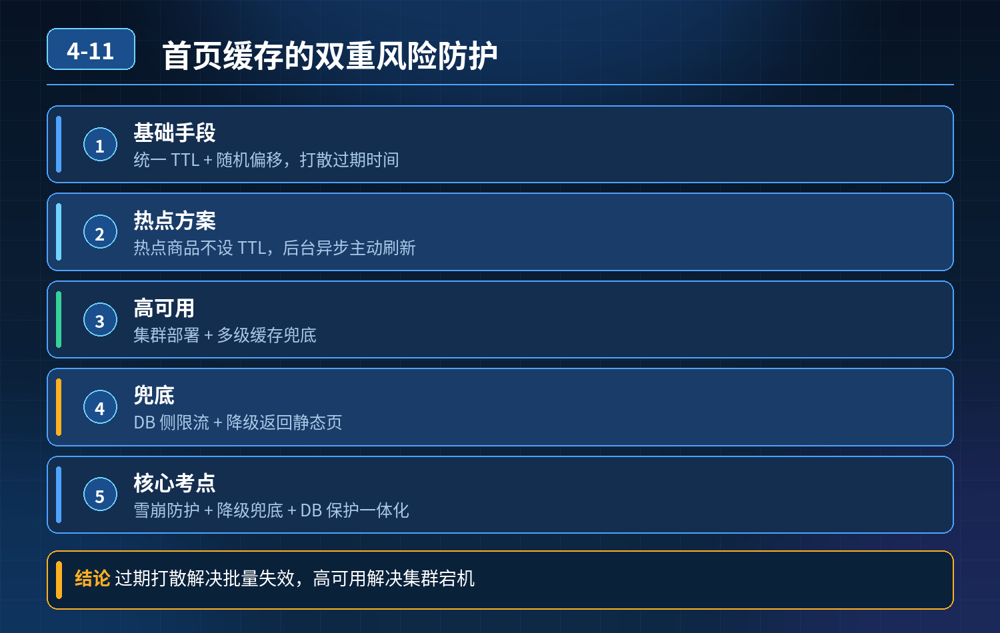

    电商首页商品缓存，大批量 key 同时过期+Redis 宕机双重风险

## 第 04-11 题　电商首页商品缓存，大批量 key 同时过期+Redis 宕机双重风险

**候选人浅层回答：** 背诵表面结论，没有深入到原理和线上场景。

## 核心拆解一句话结论

本题考察对底层原理和线上实战能力的综合理解，不能只停留在背结论。

## 场景复盘

首页上千商品缓存集中过期，大促流量涌入，大面积缓存击穿，流量直接打穿到 DB；同时还要兜底 Redis 宕机的情况。 简单方案的缺陷：单纯加过期时间会雪崩；互斥锁会阻塞、拖慢 RT；单纯拉长 TTL 会加剧数据不一致。

核心考点：缓存雪崩防护 + 缓存降级兜底 + 数据库限流保护整套体系，而不是只解决雪崩一个问题。

## 三层高分体系

第一层：根治集中过期（雪崩源头治理）

1. 过期时间加随机偏移（基础手段） 统一基础 TTL + random 偏移，打散过期时间，避免大量 key 同一时刻失效。比如基础 30min，再加 0~5min 随机值。
2. 主动更新 + 永不过期（热点商品推荐方案） 热点商品缓存 key 不设置 TTL；后台异步定时主动刷新缓存（后台线程 / 消息队列）。

- 优点：从根源消除集中过期；
- 代价：依赖主动刷新，刷新失败要保留旧缓存，不删 key；实现缓存续期，旧数据可以短暂容忍弱一致，符合首页商品场景。

3\. 逻辑过期（预热方案） 缓存里存expire_time 逻辑过期标记，Redis key 本身不删；请求读到逻辑过期后，单独起异步线程去更新缓存，当前请求直接返回旧值。

对比互斥锁：逻辑过期不会卡住用户请求，RT 稳定；缺点是会短暂返回旧数据，适合商品这种允许短时间不一致的业务。

第二层：击穿防护 + 限流隔离（就算缓存大面积失效，护住数据库）

1. 接口层限流、熔断、单机令牌桶 给首页商品查询接口单独限流，控制放行到DB 的并发总量；和缓存解耦，是 DB 最后一道闸门。
2. 分布式锁 / 轻量排队（兜底补缓存） 少量 miss 场景用互斥锁，只放行一个请求去回源写缓存，其余请求等待或短暂返回旧兜底；不适合上千 key 同时失效的场景，容易大面积阻塞，所以只能作为辅助，不能当主方案。
3. 布隆过滤器拦截无效 ID 过滤不存在的商品 ID，杜绝无效 miss 穿透到 DB。

第三层：Redis 宕机兜底（题目重点追问的双重兜底）

1. 本地 Caffeine 二级缓存 应用进程内本地缓存，作为 Redis 挂掉之后的降级层；优先读本地缓存，本地没有才尝试 Redis，Redis 异常直接走本地缓存兜底；本地缓存 TTL 设置更短。

- 注意：多实例本地缓存会出现副本间数据不一致，首页场景可接受；

2\. 降级开关 + 静态兜底页 Redis 完全不可用时，关闭回源查询 DB 的逻辑，直接返回兜底缓存 / 静态预热首页；不允许流量继续穿透数据库；

3\. Redis 集群高可用：主从、哨兵 / 集群，降低 Redis 整体宕机概率，属于基础设施层面。

分层一句话：随机偏移打散过期是预防雪崩；逻辑过期 / 主动刷新保证热点 key 不集中失效；本地缓存 + 熔断限流是 Redis 故障时的兜底，防止 DB 被打崩。

- 30

## 秒口述标准答案

这个场景是典型缓存雪崩，还要兼顾 Redis 宕机兜底。第一层先打散过期，给TTL 增加随机偏移，首页热点商品优先采用逻辑过期或者后台主动异步刷新，避免集中失效；第二层加接口限流控制打到数据库的并发，配合布隆过滤器拦截无效请求，少量缓存 miss 才用分布式锁防击穿；第三层做二级兜底，在应用内增加 Caffeine 本地缓存，Redis 故障时直接降级返回本地缓存，并且熔断禁止继续访问数据库。首页商品允许短时间弱一致，优先保可用性，而不是强一致。

## 高频追问

Q：逻辑过期和互斥锁怎么选？ A：追求低延迟、允许短暂旧数据（首页商品）选逻辑过期；对一致性要求高、不能返回脏数据，才用互斥锁，代价是请求排队等待。 Q：本地 Caffeine 有什么缺点？ A：多节点之间数据不同步，更新商品后各个实例本地缓存失效时间不一致；适合非强一致场景；强一致场景不适合。 Q：如果商品修改了，怎么主动失效缓存？ A：商品更新后，删除 Redis 缓存；如果是逻辑过期方案，直接更新缓存里的数据和逻辑过期时间即可。

## 连环追问要点整理

1. 底层核心原理是什么？为什么这么设计？
2. 线上出现相关故障如何快速止损、定位根因？
3. 高并发场景下有哪些坑点，性能、一致性、可用性如何权衡？

## 面试回答完整话术

  - **一句话结论**：本题考察对底层原理和线上实战能力的综合理解，不能只停留在背结论。
  - **场景复盘**：首页上千商品缓存集中过期，大促流量涌入，大面积缓存击穿，流量直接打穿到 DB；同时还要兜底 Redis 宕机的情况。 简单方案的缺陷：单纯加过期时间会雪崩；互斥锁会阻塞、拖慢 RT；单纯拉长 TTL 
  - **三层高分体系**：过期时间加随机偏移（基础手段） 统一基础 TTL + random 偏移，打散过期时间，避免大量 key 同一时刻失效。比如基础 30min，再加 0~5min 随机值。
  - **秒口述标准答案**：这个场景是典型缓存雪崩，还要兼顾 Redis 宕机兜底。第一层先打散过期，给TTL 增加随机偏移，首页热点商品优先采用逻辑过期或者后台主动异步刷新，避免集中失效；第二层加接口限流控制打到数据库的并发，
  - **高频追问**：Q：逻辑过期和互斥锁怎么选？ A：追求低延迟、允许短暂旧数据（首页商品）选逻辑过期；对一致性要求高、不能返回脏数据，才用互斥锁，代价是请求排队等待。 Q：本地 Caffeine 有什么缺点？ A：多节
  - **收尾**：线上问题按「先止损保可用性 → 再定位根因 → 最后从架构规范层面根治」三段论闭环。

## 追问：本题考察核心是什么？

###  高级工程师要分清：

1. **不能只停留在背结论**：要能回答「为什么这样设计、不这样会怎样、线上踩坑怎么排查」；
2. **具备止损→定位→根治三段论**：先止血保业务，再定位根因，最后从架构与规范层面根治；
3. **给出工程取舍**：性能、一致性、可用性三者权衡，说清代价与适用场景。

  核心思想：这道题考察原理理解 + 线上实战 + 架构思维，真正的工程答案是「现象 → 根因 → 止损 → 定位 → 根治」五段式闭环。

