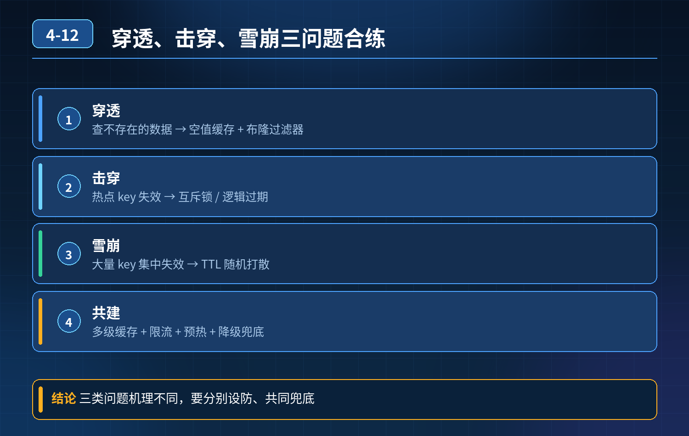

    Redis 缓存穿透、击穿、雪崩

## 第 04-12 题　Redis 缓存穿透、击穿、雪崩

**候选人浅层回答：** 背诵表面结论，没有深入到原理和线上场景。

## 核心拆解一句话结论

本题考察对底层原理和线上实战能力的综合理解，不能只停留在背结论。

## 三层防御体系

第一层：入口拦截层（挡无效请求，优先防穿透）

1. 布隆过滤器：把所有合法商品 ID 预加载进布隆过滤器；请求进来先过过滤器，不存在的商品直接拦截，不进 Redis、不碰 DB；缺点是存在误判，不能删除元素。
2. 兜底方案：缓存空值 / 占位符，给不存在的 ID 写入短 TTL 空缓存，避免反复穿透；适合数据变动频繁、不方便上布隆过滤器的场景。
3. 网关层限流、黑名单，拦截恶意刷不存在 ID 的爬虫。

第二层：缓存业务层（解决击穿、雪崩，核心防护）

1\. 缓存击穿（热点 key）

1\. 方案一：热点 key 永不过期，后台异步主动刷新缓存，不走过期淘汰；

2\. 方案二：互斥锁（Redis 分布式锁），同一时间只放行一个请求去 DB 回写缓存，其他请求等待或者重试；注意锁不要粒度太大，避免性能问题；

2\. 缓存雪崩（大量 key 同时过期）

1\. 过期时间加随机偏移量，打散过期时间，防止集中失效；

2. 搭建 Redis 高可用架构：小规模主从 + 哨兵，或直接用 Redis Cluster（Cluster 内置主从复制与故障转移，不与哨兵混用），避免单节点宕机引发缓存整体失效；

3\. 多级缓存：本地 Caffeine 一级缓存 + Redis 二级缓存；本地缓存兜底，Redis挂了也有一层防护。

第三层：数据库兜底 + 监控告警层（最后防线）

1. DB 层面：数据库限流、读写分离，增加降级熔断；缓存全部失效时，Sentinel熔断保护 DB，快速返回兜底，防止库直接宕机；
2. 监控指标：持续监控缓存命中率、DB QPS、Redis 异常、接口超时；命中率下跌、DBCPU 突涨立刻告警；
3. 缓存更新规范：不缓存超大 value、高频变更数据，减少缓存失效频率。

- 30

秒口述标准答案（直接背诵）只做过期和预热无法覆盖全部风险，穿透、击穿、雪崩要分层防护。第一层入口用布隆过滤器拦截不存在的 key，防止穿透；第二层热点 key 设置永不过期、后台主动刷新，或者用互斥锁防击穿，所有 key 过期时间增加随机值打散，配合本地多级缓存避免雪崩；第三层数据库增加熔断限流兜底，同时监控缓存命中率和数据库指标及时告警。

## 高频延伸追问

Q：布隆过滤器和缓存空值怎么选？ A：商品这类 ID 固定、总量稳定的场景优先布隆过滤器；数据频繁增删、数量不大，适合缓存短 TTL 空值。

Q：互斥锁会不会拖慢并发？ A：会降低一点吞吐，适合热点不多的场景；秒杀类超高并发热点 key 优先永不过期 + 主动刷新方案。

Q：本地缓存 Caffeine 有什么优缺点？ A：速度极快，不依赖 Redis；缺点是多实例本地缓存不一致，更新比较麻烦，适合允许短暂不一致的读场景。

## 连环追问要点整理

1. 底层核心原理是什么？为什么这么设计？
2. 线上出现相关故障如何快速止损、定位根因？
3. 高并发场景下有哪些坑点，性能、一致性、可用性如何权衡？

## 面试回答完整话术

  - **一句话结论**：本题考察对底层原理和线上实战能力的综合理解，不能只停留在背结论。
  - **三层防御体系**：第一层：入口拦截层（挡无效请求，优先防穿透）
  - **高频延伸追问**：Q：布隆过滤器和缓存空值怎么选？ A：商品这类 ID 固定、总量稳定的场景优先布隆过滤器；数据频繁增删、数量不大，适合缓存短 TTL 空值。
  - **收尾**：线上问题按「先止损保可用性 → 再定位根因 → 最后从架构规范层面根治」三段论闭环。

## 追问：本题考察核心是什么？

###  高级工程师要分清：

1. **不能只停留在背结论**：要能回答「为什么这样设计、不这样会怎样、线上踩坑怎么排查」；
2. **具备止损→定位→根治三段论**：先止血保业务，再定位根因，最后从架构与规范层面根治；
3. **给出工程取舍**：性能、一致性、可用性三者权衡，说清代价与适用场景。

  核心思想：这道题考察原理理解 + 线上实战 + 架构思维，真正的工程答案是「现象 → 根因 → 止损 → 定位 → 根治」五段式闭环。

