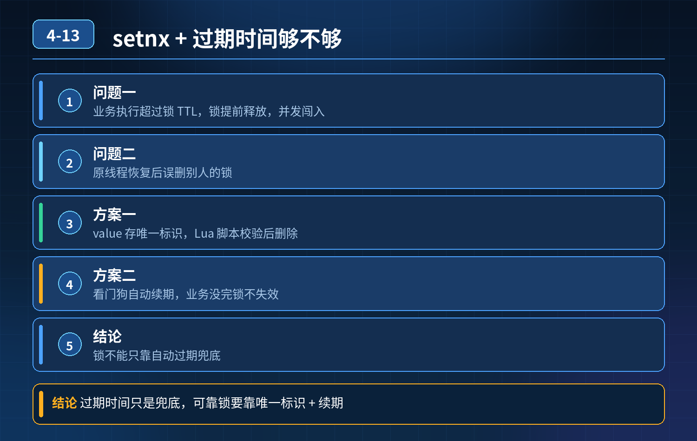

    实现分布式锁能不能直接用 Redis setnx+过期时间，靠自动过期兜底？

## 第 04-13 题　实现分布式锁能不能直接用 Redis setnx+过期时间，靠自动过期兜底？

**举例说明：**锁 TTL 设 30 秒，业务因为一次慢查询跑了 40 秒。第 30 秒锁自动释放，线程 B 拿到锁进入临界区；第 40 秒线程 A 执行完，执行 del 把线程 B 的锁删掉，线程 C 又能拿到锁——三个线程同时操作同一份库存。

**候选人浅层回答：** setnx 抢锁，设置 expire 过期，业务执行完 del 释放，超时自动释放兜底。

## 核心拆解一句话结论

本题考察对底层原理和线上实战能力的综合理解，不能只停留在背结论。

## 连环追问

1. 如果业务执行时间超过锁过期时长，锁被自动释放；后续线程拿到锁进入临界区；原线程恢复后，把别人的锁删掉，为什么会出现这个问题？
2. 安全的分布式锁，要解决哪几个核心问题？只把过期时间调长能根治吗？

## 一、原生 setnx + expire 最致命的两个漏洞

注意：SETNX 和EXPIRE 是两条独立命令，非原子。如果 setnx 成功后，执行 expire 前进程宕机，key 永久不会过期，锁死，这是第一个大坑。 所以基础写法应该用单条原子命令：SET lock_key uuid NX EX 30，这一步解决原子加锁，但依然还有下面两大核心问题：

1. 业务执行超时 \> 锁过期，锁提前释放，锁失效，并发闯入 假设锁过期 30 秒，业务因为 GC 停顿、网络、数据库慢查询跑了 40 秒。30 秒时 Redis 自动删除 key，锁释放；第二个线程成功拿到锁，两个线程同时进入临界区，互斥失效，库存超卖、重复下单。

单纯调长过期时间不能根治：只是降低概率；极端 GC / 宕机场景依然会超时，同时锁卡死风险变大。

1. 无锁持有者身份校验，导致误删除别人的锁 锁 key 的值如果只是固定字符串。

线程 A 拿到锁，业务超时锁过期；线程 B 拿到同一把锁；线程 A 业务终于跑完，执行 del 删除 key，直接删掉 B 正在持有的锁。 解决：锁的 value 必须是全局唯一标识（UUID / 随机串），删除锁的时候，先判断 value 等于自己持有的标识，再删除。 并且查询 + 删除也必须原子执行，要用 Lua 脚本，不能 get 然后判断再 del（两条命令存在竞态）。

## 二、安全分布式锁三大核心能力（Redisson 的实现思路）

1. 锁持有者身份校验 加锁写入唯一随机 value；释放锁 Lua 脚本：ifredis.call('get',KEYS\[1\]) == ARGV\[1\] then return redis.call('del',KEYS\[1\]) else return 0 end。只有持有者能删自己的锁，杜绝误删。
2. 看门狗自动续期（核心，解决业务超时锁过期） Redisson 的 WatchDog 看门狗后台线程，每 1/3 锁过期时间，自动延长锁有效期。业务只要还在运行，锁就不会过期；业务正常结束，看门狗停止，锁主动释放。

注意：看门狗只在业务线程存活时续期；如果进程宕机，不再续期，锁到期自动释放。

1. 原子操作 加锁、释放锁都要保证原子性。加锁使用 SET NX EX；释放锁必须
2. Lua 脚本，不能拆成多条命令。

## 三、额外风险：主从异步复制带来的锁丢失（Redis 单主 / 主从的短板）

主节点写入锁成功，但还没同步到从节点，主节点宕机，从节点晋升为主。新主没有锁记录，其他客户端可以再次拿到锁，锁失效。 高可靠场景解决方案：RedLock 红锁，同时向多个独立 Redis 实例申请锁，过半成功才算拿到锁；代价是复杂，性能差，一般业务很少使用。大部分业务接受主从异步的极小概率风险，使用单实例 + 看门狗方案。

## 四、选型总结

- 简单 setnx + expire + del：不安全，不推荐生产直接手写；
- 生产推荐直接使用 Redisson，自带看门狗、Lua 释放、身份校验；不要自己手写分布式锁。

<strong>追问：</strong>本题考察核心是什么？

<strong>参考答案：</strong> 初级开发只知道 setnx+expire，以为设置过期时间就万事大吉。

高级工程师要理解：

1. 区分两个原子性坑：加锁命令原子，释放锁也要原子；
2. 明白锁过期只是宕机兜底，不能用来解决业务执行超时；看门狗续期才是解决业务长时间执行的方案；拉长过期时间只是掩盖问题；
3. 理解锁 value 身份校验的意义，防止误删其他线程锁；
4. 知道 Redis 主从异步复制带来的分布式锁固有缺陷，能评估风险，知道什么时候需要红锁。

<strong>核心思想：</strong>分布式锁的安全由三部分组成：原子加锁、持有者校验 + 原子释放、锁自动续期；过期时间只是宕机故障兜底，不是业务正常流程的方案。

## 连环追问要点整理

1. 底层核心原理是什么？为什么这么设计？
2. 线上出现相关故障如何快速止损、定位根因？
3. 高并发场景下有哪些坑点，性能、一致性、可用性如何权衡？

## 面试回答完整话术

  - **场景举例**：锁 TTL 设 30 秒，业务因为一次慢查询跑了 40 秒。第 30 秒锁自动释放，线程 B 拿到锁进入临界区；第 40 秒线程 A 执行完，执行 del 把线程 B 的锁删掉，线
  - **一句话结论**：本题考察对底层原理和线上实战能力的综合理解，不能只停留在背结论。
  - **连环追问**：如果业务执行时间超过锁过期时长，锁被自动释放；后续线程拿到锁进入临界区；原线程恢复后，把别人的锁删掉，为什么会出现这个问题？
  - **一、原生 setnx + expire 最致命的两个漏洞**：注意：SETNX 和EXPIRE 是两条独立命令，非原子。如果 setnx 成功后，执行 expire 前进程宕机，key 永久不会过期，锁死，这是第一个大坑。 所以基础写法应该用单条原子命令：SET
  - **二、安全分布式锁三大核心能力（Redisson 的实现思路）**：锁持有者身份校验 加锁写入唯一随机 value；释放锁 Lua 脚本：ifredis.call('get',KEYS\[1\]) == ARGV\[1\] then return redis.call
  - **三、额外风险：主从异步复制带来的锁丢失（Redis 单主 / 主从的短板）**：主节点写入锁成功，但还没同步到从节点，主节点宕机，从节点晋升为主。新主没有锁记录，其他客户端可以再次拿到锁，锁失效。 高可靠场景解决方案：RedLock 红锁，同时向多个独立 Redis 实例申请锁，
  - **四、选型总结**：简单 setnx + expire + del：不安全，不推荐生产直接手写；
  - **收尾**：线上问题按「先止损保可用性 → 再定位根因 → 最后从架构规范层面根治」三段论闭环。

## 追问：本题考察核心是什么？

###  高级工程师要分清：

1. **不能只停留在背结论**：要能回答「为什么这样设计、不这样会怎样、线上踩坑怎么排查」；
2. **具备止损→定位→根治三段论**：先止血保业务，再定位根因，最后从架构与规范层面根治；
3. **给出工程取舍**：性能、一致性、可用性三者权衡，说清代价与适用场景。

  核心思想：这道题考察原理理解 + 线上实战 + 架构思维，真正的工程答案是「现象 → 根因 → 止损 → 定位 → 根治」五段式闭环。

