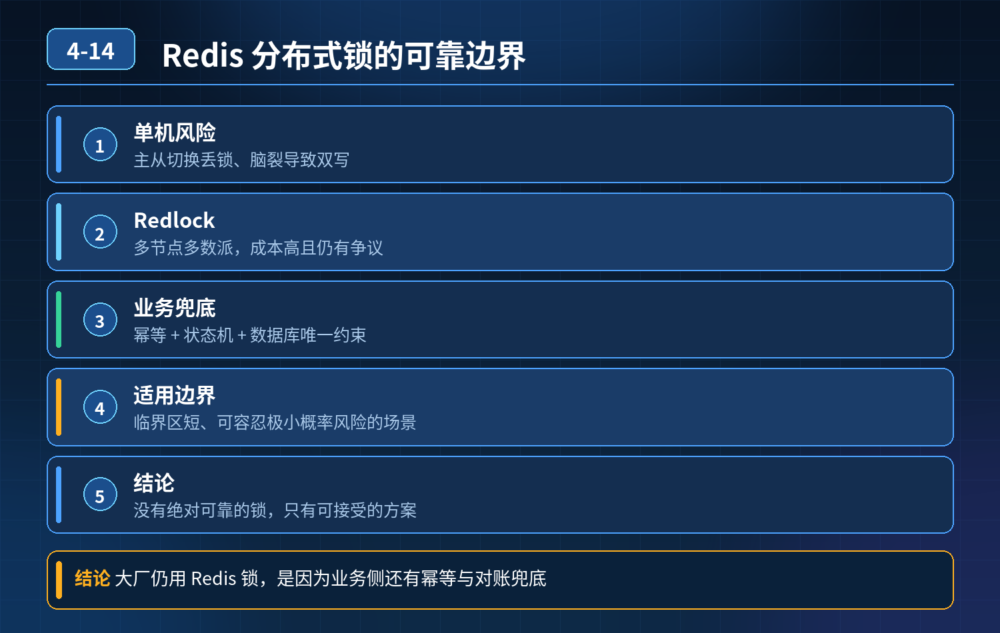

    Redis 能实现绝对可靠的分布式锁吗？单机 Redis 锁随时存在失效风险，那为什么大厂核心业务还在用 Redis 做分布式锁？

## 第 04-14 题　Redis 能实现绝对可靠的分布式锁吗？单机 Redis 锁随时存在失效风险，那为什么大厂核心业务还在用 Redis 做分布式锁？

**候选人浅层回答：** 不能，Redis 锁不安全；或者直接说可以，用 SETNX 加过期时间就行。

## 核心拆解一句话结论

本题考察对底层原理和线上实战能力的综合理解，不能只停留在背结论。

## 连环追问

1. 单机 Redis 分布式锁会遇到哪些典型失效场景？
2. Redlock 红锁方案能不能做到绝对安全？它的代价和缺陷是什么？
3. Redis 锁达不到绝对可靠，业务层面该如何兜底，什么场景不适合用 Redis 分布式锁？

## 一、核心结论

Redis 无法做到绝对可靠、100% 无缺陷的分布式锁，无法满足严格 CP 强一致场景。 单机 Redis 锁存在不少风险；Redlock 红锁也有争议，依然存在理论漏洞。 但绝大多数高并发业务，并不需要绝对的锁安全性，在业务增加兜底校验后，Redis 锁是性价比极高的选择，所以大厂大量使用。

## 二、单机 Redis 锁典型失效问题

1. 锁过期，业务还没执行完 线程拿到锁，业务执行耗时超过锁 TTL，锁自动释放；其他线程抢占锁，出现两个线程同时执行业务，锁失效。

解决：看门狗自动续期（Redisson 自带），业务没执行完成，后台线程不断延长锁过期时间。

1. 主从切换丢锁（最经典致命问题） Redis 主节点拿到锁，还没同步到从节点，主节点宕机；从节点晋升为主节点，锁丢失，别的客户端重新拿到同一把锁，并发冲突。

单机主从架构，这个问题看门狗解决不了。

1. 错误释放别人的锁 简单 SETNX+expire，释放锁没有校验持有者标识，线程 A超时锁被释放，线程 B 拿到锁；A 执行完直接 del，把 B 的锁删掉。

解决：set key value NX EX，value 存唯一客户端标识；释放锁必须用 Lua 脚本，校验 value 匹配才允许删除，保证原子性。

## 三、Redlock 红锁方案

Redlock：向多个独立 Redis 主节点申请锁，超过半数节点获取成功才算拿到锁。

- 优点：降低主从切换丢锁的概率；
- 缺点：部署成本高、性能下降；分布式时钟漂移依然存在理论漏洞，业界（如Martin Kleppmann）对它安全性有争议；运维复杂。

大厂很少大规模落地红锁，太重，一般不作为首选。

## 四、为什么大厂还大量使用 Redis 分布式锁？

1. 性能极高：Redis 内存操作，QPS 很高，适合秒杀、库存扣减这类高并发场景；数据库锁性能差很多。
2. 大部分业务不需要绝对强一致锁：业务接受极低概率锁失效，只要业务层增加兜底校验，就算锁失效也不会出现严重事故。 举例：库存扣减，Redis 锁只是前置并发控制，最终扣减必须在数据库加事务 / 行锁校验，即使锁失效，数据库层拦截超卖。
3. 工程成熟：Redisson 封装完善，自带看门狗、Lua 原子释放、重试机制，开箱即用，开发成本低。

## 连环追问要点整理

1. 底层核心原理是什么？为什么这么设计？
2. 线上出现相关故障如何快速止损、定位根因？
3. 高并发场景下有哪些坑点，性能、一致性、可用性如何权衡？

## 面试回答完整话术

  - **一句话结论**：本题考察对底层原理和线上实战能力的综合理解，不能只停留在背结论。
  - **连环追问**：单机 Redis 分布式锁会遇到哪些典型失效场景？
  - **一、核心结论**：Redis 无法做到绝对可靠、100% 无缺陷的分布式锁，无法满足严格 CP 强一致场景。 单机 Redis 锁存在不少风险；Redlock 红锁也有争议，依然存在理论漏洞。 但绝大多数高并发业务，并
  - **二、单机 Redis 锁典型失效问题**：锁过期，业务还没执行完 线程拿到锁，业务执行耗时超过锁 TTL，锁自动释放；其他线程抢占锁，出现两个线程同时执行业务，锁失效。
  - **三、Redlock 红锁方案**：Redlock：向多个独立 Redis 主节点申请锁，超过半数节点获取成功才算拿到锁。
  - **四、为什么大厂还大量使用 Redis 分布式锁？**：性能极高：Redis 内存操作，QPS 很高，适合秒杀、库存扣减这类高并发场景；数据库锁性能差很多。
  - **收尾**：线上问题按「先止损保可用性 → 再定位根因 → 最后从架构规范层面根治」三段论闭环。

## 追问：本题考察核心是什么？

###  高级工程师要分清：

1. **不能只停留在背结论**：要能回答「为什么这样设计、不这样会怎样、线上踩坑怎么排查」；
2. **具备止损→定位→根治三段论**：先止血保业务，再定位根因，最后从架构与规范层面根治；
3. **给出工程取舍**：性能、一致性、可用性三者权衡，说清代价与适用场景。

  核心思想：这道题考察原理理解 + 线上实战 + 架构思维，真正的工程答案是「现象 → 根因 → 止损 → 定位 → 根治」五段式闭环。

