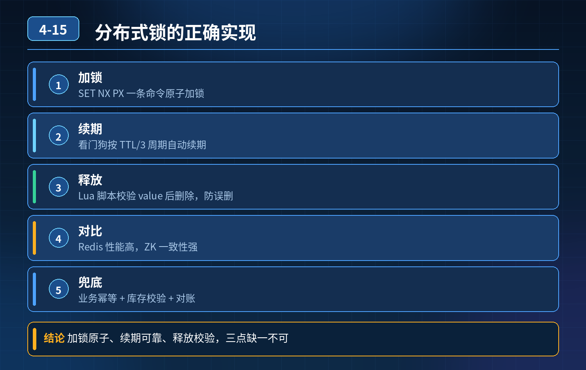

<div class="essay-image ">
    分布式锁怎么实现？幂等、防超卖、定时任务防重复；Redis 锁超时、误删、死锁、锁失效；Redis 锁 vs ZK 锁
</div>

## 第 04-15 题　分布式锁怎么实现？幂等、防超卖、定时任务防重复；Redis 锁超时、误删、死锁、锁失效；Redis 锁 vs ZK 锁

**候选人浅层回答：** 背诵表面结论，没有深入到原理和线上场景。

## 核心拆解一句话结论

本题考察对底层原理和线上实战能力的综合理解，不能只停留在背结论。

## 连环追问

1. 分布式锁五大特性：互斥、防死锁、防误删、可重入、高可用分别怎么落地？
2. 可重入锁是什么？Redis 原生不支持可重入，Redisson 怎么实现可重入？
3. 定时任务场景，用分布式锁要额外注意什么？
4. 幂等和分布式锁是一回事吗？什么场景只用幂等就够，不需要锁？
5. Redis 主从、Redlock、ZK 锁各自的取舍和生产落地建议？

## 一、分布式锁五大核心原则（开篇必说）

1. 互斥性：同一时刻只有一个客户端拿到锁；
2. 防死锁：客户端拿到锁后宕机，锁最终一定能释放，不会永久卡死；
3. 防误删：只能自己释放自己的锁，不能删掉别人持有的锁；
4. 可重入：同一个线程，拿到锁之后可以再次加锁（避免自己把自己卡死）；
5. 高可用：锁服务故障、网络抖动，锁机制不能大面积失效。

重要区分：分布式锁 ≠ 幂等

- 分布式锁：控制并发串行执行，解决并发竞争（库存扣减、定时任务抢执行）；
- 幂等：同一个请求重复提交，多次执行结果和一次一样；
- 很多场景优先做幂等，不一定需要锁；超卖这类强竞争场景，锁+ 幂等 + 数据库兜底一起上。

## 二、主流三种实现方案：Redis 锁、Zookeeper 锁、数据库锁

方案 1：Redis 分布式锁（项目最常用，Redisson）基础正确写法（禁止 SETNX + EXPIRE 分开两行，非原子，宕机死锁）加锁原子命令：

```
SET lockKey uuid NX EX ttl
```

- NX：key 不存在才成功，保证互斥；
- uuid：当前锁持有者唯一标识；
- EX：过期时间，基础防死锁。

解决面试官几个问题

1. 锁被误删：不能直接 DEL lockKey；使用 Lua 脚本，先判断 value 等于自己的uuid，才删除，原子执行。
2. 业务执行超过 TTL，锁提前过期：Redisson 看门狗（自动续期）。拿到锁后后台线程定时刷新过期时间；业务执行完成，停止续期。

局限：看门狗解决不了Redis 主从异步复制丢锁（主节点加锁成功，未同步从，主宕机从晋升，锁消失）。

3\. 死锁：两层保障：①过期时间兜底；②正常流程业务完成主动释放锁。

4\. 可重入：Redis 原生不支持；Redisson 用 hash 结构：key = 锁名，field = 线程

3\. 标识，value = 重入次数，加锁次数 + 1，释放 - 1，次数为 0 才删除 key。

6\. 集群锁失效（主从丢锁）

- 普通主从：异步复制，有丢锁风险，适合允许极小概率不一致场景（大部分业务、定时任务）；
- Redlock：多独立节点过半加锁成功才算持有锁；缺点：依赖系统时钟、性能差、运维复杂，大厂很少上生产；
- 强一致场景，不推荐用 Redis 锁做强互斥。

方案 2：Zookeeper 分布式锁原理：利用临时有序节点。抢锁时在指定目录创建临时节点；最小序号节点拿到锁；监听前一个节点，释放后触发下一个竞争者。 特点：

1. 临时节点：客户端断开会话，节点自动删除，天然防死锁，不需要设置过期时间、不需要看门狗；
2. ZK 是 CP，写过半成功，主节点宕机不会凭空丢锁，一致性比 Redis 好；
3. 自带监听机制，抢锁是阻塞监听，轮询压力小； 缺点：

- ZK 很重，运维成本高；吞吐量低；网络抖动容易 session 过期，锁意外释放；对比 Redis vs ZK | 对比项 | Redis 锁（AP） | Zookeeper 锁（CP） | | ---- | ---- | ---- | | 一致性 | 主从异步，存在丢锁风险 | 强一致，过半写成功，不会丢锁 | | 性能 | 高，适合高并发秒杀 | 低，不适合超高并发 | | 死锁 | 靠过期时间 + 看门狗 | 临时节点，会话断自动释放，天然防死锁 | | 超时续期 | 需要看门狗 | 不需要 | | 运维成本 | 低，Redis 集群普及 | 高，ZK 集群难维护 | | 适用 | 大部分业务、定时任务、秒杀前置限流 | 一致性要求极高、并发不高场景 |方案 3：数据库锁（乐观锁 / 悲观锁）
- 悲观锁：select ... for update，行锁；性能差，并发低；
- 乐观锁：version 版本号 /stock \>= 1 条件更新；一般不作为分布式锁主方案，更多用来兜底防超卖。

## 三、两个高频业务场景：接口幂等 & 定时任务防重复执行

1. 接口幂等实现方式

- 前端传全局唯一幂等号；
- 幂等表：记录幂等号 + 执行状态；
- 唯一索引、数据库条件更新、token 防重复提交；很多查询、更新接口，只做幂等就够，不需要分布式锁。

2\. 定时任务防重复执行（比如 xxl-job） 分布式锁作用：保证同一个任务同一时间只有一台机器执行；

<strong>注意：</strong>锁超时时间 \> 任务预估最大执行时长，搭配看门狗；任务宕机自动释放锁；任务本身也要做幂等，防止重试重复扣减。

## 四、项目选型回答（面试官最后一问：你们项目一般用哪种？）

大部分业务：优先 Redisson Redis 分布式锁，开发简单、性能高；同时底层数据库乐观锁兜底，抵消 Redis 主从丢锁的极小概率风险。 只有一致性要求极高、并发量不大的场景（订单状态流转核心强互斥），才考虑 ZK 锁； Redlock 基本不落地，收益抵不上复杂度； 库存秒杀场景：Redis 锁只做前置限流削峰，防超卖的底线是数据库条件更新。

## 连环追问要点整理

1. 底层核心原理是什么？为什么这么设计？
2. 线上出现相关故障如何快速止损、定位根因？
3. 高并发场景下有哪些坑点，性能、一致性、可用性如何权衡？

## 代码示例

```java
SET lockKey uuid NX EX ttl
```

## 面试回答完整话术

  - **一句话结论**：本题考察对底层原理和线上实战能力的综合理解，不能只停留在背结论。
  - **连环追问**：分布式锁五大特性：互斥、防死锁、防误删、可重入、高可用分别怎么落地？
  - **一、分布式锁五大核心原则（开篇必说）**：防死锁：客户端拿到锁后宕机，锁最终一定能释放，不会永久卡死；
  - **二、主流三种实现方案：Redis 锁、Zookeeper 锁、数据库锁**：方案 1：Redis 分布式锁（项目最常用，Redisson）基础正确写法（禁止 SETNX + EXPIRE 分开两行，非原子，宕机死锁）加锁原子命令：
  - **三、两个高频业务场景：接口幂等 & 定时任务防重复执行**：唯一索引、数据库条件更新、token 防重复提交；很多查询、更新接口，只做幂等就够，不需要分布式锁。
  - **四、项目选型回答（面试官最后一问：你们项目一般用哪种？）**：大部分业务：优先 Redisson Redis 分布式锁，开发简单、性能高；同时底层数据库乐观锁兜底，抵消 Redis 主从丢锁的极小概率风险。 只有一致性要求极高、并发量不大的场景（订单状态流转核心
  - **收尾**：线上问题按「先止损保可用性 → 再定位根因 → 最后从架构规范层面根治」三段论闭环。

## 追问：本题考察核心是什么？

###  高级工程师要分清：

1. **不能只停留在背结论**：要能回答「为什么这样设计、不这样会怎样、线上踩坑怎么排查」；
2. **具备止损→定位→根治三段论**：先止血保业务，再定位根因，最后从架构与规范层面根治；
3. **给出工程取舍**：性能、一致性、可用性三者权衡，说清代价与适用场景。

  核心思想：这道题考察原理理解 + 线上实战 + 架构思维，真正的工程答案是「现象 → 根因 → 止损 → 定位 → 根治」五段式闭环。

<div class="img-wrap-left"></div>
