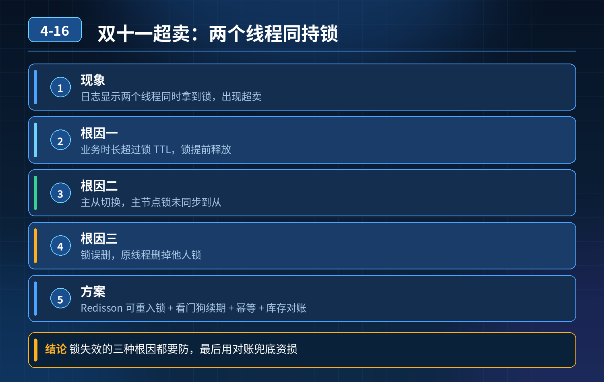

<div class="essay-image ">
    Redis 分布式锁控库存，双十一超卖，日志显示两个线程同时拿到锁，排查、根因、四层可靠锁方案
</div>

## 第 04-16 题　Redis 分布式锁控库存，双十一超卖，日志显示两个线程同时拿到锁，排查、根因、四层可靠锁方案

**候选人浅层回答：** 业务执行太久，锁过期自动释放了。

## 核心拆解一句话结论

四层可靠分布式锁 + 库存防超卖完整设计（面试标准答案四层）核心一句话：Redis 锁是【前置限流 / 互斥】，绝对不能单独作为防超卖的唯一屏障，数据库层必须兜底！

## 面试官追加反问：

1. 除了锁超时，Redis 主从切换会不会丢锁？
2. 看门狗（续期）解决什么问题，它的局限是什么？
3. Redlock 是什么，适用场景和缺点？
4. 完整可靠的分布式锁该怎么分层设计？

## 连环追问

1. 普通 Redis 主从异步复制，加锁成功写主、还没同步到从，主宕机、从晋升为主，为什么会出现锁丢失？
2. 看门狗本质是自动续期，那看门狗能解决主从切换丢锁的问题吗？
3. Redlock 为什么生产很少用？它对时钟漂移、多节点依赖有什么要求？
4. 就算锁没问题，为什么只靠 Redis 锁依然可能超卖？
5. 释放锁为什么必须用 Lua 脚本，判断 value 匹配再删，直接 del 会有什么问题？

## 参考答案

先梳理常见根因（候选人只想到了超时，漏掉最致命的主从丢锁）场景：单 Redis 主从集群 + 普通 SETNX + 过期时间做分布式锁 根因分两大类：
1. 锁超时（候选人说的这个） 业务执行耗时 \> 锁 TTL，锁被 Redis 自动过期释放；第二个线程拿到锁，两个线程同时进入扣库存逻辑，超卖。看门狗就是为了解决这个：业务没执行完，后台定时续期，延长过期时间。 局限：看门狗只能解决业务长于 TTL，解决不了主从切换丢锁。
2. 主从异步复制丢锁（本题重点、面试高频坑） 时序： ① 线程 A 在 master加锁成功，SETNX 返回 ok； ② 数据还没异步同步到 slave； ③ master 宕机，哨兵把 slave 晋升成新 master； ④ 新 master 里没有这条锁记录； ⑤ 线程 B 直接在新 master 拿到同一把锁； → 两个线程同时持有锁，超卖。
- 本质：普通 Redis 主从是异步复制，不保证锁的持久化和一致性，锁不具备强一致性。
3\. 其他容易同时拿到锁的原因
1\. 释放锁直接del key，没有校验 value：线程 A 的业务慢了，锁过期，线程
2\. B 拿到锁；A 执行完直接 del，删掉 B 的锁，后面又有线程 C 拿到锁；
2\. 锁粒度设计问题、并发预扣逻辑没做数据库兜底；
3\. Redis 集群槽位迁移、网络分区。
Redlock 原理：在多个独立、无主从关系的 Redis 节点上依次加锁，超过半数节点加锁成功才算拿到锁；释放全部节点锁。
Redlock 缺点：依赖服务器系统时钟不能漂移；部署成本高；性能差；多数业务场景收益很低，大厂很少落地。它能缓解单节点宕机丢锁，但时钟漂移会直接失效，不是银弹。

第一层：锁的基础语法规范（基础层）加锁：SET lock_key uuid NX EX ttl，必须原子； 释放锁：Lua 脚本，先判断 value 等于当前线程的唯一标识，再删除，防止误删别人的锁； 长任务开启看门狗自动续期（Redisson 自带）； 禁止单纯 SETNX 再 expire（非原子，宕机会死锁）。

第二层：锁的一致性加固（解决主从丢锁）两个路线二选一：

1. 追求简单主流方案：放弃用 Redis 锁做强互斥，Redis 只做流量拦截、预扣，把强一致性交给数据库；
2. 非要用 Redis 强锁：不依赖异步主从，要么用 Redis Cluster 强同步、或者改用Zookeeper 分布式锁（Zookeeper 是同步写过半，主节点挂了，锁不会凭空丢失）；重点：Redlock 谨慎上生产，一般不推荐。

第三层：业务层库存预扣、幂等控制

- 下单携带全局唯一幂等号，防止同一个订单重复扣减；
- 先在 Redis 预扣库存（预扣只是计数，用来挡高并发），预扣成功才往下走；预扣失败直接返回无货；
- 预扣和 DB 真实扣减状态绑定，预扣超时自动回补 Redis 库存。

第四层：数据库最终兜底（最关键，Redis 锁再完美也要这一层）数据库扣库存，SQL 自带乐观锁：

```sql
update stock set num = num - 1 where id = #{skuId} and
num >= 1;
```

依靠数据库行锁 + 条件判断，数据库层面保证不会扣成负数。 哪怕 Redis 锁失效、两个线程同时进来，这条 update 的 affected rows 只会有一个成功，另一个返回 0，判定库存不足，杜绝超卖。

四层总结：规范锁语法 → 选择合适的一致性组件（规避主从异步丢锁） → 业务幂等 + Redis 预扣限流 → DB 乐观锁兜底防超卖。

## 面试高分话术

两个线程同时拿到锁，不只有锁超时这一种原因，还有一个更致命的：Redis 主从异步复制丢锁。 时序是：线程 A 在 master 加锁成功，锁还没同步到从节点，master 宕机，从晋升为主，新主没有锁记录，线程 B 就可以拿到同一把锁，造成并发进入。看门狗只能解决业务执行时间超过 TTL、锁提前过期的问题，它解决不了主从切换丢锁。Redlock 在多个独立 Redis 节点加锁，过半成功才算持有锁，但是强依赖系统时钟，部署复杂、性能差，生产很少落地。

可靠方案分为四层： 第一层，锁本身原子化，SET NX EX 加锁，Lua 脚本释放锁，带唯一 value 防误删；长任务用 Redisson 看门狗自动续期。 第二层，锁的一致性选型：如果业务库存绝对不能超卖，不要依赖异步主从的 Redis 锁做强互斥；要么 Redis 只做前置拦截，强互斥交给 Zookeeper，或者直接放弃 Redis 锁做强互斥。 第三层，业务层加全局幂等号，Redis 做库存预扣，拦截大部分无效流量，超时自动回补预扣库存。 第四层，数据库兜底，扣库存 SQL 带上num \>=1 乐观锁条件。哪怕上层 Redis 锁全部失效，数据库这条更新语句也能保证库存不会被扣成负数，从根源杜绝超卖。 Redis 分布式锁更多是用来削峰、减少 DB 压力，不能单独作为防超卖的唯一保障。

## 连环追问要点整理

1. 底层核心原理是什么？为什么这么设计？
2. 线上出现相关故障如何快速止损、定位根因？
3. 高并发场景下有哪些坑点，性能、一致性、可用性如何权衡？

## 代码示例

```sql
update stock set num = num - 1 where id = #{skuId} and
num >= 1;
```

## 面试回答完整话术

  - **一句话结论**：四层可靠分布式锁 + 库存防超卖完整设计（面试标准答案四层）核心一句话：Redis 锁是【前置限流 / 互斥】，绝对不能单独作为防超卖的唯一屏障，数据库层必须兜底！
  - **面试官追加反问：**：除了锁超时，Redis 主从切换会不会丢锁？
  - **连环追问**：普通 Redis 主从异步复制，加锁成功写主、还没同步到从，主宕机、从晋升为主，为什么会出现锁丢失？
  - **参考答案**：主从异步复制丢锁（本题重点、面试高频坑） 时序： ① 线程 A 在 master加锁成功，SETNX 返回 ok； ② 数据还没异步同步到 slave； ③ master 宕机，哨兵把 slave 晋
  - **面试高分话术**：两个线程同时拿到锁，不只有锁超时这一种原因，还有一个更致命的：Redis 主从异步复制丢锁。 时序是：线程 A 在 master 加锁成功，锁还没同步到从节点，master 宕机，从晋升为主，新主没有
  - **收尾**：线上问题按「先止损保可用性 → 再定位根因 → 最后从架构规范层面根治」三段论闭环。

## 追问：本题考察核心是什么？

###  高级工程师要分清：

1. **不能只停留在背结论**：要能回答「为什么这样设计、不这样会怎样、线上踩坑怎么排查」；
2. **具备止损→定位→根治三段论**：先止血保业务，再定位根因，最后从架构与规范层面根治；
3. **给出工程取舍**：性能、一致性、可用性三者权衡，说清代价与适用场景。

  核心思想：这道题考察原理理解 + 线上实战 + 架构思维，真正的工程答案是「现象 → 根因 → 止损 → 定位 → 根治」五段式闭环。

<div class="img-wrap-left"></div>
